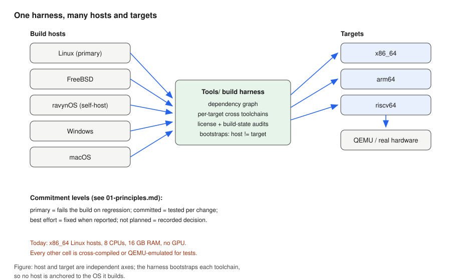

# 01 — Design principles

This document states what ravynOS is, the three engineering pillars every
subsystem is held against, and the rules that follow from them: the no-stubs
doctrine, the clean-room protocol for filling Apple's closed-source gaps, and
the licensing rules that gate every import. It also draws the factual line
between this project and PureDarwin, and records our portability commitments.
Read it before any other document in this directory; the later files assume
the terms defined here.

## The mission

ravynOS is an operating system that runs real macOS software natively. The
compatibility target is the macOS 27.2.1 generation, build 26B131 ("Golden
Gate", released 2026-11-09 —
https://developer.apple.com/news/releases/?id=11092026d), which corresponds to
Darwin 27.2.0 and XNU xnu-13432.41.4~25
(https://macosdb.com/macos/release/27.2.1-26B131/). The system is built from
Apple's own open-source releases — kernel, libc, dyld, libdispatch, the Objective-C runtime and CoreFoundation, published under
https://opensource.apple.com/releases/ and on https://github.com/apple — plus
our own native implementations of everything Apple keeps closed: the window
server, Metal, the APFS implementation, and the missing pieces of the
framework stack. We do not emulate macOS and we do not translate its binaries;
we build the OS those binaries expect to find, to the ABI of the release we
target.

One honest caveat on the kernel target. The tree today vendors
xnu-12377.121.6, a Darwin 25.5-generation kernel. The design docs aim the
project at the xnu-13432 line, and upgrading the vendored source is part of
the kernel workstream in [03-kernel.md](03-kernel.md). Until Apple publishes
that release, the ABI target is defined by the 27.2.1 release documents and
public headers, not by guesswork about source we do not have.

## The three pillars

Every design decision in this documentation is justified against one or more
of three pillars. When two pillars conflict, the conflict is stated in the
document that owns the decision, not hidden.

### Performance

Performance is a budget, not an aspiration. Each subsystem document sets
measured budgets for the operations that matter to it — boot to first user
process, cold launch of a framework-heavy application, IPC round-trip between
an application and the window server, dispatch wake-up latency — and the build
system runs the benchmarks that check them. A budget without a benchmark in
the tree is a wish, so the measuring tool ships before or with the feature it
measures.

In engineering terms this means low-level discipline in the code: no heap
allocation in hot paths, data structures laid out for the caches they sit in,
syscalls and Mach traps kept short, lock hold times measured rather than
assumed. It also means no abstraction tax where it matters. Virtual dispatch
at an API boundary is fine; a virtual call per element inside an inner loop of
the graphics or memory path is not. The test is always the same: if a
procedure would be rejected in a hand-written C implementation, it is rejected
in ours.

We accept abstraction where the cost is off the hot path. A framework's
public API can be as object-oriented as it needs to be; the discipline
applies to the kernel, the window server, the allocator, and the dispatch
layer, where every cycle is a user-visible one.

### Modularity

Modularity is a dependency direction, enforced by tooling. The top-level
layout in [02-architecture.md](02-architecture.md) defines a strict graph:
applications depend on frameworks, frameworks depend on Foundation, Foundation
depends on the kernel's documented surface. Nothing points upward, nothing
points sideways around the graph, and the build harness rejects a target that
tries. See [05-build-system.md](05-build-system.md) for how the graph is
checked.

Each component is independently buildable and replaceable. Independently
buildable means a directory builds with nothing else in the tree present
beyond its declared dependencies — you can build Foundation against a stock
XNU tree without cloning the rest of the project. Replaceable means the
interface contract is written down: another implementation that satisfies the
headers and the tests drops in without changes above it. This is how we keep
the project debuggable. When the window server misbehaves, we replace it with
a tracing shim, not by sprinkling print statements through four layers.

Modularity also bounds the blast radius of Apple's release cadence. When a
new XNU drop lands, the work is confined to `Kernel/` and the contracts the
kernel exposes; it does not ripple through the frameworks.

### Native design

Native design means the system is not an emulation stack, and no translation
layer is allowed to become permanent architecture. Where ravynOS presents a
macOS API, the implementation behind it is a real subsystem of this OS —
written for this kernel, scheduled by this scheduler, drawn by this window
server. The alternative — load a Mach-O, trap every system call, shuffle
pixels through a foreign compositor — runs the software, but it makes the
emulator the product and every macOS feature a special case forever.

This pillar does not forbid compatibility layers; it forbids the wrong shape
for them. Support for Linux and FreeBSD drivers or Linux binaries is real and
planned, but each such layer is itself a native subsystem with a defined
boundary, a documented contract, and pinned upstream versions it is tested
against. A Linux-driver shim in `Compat/` is a component with an owner, tests
and a version pin — the same standing as the window server — not a bag of
tricks behind the kernel's back. It is never a VM and never an emulator: the
code runs natively on XNU, on our terms.

The same reasoning drives the window server choice. A Wayland or X11
compositor would be cheaper to reach for, but it would make a foreign
protocol the permanent center of the graphics stack, and macOS applications
would pay a translation tax on every frame. The native protocol costs more up
front and is the only option that ends at the right place.

## The no-stubs doctrine

A stub is code that exists to make something else link or run while doing
none of the work: a function that returns a fake success code, a framework
that exports the full symbol list and implements nothing, a system call that
logs and returns zero. Stubs are forbidden in the tree.

The reason is that a stub lies to the build. Once `NSWorkspace` exists as a
stub, every application that links it appears to work, the gap is invisible
in every status report, and the ABI claim ("we export this surface") becomes
unmeasurable. Stubs also rot: the person who wrote one moves on, the real
implementation lands somewhere else, and the stub outlives both. An operating
system that lies to its developers cannot be debugged, and one that lies to
its users cannot be trusted.

What we do instead when a subsystem is not ready:

- The component is absent from the build. Applications that need it fail to
  link, loudly, at the point of use.
- Where partial function exists, the component is present and marked
  incomplete in its `BUILDstate` declaration, with the exact list of
  unimplemented selectors, ioctls or error paths written in the component's
  README. "Incomplete and documented" is a state we accept; "silently
  pretending" is not.
- The gap is recorded in the roadmap ([12-roadmap.md](12-roadmap.md)) so the
  next contributor can find it without archaeology.

The build harness enforces this: a component cannot claim a state it does not
have, and a test that documents a gap fails if the gap closes without the
documentation changing. Honest build states are cheap; the alternative is how
projects end up with a thousand stubs and no OS.

## Clean-room reverse engineering

Apple does not publish everything we must implement. Metal, the window
server, the APFS on-disk implementation and parts of the framework stack are
closed. What is public for each: the API headers and documentation
(https://developer.apple.com/metal/ for the Metal 4 surface,
https://developer.apple.com/metal/cpp for the Apache-2.0 metal-cpp headers
that define the ABI we must satisfy), the sample-code library
(https://developer.apple.com/metal/sample-code/), and Apple's release index
(https://opensource.apple.com/releases/). Where public material ends, we fill
the gap by clean-room study, in this order:

1. **Understand the contract from public material first.** Headers,
   documentation, sample code, and Apple's own open-source releases answer
   most questions about behavior. Exhaust these before anything else.
2. **Decompile Apple binaries only to understand behavior.** Where the
   documentation is silent — an undocumented error path, an on-disk format
   detail, a performance characteristic — we disassemble the shipped binary
   to learn what it does, and write down the finding as a functional
   specification in our own words.
3. **A different engineer implements from the specification.** Where
   practical, the person who studied the binary does not write the
   implementation; the spec is the only thing that crosses the wall.
4. **Decompiled code never enters the tree.** Not as comments, not as
   renamed listings, not as "just the structure". A finding enters as an
   English sentence in a spec, and the implementation is ours.

This protocol is how the project stays shippable at all: it is the only
legally sound way to close the gap between the ABI macOS software expects and
the source Apple publishes. The cost is real — clean-room work is slower than
copying — and the design docs price it honestly rather than pretending the
gaps are smaller than they are.

## Licensing

The rule is hard: no GPL, LGPL or AGPL code anywhere in the tree, and no
GPL-linked tooling in the build. This is not a philosophical position about
copy-left licenses; it is the licensing that makes the project's
distributions possible. An operating system whose stated purpose is binary
compatibility with proprietary software cannot carry a copy-left obligation
through its core and remain distributable.

Acceptable licenses for code in the tree:

| License | Typical source |
| --- | --- |
| APSL 2.0 | Apple's own open-source releases |
| BSD (2/3/4-clause) | XNU-derived and BSD userland code |
| MIT | Our own code by default; MLX (https://opensource.apple.com/projects/mlx) |
| Apache-2.0 | metal-cpp, other Apple-adjacent projects |
| Zlib, ISC | Small vendored utilities |
| Public domain | Individual imports, verified per file |

Practices that make the rule enforceable:

- Every imported file keeps its upstream license header, unmodified. A file
  whose header was stripped does not enter the tree.
- Every directory carries a LICENSE file listing the licenses it aggregates.
- The license audit is a build gate, not a convention: a script runs on every
  build, extracts the header of every source file, matches it against the
  allowlist, and fails the build on an unknown or missing license. A new
  license appears in the tree only by changing the audit, never by slipping a
  file past it.
- Projects we study but do not import are handled with the same care.
  darling (https://github.com/darlinghq/darling) contains GPL code in places;
  we study its ideas for Mac-binary loading on Linux and import nothing.
  corecrypto (https://github.com/apple/corecrypto) is source-available under
  its own APSL-style license and gets a per-file check before any import.

## How we differ from PureDarwin

PureDarwin (https://github.com/PureDarwin/PureDarwin, https://puredarwin.org/)
is the other serious project building on Apple's open-source releases, and
this section exists because contributors deserve a plain account of why
ravynOS is a separate codebase. Nothing here is a criticism of their work;
several of their components are excellent and we say below which ones we
study. The differences are about architecture and targets:

- **Build system.** PureDarwin builds through Nix flakes only — `nix build
  .#image-minimal` — and calling CMake directly is unsupported. A Nix-only
  path is reproducible but opaque and hard to extend modularly. We build
  through our own harness (see [05-build-system.md](05-build-system.md)) with
  an explicit dependency graph, so a contributor can build one directory with
  ordinary tools and no Nix.
- **Graphics.** Their desktop is a Wayland compositor ("Argon", on their
  neuswc/neuwld) plus X11. That is a working desktop, but it is not the
  protocol macOS applications speak, so stock Mac GUI software still cannot
  run against their AppKit, which talks to its own RPC protocol. We build a
  native window server speaking the protocol the target release uses, and
  accept that this is the longer road (see [07-graphics.md](07-graphics.md)).
- **Build hosts.** PureDarwin builds on Linux and macOS hosts. Our build
  matrix targets Linux, FreeBSD, ravynOS itself, Windows and macOS (see the
  portability matrix below), because a self-hosting OS needs a toolchain that
  is not anchored to one host.
- **Architectures.** They build for x86_64 PCs, with arm64 work under QEMU on
  specific boards. We design arm64, RISC-V and x86_64 in from day one rather
  than porting to them later; the cost shows up in the port layers
  ([03-kernel.md](03-kernel.md)) and is paid deliberately.
- **An iOS-alternative track.** We carry an explicit goal of hosting iOS-
  generation userland on our system. The evidence this is feasible is
  ios-sweet (https://github.com/dipa-studio/ios-sweet): xnu-8796 booting
  unmodified iOS 16.7.16 userland (launchd, backboardd, SpringBoard) to the
  home screen on a Snapdragon 732G phone as of 2026-10-18, CPU-rendered and
  with security features permissive. PureDarwin has no iOS story. We are not
  porting their patches; the design is in [10-mobility.md](10-mobility.md).
- **Compatibility layers as first-class subsystems.** Their driver shim
  ("fbsdkpi") and Linux binary loader ("elftrans", which runs unmodified
  Linux binaries including NVIDIA userspace) prove the approach works, and
  their APFS, ext4 and HFS+ work is real. Our version of the same idea puts
  these layers in `Compat/` with contracts, version pins and tests, as
  described under *Native design* above.
- **Shipping speed versus target.** As of November 2026 PureDarwin runs a
  stock macOS Firefox build unmodified against their own AppKit
  ([github.com/PureDarwin/PureDarwin](https://github.com/PureDarwin/PureDarwin))
  — they ship the demo faster, and that pace is the benchmark our wave
  exits must beat. Our target is unchanged and harder: unmodified
  closed-source Mac GUI software against the real client protocol, which a
  Wayland/X11 compositor with an own-RPC AppKit cannot host (the argument
  in [07-graphics.md](07-graphics.md)).

We study their working code and we build our own designs. The clearest
example: PureDarwin/xnu-loader (https://github.com/PureDarwin/xnu-loader) is
a GNU-EFI bootloader that boots XNU from an ESP, and its author's own note is
"I made it to work, not to be clean." We use it as the reference for the
`boot_args` structure and the hand-off sequence, and design our bootloader
properly — modular, BSD/MIT, real driver model, three architectures — in
[04-boot.md](04-boot.md).

## Portability

The build harness treats host and target as independent axes. Any host in the
matrix below can in principle build any target, because the toolchain is
bootstrapped per target and the harness never assumes it is running on the
OS it is building for. The commitment level for each cell:

- **Primary** — exercised continuously; a regression here fails the build.
- **Committed** — must work; tested per change, though less often.
- **Best effort** — intended to work; fixed when reported, tested when
  available.
- **Not planned** — out of scope for now, recorded here so the absence is a
  decision rather than an oversight.

| Build host | x86_64 | arm64 | riscv64 |
| --- | --- | --- | --- |
| Linux | Primary | Committed | Committed |
| FreeBSD | Committed | Best effort | Best effort |
| ravynOS (self-host) | Committed | Best effort | Best effort |
| Windows | Best effort | Not planned | Not planned |
| macOS | Committed | Committed | Best effort |

The honest current reality: our build machines today are x86_64 Linux boxes
with 8 CPUs, 16 GB of RAM and no GPU. Everything on the matrix except the
Linux/x86_64 cell is currently cross-compiled or QEMU-emulated for testing;
the arm64 and riscv64 columns are commitments we grow into, not capabilities
we have. The macOS and FreeBSD host rows matter most once the toolchain
bootstraps on them; the Windows row is real only through its native LLVM/
LLD-based path, and "best effort" is a generous description until someone
exercises it. No GPU in the build fleet also means the graphics stack's
hardware bring-up ([07-graphics.md](07-graphics.md)) depends on contributors
with real machines, and the docs plan around that rather than around
hardware we do not have.

Figure: the build harness decouples hosts from targets; QEMU and real
hardware close the loop for architectures we do not run natively.

## Open questions

- Does the xnu-13432 line carry ABI changes beyond the 27.2.1 release
  documents, and how do we verify our ABI target against real macOS binaries
  before the kernel source is published?
- Should the Windows build host target native Windows toolchains only, or
  also document the WSL2 path (which is effectively the Linux row) as a
  supported configuration?
- The clean-room protocol specifies a two-person split between specification
  and implementation "where practical". For small components, when is the
  overhead justified, and who reviews the spec in the one-engineer case?
- What is the process for adding a build host to the matrix? Presumably a
  host enters at best effort and is promoted, but the promotion criteria
  (what gets exercised, how often) are not yet written down.
- The license audit is a build gate for the tree, but the toolchain itself
  (LLVM and friends) is pulled from upstream releases; the boundary between
  "in the build" and "in the tree" for the no-GPL rule needs a written
  definition in [05-build-system.md](05-build-system.md).
