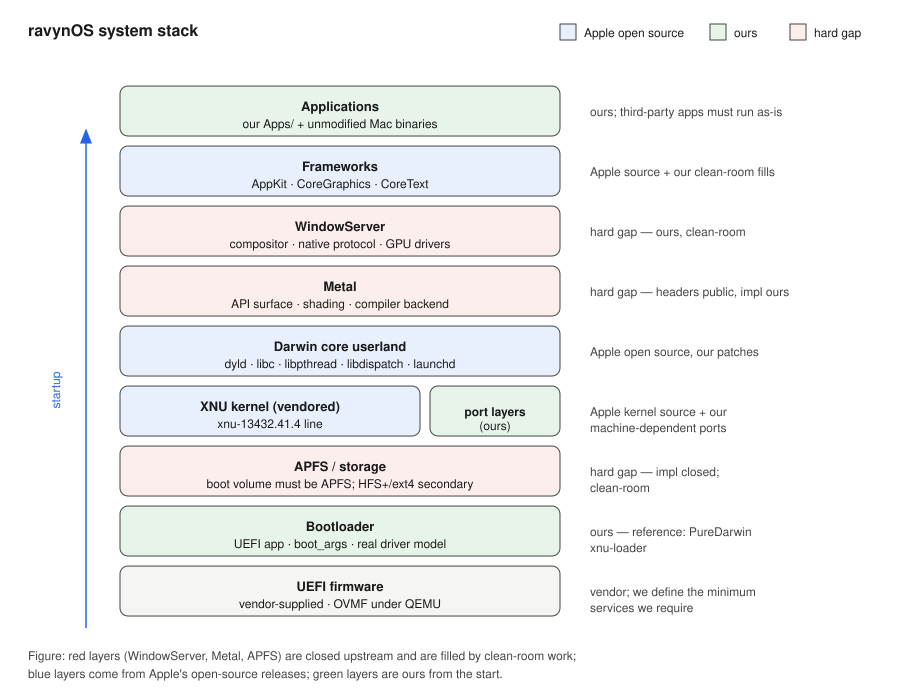
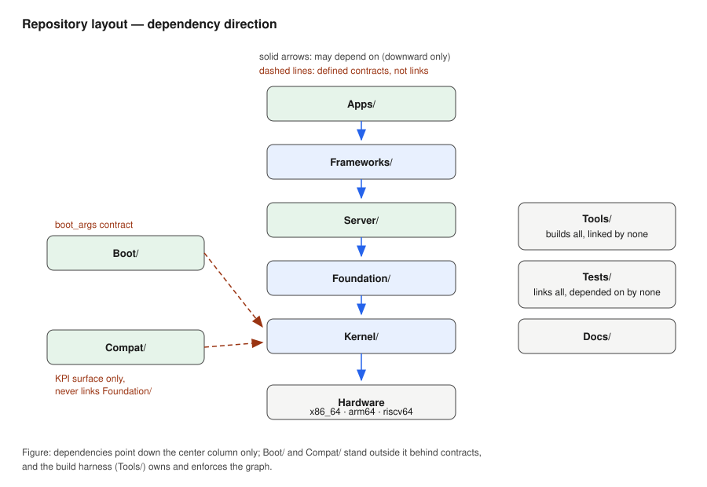

# 02 — System architecture

This document is the map of ravynOS: the full stack from firmware to
applications, the top-level layout of the repository, the dependency rules
that hold the layout together, and the process architecture that runs at
boot. It names the sibling document that owns each layer and stops there —
the details live with the layer. Read this after [01-principles.md]
(01-principles.md); read it again whenever you forget which document owns a
problem.

## The stack

The system has seven layers. Each is either Apple's open-source code, our
code, or a hard gap — something closed that we must write clean-room. The
figure shows which is which; the text walks the stack from the bottom.



Figure: the runtime stack. Blue is Apple's open source, green is ours, red
is a hard gap we fill by clean-room work.

**UEFI firmware.** The machine's firmware, vendor-supplied, is where our
control begins and ends: we require the standard UEFI services (file access
from the EFI system partition, block and simple-network protocols where
available, exit-boot-services) and we document the minimum a board must
provide rather than working around what boards actually ship. On QEMU, OVMF
plays this role. We do not write firmware.

**Bootloader — [04-boot.md](04-boot.md).** Our bootloader is a UEFI
application that loads the XNU Mach-O from the ESP, builds the `boot_args`
structure XNU's entry point expects, copies segments to their physical
addresses, exits boot services and jumps to the kernel. PureDarwin's
xnu-loader (https://github.com/PureDarwin/xnu-loader) is our reference for
that hand-off sequence; ours adds a real driver model, filesystem coverage
beyond the minimum, and x86_64, arm64 and riscv64 targets from the start.

**XNU kernel + port layers — [03-kernel.md](03-kernel.md).** The kernel is
Apple's XNU, vendored whole, with our platform port layers kept strictly
separate from the vendored source: a port layer implements the machine- and
platform-dependent surface (interrupt controllers, timers, UART and other
early console, interrupt and DMA for the devices we support) behind the
interfaces XNU already defines, so a new board is a new port layer and not a
diff across the kernel. Patches to vendored files are separate files applied
by the build, never edits in place, so an XNU upgrade is a rebase of a short
patch list instead of an archaeology dig. The kernel expects APFS for the
boot volume — that expectation is why the project moved from ZFS-as-root to
APFS when it moved to the Darwin base (ravynOS Discussion #529,
https://github.com/ravynsoft/ravynos/discussions/529).

**Darwin core userland.** dyld, libc, libpthread, libdispatch, launchd and
CoreFoundation come from Apple's releases (https://opensource.apple.com
/releases/), built by our harness with our patches. This layer defines most
of the platform's feel: it is where binary compatibility is won or lost for
every program that does not draw a pixel. launchd is the first user process
and is described under *Process architecture* below.

**Window server — [07-graphics.md](07-graphics.md).** A hard gap and the
centerpiece of the GUI story. The window server is a peer process that owns
the GPU and the compositor, speaking the protocol the target release's
applications expect. There is no Wayland or X11 underneath to lean on; the
protocol, the compositor and the GPU drivers are ours. On the machine
reality we have today (no GPU in the build fleet), development starts with
software rendering against QEMU.

**Metal — [07-graphics.md](07-graphics.md).** The hardest gap in the
project. Apple has not released the Metal implementation; what is public is
the API surface and its documentation (https://developer.apple.com/metal/),
the Apache-2.0 metal-cpp headers covering Metal 4 through macOS 27
(https://developer.apple.com/metal/cpp), and the sample-code library
(https://developer.apple.com/metal/sample-code/). The public headers define
the ABI; shaders, the AIR/metallib formats and the compiler backend are the
hard parts, and the design says so plainly instead of glossing them.

**APFS and storage — [03-kernel.md](03-kernel.md).** The kernel expects
APFS; Apple's APFS implementation is closed. Filling this gap clean-room is
a prerequisite for a self-hosting system, since the boot volume must be APFS.
HFS+ read, and secondary filesystems such as FAT, NTFS and ext4, are useful
in the meantime and are the pragmatic early path for bring-up.

**Frameworks — [08-frameworks.md](08-frameworks.md).** CoreFoundation,
Foundation and upward through AppKit. Apple releases some of this as source;
the rest we fill against the public headers and documentation. The frameworks
are where the ABI compatibility target (macOS 27.2.1, build 26B131) becomes
concrete: a framework is done when real Mac binaries link and behave, not
when the symbols exist.

**Applications.** Two kinds. Applications we write — Finder, Terminal,
System Settings, the installer — live in `Apps/` and are ordinary framework
clients. Applications other people wrote — every macOS app we did not build —
must run unmodified against the stack above; nothing in the tree may depend
on them, and nothing below the frameworks may know they exist.

## Project structure

The layout follows the dependency direction, the way Apple's own source
drops group components: a component's neighbors in the tree are its
dependencies and dependents, and nothing jumps a layer. The tree:

```
ravynos/
├── Kernel/
│   ├── xnu/                 vendored Apple XNU, unmodified
│   ├── port/                our per-architecture / per-board port layers
│   └── patches/             patches applied to xnu/ at build time
├── Boot/                    UEFI bootloader, per-arch loaders
├── Foundation/              Libc, libpthread, libdispatch, objc4, dyld,
│                            CoreFoundation
├── Frameworks/              CoreGraphics, CoreText, AppKit, ...
├── Server/
│   ├── WindowServer/        compositor, protocol endpoint, GPU drivers
│   ├── launchd/             PID 1 and its plists
│   └── configd/             system configuration daemon
├── Compat/
│   ├── linux-syscall/       Linux binary support (native subsystem)
│   ├── freebsd-driver-pi/   FreeBSD driver portability interface, pinned
│   └── README.md            per-layer contracts and version pins
├── Apps/                    Finder, Terminal, Settings, installer
├── Tests/                   per-layer suites + cross-layer ABI tests
├── Tools/                   build harness, toolchain scripts, mig, audits
├── Legacy/                  upstream ravynOS imports, pending manifesting
└── Docs/                    the documents in this directory
```



Figure: solid arrows are allowed dependency directions; dashed lines are
contracts (a defined interface, not a link).

What each top-level directory contains, and the dependency fences on both
sides:

| Directory | Contains | May depend on | May be depended on by |
| --- | --- | --- | --- |
| `Kernel/` | Vendored XNU, port layers, patch set | Nothing in-tree (vendor drop + port layers it declares) | `Foundation/`, `Server/`, `Compat/`, `Boot/` contract |
| `Boot/` | UEFI loader, arch loaders | Its own code only; consumes the `boot_args` contract | Nothing (nothing links against it) |
| `Foundation/` | Libc, libpthread, libdispatch, objc4, dyld, CoreFoundation | Kernel's documented syscall/Mach surface, via the SDK | `Frameworks/`, `Server/`, `Apps/`, `Compat/` never |
| `Frameworks/` | CoreGraphics, CoreText, AppKit and the rest | `Foundation/` only (plus the SDK) | `Server/`, `Apps/` |
| `Server/` | WindowServer, launchd, configd | `Foundation/`, `Frameworks/` where a server hosts views | `Apps/`; nothing links into servers |
| `Compat/` | Linux/FreeBSD subsystems with pinned versions | Kernel KPI surface only | Nothing in-tree; userland binaries at runtime |
| `Apps/` | Our applications | `Frameworks/`, `Foundation/`, servers via Mach ports | `Tests/` |
| `Tests/` | Suites for every layer + ABI tests | Everything (read-only, test-only links) | Nothing |
| `Tools/` | Build harness, toolchain bootstrap, mig, license audit | Nothing in-tree (self-contained) | Builds everything |
| `Legacy/` | Imported upstream ravynOS trees (desktop sources, SDK snapshot) | Nothing in-tree | Nothing; nothing in the build graph references it until a tree is manifested per [05-build-system.md](05-build-system.md) |
| `Docs/` | This design documentation | Nothing | Nothing |

Two entries deserve a note. `Compat/` never links `Foundation/`: a
compatibility layer that depends on the platform it exists to supplement
cannot be tested against a moving Foundation, so it touches only the kernel
interfaces its contract names. And `Boot/` is deliberately outside the
vertical order — it runs before anything else exists and depends on nothing
in the tree, only on the `boot_args` contract the kernel defines.

## Dependency rules

The layout encodes the following rules. They are enforced by the build
harness (see [05-build-system.md](05-build-system.md)), which rejects a
target that violates them, so a violation is a build break and not a
conversation.

1. **Dependencies point down the stack only**: `Apps/` → `Frameworks/` →
   `Foundation/` → kernel. No upward include, no sideways shortcut.
2. **Frameworks never call the kernel directly.** A framework reaches the
   kernel through `Foundation/` (Libc, libdispatch, Mach wrappers), never by
   including kernel-internal headers. This keeps one choke point per
   syscall surface.
3. **Userland never includes kernel-internal headers.** Userland builds
   against the SDK the harness produces from the kernel's exported
   interfaces; anything else would couple the whole tree to XNU internals.
4. **`Compat/` never links `Foundation/`.** Compatibility subsystems touch
   the kernel KPI surface their contract names, and nothing else.
5. **Everything below `Frameworks/` builds before anything above it**, and
   each directory builds standalone given its declared dependencies —
   `Foundation/` builds against a stock XNU tree with nothing else checked
   out.
6. **No circular dependencies**, including test targets: a suite in
   `Tests/` may link anything, but nothing links `Tests/`.
7. **Vendored code stays vendored.** Files under `Kernel/xnu/` and other
   vendored drops are never edited in place; changes are patch files under
   `patches/`, so an upgrade re-applies a known list.
8. **The harness owns the graph.** The dependency graph is data in `Tools/`,
   not convention in documentation; the audit tools (dependency direction,
   license headers, build states) run on every build.

## Process architecture at runtime

At runtime the system looks like this: a small set of servers, each a peer
userland process, coordinated through Mach ports. There is no monolith.

**launchd is PID 1.** The kernel starts launchd and nothing else. launchd
reads its property lists, mounts the boot volume's remaining filesystems,
stages the system daemons, and owns service definitions for everything else.
Every long-running process in the system is started by launchd, from its
plist, and can be restarted by it — which is the mechanism that keeps a
crashed daemon from being a crashed system.

**The window server is a peer process**, not a kernel service. It owns the
GPU and the framebuffer, runs the compositor, and publishes a Mach port that
clients connect to. Being userland is the point: it can crash and be
restarted by launchd, it can be traced and replaced like any other process,
and it cannot take the kernel down with a bad frame.

**IPC is Mach ports.** Servers advertise bootstrap ports; clients look them
up and message them. There is no shared-memory side channel as part of the
architecture (individual subsystems may opt into shared buffers for bulk
pixel or audio data, but the control path is messages). This keeps the
contract between processes inspectable and matches the ABI macOS software
already speaks.

**Where daemons live.** System daemons live under `Server/` and their
service definitions live with them as plists; per-user agents are defined
the same way and launched into the user's session. Daemons do not listen on
wildcard ports or scan for hardware at arbitrary times; they are started
with a declared purpose by launchd and advertise their endpoints.

**First boot, in order.** The sequence on a fresh system:

1. UEFI firmware runs the bootloader from the ESP ([04-boot.md]
   (04-boot.md)).
2. The bootloader loads the XNU Mach-O, builds `boot_args`, exits boot
   services, and jumps to the kernel.
3. XNU initializes the platform through its port layer, mounts the root
   filesystem (APFS — the storage gap above is why this step is hard), and
   starts launchd as PID 1.
4. launchd runs the boot stage: configd, the storage stack's userland
   helpers, and the daemon set defined in its plists.
5. The window server starts, claims the GPU, and publishes its bootstrap
   port.
6. The login/session stage starts; the first user session gets a window
   environment, and Finder appears.

Steps 4 through 6 are exactly the stages launchd already models with its own
run-level machinery; we inherit that rather than inventing a second one.

## Open questions

- Where exactly does dyld sit? It is listed under `Foundation/` here, but it
  is also toolchain-adjacent (it must be built in lockstep with the loader
  in `Tools/`). [05-build-system.md](05-build-system.md) needs to settle the
  build-order edge this creates.
- Does `Server/` depend on `Frameworks/`, or only on `Foundation/`? A
  server that hosts views (the login screen, Finder's desktop) needs AppKit;
  a server that must never pay framework startup cost (configd) should not
  link it. The rule may need to be per-server rather than per-directory.
- The first-boot order above assumes the storage userland helpers can be
  staged from the root volume; on a truly fresh install, the installer's
  staging step needs its own design (installer not yet assigned a document).
- riscv64 has no XNU platform support to start from. Whether the port layer
  abstraction is strong enough to admit a from-scratch riscv64 port without
  touching vendored code is unproven; [03-kernel.md](03-kernel.md) owns this
  risk.
- The window server's protocol details (what the target release's clients
  actually speak) are a clean-room target under [07-graphics.md]
  (07-graphics.md); this document intentionally does not name it.
