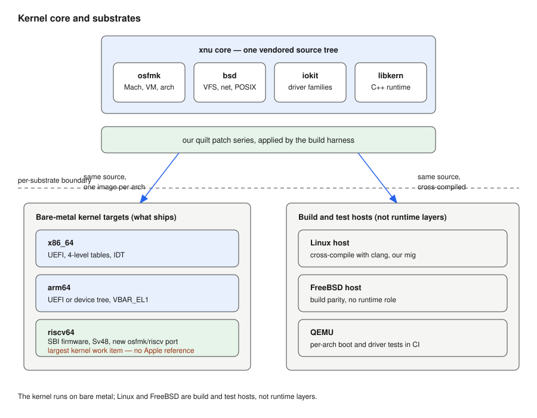
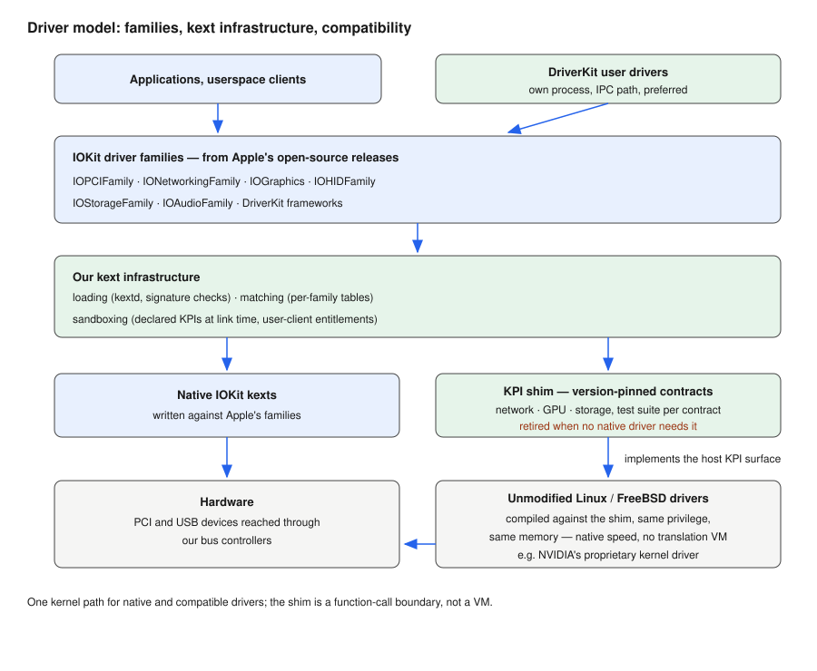

# The kernel

> Background document. [SYSTEM-DESIGN.md](SYSTEM-DESIGN.md) is the design of record; where this document disagrees with it, SYSTEM-DESIGN.md is right. Status lives only in [STATUS.md](STATUS.md).

This document covers the kernel of record, how we build and vendor it, the
architectures we target, the driver model, kernel-level compatibility for
third-party drivers, compute support for large ML workloads, and
debuggability. It is for anyone working on the kernel, the build harness, or
a driver. Read it next to [04-boot.md](04-boot.md), which picks up where the kernel
entry point begins.

## Kernel of record

We ship Apple's XNU. Not a fork we maintain as a separate kernel, not a
Mach/BSD hybrid we assemble from parts — the same source Apple publishes
with each macOS release, vendored into this tree. The design targets the
xnu-13432.41.4 line: Darwin 27.2.0, the kernel released with macOS 27.2.1
build 26B131 on 2026-11-09
([developer.apple.com/news/releases](https://developer.apple.com/news/releases/?id=11092026d),
[macosdb.com](https://macosdb.com/macos/release/27.2.1-26B131/)). Apple's
open-source downloads live under [github.com/apple](https://github.com/apple)
with a release index at [opensource.apple.com/releases](https://opensource.apple.com/releases/).

The tree currently vendors xnu-12377.121.6 (Darwin 25.5 generation). The
first work item in this document is the vendor bump to the xnu-13432 line
once Apple publishes it; everything below assumes that baseline.

### Vendoring policy

The vendored source sits in the tree unmodified at `Kernel/xnu/`. Our
changes are a quilt patch series under `Kernel/patches/` (DESIGN.md
§8.2), each patch filed with a short RFC in `Docs/rfc/` before it lands. Nobody edits files under the vendored root; a build harness applies
the series before compiling and can regenerate a pristine upstream tree at
any time, which keeps our delta measurable with `quilt series | wc -l` or a
plain diff against the upstream tarball.

Every patch file starts with a structured comment:

```
# why: cross-build fails on Linux because makedefs assumes a macOS sysroot
# fate: candidate for retirement once makedefs upstream grows a host-cc knob
```

The `fate` line is the important one. Patches fall into three groups:

| Fate | Meaning | Examples |
|---|---|---|
| retirement | exists only because of a Linux build-host quirk; delete when upstream or our tooling changes | host-tool fixes, missing headers on Linux |
| upstreamable | clean enough to send to Apple or mirror as a standalone port | riscv64 port files, cross-compile fixes |
| permanent | defines a behavior Apple will never ship | bare-metal boot glue for our targets |

If a patch cannot say which group it is in, it does not get merged. This
sounds like ceremony, but it is the only defense against the delta growing
into a fork we can no longer rebase. Every Apple release should shorten the
series, not lengthen it.

## Building XNU on Linux

Apple builds XNU on macOS with Xcode. We build it on Linux hosts (our
current machines are x86_64, 8 cores, 16 GB RAM, no GPU), so cross-building
is the normal path, not a convenience. What is actually needed:

| Piece | What it is | Where it comes from |
|---|---|---|
| mig | Mach interface generator; compiles `.defs` into IPC stubs and headers | Apple's migcom from `bootstrap_cmds` (APSL), vendored pristine under `Tools/mig/upstream/` and built on Linux by `Tools/mig/build.sh` with a three-patch series applied by our `rvpatch` |
| Generated mig headers | the output of mig for every Mach subsystem, needed before anything compiles | committed, regenerated by an explicit build rule that fails CI on any diff |
| Header shims | the few Apple-SDK headers XNU expects but that are not in `EXTERNAL_HEADERS/` | written by us, minimal, permissively licensed |
| LLVM/clang | the only toolchain known to compile XNU cleanly (attribute set, `_Atomic` details, assembly dialect) | LLVM releases; clang plus lld and llvm-ar |
| Host tools | `kextsymboltool`, `newvers`, `decomment` and friends in `SETUP/` | built for the build host first, then used to build the target |

mig deserves a paragraph. It is the Mach RPC compiler: run it over
`osfmk/mach/*.defs` and you get the stub and header files that both kernel
and userspace include. Apple generates these during the macOS build and
does not publish the outputs. The compiler itself, migcom, is published in
Apple's `bootstrap_cmds` project; we vendor it unmodified
(`Tools/mig/_PROVENANCE` records tag `bootstrap_cmds-138`) and carry the
Linux delta as patches, which is the same vendoring rule the kernel follows.
Writing our own mig was considered and rejected: Apple's is the reference,
it is APSL, and a reimplementation would spend effort proving it matches.
The committed generated headers pin the behavior and double as regression
fixtures; the rule that regenerates them runs in CI, so a mig change that
alters output fails loudly.

One license wrinkle: migcom's parser is a yacc grammar. The build must
generate it with a permissively licensed yacc (byacc, public domain), not
GNU bison — bison is GPL tooling, which the rule in
[05-build-system.md](05-build-system.md), "Tooling boundary", forbids even
though bison's output carries an exception. `Tools/mig/build.sh` runs byacc,
and `Tools/ci/check-host-tools.sh` fails CI if bison or another GPL program
returns.

Prior art matters here: the
[darwin-xnu-build](https://github.com/blacktop/darwin-xnu-build) project
(MIT) builds current-generation XNU on Linux with a modest patch set, and
PureDarwin builds XNU 12377.121.6 the same way. So we know the approach works
end to end. The known hard parts are the ones those projects document:
missing mig outputs, Apple-internal headers referenced from a handful of
files, linker expectations (XNU links as a static Mach-O with a hand-rolled
layout), and dtrace helper generation. None of them are research problems;
they are all work.

## Substrates

One sentence to keep the rest of this document honest: **the kernel runs on
bare metal.** Linux and FreeBSD appear only as build and test hosts —
machines that compile the kernel, run it under QEMU, and exercise drivers.
They are not layers the kernel sits on, and no shipped system depends on
them. We call the build/test arrangements "substrates" because that is what
they are: surfaces we build from.



Figure: the same XNU source tree produces a bare-metal kernel per
architecture; Linux and FreeBSD are build and test hosts, not runtime
layers.

The build produces one bare-metal kernel image per target. There is no
"Linux edition" of the kernel and no FreeBSD edition. A developer on a Linux
laptop cross-compiles the arm64 image and boots it in QEMU; the same commit
built on a FreeBSD machine produces the same image. Host differences stop at
the compiler.

## Architecture targets

Three architectures from day one: x86_64, arm64, riscv64.

| | x86_64 | arm64 | riscv64 |
|---|---|---|---|
| Firmware | UEFI | UEFI (or device tree where UEFI is absent) | SBI (RustSBI/openSBI class) |
| Page tables | 4-level x86-64 tables, large pages | ARMv8 translation tables (up to 4 levels), TTBR0/TTBR1, 16K/4K granules | Sv39 baseline, Sv48 where present, via `satp` |
| Exceptions | IDT, IST stacks | VBAR_EL1 vector tables | `stvec` + SBI trap delegation |
| Code location in XNU | `osfmk/i386`, `osfmk/x86_64` | `osfmk/arm`, `osfmk/arm64` | `osfmk/riscv` — we write it |
| Status | source vendored; kernel link in progress (W1) | source vendored; not yet built by us (W5) | no source; largest kernel work item (riscv64 track) |

x86_64 and arm64 source comes with the tree; building it is our work. XNU's own layout separates arch code
under `osfmk/<arch>` with `pexpert/` holding early platform code, so per-arch
work stays where Apple put it. The arm64 side also carries Apple-silicon
assumptions in places; some of that code is useful to us (it is the newest
port) and some is dead weight for generic hardware, which the stripping
section below handles.

riscv64 is different in kind, not degree. There is no Apple reference port,
no half-finished Apple branch to study, and no second open-source riscv XNU
to compare against. Porting means writing `osfmk/riscv` from the Mach/ARM
ports as templates: address-space setup, per-CPU state, interrupt control
(PLIC/AIA), timer via SBI, context switching assembly, pmap, and the
`machine/` glue that ties Mach to the arch. The PureDarwin arm64 bring-ups
and the ios-sweet project (xnu-8796 booted on a Snapdragon phone, per
[01-principles.md](01-principles.md)) show that non-Apple XNU ports are feasible
with a small team, but riscv64 is still the largest single item in the
kernel plan and its schedule should be treated as the least certain in this
document.

## Driver model

Drivers are IOKit drivers: C++ subclasses of `IOService` matched by an
element-tree declaration, loaded as kernel extensions. The families we
depend on come from Apple's open-source releases — IOPCIFamily,
IONetworkingFamily, IOGraphics, IOHIDFamily, IOStorageFamily, IOAudioFamily
and the rest (each has its own version in the
[release index](https://opensource.apple.com/releases/); we track them
per-release and do not pin numbers here).

On top of Apple's families we build our own kext infrastructure:

- **Loading** — a kextd that reads kernel extension bundles from the ESP
  and the root volume, resolves links against the running kernel's symbol
  set, and validates code signatures before link time.
- **Matching** — IOService personality matching driven by per-family
  tables we own, so that a given PCI ID or device tree node resolves to one
  driver deterministically. Apple's matching dictionary format is public
  and we keep it.
- **Sandboxing** — kernel drivers are trusted code, so "sandboxing" here
  means three concrete things: kexts link only against the KPIs they
  declare (enforced at link time by the symbol-set tooling), IOKit user
  clients get per-entitlement IOService access, and a DriverKit user
  driver runs in its own process with the kernel talking to it over an
  explicit IPC path. Wherever a driver does not strictly need to be in the
  kernel — HID, audio, most storage — we prefer the DriverKit-style user
  driver, because a hung user driver is recoverable and a hung kernel
  driver is not.



Figure: Apple's IOKit families and our kext infrastructure serve both
native IOKit drivers and unmodified Linux/FreeBSD drivers through the
compatibility environment.

## Native compatibility for third-party kernel drivers

The GPU, network, and storage worlds are full of drivers Apple will never
re-release as IOKit and that we could not rewrite fast enough: NVIDIA's
proprietary driver, the Linux per-device drivers for Wi-Fi and NVMe
quirks, the FreeBSD ones. The design answers this with a first-class
in-kernel compatibility environment, not an emulator.

**What it is.** A maintained KPI shim compiled into (or linked into) the
kernel. An unmodified Linux or FreeBSD kernel driver is compiled against
that shim — its own headers, its own build system — and linked as a kext.
The shim implements the subset of the host kernel API the driver calls:
memory-management APIs, workqueues, mutexes, bus access via our PCI/USB
controller drivers, and a socket or block-device plane below.

**Version pinning.** Linux and FreeBSD KPIs move. A shim that claims "the
Linux kernel API" is a lie; a shim that claims "Linux 6.18.y network
device KPI" is a contract. We pin a version per driver class — network,
GPU, storage — and document it:

| Driver class | Host KPI pinned to | Contract tests live in |
|---|---|---|
| Network | FreeBSD 15.1-RELEASE ifnet/iflib (BSD drivers); Linux 6.18.y longterm netdev + napi for permissively licensed Wi-Fi drivers | `Tests/kpi/network` |
| GPU | Linux DRM/KMS subset as of 6.18 (deferred shim, see below) | `Tests/kpi/drm` |
| Storage | FreeBSD 15.1-RELEASE CAM subset; native IOKit for NVMe and AHCI | `Tests/kpi/storage` |

The shim in the tree today, `Kernel/Extensions/FreeBSDPort/`, targets
FreeBSD 11.4's pre-iflib driver model (DESIGN.md §2.4) and carries the vtnet
driver. The 15.1 pin is the contract it migrates to when the iflib port
lands after W4; until then 11.4 is the honest description of what runs.

(6.18 longterm is the contract because a KPI must live for years; newer
stable series are test kernels, not the pin. Exact patch levels are
recorded next to the shim source, because they change per driver.) Each
contract has a documented
test suite that the shim must pass before the driver using it is
considered supported. The suite is what makes the contract real; without
it, "compatible" degrades into "it booted once".

**License eligibility.** Most Linux drivers are GPL-2.0-only, and the
no-GPL rule in [01-principles.md](01-principles.md) does not bend for code
that happens to run behind a shim. A driver is eligible for the Linux KPI
environment only if it is available under a permissive license — MIT, BSD
or ISC alone, or a dual license whose permissive option we take. That
admits a useful set: the DRM drivers for AMD, Intel and nouveau are
MIT-licensed (the basis of FreeBSD's drm-kmod), several Wi-Fi drivers are
ISC or dual BSD/GPL, and NVIDIA's open kernel modules are dual MIT/GPLv2
([NVIDIA kernel_open README](https://download.nvidia.com/XFree86/Linux-x86_64/595.84/README/kernel_open.html)).
It excludes most network, storage and filesystem drivers (ext4, ntfs3,
e1000e among them); those classes are served by the FreeBSD KPI side or by
native IOKit drivers instead. The shim's own headers are written by us from
the documented interfaces and the drivers' call sites — never copied from
Linux's GPL headers. FreeBSD's LinuxKPI is the reference design and a
possible seed, file by file: FreeBSD keeps its GPL-licensed LinuxKPI pieces
in a separate module, and the per-file audit decides what we may import.
NVIDIA's older proprietary kernel module (needed for pre-Turing GPUs) carries
NVIDIA's own license: users may load it, but it never enters the tree or a
release image.

**Why this is native, not emulation.** The driver runs at the same
privilege level as the rest of the kernel, in the same address space,
calling the shim directly — no translation VM, no second kernel, no
paravirtual device. A syscall or interrupt takes the same path as for an
IOKit driver. The only thing between the driver and our kernel is a
function-call boundary. Calling it emulation would misdescribe both the
performance and the failure modes.

**NVIDIA.** NVIDIA's userspace stack (their GL/Vulkan/CUDA libraries)
talks to their kernel-mode driver through an ABI they control. Our shim
presents the Linux KPI surface that driver expects — the open kernel
modules, taken under MIT — compiled against the pinned contract, and
NVIDIA's own userspace binaries run on top unchanged.
That is the whole trick: their userspace already knows how to talk to
their kernel driver, so our job ends at the kernel boundary.

**Comparison with PureDarwin.** PureDarwin runs AMD/Intel/nouveau GPUs
through an in-kernel FreeBSD/Linux driver compatibility layer ("fbsdkpi")
and NVIDIA's 580 driver through their PDNLoader; that approach demonstrably
works and we learn from it. What we do differently is process, not
concept: we define versioned KPI contracts per driver family with a
documented test suite per contract, and we treat every shim as a liability
with a retirement plan. When the native driver set for a class no longer
needs a shim — because IOKit or DriverKit drivers cover it — we delete the
shim instead of keeping it warm. PureDarwin's layer, as far as their public
repo shows, does not publish per-contract tests or a removal criterion;
that gap is where driver stacks rot.

## Compute for large ML workloads

ML is the workload where memory plumbing matters most, and the kernel side
of it is modest but must be right.

- **Unified-memory-style allocations.** The VM must hand out buffers that
  are coherent between CPU and GPU from the application's point of view —
  one allocation, one pointer, device-mapped on demand. XNU's Mach VM with
  `VM_FLAGS_*` allocation paths is the substrate; the GPU-side mapping is
  done by the GPU kernel driver via the shim or IOKit.
- **Large pages.** Model weights are gigabytes; TLB pressure is the tax.
  We expose superpage allocation (2 MiB and larger, per-arch) through the
  normal allocation paths and make sure our GPU drivers map their
  structures with them too.
- **GPU shared memory.** The GPU kernel-mode driver owns a reserve and
  handles eviction; the kernel sees it as a managed-memory client with its
  own pager, not a special case wired into every subsystem.

Where it plugs in: Metal, which we must implement clean-room (Apple has
not released the Metal implementation — see [07-graphics.md](07-graphics.md)), allocates
through these paths; MLX, Apple's open-source array framework for unified
memory (MIT, [opensource.apple.com/projects/mlx](https://opensource.apple.com/projects/mlx)),
runs on top of Metal's surface and is the realistic path for training and
inference on our system — see [08-frameworks.md](08-frameworks.md).

## Debuggability

A kernel you cannot debug is a kernel you cannot ship.

- **dtrace and ktrace.** XNU ships both. We keep the providers working in
  cross-built configurations (dtrace helper generation is one of the build
  pain points listed above) and treat a regression in either as a build
  failure, not a nice-to-have.
- **Kernel core dumps.** Panic handlers write a dump via a dedicated dump
  path (the `libkdd` chunked kernel data format, already in the tree), so
  dumps survive to disk or across a serial/network dump transport we
  control.
- **Symbolicated panics.** The panic log writer emits a log with
  addresses; our build harness produces the symbolicated version from the
  kernel image and the kext link maps. A panic that pastes into an issue as
  readable frames is the goal; a raw hex panic log is a bug in the harness.
- **Boot-time tracing.** Tracing from the loader onward — boot args,
  firmware table discovery, hand-off — is owned by the boot document
  ([04-boot.md](04-boot.md)) but the kernel must preserve it: early boot messages
  buffer into the same panic log so a failed boot produces one artifact,
  not three.

## Removing unwanted code

The vendored tree contains code we will never run: Apple-internal pieces,
exclaves and other closed-source glue, per-arch code for platforms we do
not target, and debug/telemetry hooks meant for Apple's infrastructure.

We strip none of it by editing source. The build harness drives the strip:

- per-target config selects which source directories enter the build
  (`config/Makefile.x86_64`-style files already do most of this),
- the linker drops unreferenced sections for the rest,
- a manifest lists what was excluded and why, reviewed like code.

The point of never editing: the vendored tree stays diffable against
upstream, our patches stay explainable, and a future Apple release merges
in hours instead of days. If a piece must genuinely change behavior, it
becomes a patch with a `fate:` line, per the vendoring policy.

## Open questions

- **riscv64 effort estimate.** *Resolved 2026-11-26 — see the breakdown in
  [12-roadmap.md](12-roadmap.md), riscv64 track:* on the order of a person-year total;
  pmap 3–4 engineer-months, traps/context-switch assembly 1.5–2 months,
  SBI bring-up ~1.5 months, the remainder in IOKit/kext arch glue. Nothing
  lifts directly from `osfmk/arm`; structure ports as a template only.
- **Timing of the xnu-13432 vendor bump.** *Resolved 2026-11-26 by release
  audit:* xnu-12377.121.6 remains the newest tag published in
  apple-oss-distributions; xnu-13432.41.4 (Darwin 27.2.0, macOS 27.2
  "Golden Gate") has no public source drop yet, so the vendored tree is
  current and no bump is pending. Decision rule: bump the day Apple
  publishes the tag (checked weekly by lane E); lane A owns rebasing the
  `Kernel/patches/` series the same week; the wave in flight absorbs
  the cost — no wave pauses for a bump. (DESIGN.md §8.4 schedules bumps
  between waves; for a security-relevant tag, this rule wins.)
- **GPU kernel-mode driver strategy.** *Decided 2026-11-26: native IOKit
  GPU family first, always* — the Linux DRM KPI shim below is a
  compatibility layer for foreign drivers, not the native path, so it
  follows rather than leads. This fixes the shape of `Tests/kpi/drm`
  (it validates the shim, independently of the native family) and of
  [07-graphics.md](07-graphics.md). Prior art for the quality bar:
  LunarG's KosmicKrisp, see the Metal track in [12-roadmap.md](12-roadmap.md).
- **mig ownership.** *Decided 2026-11-26: adopt Apple's mig* — it is the
  reference implementation, APSL-licensed and already in the tree's
  provenance set; Apple no longer publishes a standalone mig tarball, so we
  build `migcom` on Linux with a small header shim (include-path work
  remains). The generated headers are committed either way.

Still open:

- **The Linux syscall entry.** The Linux ABI environment
  ([09-compat.md](09-compat.md)) needs a per-task syscall personality in the
  trap path, which lives in vendored code (`osfmk/i386`, `osfmk/arm64`).
  That is a permanent patch by definition; its RFC and the minimal hook
  shape are not written.
- **Kernel sanitizers.** Whether we build a KASan-style configuration of
  XNU or accept QEMU tests as the kernel's coverage
  ([11-quality.md](11-quality.md) asks the same question from the quality
  side).
- **Wi-Fi coverage under the license rule.** Which permissively licensed
  Wi-Fi drivers cover the first bare-metal rig and the phone track's first
  device is unmeasured.
