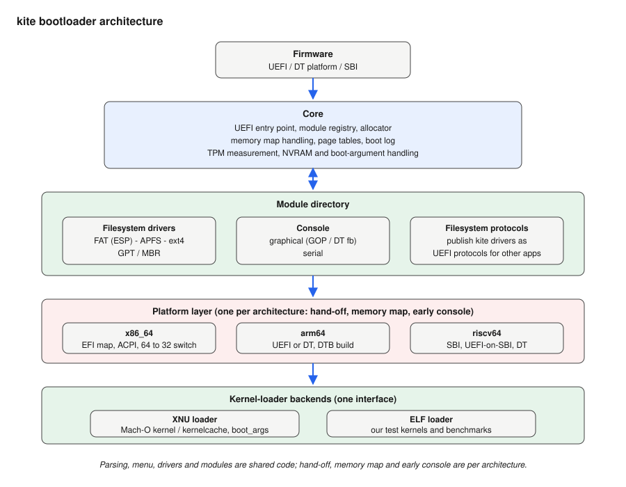
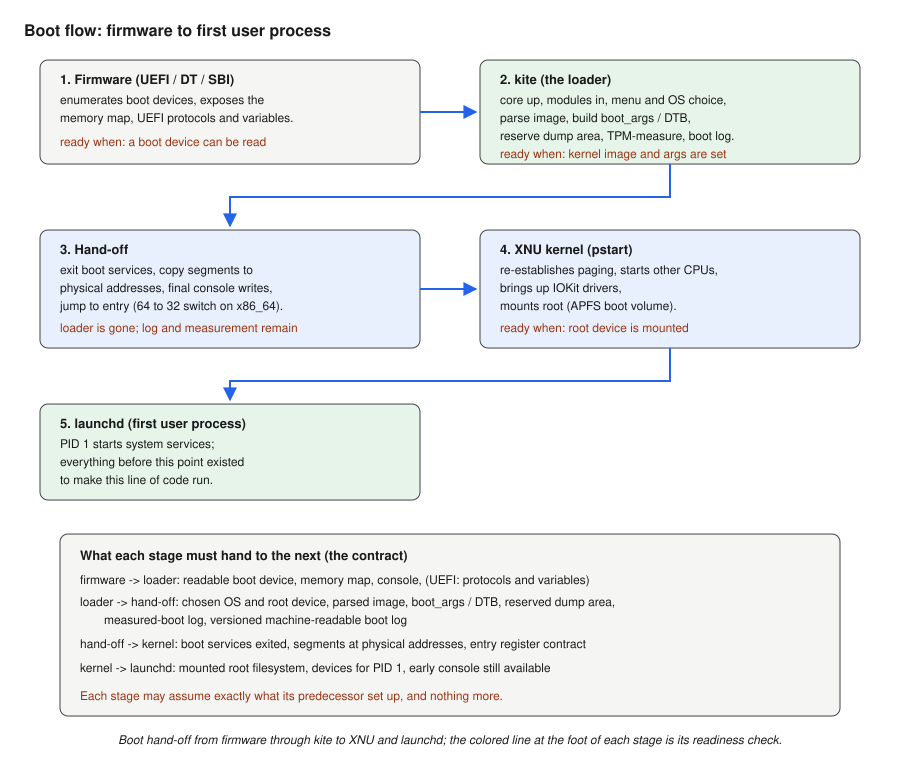

# 04 — Boot: `kite`, the ravynOS bootloader

This document covers everything between power-on and the first user process: the
bootloader we write, the hand-off into XNU, and the per-architecture paths that get a
kernel running on x86_64, arm64 and riscv64. Read it if you are working on the loader
itself, bringing up new hardware, or debugging why a kernel that runs under QEMU will
not boot on real metal.

The concrete implementation steps for this document live in
[15-implementation-guide.md](15-implementation-guide.md), sections 4 (XNU on x86_64) and 5 (XNU on arm64); current gaps are listed
in [14-status-and-gaps.md](14-status-and-gaps.md).

## Where boot stands today

`Boot/loader/` is our own UEFI loader, in freestanding C (BSD-3-Clause): it loads Mach-O
and ELF images, and the boot smokes in `Tests/boot/` run it to a test kernel's
panic-with-output on x86_64 (OVMF), arm64 (AAVMF) and riscv64 (edk2) under QEMU. It is
kite's starting point. Two things are unsettled. DESIGN.md's language policy says kite is
Rust, and this loader is C — see Open questions. And the older developer rig in
`Kernel/build/boot/` still boots the kernel through GRUB multiboot2; GRUB is GPL, so that
rig is never vendored, never part of a release artifact, and is deleted once `Boot/`
loads the real kernel (the Boot track in [12-roadmap.md](12-roadmap.md)).

## Why we write our own bootloader

XNU has a boot contract that no mainstream bootloader speaks. The kernel entry on
x86_64 expects to be called through a specific sequence — a `boot_args` structure,
segments copied to their physical addresses, boot services already exited — and the
arm64 and riscv paths have their own shapes. GRUB cannot produce this hand-off, and
beyond that we would not ship it anyway: our license policy forbids GPL code in the
tree and GPL-linked tooling in the build, which rules out GRUB outright. Apple's own
loader (iBoot) is closed source. Windows Boot Manager and systemd-boot have no XNU
support and no room to grow one on our terms.

So the project writes its own bootloader, from scratch, and gives it a plain name:
**kite**. It is a native UEFI application (plus a firmware story for riscv64, below),
written as a freestanding UEFI application — C today in `Boot/loader/`, Rust with
`no_std` per DESIGN.md §10's language policy if that policy holds for the loader —
BSD-3-Clause licensed, and free of GNU code and GNU build tooling. If the name bothers anyone, it is a rename across a handful of files,
not a design decision — but this document uses kite consistently, and so should the
tree.

The job is bigger than "load a kernel". The bootloader is the piece of the system that
must work on every machine we support, before any of our drivers exist, with no
filesystem help from anyone. That deserves its own design, not a fork of someone's
QEMU helper.

## What xnu-loader gets right, and why we do not ship it

[PureDarwin/xnu-loader](https://github.com/PureDarwin/xnu-loader) is the one open
implementation of the XNU hand-off that we can study. It is a GNU-EFI UEFI application
(`BOOTX64.EFI`) that reads the XNU Mach-O, or an lc-tools kernelcache, from the EFI
System Partition, builds the `boot_args` structure that XNU's `pstart` expects, exits
EFI boot services, copies the kernel segments to their physical addresses, and jumps
to the kernel entry through a 64→32-bit mode switch. That is the whole proof we
needed: the sequence works, and it is documented in working code.

We keep that knowledge and we do not reuse the tool. Four reasons:

- It is x86-only. Our targets include arm64 and riscv64 from the start; the hand-off
  logic belongs behind a per-architecture interface, which the existing code has no
  place to put.
- It is QEMU-first. It assumes the virtual machine's firmware and device set. A
  bootloader for real machines needs a real driver model: storage controllers,
  filesystems, consoles that work before the kernel does.
- Its driver coverage is minimal by the author's own description, and the author's own
  note on the repository says it was "made to work, not to be clean". That is an
  honest and useful artifact, and also not a production foundation.
- It is single-purpose: no menu, no other operating systems, no Secure Boot, no
  measured boot, no crash-dump participation. All of those are requirements for us.

The right relationship is: xnu-loader is our reference for `boot_args` and the
hand-off sequence; kite is the production tool. When we hit a hand-off question, we go
read xnu-loader first.

## What the bootloader has to do

Framed against GRUB — the thing people reach for by default — here is the requirement
set. The point is not to match GRUB feature for feature; it is to be better than GRUB
at this specific job.

| Area | What kite does | Why it matters here |
| --- | --- | --- |
| Driver model | Modular design with loadable pieces; core plus modules, embedded in the binary at build time first, with an on-disk module directory as a later step | Storage and filesystem support can be added per platform without rebuilding the core; keeps the deterministic single binary for Secure Boot in v1 |
| Filesystems | FAT for the ESP first, then an APFS reader, then an ext4 reader | The ESP alone is enough to boot — no separate `/boot` partition. XNU expects APFS for the boot volume, so the APFS reader is the one that makes "boot straight off the root volume" possible |
| Partitioning | GPT and MBR | Old installs and odd OEM disks still exist |
| Menu | OS selection, including other installed operating systems detected on the disk | ravynOS machines are also Linux and Windows machines; the bootloader should not pretend otherwise |
| Console | Graphical (framebuffer via UEFI GOP or DT-provided fb) and serial | Serial is how bring-up actually gets debugged; graphical is what users see |
| Secure Boot | Our own keys, with a real enrollment story: the machine owner installs ravynOS keys into firmware or a shim-less first-stage path | Boot must be verifiable end to end without trusting a third party's key hierarchy |
| Measured boot | TPM measurement of the loaded kernel and configuration, plus a measured-boot event log the OS can read later | Attestation and disk-unlock keys that depend on boot state |
| Network boot | HTTP and TFTP — later, after the first release | Diskless and lab machines; not on the critical path for 1.0 |
| Hibernate / resume | Detect a valid sleep image and resume the kernel from it instead of a cold start | XNU's hibernate support is in the source we vendor, so the image format is something we can pin against our own tree rather than guess at |
| Boot args / NVRAM | Read and set boot arguments and UEFI variables; a menu editor for one-off boots | Kernel debugging and recovery depend on this constantly |
| Crash dumps | The loader reserves the dump area and records its location for the kernel | Kernel panics must be capturable even when the root filesystem is unhappy |
| Boot log | A versioned, machine-readable boot log handed to the kernel | Support and debugging start with "what did the firmware and loader actually do" |

Two rows deserve their own paragraphs.

The APFS reader is the risky one, though less than it looks: Apple publishes the
on-disk format in the *Apple File System Reference*
(https://developer.apple.com/support/apple-file-system/Apple-File-System-Reference.pdf),
written so that others can implement read access, so a read-only reader is a
known-feasible amount of work, not a research project. We do not need write support in the bootloader; the kernel
mounts root read-write. Until the reader exists, the ESP carries the kernel and kite
boots from there, which is exactly the layout xnu-loader proves.

Secure Boot with our own keys means we do not sign with anybody's Microsoft-issued
keychain and we do not require one. The enrollment story is: our release images ship
with key files and a helper that installs them into the machine's firmware (most UEFI
implementations can do this from the setup UI or a utility), and the CI-built test
images run under OVMF with the same keys so the path is exercised on every commit.

## Architecture

Figure: kite's own layering — core, module directory, per-arch platform layer, and the
kernel-loader backends.

The bootloader is a small operating system with one customer, and it is layered like
one:

- **Core.** The UEFI entry point, the memory-map handling, page tables for the loader's
  own use, a simple allocator, and the module registry. The core knows nothing about
  XNU, ARM, or FAT; it knows how to load modules, dispatch protocols, and hold the
  machine in a defined state.
- **Module directory.** Filesystem drivers (FAT, then APFS, then ext4), console
  drivers (graphical and serial), and protocol adapters that publish kite's filesystem
  drivers through the UEFI protocol model so that other EFI applications — a shell, a
  network stack — can use them too. Modules declare dependencies; the registry loads
  them in order and refuses to start the menu until the ones marked required are in.
- **Platform layer.** One per architecture. This is where the memory map is normalized
  into the form the target kernel wants, where the console is brought up, and where
  the hand-off sequence lives. Everything above this line is shared code.
- **Kernel-loader backends.** Two of them, behind one interface: the XNU backend that
  parses a Mach-O kernel or a kernelcache and produces the hand-off, and a plain ELF
  loader for our own test kernels and microbenchmarks. The ELF loader is not a
  novelty — during kernel bring-up we boot test kernels far more often than the real
  thing, and a loader that can only boot XNU cannot help debug the machine.

Version one embeds all modules into a single binary at build time. That is the
deterministic, signable, easy-to-test shape. An on-disk module directory on the ESP is
a later step and only makes sense once Secure Boot covers the verification of
individually loaded files; we are not in a hurry.

## Per-architecture boot paths

What is shared across all three architectures: image parsing, the menu, filesystem and
storage drivers, NVRAM and boot-argument handling, the boot log, TPM measurement, and
the module system. What is per-architecture: the hand-off sequence itself, the memory
map translation, early console bring-up, and construction of the structures the kernel
consumes (ACPI, device tree, or both).

### x86_64

The primary target. The firmware is UEFI; legacy BIOS boot is out of scope. The loader
takes the EFI memory map and normalizes it for `boot_args`; on systems where we have
to fall back (none, today), the E820 layout is what XNU's x86 boot path historically
consumed, and the translation is the same shape either way. For CPU topology we read
ACPI (the MADT); MP tables are legacy firmware and we do not chase them.

The famous wrinkle is the mode switch. On x86_64, the hand-off enters the kernel
through a 64→32-bit transition: the loader drops to 32-bit protected mode before the
jump, because that is what XNU's `pstart` expects, and the kernel brings itself back
up into long mode from there. xnu-loader demonstrates the working sequence, including
the parts that are easy to get subtly wrong (segment descriptors, the return to
identity-mapped code, the exact register contract at entry). We reproduce that
sequence in clean code and pin it with a test kernel that fails loudly if any part of
the contract drifts.

One flag for the kernel-upgrade track: our vendored XNU is currently the
xnu-12377.121.6 line, and the design calls for moving to the xnu-13432 generation when
Apple publishes it. We assume the hand-off contract stays as xnu-loader proves it, and
we treat any change there as a bootloader regression test to update, not a surprise.

### arm64

Two firmware shapes. On UEFI systems — including the QEMU target and machines like the
ThinkPad X13s class of hardware that PureDarwin has shown is reachable — kite runs as
a native UEFI application, same as x86_64, and gets memory from the EFI memory map.
On device-tree platforms without UEFI, kite is loaded by whatever the board's firmware
chain provides and talks to the device tree directly.

The loader's job on arm64 is device-tree construction: it builds or augments the DTB
the kernel consumes, carrying the memory ranges, the console, and our boot arguments,
playing the role that `boot_args` plays on x86. Kernel image formats to parse are the
plain Mach-O kernel and the kernelcache variants used by the lc-tools pipeline (the
same inputs xnu-loader accepts); other vendor kernelcache wrappers get added only when
we target the hardware that needs them.

### arm64 devices behind a vendor bootloader

Phones and tablets (the phone track, [10-mobility.md](10-mobility.md)) do not expose
UEFI to us. Their vendor bootloaders, driven by `fastboot boot`, launch an image in the
Linux arm64 boot format: a kernel image with the Linux header, plus a DTB. kite gets a
second arm64 entry for this case — a small stage that presents that header, receives the
DTB pointer in `x0`, and then performs the same XNU hand-off as the UEFI path. The
format is a documented boot protocol, not Linux code; we implement it from the
protocol's description. The platform layer is shared; only the entry differs.

### riscv64

The firmware story is SBI. On riscv64 the machine starts in machine mode with SBI
below us; kite runs in supervisor mode and uses SBI calls for console and, where the
platform provides it, reboot and system reset. Where a UEFI-on-SBI stack is available
we take it, because it lets the same UEFI application shape run on all three
architectures; where it is not, the platform layer works against SBI and the device
tree directly.

The honest caveat: the XNU hand-off on riscv64 is not proven by anyone's code the way
the x86_64 hand-off is proven by xnu-loader. The kernel's riscv bring-up is its own
project (see `03-kernel.md`); the bootloader side will be designed against that work
as it lands, with the ELF loader and a test kernel carrying us until the XNU contract
is settled. The right move is to define kite's backend interface now so the riscv64
backend is an addition, not a fork.

### Shared versus per-architecture, summarized

| Concern | Shared code | Per-arch platform layer |
| --- | --- | --- |
| Image parsing (Mach-O, kernelcache, ELF) | yes | — |
| Menu, OS detection, boot-arg editing | yes | — |
| Filesystem and storage drivers | yes | — |
| NVRAM / variable handling | yes | storage of variables differs by firmware |
| Boot log, TPM measurement | yes | TPM presence differs by platform |
| Hand-off sequence | interface only | yes — entirely per arch |
| Memory map translation | interface only | yes |
| Early console | interface only | yes (GOP/serial, DT stdout, SBI console) |
| ACPI / DTB construction | helpers shared | yes, targets differ |

## The boot flow, end to end

Figure: the hand-off chain from firmware to the first user process, with what each
stage must have ready before the next one runs.

Reading the diagram stage by stage:

1. **Firmware.** UEFI (or DT firmware, or SBI) enumerates boot devices, exposes the
   memory map and, on UEFI, the protocol surface and variables. Nothing of ours runs
   yet.
2. **kite.** The loader brings up its core, loads modules, picks a console, reads the
   menu state and boot arguments from NVRAM, and lets the user pick an OS and a root
   device. It then locates the kernel image, parses it, reserves memory the kernel
   will need (including the crash-dump area), measures what it loaded into the TPM,
   and builds the hand-off structures: `boot_args` on x86_64, a DTB on arm64, the
   equivalent on riscv64.
3. **Hand-off.** The loader exits boot services, copies the kernel segments to their
   physical addresses, makes its final console writes, and jumps to the kernel entry —
   through the 64→32-bit switch on x86_64, with the DTB pointer in the agreed register
   on arm64. From this point the loader is gone; the only trace is the measured-boot
   log and the boot log it passed forward.
4. **XNU.** `pstart` takes over, re-establishes paging and the kernel's own view of
   memory, starts the other CPUs, and brings up IOKit drivers until it can mount the
   root filesystem (APFS on the boot volume).
5. **launchd.** The kernel starts the first user process. Everything before this point
   exists to make this line of code run.

The preconditions in the diagram are the contract. Each stage is allowed to assume
exactly what its predecessor set up, and nothing more. When a boot fails, the first
debugging question is always "which precondition was actually false" — which is why
the boot log is versioned and machine-readable rather than a pile of printf output.

## How kite builds and gets tested

kite is part of the unified build harness described in `05-build-system.md`, not a
separate build system with its own rules. The constraints:

- Cross-built from Linux first. Our build machines today are x86_64 Linux hosts with
  8 CPUs and 16 GB of RAM and no GPU, so the loader must cross-compile all three
  targets on a modest host with nothing but clang and the harness.
- Freestanding: no libc, no allocator beyond kite's own. The UEFI binding layer is ours
  (`Boot/loader/efi.h` today) — small, and ours to own. If kite moves to Rust, existing
  Rust UEFI crates are reference material and may be adopted only after the same license
  check as any import.
- No GNU code and no GPL-linked tooling anywhere in the build path.
- Every target builds in CI on every commit, and the tests run in QEMU: OVMF for the
  x86_64 UEFI path, QEMU's device-tree machines for arm64, and the riscv64 firmware
  QEMU ships. A bootloader that only works on the author's machine is not a
  bootloader; the CI images boot a test kernel, assert on the serial log that each
  hand-off precondition held, and fail the commit otherwise.

The test kernels from the ELF backend are load-bearing here. Each architecture has a
minimal kernel whose only job is to verify the hand-off — check its own load address,
walk the memory map it was given, print a structured record to serial, and stop. That
turns "does the loader honor the contract" into a CI assertion instead of an afternoon
of staring at a hung machine.

## Open questions

- How much of the APFS reader does the loader actually need before the kernel mounts
  root — full read-only traversal, or just enough to find and load the kernel and
  sleep image? Trim it to the minimum that is correct.
- Does the 64→32-bit entry survive the move to the xnu-13432 kernel generation? The
  vendored source is the xnu-12377 line today; re-verify the hand-off contract when we
  upgrade.
- What does the XNU hand-off on riscv64 look like? Undefined until the kernel bring-up
  work lands; the backend interface should be frozen first.
- Secure Boot enrollment: what is the exact first-run experience on firmware that
  makes key installation hard, and do we ship a small first-stage loader signed under
  a widely pre-installed key as an optional path, or refuse and require enrollment?
- Hibernate image placement and format: pin it against the vendored XNU source and
  write it down here rather than leaving it tribal knowledge.
- Do modules ever load from the ESP at runtime, or does the embedded binary stay the
  only shape? Revisit when Secure Boot covers individually signed files.
- Language: DESIGN.md §10 says kite is Rust (`no_std`); `Boot/loader/` is C and already
  boots three architectures. Rewrite before it grows a driver model and filesystems, or
  amend the policy for the loader? Decide before the module system lands.
- Crash-dump area sizing: how much memory do we reserve, and does it come out of the
  kernel's allocation or the loader's? Needs the kernel side (see `03-kernel.md`) to
  state its requirement first.
- Device-tree delivery on vendor-bootloader devices: do we hand XNU the vendor's DTB
  as-is, merge it with our own nodes, or convert it to XNU's device-tree format?
  [10-mobility.md](10-mobility.md) needs the answer before its first device.
- Does the 4 KiB/16 KiB page-size choice for arm64 kernels change what kite must
  reserve and map before the hand-off?
