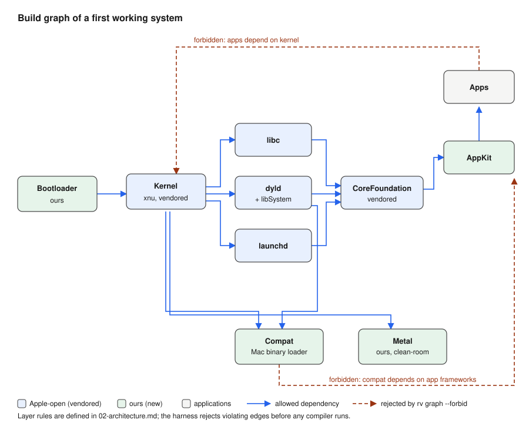

# 05 · Build system

This document specifies the ravynOS build harness: one tool, one manifest format, one graph,
from the bootloader to the last desktop app. It is for anyone who will build the system,
port it to a new target, or add a component and wonder where the manifest, the sysroot and
the license audit live. Companion pieces: `02-architecture.md` for the layer rules the
harness enforces, `03-kernel.md` for what the kernel build consumes, `11-quality.md` for the
size and performance budgets the gates check against.

The concrete implementation steps for this document live in
[15-implementation-guide.md](15-implementation-guide.md), sections 1 (toolchain and triple) and 3 (the kernel build under `rv`); current gaps are listed
in [14-status-and-gaps.md](14-status-and-gaps.md).

## Why not the status quo

PureDarwin builds with Nix flakes (`nix build .#image-minimal`), and calling cmake directly
is unsupported in their tree. Nix does what it promises: the result is reproducible. Two
things it does not give them, and by extension does not give us if we copy the model:

1. **You cannot build one component by hand.** The expression graph lives in a language that
   describes derivations, not builds. There is no documented way to sit in `src/Frameworks/`
   and compile the thing you are editing against a prepared sysroot. That pushes every
   contributor through the same blind funnel and makes debugger round-trips painful.
2. **The build graph is invisible.** Nobody can print "what depends on CoreFoundation" or
   "which components sit below AppKit" from the sources. The graph exists inside the Nix
   evaluation, and it is not inspectable, so layering rules cannot be checked against it.

Reproducibility is a property worth keeping. Opacity is not. We want all three: reproducible,
inspectable, modular. This document designs the tooling that gets all three at once.

## Requirements

Each requirement below comes with the mechanism that meets it, so a reviewer can check the
design against the claim.

**Hermetic cross-compilation from day one.** Every target is a cross target, including
x86_64 builds on x86_64 hosts. The harness prepares a per-target sysroot (headers, imported
libraries, the self-hosted parts of the system) and passes it to clang through explicit
`--sysroot` and `--target` flags. No build ever picks up headers from `/usr/include` by
accident, because there is no compiler invocation the harness does not own. Caches
(ccache/sccache, keyed on preprocessed input) sit in front of the compile step; they change
speed, not results.

**Host matrix.** Linux first, then FreeBSD, macOS, Windows. Cross-compiling removes most
host sensitivity by construction: the host provides CPU time, a compiler and nothing else.
What each host gives up, stated plainly:

| Host      | Status        | Gives up / notes                                            |
|-----------|---------------|-------------------------------------------------------------|
| Linux     | first, primary | none; this is the configuration the farm tests             |
| FreeBSD   | early          | some flags differ (linker defaults, cppflags); harness owns it |
| macOS     | early          | no native target value; useful as a fast host for developers on Macs |
| Windows   | later          | longest tail: case-sensitivity, path handling, shell glue all differ |

The point of the matrix row is not that Windows is a goal in itself. It is that the harness,
not an ad-hoc script, owns every host difference — one place to look, one place to fix.

**Deterministic and cacheable.** Compile outputs are content-addressed; two builds of the
same manifest, sources and toolchain produce bit-identical objects, so a cache hit is safe to
trust. Remote cache is optional infrastructure (sccache or an equivalent), never a
dependency: a lone contributor on the 8-CPU, 16 GB machine described in `01-principles.md` must get a
full build with no network beyond the source checkouts.

**Incremental.** Touch one file in one framework and nothing outside that framework's
dependency closure rebuilds. This falls out of the graph being real: if the harness emits a
ninja file whose edges match the manifest graph, ninja gives us this for free. The discipline
is on our side — manifests must declare what they export, so a header not listed as exported
does not leak into dependents' rebuild sets.

**Honest test integration.** `rv test` exists per component and means what it says. Component
tests run on the build host (unit tests, static checks) and, for components that need the
target, inside QEMU with the cross-compiled userland. A component that claims a test suite in
its manifest and cannot run it fails the gate, not a dashboard nobody reads.

**License audit gate.** Every file in the tree is fingerprinted against a license header
database. GPL, LGPL and AGPL fail the build — the rule in `01-principles.md` is a build gate, not a
convention. See the section below.

**Size and performance budget gates.** `11-quality.md` sets budgets for image size, boot
time and hot paths. The harness measures what it builds (section sizes per component, boot
artifact sizes) and fails the build when a change breaks a budget, with a diff of the
regression in the error message.

**Build scopes: one component to one bootable image.** The same graph and the same
commands scale from a single directory to the whole system, with no special cases:

- `rv build <component>` — one component and its dependency closure, nothing else.
  `rv build kernel` is a first-class target, not a flag combination: the kernel is just
  the component whose manifest declares mig inputs, and building it alone must be as
  fast and cacheable as building a daemon. `rv build dyld`, `rv build WindowServer`,
  `rv build AppKit` are the same story at their layers.
- `rv build <layer>` — every component in a layer (`rv build frameworks`), the natural
  unit for a lane that owns several directories.
- `rv build` — everything buildable for the target.
- `rv image [-t <target>]` — the whole-system build: runs the full graph, then assembles
  the run-time artifacts from the outputs, in the formats each wave's exit criteria name
  — the boot image (kernel + bootloader + boot-args payload), the disk image launchd
  boots from in W3, the ISO and the Mac VM demo package in W8 (wave numbers per
  [12-roadmap.md](12-roadmap.md)). Image assembly is
  manifest-described too (which components land in which partition), so an image is
  reproducible from source and auditable, never a hand-run script over build outputs.

The rule this buys: any target a lane can describe — one file's rebuild, one component,
one layer, one image — is `rv` plus a name, and CI uses exactly the commands a
developer uses, never a parallel build path that can drift.

**Manual builds that work.** `rv shell` drops you into an environment with the sysroot,
compiler flags, include paths and library paths of one component already set, where
`ninja -C build/x86_64/AppKit` (or a plain clang invocation) works. This is the thing Nix
never gave PureDarwin users, and it is a design goal, not a debugging escape hatch.

## The harness: `rv`

One entry point, a statically linked Rust binary living at `Tools/rv/` (the language is
decided on evidence in [13-toolchain-sdk.md](13-toolchain-sdk.md) §2.2: both reference
builds — PureDarwin's Nix-driven tree and upstream ravynOS's bmake/CMake glue — keep the
top-level driver out of the interpreted-scripting layer). Subcommands:

```
rv build [-t <target>] [<component>|<layer>...]   # one component, a layer, or everything
rv build sdk [-t <target>]                # assemble the SDK (13-toolchain-sdk.md §2.3)
rv bootstrap                              # build and verify the stage-1 toolchain (13 §2.1)
rv image [-t <target>]                    # whole-system build + image assembly (boot image, disk, ISO)
rv test  [<component>...]                 # run component tests
rv shell [<component>]                    # environment for manual builds
rv graph [--reverse] [--forbid]           # print the dependency graph
rv vendors [check|bump <name>]            # VENDORS file operations
rv audit [license|size]                   # run the audit gates by hand
```

Implemented today: `rv build`, `rv graph`, `rv shell` and `rv audit license`. The rest are
specified here and tracked as W0 and later exit items in [12-roadmap.md](12-roadmap.md).

Every component — kernel, bootloader, libc, dyld, launchd, each framework, each daemon,
each tool — declares itself in one small manifest at its directory root. The format is
TOML, because it parses in every language we care about and diffs cleanly. A framework
manifest:

```toml
name      = "CoreFoundation"
layer     = "foundation"             # one of the layers in 02-architecture.md's fence table
license   = "APSL-2.0"               # SPDX; must match the component's LICENSE file
state     = "incomplete"             # working | incomplete | experimental (01-principles.md)
sources   = ["Sources/**.c", "Sources/**.h"]
exports.headers = ["include/**.h"]
exports.libs    = ["libCoreFoundation.dylib"]
deps.internal   = ["libdispatch", "Libc"]
deps.system     = []                   # kernel-provided interfaces, named interfaces only
targets   = ["x86_64-ravynos", "aarch64-ravynos", "riscv64-ravynos"]
tests     = ["Tests/**"]
vendored  = { CoreFoundation = "opensource.apple.com:CoreFoundation-<tag>" }
```

Layer names are the ones the harness knows: `bootloader`, `kernel`, `foundation`,
`frameworks`, `server`, `compat`, `apps`, plus `build-toolchain` for the stage-1 tools
(13-toolchain-sdk.md §2.2). The `state` field is specified here and not yet parsed by
`rv`; until it is, the no-stubs doctrine's build states are a review rule.

A daemon's manifest is the same shape with fewer exports. The kernel's manifest adds mig
inputs (below). Nothing else is declarative; build logic that is genuinely per-component
lives in an optional `build.lua`-style hook the harness calls with a frozen API, and the
review bar for adding one is high.

The harness reads all manifests, resolves the graph, checks it (layers, licenses, budgets),
and emits a single ninja file — or the equivalent low-level format if we change our minds
about ninja. It builds nothing itself; it describes the work and lets ninja schedule it. This
keeps `rv` small and keeps the "build one component by hand" story real: the emitted file is
the same file `rv build` uses.

**No component builds by invoking cmake directly.** That is the enforced rule, stated as
strongly as PureDarwin states the reverse. CMake exists in our tree only where a vendored
upstream project ships it (and the vendored build goes through the manifest like anything
else). `02-architecture.md` defines the layer rules in prose; the harness enforces them
mechanically by rejecting cross-layer dependency edges at graph time, before a single
compiler runs.

## Layer enforcement in the graph

The manifest `layer` field is checked against the dependency direction table in
`02-architecture.md`. The failure mode we are designing against is familiar: a "temporary"
include of a higher-layer header, present for three years. The check is one line of code in
the graph resolver and it fails loudly:

```
$ rv build AppKit
error: AppKit -> WindowServer (private) violates layer rules
       frameworks may not depend on server layer
       (02-architecture.md, layer table)
```

The same resolver rejects undeclared dependencies: if a source file includes a header no
manifest exports to it, the compile itself fails under the per-component include paths, so
the graph in the manifests and the graph the compiler sees cannot drift apart.

## The build graph



Figure: dependency DAG of a first working system. Solid arrows are allowed edges; the two
dashed arrows marked with a cross are edges the harness forbids.

Reading it: bootloader and kernel are the foundation; libc, dyld and launchd sit on the
kernel's ABI; CoreFoundation sits on libc; AppKit sits on CoreFoundation and the graphics
stack; apps sit on AppKit. Compat (the Mac-binary loading path) and Metal are parallel
branches — Compat depends on libc and the loader, Metal on the kernel's driver interfaces
and the shader compiler. Neither is on the critical path to a first boot, and the graph
shows that.

## Hermetic cross-compilation in practice

Target triples, pinned:

| Target                        | Notes                                            |
|-------------------------------|--------------------------------------------------|
| `x86_64-ravynos`              | the first working system; farm hardware matches  |
| `aarch64-ravynos`             | cross-compiled; tests run under QEMU             |
| `riscv64-ravynos`             | cross-compiled; QEMU for tests; least mature     |

These are the harness's target names. They are not yet valid LLVM triples for our
purpose: stock clang does not know a `ravynos` OS and silently emits **ELF** for
`x86_64-ravynos`, so today's W0 build produces ELF objects. The harness must map each
name to a triple that emits Mach-O with the load commands we commit to — the open
question in [13-toolchain-sdk.md](13-toolchain-sdk.md) — and CI asserts the object format
so the mistake cannot return silently.

Each target gets a sysroot under `build/sysroots/<target>/`, assembled by the harness from
the manifests: headers and libraries from `exports.*` of components already built for that
target, plus the imported external libraries the VENDORS file pins. The sysroot is a build
output, not a checked-in binary blob, so it is reproducible from source and auditable.
The sysroot is the internal, per-build view; the SDK that `rv build sdk` assembles under
`build/sdk/<target>/` (13-toolchain-sdk.md §2.3) is the published view of the same
outputs — headers, `.tbd` link stubs, module maps and `SDKSettings.json`. Components
build against the sysroot; applications build against the SDK.

The compiler is clang, the linker is lld (`ld64.lld` for Mach-O), both driven by the harness's own flag table. There
is no `configure` and nothing probes the host: the flag table says exactly what each
target-and-host pair gets, which is where the host-matrix differences (linker defaults,
cppflags) live. Flags that differ between hosts are data in the harness, reviewed in one
place, not folklore in component makefiles.

## Caching, determinism, incremental

Objects are content-addressed by a hash of: preprocessed source, resolved compiler flags,
target, and the header set the manifest exports to this component. Two consequences:

- A cache hit from another developer or a remote cache is exactly as trustworthy as a local
  build, because the key covers everything that could change the bytes.
- Rebuild closure is honest. Changing a private `.c` file invalidates one object. Changing an
  exported header invalidates exactly the components that declared (and received) that
  export. Nobody can be surprised by a hidden dependency, because hidden dependencies fail
  the build instead of hiding.

Remote cache (sccache or equivalent) is optional and unauthenticated against a project-run
endpoint; a machine with no network does a full local build.

## Tests, license audit, budgets

**Tests.** `rv test <component>` runs what the manifest declares: host-side unit tests as
native binaries, target-side tests under QEMU with the component's cross-built dependencies
in the sysroot. The gate is that declared tests run and pass in CI; a skipped test is a
manifest change, reviewed like code.

**License audit.** Every file carries an SPDX header; `rv audit license` checks each
against the accept list today. The design adds a license header database (SPDX
expressions plus the exact header texts we accept) and content fingerprinting, so that a
GPL-derived rewrite with a false header is caught too (DESIGN.md §6.2). At build time,
every file is checked:

- accept: APSL, BSD, MIT, Apache-2.0, Zlib, ISC, public domain (per `01-principles.md`)
- fail: GPL, LGPL, AGPL — any version, anywhere, including build tooling we link or run
- every vendored file keeps its upstream header; a stripped header fails the audit

The audit runs as a build step, not a CI afterthought, so a bad import cannot enter the
tree through a local build. `rv audit license` runs it by hand with a report of what and why.

## Tooling boundary

"No GPL in the build" needs a line drawn, because every build runs on some host with some
operating system under it. Three classes:

| Class | Examples | Rule |
|---|---|---|
| In the tree | our code, vendored sources, generated files we commit | No GPL, LGPL or AGPL. Enforced by the license audit |
| Build tooling | compilers, linkers, assemblers, parser and lexer generators, archive and image tools, anything whose output or code enters a build artifact | No GPL, LGPL or AGPL, even when the tool grants an output exception. clang/lld (Apache-2.0 with LLVM exception), byacc (public domain), flex (BSD), ninja (Apache-2.0) qualify; GNU bison, GNU as/ld, GCC and GRUB do not |
| Host environment | the build host's kernel, shell, coreutils, git, QEMU and OVMF as test executors | Allowed, because nothing they contain reaches an artifact. They are recorded in the build log, never vendored, never invoked to produce bytes that ship |

The test for a borderline tool is the artifact: if any byte of a release image, the SDK or
a committed file was produced by the tool's code (including a generated parser skeleton or
a bootloader embedded in an image), the tool is build tooling. Under that test the old
GRUB rig in `Kernel/build/boot/` is a violation being retired, not an exception. The
mechanical side exists: `Tools/ci/check-host-tools.sh` fails CI when a script under
`Boot/`, `Tools/`, `Tests/` or `.github/` invokes a GPL program (11-quality.md, "Host
tools are gated too"). Rust crates `rv` and kite depend on are build tooling and are
scanned by the license gate.

**Budgets.** `11-quality.md` owns the numbers; the harness owns the measurement. Per-target
artifact sizes and section sizes per component are recorded on every build, compared against
the budget table, and a regression fails the build with the old and new numbers in the error.
Performance budgets are measured by the test runner on the reference hardware, not inferred.

## `rv shell`

```
$ rv shell CoreFoundation
[CoreFoundation x86_64-ravynos] $ ninja -C $RV_BUILD_DIR
[1/1] link libCoreFoundation.dylib
[CoreFoundation x86_64-ravynos] $ clang -### -c Sources/CFString.c  # shows the exact flags
```

The shell exports `CC`, `CFLAGS`, `--sysroot`, include and library paths, and `RV_BUILD_DIR`,
all derived from the same manifest and flag table the normal build uses. Manual builds and
harness builds cannot disagree, because they read the same configuration; the shell is a
view onto the emitted ninja file, not a parallel definition of the build. This is the
property Nix never delivered to PureDarwin users, and it is what makes the harness
inspectable rather than merely present.

## Toolchain and mig

**Where mig-generated headers come from.** The kernel's manifest lists its `.defs` files;
the harness runs `mig` — Apple's migcom, vendored and built as a host tool with its own
manifest (`03-kernel.md`) — over them and places the generated headers in the kernel's
build directory and, for the userland-side stubs, into the sysroot of the targets that
need them. A reference copy of the generated output is committed as a regression fixture;
the build always regenerates and fails if the two differ, so a mig or `.defs` change
cannot alter the IPC surface unnoticed. `03-kernel.md` owns the list of kernel interfaces
that go through mig; the harness owns running it at the right time and invalidating
dependents when a `.defs` file changes.

**Where vendored Apple sources are pinned.** A single `VENDORS` file at the tree root pins
every external source, with the exact tag from the release index at
https://opensource.apple.com/releases/ (Apple's open-source downloads live on GitHub under
github.com/apple, indexed per release at https://opensource.apple.com/projects/):

```toml
[vanillas."opensource.apple.com:xnu"]
tag     = "xnu-12377.121.6"          # bumps to the xnu-13432 line when Apple publishes it
license = "APSL-2.0"

[vanillas."opensource.apple.com:libdispatch"]
tag     = "libdispatch-1273.40.2"
license = "Apache-2.0"
```

The pins we care about most today: the vendored kernel in this clone is xnu-12377.121.6
(Darwin 25.5 generation) and the design upgrades it to the xnu-13432 line (Darwin 27.2.0,
shipped in macOS 27.2.1, build 26B131 — see
https://developer.apple.com/news/releases/?id=11092026d and
https://macosdb.com/macos/release/27.2.1-26B131/) when Apple publishes the source. The
VENDORS file is where that bump happens.

**How updates happen.** Bump the tag, `rv build` the component and its dependents, run the
component's diff test: a scripted comparison of exported symbols, mig-generated headers and
public structure layouts before and after the bump. Symbol or layout changes that are not
explained in the same commit fail review. `rv vendors check` reports pins that are stale
against the release index. The diff test exists because the dangerous part of an Apple
source bump is not the code that stops compiling — it is the ABI that quietly changed.

## What this does not solve

- Bootstrap of the toolchain itself (compiler, mig, host tools) is out of this design's
  scope by choice — it is the three-stage native bootstrap specified in
  [13-toolchain-sdk.md](13-toolchain-sdk.md) §2.1 (host clang → our cross-toolchain →
  self-hosting), not an unsolved gap. This design assumes its stage-1 output and pins it.
- QEMU test fidelity is not hardware fidelity; target-side tests catch logic errors, not
  driver timing. `11-quality.md` and the hardware testing plan own that gap.
- Windows as a build host is designed-for, not yet specified; its flag table row will be
  written by whoever does the port, in the harness, not in component directories.

## Open questions

- Manifest format: TOML holds the shape we need, but a second opinion (JSON with comments?
  Starlark?) before the first hundred manifests is cheaper than a migration after.
- How much of ninja's semantics do we rely on? If `rv` should also emit to another executor
  (a distributed build farm, Bazel's protocol), the emission boundary needs defining now.
- The license header database will have false positives on vendored files with unusual
  formatting; the appeals process (who re-fingerprints a file by hand) is unwritten.
- `rv graph --forbid` is accepted but does nothing distinct today: layer checks run on
  every graph resolution. Keep the flag as a no-op alias, or give it a meaning (print every
  edge the fences would reject, without failing)?
- Whether `rv graph` should gain a "what breaks if I change this header" query as a
  first-class command, or stay a filter on the printed graph.
