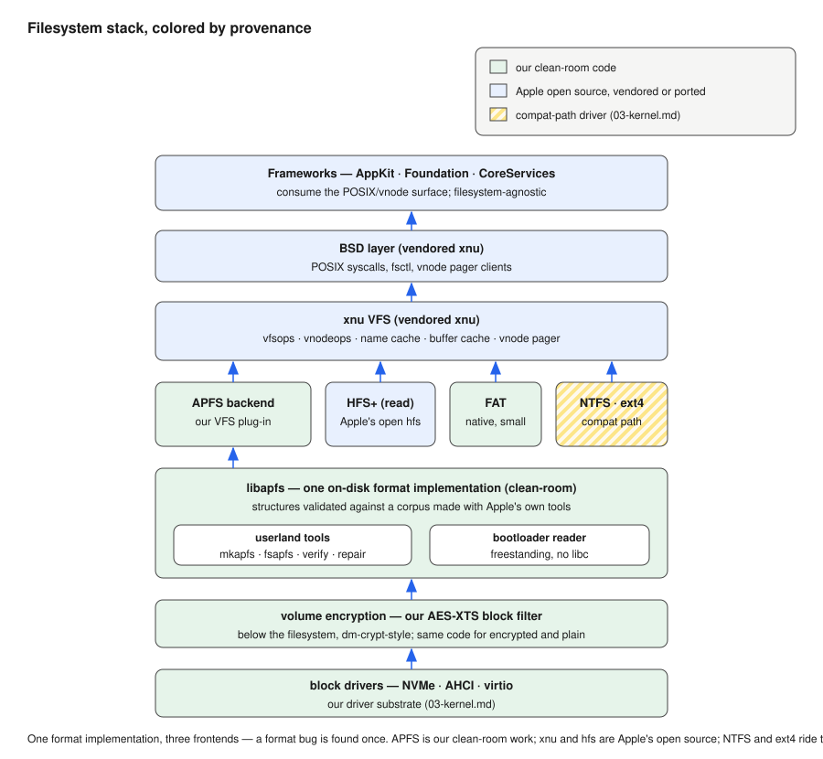

# 06 · Filesystem

This document specifies ravynOS's filesystem stack: APFS as the root filesystem, the
clean-room implementation plan that gets us there, the secondary filesystems for migration
and interoperability, and what we have to measure. It is for anyone working on the VFS
backend, the volume tools, the bootloader's APFS driver, or the installer. Related reading:
`03-kernel.md` (where the VFS plug-in and the compat driver path live), `04-boot.md` (the
loader's APFS driver), `05-build-system.md` (the cache volumes this design serves).

## The decision: APFS is the root filesystem

When ravynOS moved to the Darwin base — xnu — the filesystem choice was made for us, and we
agree with it (Discussion #529, 2025-10-29, https://github.com/ravynsoft/ravynos/discussions/529).
XNU expects APFS on the boot volume; that is the configuration Apple's open-source kernel
actually runs, and every upstream code path we care about is tested against it. ZFS as root
is what the old FreeBSD-based install script sets up, and that is the old path now.

APFS brings properties the system is designed around:

- **Checksumming** of metadata (and optionally file data), so corruption is detected instead
  of silently served.
- **Copy-on-write** everywhere, with crash consistency that does not depend on an external
  journal replay tool.
- **Snapshots and clones**, which the build system (below), the backup story and system
  updates all lean on.
- **Per-container space sharing**: volumes in a volume group share one free-space pool, so
  "the read-only system volume" does not need a size guessed at install time.
- **The volume group model**, which is what the Mac directory layout (`/System`, `/Users`
  as separate volumes in one group, `/private/preboot`, the sealed-system-volume machinery)
  assumes. Our directory layout mirrors the Mac one; it would fight the filesystem not to
  give it the same model.

HFS+ stays read-capable for migration — Apple's hfs source is open (it is part of what the
ios-sweet project boots with, and it is in Apple's open-source releases), so a read
implementation is a matter of porting and licensing discipline, not behavioral study.
FAT, NTFS and ext4 are secondary filesystems; NTFS and ext4 ride the compat driver path
described in `03-kernel.md` rather than a native xnu VFS backend each.

## The hard truth

Apple has never open-sourced APFS. Say it plainly and design around it. What is public:

- **The on-disk format is documented by outside researchers** — notably the nxfs / apfs
  reference work and the `apsfstools` project's nx common structure documentation — good
  enough to write a reader, with care.
- **Apple's own binaries implement it**: every macOS system ships `mkfs.apfs`-equivalent
  tools, `fsck_apfs`, and the kernel driver. We can create reference volumes and study
  their behavior.
- **Existing reader implementations** exist, of varying provenance and license (Linux
  staging `apfs` driver, various FUSE readers, `apfs-fuse`, `apsfstools`). Some are GPL,
  which we cannot touch per the license policy in FACTS.md.

We do not get the format specification from Apple, we do not get the source, and we do not
get their encryption internals. Everything below follows from that.

## Clean-room discipline

The rule in FACTS.md is: study observable behavior, write our own implementation, never copy.
For filesystems the discipline is sharper because the format has both open documentation and
GPL implementations of it:

- **Read behavior, never code.** We may read the outside format documentation, run Apple's
  tools on reference volumes, and diff `hexdump` output of known states. We may not read
  GPL-licensed source (the Linux staging driver, `apfs-fuse`) or BSD-licensed source with
  attribution requirements we cannot meet cleanly, and then write "ours" — that poisons the
  clean-room claim for the whole tree.
- **Two-party implementation.** Engineers who have read third-party APFS implementation
  code do not write our APFS code. The license audit gate (05-build-system.md) fingerprints
  every file; the APFS tree additionally gets a provenance note per file, so an audit can
  tell "written from the nx format docs and reference volumes" from "written by someone who
  read apfs-fuse last week".
- **Reference volumes are the spec.** We build a corpus of APFS images with Apple's own
  tools (create, snapshot, clone, grow, corrupt, repair) on macOS hosts, commit the volume
  *generation scripts* (not the volumes) to the tree, and test our implementation against
  them. Any behavior question is settled by making a volume and observing, not by guessing.

## Two pieces: userland first, kernel second

A filesystem is two designs, not one, and the order matters.

**Piece one: the userland library.** `libapfs`, plus `mkapfs`, `fsapfs` (list, stat, read,
extract) and `apfs_verify`/`apfs_repair` as userland tools. Fully unit-tested against
volumes made by Apple's tools. This piece is where correctness gets built: on-disk structures
are just C structs over a block device, testable on any host, no kernel debugging loop, and
a bug is a failed assertion rather than a panicked machine. It also gives the bootloader
(04-boot.md) and the installer something to link before the kernel backend exists.

**Piece two: the xnu VFS backend.** The same library's structures, wired into the kernel as
a VFS plug-in. This is the piece that makes APFS the boot volume. It lands after the userland
library passes its corpus, because debugging the on-disk format *and* the kernel interface at
the same time is how filesystem projects die.

| Piece        | Ships            | Tested against                        |
|--------------|------------------|---------------------------------------|
| `libapfs` + tools | first       | volumes made by Apple's tools (corpus) |
| xnu VFS backend | second        | same corpus under QEMU, then hardware  |

### The conformance corpus

The corpus is the spec, so it gets the same care as the code. Each case is a script that
uses Apple's tools on a macOS host to produce a named volume state, plus the assertions our
implementation must pass against it:

| Corpus case                  | Produced by            | Our assertion                          |
|------------------------------|------------------------|----------------------------------------|
| fresh `mkapfs` volume        | Apple's format tool    | structures parse; superblock checksums pass |
| after 10k file creates       | scripted file activity | object map, trees consistent; read matches source tree |
| snapshot taken, files change | Apple's snapshot tools | snapshot read yields the old contents   |
| clone of a directory tree    | Apple's clonefile      | clone reads identically; writes diverge |
| volume grown, volume shrunk  | Apple's resize tools   | space accounting stays correct          |
| deliberately corrupted block | bit-flip script        | verifier flags it; repair restores or refuses loudly |
| encrypted volume, ours       | our `mkapfs --encrypt` | mounts with the right key; fails closed without it |

The scripts run on macOS hosts in the project farm. A contributor without a Mac tests
against generated fixtures checked into the repository, and the farm is the authority.

## Directory layout and the volume group

The Mac layout is a property of the volume group, not of any single volume, so we specify
the group and not just the mount points:

- A **system volume**, intended read-only, holding the OS: `/System` and the kernel cache.
  Sealed by our own scheme when created with sealing on.
- A **data volume** in the same group, holding `/Users`, `/private/var`, and the writable
  halves of paths that Mac treats as firmlinks (`/usr/local`, `/opt`). Firmlinks themselves
  are a Mac filesystem feature we have to decide on: either we implement them in the VFS
  backend or we define our own union of the two volumes and say we did. Unsettled; see Open
  questions.
- A **preboot volume** per system volume, holding what the loader needs to boot it, and a
  **recovery** entry when the installer makes one.

The installer creates the group, the roles and the mount table together. Free space is
shared across the group, which is the point: a user filling `/Users` cannot fail a system
update for lack of space on a differently-sized partition, and a growing build cache volume
steals space from the same pool it borrows from.

Figure: the filesystem stack from block device to frameworks. Green boxes are our clean-room
work; blue boxes are Apple-open source we vendor or port; the striped box is a compat-path
driver.

## The xnu VFS plug-in surface

We implement against the VFS interface xnu actually publishes in its open source: the
`vfsops` / `vnodeops` operation vectors, mount entry points, the name cache, the buffer
cache interactions, and the pager (vnode pager) hooks that mmap depends on. This is not
guesswork — the vendored xnu source in this clone (xnu-12377.121.6, to be upgraded to the
xnu-13432 line per 05-build-system.md) contains the hfs and, where shipped, apfs backends as
the reference shape for what the kernel calls and when.

What the backend has to get right, in rough order of pain:

- **Copy-on-write transaction semantics** under xnu's buffer cache, which assumes it may
  cache blocks that the filesystem must not then rewrite in place.
- **The vnode pager**, so memory-mapped files (which every Objective-C framework, dyld
  included, relies on) stay coherent with writes and snapshots.
- **Snapshots and clones** exposed through the mount and ioctl interfaces the upper layers
  expect (`fsctl`-style calls; see the snapshots section).
- **Space accounting across the volume group**, because per-container free space is a lie
  per volume unless the group is in on it.

`03-kernel.md` owns the kernel-side interfaces; this document owns the filesystem behavior
behind them.

## Encryption

We cannot ship Apple's FileVault internals. Their implementation is closed, and the
key-wrapping and volume-key machinery around APFS encryption volumes is part of what Apple
did not publish. Being honest about what we do instead:

- **Our own volume encryption layer**: AES-XTS under our control, using a BSD/Apache
  primitive or code studied under the same clean-room rule as everything else — apple's
  corecrypto is source-available under its own APSL-style license
  (https://github.com/apple/corecrypto) and is a candidate, with a per-file license check
  before any import (FACTS.md). The layer sits below the filesystem, as a dm-crypt-style
  block-device filter, so `libapfs` and the VFS backend are written once for encrypted and
  unencrypted volumes alike.
- **The compatibility boundary is clear and narrow**: we can read and write *our* encrypted
  volumes; we cannot claim to unlock FileVault volumes created by macOS whose keybag
  machinery we have not implemented. An encrypted volume made by macOS mounts as "encrypted,
  unsupported", not as "corrupt". Nothing in our installer or tools pretends otherwise.
- Password and key management is ours: PBKDF wrapped keys in the volume header, the passphrase
  prompt lives in the boot loader and in `rv`'s volume tools, not in a ported Apple keychain
  daemon that expects services we did not build.

The trade-off is real: a macOS user's FileVault disk does not carry over. We say so in the
installer instead of half-supporting it.

## Snapshots and backups

Snapshots are per-volume, copy-on-write, named, and enumerable. The consumer list:

- **System updates**: snapshot before mutating the system volume; a failed update boots the
  snapshot. This is the same shape macOS uses, and our volume group layout is built for it.
- **Time-machine-style backups**: our backup tool takes periodic snapshots on the destination
  volume and hard-link-or-clone deduplicated exports. The schedule, retention and the
  on-disk format of the backup store are ours; APFS gives us cheap snapshots and clones to
  build them from, not a backup protocol.
- **The build cache**: see the performance section.

The userland tools (`libapfs` + `apfs` CLI) own snapshot create/list/delete before the kernel
backend does, for use on volumes from other systems and in tests.

## The boot volume role in the bootloader

`04-boot.md` owns the loader; this section fixes what it must contain. The loader needs an
APFS *reader* — enough of the format to find the boot volume in a volume group, follow its
snapshot pointer, and read the kernel Mach-O out of it. That reader is a third consumer of
`libapfs`'s structures: a no-allocation-hostile, freestanding build of the same on-disk
code the userland library validates against the corpus. One format implementation, three
frontends (userland tools, kernel backend, loader reader), so a format bug is found once.

The loader also reads the sealing information if a volume carries it (our own scheme; the
macOS sealed-volume key roots are not available to us — same honesty as the encryption
section) and hands the kernel the volume role and UUID it expects in `boot_args`.

## Secondary filesystems

| Filesystem | Role                          | Implementation path                       |
|------------|-------------------------------|-------------------------------------------|
| HFS+       | migration read from old volumes | port of Apple's open hfs source, read-capable |
| FAT        | ESP, USB sticks, cameras      | native, small, in-kernel                   |
| NTFS       | interop with Windows volumes  | compat driver path (03-kernel.md)          |
| ext4       | interop with Linux volumes    | compat driver path (03-kernel.md)          |

HFS+ read is the migration requirement, not a legacy support promise: the installer offers
to import a user's files from an HFS+ volume, and the system mounts HFS+ read-only by
default. Write support is out of scope until read is proven and someone owns it.

## Performance

What APFS buys us, and what we have to measure. No numbers here are invented; the baselines
get filled in from measurement on the reference hardware when the implementation exists.

**What it buys:**

- **Fine-grained snapshots** at update, backup and (optionally) commit boundaries, at a cost
  on the order of metadata writes, not data copies.
- **Low-overhead clones for builds.** `rv` (05-build-system.md) stages per-target sysroots
  and cache volumes as APFS clones of a base volume: a clone is nearly free at creation and
  shares storage until written. The build cache volume, the sysroot volume and the test
  scratch volume are all clones; a clean build tree is `clone` + `rm`, not `cp -a`.
- **Copy-on-write across the volume group**, so the system volume can be snapshotted during
  a build without pausing it.

**What we must measure** (fs.mark and build-tree operation suites; targets set in
`11-quality.md`):

- fs.mark-style throughput and latency for metadata-heavy operations: source trees are
  metadata workloads, and APFS CoW can be slower than ext4 at them on some workloads. We
  measure, we do not assume either direction.
- Build-tree operations end to end: `clone + rm` vs `cp -a` of a sysroot-sized tree, git
  status over a cloned tree, `ninja` no-op rebuild time on a clone.
- Snapshot create/delete cost at realistic volume sizes, because backup tooling will do it
  on a schedule a user feels.
- Encrypted-volume overhead versus plain, since our encryption layer is below the filesystem
  and every byte moves through it.

The measurement harness lives with the test runner (`rv test` targets), so the numbers are
produced by the same build that produces the system.

## Open questions

- Volume group layout details: how many volumes (system, data, preboot, VM, recovery), and
  whether we reproduce the macOS roles exactly or define our own subset. This interacts with
  the installer and `04-boot.md` and is not settled here.
- The snapshot ioctl/`fsctl` interface our upper layers will use: define it once, early, so
  the backup tool and the updater do not each invent one.
- Whether the loader's APFS reader is freestanding-compiled `libapfs` or a separately
  audited subset; freestanding is less code to keep honest, but drags libc assumptions in.
- Which primitive wins for AES-XTS: corecrypto under its APSL-style license, or a
  BSD/Apache implementation. The per-file license check decides, not preference.
- Repair semantics: `apfs_repair` in userland can fix what fsck_apfs fixes on the corpus,
  but our repair will be less complete than Apple's for years. What the tool does when it
  cannot fix a volume (refuse? salvage?) needs a policy before the first release.
- Compat driver path capabilities for NTFS and ext4 (read-write? journal replay?) are owned
  by `03-kernel.md`; this document assumes read-write eventually and promises nothing.
