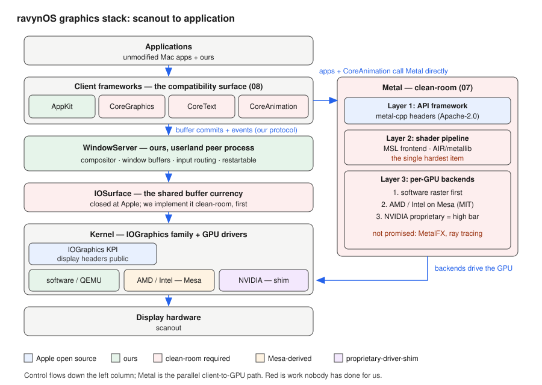

# 07 — Graphics

> Background document. [SYSTEM-DESIGN.md](SYSTEM-DESIGN.md) is the design of record; where this document disagrees with it, SYSTEM-DESIGN.md is right. Status lives only in [STATUS.md](STATUS.md).

This document covers the graphics stack from scanout to application: the
kernel's display services, the window server, CoreAnimation, the client
frameworks, and Metal. It is for anyone working on the window server, a GPU
backend, or a graphics framework. The frameworks themselves — who writes them
and from what source — belong to [08-frameworks.md](08-frameworks.md); this
document owns the server, the kernel-side display surface, and Metal.

## The stack, scanout to application

Read the figure bottom-up for hardware, top-down for how a frame is born. A
client app draws into buffers, commits them through CoreAnimation; the window
server composites committed buffers and hands the result to the display
driver; the display driver scans it out. Metal is the direct path to the GPU
that apps and CoreAnimation both use, parallel to the window-server path.

Figure: the graphics stack from scanout to application, colored by where each
piece comes from. Red boxes are work nobody has done for us.

Three properties of this stack shape everything below:

- **The window server is a peer process**, not a kernel service. It owns the
  GPU and the framebuffer, runs the compositor, and publishes a Mach port
  clients connect to ([02-architecture.md](02-architecture.md)). It can crash
  and be restarted without taking the system down.
- **Buffers move through shared memory, control moves through messages.** The
  bulk-pixel path is IOSurface — kernel-referenced shared memory — and the
  control path is Mach IPC, matching the process architecture in
  [02-architecture.md](02-architecture.md). No pixel is ever copied into a
  message.
- **The client side is where compatibility lives.** Unmodified Mac
  applications link our CoreGraphics, CoreAnimation and AppKit; they never
  speak to the server directly. The frameworks are the contract, and their
  design is the subject of [08-frameworks.md](08-frameworks.md).

## What the kernel provides

The kernel's job in this stack is small and strictly defined: scanout, display
mode control, buffer sharing, and the kernel side of GPU memory. It does not
composite, and it knows nothing about windows.

**The IOGraphics family.** The driver interfaces an XNU display stack expects
are the IOKit graphics families — framebuffer, display, accelerator — whose
headers ship in the public SDK and therefore define the KPI surface our
drivers must satisfy regardless of implementation. Which of these families
Apple has published as source in the current generation is a per-release
question we check against the index at
[opensource.apple.com/releases](https://opensource.apple.com/releases/); we do
not assume. What we add ourselves is the platform side — the port layers that
program scanout hardware, per [03-kernel.md](03-kernel.md). On our GPU-less
build machines that platform side targets QEMU's virtual display devices
first, which is enough to bring up the whole userland stack before any real
GPU exists.

**IOSurface.** The buffer-sharing primitive underneath everything: the
currency in which window content, compositor output, decoded video frames and
GPU memory all move. Apple's implementation is closed; the SDK headers define
the API. We implement it clean-room, and it is small enough in concept to be
one of the first graphics components we write: allocate, wrap, share between
processes, map on the GPU. Every layer above depends on it, so it lands early
and stays boring.

**GPU kernel-mode drivers.** The strategy question — a Linux DRM KPI shim
running ported drivers versus a native IOKit GPU family — was decided
2026-11-26 in [03-kernel.md](03-kernel.md): the **native IOKit GPU family
comes first**; the DRM KPI shim is a deferred compatibility layer for
foreign drivers (NVIDIA's), contract-tested in `Tests/kpi/drm`. This
document depends on that answer only for its vocabulary: whichever path a
given device takes, the userland drivers above it speak our IOKit
accelerator KPI, and the choice does not change the shape of Metal or the
window server.

## The window server

The window server is the piece of the GUI story that macOS ships closed and
we must write whole. It composites, it owns window buffers, it routes input
events to the application that owns the window under the cursor, and it
programs the display. Its job description is easy to state. The design
decisions around it are not, and they deserve to be argued.

### Design goal, stated once

Applications speak the same public client-side APIs Apple applications speak —
CoreGraphics, CoreAnimation, AppKit, as we implement them in
[08-frameworks.md](08-frameworks.md). The server owns compositing, window
buffers and input routing. Everything else follows.

### Why not Wayland or X11

The obvious shortcut is to build on an existing desktop stack: a Wayland
compositor with the frameworks rendering into it, the way everyone who has
tried this has tried it first. We are not taking that road, and the reasoning
matters more than the conclusion.

PureDarwin is the standing existence proof of the shortcut, and their result
deserves a factual account: their desktop is a Wayland compositor ("Argon",
on their neuswc/neuwld) plus X11, with their own AppKit, CoreGraphics,
CoreText, QuartzCore and OpenGL under `src/Frameworks` — BSD-licensed
mySTEP-lineage code. Stock macOS Firefox has run unmodified against this
stack since October 2026
([github.com/PureDarwin/PureDarwin](https://github.com/PureDarwin/PureDarwin)).
They got a desktop. The limitation is equally factual: their compositor is a
Wayland/X11 compositor rather than the protocol macOS graphics machinery
assumes, and their AppKit talks to their own RPC protocol, so stock Mac GUI
applications still do not run against it.

Firefox is the informative data point in both directions. A browser carries
its entire widget layer inside itself and only asks the desktop for a surface
and input, so it runs over almost any competent compositor. An application
built on AppKit — Terminal, System Settings, half the Mac software catalogue —
asks the desktop to *be* AppKit's backend. For those applications the
compatibility surface is not the protocol and not the compositor; it is the
observable behavior of the client frameworks. That is our goal, and it is a
different constraint from "get a desktop running".

There is also a negative argument. Wayland's protocol model — the compositor
as authority, clients as surfaces — overlaps our problem and then stops. Our
clients expect to hand the server pre-composited layer trees with transform
hierarchies and commit semantics (CoreAnimation), not flat buffers. We would
spend our effort extending a protocol whose core assumptions do not match,
and still own every line of the framework code on top. A protocol we design
next to the frameworks that are its only clients costs the same and fits.

### The compatibility surface, and the honest hard part

Here is the part of this document to read twice.

Unmodified applications never touch the wire. They link CoreGraphics,
CoreAnimation and AppKit — our builds, on our system — and the wire protocol
between our frameworks and our window server is a private interface between
two components we own. We design that protocol around what the frameworks
need: IOSurface buffer hand-off, layer-tree commits, event delivery, and a
reconnection story for server restarts. It is ours to shape.

What is *not* ours to shape is what stock applications observe through the
frameworks: every method's return value, every CGContext semantic, every
event field, every timing behavior an application has come to depend on.
Apple has never documented or published the WindowServer. What we have is the
public headers and documentation of the client frameworks, and the observed
behavior of Apple's binaries. Exactly what wire behavior stock applications
expect is therefore knowable only by studying both — which makes this a
clean-room-with-study effort under the same rules as Metal: study observable
behavior, write our own implementation, never copy anything derived from
Apple's compiled code into the tree ([01-principles.md](01-principles.md)).

Private SPI belongs to that surface too. Some shipping applications and many
utilities call undocumented CoreGraphics/SkyLight functions (the `CGS*` and
`SLS*` families: window levels, spaces, event taps). Those calls land in our
frameworks, not on the wire, so they are framework work like any other —
specified from observed behavior, implemented by us — and W7's closed-source
ladder ([12-roadmap.md](12-roadmap.md)) is where the needed set gets
measured.

The practical consequence: the protocol is versioned and documented in this
tree like any other contract, but it is allowed to change freely while no
client outside our own frameworks depends on it. The framework behavior, by
contrast, is pinned by the applications. When the two conflict, the framework
side wins and the protocol moves.

### Restartability

The window server is restartable without losing applications. launchd owns
the process and relaunches it after a crash or an explicit kill, the same
mechanism that governs every daemon ([02-architecture.md](02-architecture.md)).
The design makes that more than a slogan:

- Client window buffers live in IOSurfaces referenced by the kernel, so they
  survive the server's death. An application's rendered content is not lost
  because the compositor crashed.
- Clients watch their connection port for death, re-establish the connection
  through the bootstrap port, and re-attach their surfaces. An application
  experiences a server restart as a lost frame or two, not a crash of its own.
- The server rebuilds its scene from what clients re-attach, so the desktop
  reassembles without every application redrawing from scratch.

This is exercised in CI, not asserted: a test kills the window server under
load and fails if any client application exits or fails to reconnect. A
restart path that has never been executed is a claim, not a property.

## Metal, stated plainly

Apple has not released the Metal implementation. What exists publicly is the
API documentation (https://developer.apple.com/metal/), the sample-code
library (https://developer.apple.com/metal/sample-code/), and metal-cpp — the
header-only C++ interface, Apache-2.0, covering the full Metal 4 API surface
through macOS 27 / iOS 27 and the Apple11 GPU family
(https://developer.apple.com/metal/cpp). Metal is the hardest gap in the
project, and we say so plainly instead of glossing it: the headers define the
ABI we must satisfy; the implementation — API internals, shader pipeline,
compiler, GPU drivers — is ours to write.

### Layer 1: the API framework

The public header surface, satisfied against the metal-cpp definitions and
the documented semantics. This layer is testable without any GPU at all —
every call can be validated against a software backend — which is precisely
why it comes first on our GPU-less build machines
([01-principles.md](01-principles.md)). An application that links Metal,
creates devices and command queues, encodes commands and gets correct pixels
out of a software rasterizer is a real, testable milestone.

### Layer 2: the shader pipeline

The single hardest item in the project, and the reason no one has done this
before. Two distinct problems hide inside it:

- **Consuming existing shaders.** Unmodified applications ship precompiled
  `metallib` libraries containing AIR bytecode. Running those applications
  means parsing AIR/metallib and translating it to something our backends
  execute — formats Apple has not documented, knowable only by study. This is
  the compatibility-critical half and it exists whether or not we ever
  compile a line of Metal ourselves.
- **Compiling Metal Shading Language.** The MSL frontend plus a compiler
  backend to each GPU's ISA. The language is documented publicly; the
  toolchain is not. A from-scratch MSL compiler backend per GPU family is a
  compiler project of the first order, and we treat it as its own
  multi-year workstream rather than a subtask of "Metal".

### Layer 3: per-GPU backends

The plan is ordered by honesty, not by desirability:

1. **Software rasterization first.** All of layer 1 and the API-level tests
   run on our GPU-less development machines against a CPU rasterizer. This
   follows from the machine reality — x86_64 Linux hosts, 8 CPUs, 16 GB RAM,
   no GPU ([01-principles.md](01-principles.md)) — and it is not a
   consolation prize: it makes the entire API surface testable in CI.
   ios-sweet's result (unmodified iOS userland at roughly 20–30 fps on pure
   CPU rendering, https://github.com/dipa-studio/ios-sweet) is evidence that
   CPU rendering carries a real desktop further than intuition suggests.
2. **AMD and Intel through Mesa infrastructure.** The compiler backends and
   driver infrastructure Mesa ships for these GPUs are MIT-licensed —
   acceptable under our license rules, after the per-directory audit, since
   Mesa carries a few differently licensed files — and the compiler work for
   our backends can build on them. The kernel side is a native IOKit GPU
   driver first ([03-kernel.md](03-kernel.md)). PureDarwin reaches AMD/Intel/nouveau GPUs
   through their in-kernel driver compatibility layer and Vulkan through
   Mesa, which tells us the licensing and the architecture both hold.
3. **NVIDIA proprietary userspace as the high bar.** NVIDIA's own driver is
   the only practical path to their newer GPUs, and PureDarwin has proved
   the route: NVIDIA's 580 driver running through their PDNLoader, with
   nvidia-smi and Vulkan working. Ours is the same shape — the Linux KPI
   shim in the `compat` layer ([02-architecture.md](02-architecture.md))
   hosting NVIDIA's open kernel modules, taken under their MIT option
   ([03-kernel.md](03-kernel.md), "License eligibility"), under a proprietary
   userspace we do not modify. We do not write the shim until layers 1 and 2
   exist; a proprietary driver with nothing above it proves nothing.

### What we do not promise

MetalFX and ray tracing are out of scope until the base pipeline runs real
applications, and we attach no date to them. Writing them down here as
"later, unscheduled" is the honest form; promising them in the same sentence
as layer 1 would be the dishonest one.

## What we instrument

Frame latency and IPC budgets are system-level numbers and belong to
[11-quality.md](11-quality.md). What belongs here is the instrumentation that
makes those budgets measurable on this stack, shipped with the components
they measure:

- **Swap-to-photon latency.** The analog of the classic metric: a timestamp
  at client buffer commit (the CoreAnimation commit), one at compositor
  start and end, and one at scanout from the display driver's vblank
  timestamp. Because we define the pipeline, we define the checkpoints — and
  every one of them is a trace point, not a guess.
- **Composition cost.** Per frame and per layer: composite time in the
  server, broken out by layer count and pixel throughput. A compositor whose
  cost grows with total window count rather than visible pixel count is
  broken; the instrumentation should show it the day it happens.
- **Buffer copies.** Count and bytes per frame. The design target is zero
  copies on the steady-state path — IOSurface hand-off end to end — so every
  copy is a counted anomaly with an owner, not a rounding error.
- **IPC round trips.** Per event delivery and per commit, because the control
  path is Mach messages and a chatty protocol shows up here first.
- **Restart recovery.** Time from server death to last client reconnected,
  from the CI kill test described above.

## Open questions

- The wire protocol between our frameworks and the window server is designed
  beside the frameworks, but its first concrete draft has no owner yet. It
  should not be designed twice — once by the server author and once by the
  framework author.
- How much AIR/metallib coverage do unmodified applications actually require
  in the first milestone, and which LLVM-level backend do we target for
  translating it — our own, or Mesa-derived infrastructure?
- CI standardizes on virtio-gpu (DESIGN.md §2.4 lists it among the first
  drivers) with the UEFI GOP framebuffer as the boot console. Still open: does
  virtio-gpu's 2D-only mode constrain the scanout API the port layer exposes,
  or do we design that API against bare-metal KMS first?
- Does the client ABI cover Quartz Event Services (event taps and synthetic
  input) at the level applications expect? Input routing is the server's
  job, but the observable API lives in the frameworks, and some utilities
  depend on it heavily.
- Multi-display and HiDPI behavior: the single-display QEMU path is designed;
  mode changes, display hotplug and per-display scale factors are not yet
  written down anywhere.
