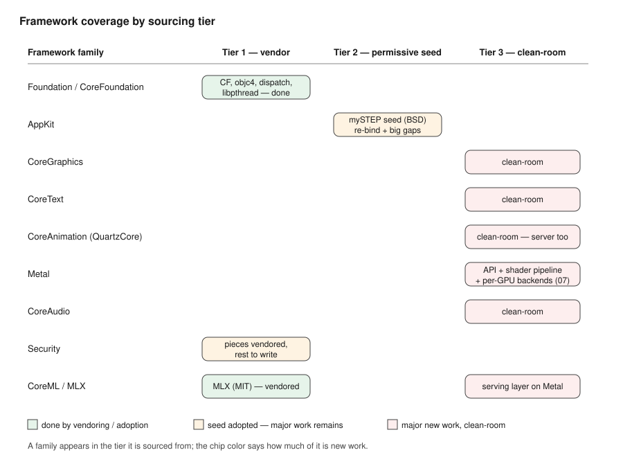

# 08 — Frameworks

This document specifies the framework strategy: three sourcing tiers with
their rules, a coverage map of the framework families against those tiers, a
concrete inventory with first milestones, the ML story built on MLX, and what
"we must run Xcode" actually means. It is for anyone implementing or porting
a framework, and for anyone deciding whether a given piece of code may enter
the tree. The graphics stack these frameworks sit on is
[07-graphics.md](07-graphics.md); the license rules cited throughout are the
hard rule from [01-principles.md](01-principles.md).

## Three tiers, three sets of rules

Every framework component is sourced through exactly one of three tiers. The
rule for choosing among them is short: prefer Tier 1; where Apple's code is
closed or incomplete, take Tier 2 if a qualifying implementation exists;
otherwise Tier 3. A single framework can mix tiers across its subcomponents —
CoreAnimation's client library and its server behavior have different
provenance, for example — so the tiers apply per component, not per name.

### Tier 1 — Apple's own open-source releases

Where Apple publishes a component, we vendor Apple's release. This covers
CoreFoundation, libdispatch, libpthread, libclosure, objc4, pieces of
Security, libxpc where published, and kernel-adjacent families like hfs and
IOHIDFamily. The authoritative list of what is published is the release index
at [opensource.apple.com/releases](https://opensource.apple.com/releases/)
(components are also listed per release at
[opensource.apple.com/projects](https://opensource.apple.com/projects/), and
the sources live under [github.com/apple](https://github.com/apple)). We do
not maintain our own notion of which versions exist: the index is the list,
and inventing a version number is a documentation bug.

The rules for this tier are the ones the kernel already follows
([03-kernel.md](03-kernel.md)):

- Vendored source sits unmodified in the tree; our changes are a quilt patch
  series applied by the build, each patch carrying a `why:`/`fate:` header.
- Every imported file keeps its upstream license header (these releases are
  APSL-licensed, which the license policy accepts).
- The per-directory license audit is a build gate, not a convention.

### Tier 2 — permissively licensed seeds

Where Apple's code is closed or incomplete, we may adopt an established
implementation, and the license test is strict: BSD, MIT, Apache-2.0, Zlib or
ISC only. No LGPL, no GPL-derived code, no "mostly permissive with one
problematic file" — the audit either passes the whole directory or the
adoption does not happen.

The precedent, and the most important Tier 2 case, is AppKit itself. The
AppKit seed is the BSD-licensed mySTEP-lineage AppKit that PureDarwin
maintains under `src/Frameworks`
([github.com/PureDarwin/PureDarwin](https://github.com/PureDarwin/PureDarwin))
— a working AppKit with real lineage, which is why we start from it rather
than from an empty file. The seed carries one caveat that shapes the work:
PureDarwin's AppKit binds to their own WindowServer RPC protocol. We re-bind
ours to ours. The binding layer — how a view's layer tree reaches the server,
how events arrive — is rewritten against the window server designed in
[07-graphics.md](07-graphics.md); what we keep from the seed is the API-shape
and behavioral work that is binding-independent. The same logic applies to
the rest of their `src/Frameworks` set (Foundation, CoreGraphics, CoreText,
QuartzCore, OpenGL), each taken under its own license check.

Tier 2 adoption is a beginning, not a completion. A seed enters the tree with
its gap list written into this document's inventory, and the gap list only
shrinks by work, not by optimism.

### Tier 3 — clean-room implementations

For what neither tier covers, we write clean-room implementations: study
Apple's public headers, documentation and observed binary behavior; specify;
then implement from the specification, never from decompiled code. The
protocol is in [01-principles.md](01-principles.md), including the two-person
split between specification and implementation where practical.

Tier 3 currently owns the hardest items in the project:

- **Metal API internals, shader pipeline, backends** — the full design is in
  [07-graphics.md](07-graphics.md); the headers are Apple's metal-cpp
  (Apache-2.0), the implementation is ours.
- **CoreAnimation server behavior** — the client library surface is public;
  the render-tree semantics the server must honor are observable behavior
  only.
- **CoreText internals** — the public API is documented; font shaping and
  measurement internals are closed.
- **The media stack** — audio and video frameworks, codecs as far as
  licensing permits.
- **The CoreML serving layer** — see the MLX section below for what sits
  above it.

## Coverage

The chart maps framework families to their sourcing tier and marks honestly
which are settled by vendoring and which are major new work. Green means done
by vendoring or adoption; amber means a seed exists and the remaining work is
substantial; red means we write it clean-room from nothing.

Figure: each framework family against its sourcing tier. Most of the hard
work concentrates in the graphics and media families — nothing about this
chart is an accident.

## Order of attack

The chart says where code comes from; the order below says what gets built
when, and each step exists because the next one leans on it.

1. **CoreFoundation, objc4, libdispatch, libpthread, libclosure** — Tier 1,
   vendored, cross-built on Linux hosts. Nothing else in the tree builds
   without them, and they are the layer most other people have already
   exercised on non-Apple hosts, which makes them the cheapest real
   compatibility wins on the board.
2. **dyld, libc++, the linker lineage** — a "hello world" Mach-O loads and
   runs. This is the point where stock command-line Mac binaries become the
   test suite: they either load or they name the missing symbol.
3. **CoreGraphics and CoreText** against a headless software target — no
   window server yet, pixels into a buffer a test can read. Context and text
   semantics are worked out here, where failures are cheap to reproduce.
4. **IOSurface, then the window server, then CoreAnimation** — the triangle
   from [07-graphics.md](07-graphics.md): the server needs surfaces to
   composite, CoreAnimation needs the server to commit to, and none of it is
   demoable until all three exist. Still all software rendering.
5. **AppKit**, re-bound to the stack from step 4, driven toward the Terminal
   milestone from the inventory. Terminal is chosen deliberately: it is a
   real shipping-quality Mac application whose AppKit surface — windows,
   views, menus, alerts, text — is large enough to be honest and small
   enough to be reachable.

The order is bottom-up on dependencies and top-down on risk at the same
time: the riskiest items (the window server triangle, Metal's shader
pipeline) start as soon as their dependencies exist rather than last, so the
schedule's surprises surface early.

## How a framework knows it is done

[02-architecture.md](02-architecture.md) sets the definition: a framework is
done when real Mac binaries link and behave, not when the symbols exist. The
mechanism that makes that checkable lives in the build harness
([05-build-system.md](05-build-system.md)):

- **ABI tests.** Every framework ships a suite that links against the public
  headers as an outside application would and asserts observed behavior —
  return values, mutation semantics, notification ordering. A suite that
  only checks "the symbol exists" does not count and will not pass review.
- **Stock-binary probes.** Small, freely redistributable Mac applications
  and command-line tools are run against the tree in CI. Each framework row
  in the inventory names the probe that currently proves its milestone.
- **No-stubs enforcement.** The states, the failure rules and the audit are
  the ones defined in [01-principles.md](01-principles.md): absent,
  unimplemented-selector errors or honest error paths — never a body that
  pretends.

The inventory's "first milestone" column is written in application terms so
that this machinery has something concrete to assert. When a row's milestone
passes its probe on CI, the row moves; nothing in this document is a
milestone because someone believes it.

Two readings of the chart are worth making explicit. First, the Tier 1 column
is full but shallow: CoreFoundation, objc4, libdispatch and friends are
settled by vendoring, and that settles a large fraction of what every binary
loads — which is why they come first. Second, the Tier 3 column is where
compatibility is actually won or lost. A stock Mac application does not care
whether CoreFoundation was vendored; it cares whether CoreAnimation commits
behave. The tiers describe where code comes from, not where risk lives.

## Inventory

Concrete sourcing and first milestones. A first milestone is a working
scenario an application exercises, not a completeness percentage — "AppKit
complete" is not a milestone, "enough AppKit for Terminal" is.

| Framework | Current best source | License | Gap notes | First milestone |
| --- | --- | --- | --- | --- |
| CoreFoundation | Apple release, Tier 1 | APSL | Cross-build on Linux hosts via the harness | launchd and the build harness run on it |
| objc4 | Apple release, Tier 1 | APSL | Cross-build; class and selector ABI pinned to target | A two-class program with categories and protocols runs |
| libdispatch / libpthread / libclosure | Apple releases, Tier 1 | APSL | Same cross-build discipline as objc4 | GCD queues serve launchd and Foundation |
| dyld + libc++ / libc++abi | Apple releases, Tier 1 | APSL | Built in lockstep with the toolchain ([05-build-system.md](05-build-system.md)) | A two-dylib `.app` loads and runs |
| Foundation | Tier 2 seed (mySTEP lineage) + our fills | BSD (seed) | Closed at Apple; seed re-bound to our stack | Our own daemons and tools link it |
| AppKit | Tier 2 seed (PureDarwin mySTEP AppKit) | BSD (seed) | Re-bind from their WindowServer RPC to ours; behavior gaps against stock apps | NSWindow + NSView + NSAlert enough for Terminal |
| CoreGraphics | Tier 3 (headers public in the SDK) | — | Closed at Apple; context and path semantics are the work | CGContext draws the text and rects Terminal needs |
| CoreText | Tier 3 (headers public) | — | Closed internals; font parsing and shaping | Measure and draw Latin text without fallback surprises |
| CoreAnimation (QuartzCore) | Tier 3 (headers public) | — | Client library plus server render-tree semantics | A committed layer tree composites in the window server |
| Metal | Tier 3; headers are metal-cpp | Apache-2.0 (headers) | See [07-graphics.md](07-graphics.md) — shader pipeline is the hard part | Clear a framebuffer through the software backend |
| CoreAudio | Tier 3 (headers public) | — | Closed at Apple; HAL and format handling | Play a sine wave through the HD-audio path |
| Security | Tier 1 pieces + Tier 3 fills | APSL (pieces) | Which pieces build standalone is unverified per release | Verify a code signature at launch |
| CoreML / MLX | MLX: Apple release, Tier 1 (MIT); serving layer: Tier 3 | MIT (MLX) | Serving layer on our Metal; see below | An MLX example model runs end to end |

Three rows deserve a note. **dyld** sits awkwardly between framework and
toolchain — [02-architecture.md](02-architecture.md) flags the same edge —
and it is listed here because applications load it at runtime, whatever the
build graph says. **Security** is the row most likely to move: Apple's
published pieces depend on corecrypto, whose source is available under its
own APSL-style license ([github.com/apple/corecrypto](https://github.com/apple/corecrypto))
but needs a per-file license check before any import. **Foundation** is
listed as Tier 2 even though CoreFoundation — its C layer — is Tier 1; the
two ship together and are tested together.

## MLX and the ML story

Running, training and fine-tuning LLMs on this system is a first-class
workload, not a demo we record someone else doing. The plan rests on one
fact: MLX, Apple's open-source array framework for unified memory, is
MIT-licensed and published at
[opensource.apple.com/projects/mlx](https://opensource.apple.com/projects/mlx)
— with C++, C, Python and Swift bindings, and PyTorch backend integration on
the Mac. It is the realistic path for models on our system.

The stack is short: PyTorch and MLX APIs on top; MLX in the middle; our Metal
implementation underneath; the kernel's memory work holding it up. Each layer
has a named dependency:

- **Metal** ([07-graphics.md](07-graphics.md)) must deliver the compute
  surface — buffers, command encoding — before any model runs. The software
  backend makes the path testable on GPU-less machines, slowly.
- **Kernel memory** ([03-kernel.md](03-kernel.md)) owns the parts model
  workloads stress: unified-memory allocation, large pages to keep TLB
  pressure down on gigabyte weights, and GPU shared memory as a
  managed-memory client with its own pager.
- **MLX itself** is vendored Tier 1 and builds against our Metal surface;
  where MLX assumes Apple silicon behaviors our hardware does not have, the
  gap is a portability bug to fix in our tree, not a reason to fork.
- **The PyTorch compatibility route** is MLX's PyTorch backend integration,
  which exists on the Mac; running it on our system means our Metal must be
  good enough for MLX, not that we reimplement PyTorch.

The compute side of running third-party workloads — what CUDA-native
software sees on this system — is owned by [09-compat.md](09-compat.md);
this document owns the native ML stack above our Metal.

## The Xcode story

Be precise about the claim, because the imprecise version is a promise we
cannot keep.

Running Apple's Xcode binary on our OS is not a day-one claim. Xcode is an
enormous AppKit application tied to closed services, and it runs when the
framework inventory above — AppKit, CoreAnimation, the window server, Metal —
is close to complete. We will not pretend otherwise.

What "we must run Xcode" really means, and what we actually commit to, is the
toolchain expectation Mac developers carry: the pieces that Xcode-built
products assume at runtime, and the ability to build the artifacts those
products take for granted. Concretely:

- **Runtime pieces we ship:** dyld from Apple's releases, libc++ and
  libc++abi, the Objective-C runtime (objc4, Tier 1), and the Swift runtime
  — Swift is Apache-2.0 with its runtime components included
  ([github.com/swiftlang/swift](https://github.com/swiftlang/swift)), so the
  runtime is vendorable where the compiler story allows.
- **Formats we produce:** the same `.app`, `.framework` and `.dylib` bundle
  and binary formats macOS tooling emits. An artifact built for our system
  is shaped like a Mac artifact, because the whole compatibility argument
  depends on it.
- **Linker lineage:** ld64, cctools and dyld come from Apple's releases, so
  the object-file and load-command dialects match what Mac binaries expect
  rather than approximating them.
- **Our own Xcode-equivalent surface** — project model, build graph UI, the
  debugger experience — is a later, separate project. We name it here so the
  gap is a decision on the record, not a surprise.

A developer on ravynOS builds with our toolchain (LLVM/clang per
[03-kernel.md](03-kernel.md), driven by the harness in
[05-build-system.md](05-build-system.md)) and produces artifacts that are
indistinguishable in format from Mac-built ones. That is the commitment. The
IDE comes much later, if the platform earns it.

## Open questions

- Which Security components actually build standalone on Linux hosts, and
  what does the corecrypto per-file license audit permit? This gates the
  code-signing milestone and nothing else in the inventory moves until it is
  answered.
- Where does Foundation cross from Tier 2 seed to Tier 3 rewrite — or does
  it never cross? The seed's API coverage versus the behavior stock
  applications expect needs a measured comparison, not a preference.
- OpenGL: PureDarwin ships it under `src/Frameworks`, and Mesa (MIT) has a
  mature implementation. Do we need an OpenGL layer at all, and if so, does
  it run on our Metal or on the backends directly? Unwritten either way.
- Swift runtime version pinning: which Swift release matches the ABI target
  of the 27.2.1 generation, and who tracks the drift?
- The media stack has no document and no owner. It is the largest row in the
  inventory without a design; it needs one before anyone promises video.
- Should the inventory gain a "verified against stock binary" column — an
  application that exercises each milestone — so "done" is always a tested
  statement? [02-architecture.md](02-architecture.md) defines done as "real
  Mac binaries link and behave"; the inventory does not yet track it per row.
