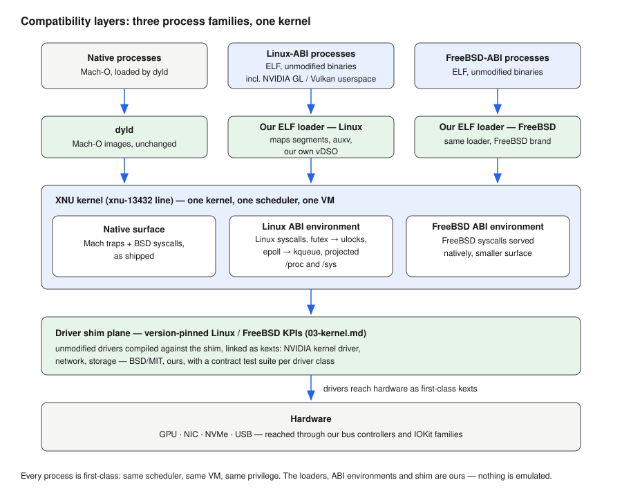

# 09 — Compatibility: Linux and FreeBSD as native subsystems

This document covers running unmodified Linux and FreeBSD *binaries* on
ravynOS: the ELF loader, the Linux ABI environment (name space, syscalls,
synchronization primitives), the NVIDIA userspace case study, the ML
story the whole thing enables, and the test strategy that keeps honest
score. The kernel-driver side of the same idea — unmodified Linux and
FreeBSD *drivers* in the in-kernel KPI shim — belongs to
[03-kernel.md](03-kernel.md); this document builds on it and does not
redefine it. Read it if you work on the loader, the ABI layers, the
compute stack, or the compatibility test fleet.

## Two problems, one principle

"Compatibility" usually summons an emulator: a VM, a translated
sandbox, a second kernel in a window. We take the same position here as
[03-kernel.md](03-kernel.md) takes for drivers — that approach
misdescribes both the performance and the failure modes, and we do not
use it. Two distinct problems get two distinct designs:

- **Unmodified Linux userland.** A program built for Linux is an ELF
  image that makes Linux syscalls. We load it as an ordinary process on
  XNU and serve its syscalls from a native implementation of the Linux
  kernel interfaces it uses. No container, no VM, no qemu.
- **Unmodified FreeBSD userland.** The same architecture with a smaller
  syscall surface and different runtime expectations.

A Mach-O and an ELF are both just process images. dyld loads the first;
our loader loads the second. Once the segments are mapped and the entry
point is running, the kernel does not care what format the file was —
a process is a process. The Linux program gets the same scheduler, the
same virtual memory, the same privilege model as a native one. That is
what "native" means here, and it is why the speed claim is boring: there
is nothing to be slow. The work is in the surface, not in a translation
engine.

## The ELF loader

dyld handles Mach-O and stays exactly where [02-architecture.md]
(02-architecture.md) puts it. ELF is a second image format handled by
our own loader, in `Compat/`, with the same modularity contract as
everything else: it builds against the kernel's documented surface and
nothing else.

What the loader does, in order:

1. Parse the ELF header and program headers; reject anything it cannot
   honor rather than half-map it.
2. Map the `PT_LOAD` segments, apply `PT_TLS` and the dynamic
   relocations, and honor the architecture-specific ABI details
   (relro, ifunc resolution, per-arch TLS placement).
3. Provide a vDSO. Linux programs read time and a few other hot values
   through a vDSO page; we build our own ELF vDSO from our libc and
   hand it over. We do not ship anyone else's.
4. Set up the process environment a Linux program expects: the initial
   stack layout, auxv entries, and the name space described below.

The loader handles both the Linux and FreeBSD cases, keyed off the ELF
brand and the image's runtime expectations; the ABI environment behind
it differs, the loader does not.

One thing the loader deliberately does not do: provide a libc. Static
binaries need nothing but the loader. Dynamic Linux binaries link
against glibc or musl, and we neither write nor import a Linux libc
into the tree — glibc is LGPL and the license gate in
[01-principles.md](01-principles.md) is absolute. The Linux runtime
(libraries, `ld-linux`) installs as a vendor package, data to us, the
same way FreeBSD's Linux compat consumes a distribution's runtime
([freebsd.org, linux(4)](https://man.freebsd.org/cgi/man.cgi?query=linux&sektion=4)).
Our tree carries the loader and the ABI environment, both permissively
licensed; the packaged runtime is a download with pinned versions, not
source we own.

## The Linux ABI environment

The ABI environment is a native subsystem in the kernel — the same
privilege, the same address space discipline as the BSD layer — that
implements the Linux kernel interfaces userland programs actually call.
"Serves the syscalls" is the contract; how each cluster is satisfied
differs:

| Linux facility | What programs use it for | Our native implementation |
|---|---|---|
| `clone(2)` with flags | thread and process creation | Mach thread creation plus the BSD process bits, behind a `clone`-compatible entry ([man7.org](https://man7.org/linux/man-pages/man2/clone.2.html)) |
| `futex(2)` | every lock in glibc's pthreads | the wait/wake machinery XNU already carries (ulock family, psynch queues), behind a futex entry ([man7.org](https://man7.org/linux/man-pages/man2/futex.2.html)) |
| `epoll(7)` | every event loop | kqueue-backed translator; one fd table, Linux semantics at the boundary ([man7.org](https://man7.org/linux/man-pages/man7/epoll.7.html)) |
| `io_uring` | high-throughput async I/O | no XNU equivalent exists; a native async submission/completion layer over our kqueue and Mach messaging — the hardest single item, tracked as its own work item |
| procfs, sysfs | `/proc`, `/sys` reads | projected filesystems, below |
| vDSO | cheap time and cache queries | our own ELF vDSO |

None of these are shims in the dismissive sense. A futex implemented on
the kernel's native wait queues is not a fake futex; it is a futex, and
it competes on speed instead of surviving on pity.

### Name space: /proc and /sys as projected filesystems

Linux programs read `/proc/self/maps`, `/proc/cpuinfo`,
`/sys/class/*` and friends as part of ordinary startup. Those trees do
not exist on our root filesystem, and bolting a global /proc onto the
system for their sake would be wrong. The design is projected
filesystems mounted where a Linux-ABI session needs them, built on the
VFS projection machinery in [06-filesystem.md](06-filesystem.md):

```
/                      our root, mounted read-only for the session
/compat/linux/         the packaged Linux runtime (glibc, ld-linux)
/compat/linux/proc     projected procfs — Linux semantics, our kernel
/compat/linux/sys      projected sysfs — Linux semantics, our kernel
/dev/                  our device nodes, including ones published
                       by shimmed drivers (see NVIDIA, below)
```

The projected trees generate their content on demand from kernel state,
in the format Linux programs parse. A session's `procfs` reports the
fields of `/proc/self/*` that glibc and common tools read; unknown
fields are absent, not fabricated — the no-stubs doctrine in
[01-principles.md](01-principles.md) applies to file contents exactly
as it applies to syscalls.

### Where the boundary leaks

Every ABI surface leaks at the same three places, and each gets a
stated policy rather than a shrug.

**ioctls.** An ioctl command number is part of the ABI, and the Linux
world's ioctl surface (DRM, sound, terminals) is where the real
programs live. Our policy is the same as the driver policy in
[03-kernel.md](03-kernel.md): pin the subsystem, implement the command
set the pinned version's programs issue, and test with the contract
suite. We implement, we do not fake. An ioctl we have not implemented
returns a real error and is recorded as a gap, never a silent lie.

**Exotic syscalls.** The long tail — namespaces, bpf, mount
manipulation, the administrative surface. These get a three-way
classification, recorded per syscall in the ABI's gap table:

| Class | Behavior | Example |
|---|---|---|
| served | implemented natively, full semantics | futex, epoll |
| translated | partial semantics over a native facility, documented | mount as a session-scoped view |
| refused | returns `ENOSYS` with a gap entry | namespaces that have no meaning here |

**Runtime introspection.** Debuggers and leak checkers use ptrace and
/proc walk-throughs to a depth we will not match initially. Linux-ABI
debugging starts with what our kernel can honestly expose and grows
from there; see the test strategy below, which exists precisely so
these gaps are counted rather than forgotten.

## What PureDarwin's elftrans proves

PureDarwin's "elftrans" runs unmodified Linux binaries on XNU,
including NVIDIA's userspace — `nvidia-smi` and Vulkan work
([github.com/PureDarwin/PureDarwin](https://github.com/PureDarwin/PureDarwin)).
That is existence proof enough: the approach is sound and the hardest
single customer (NVIDIA's stack) already runs on it.

What elftrans does not settle, as far as their public tree shows, is
the design around the trick: no stated name-space model, no versioned
contract for which Linux kernel surface is served, no tiered test
corpus with expected behavior. Those are the parts that decide whether
a compatibility layer stays a demo or becomes infrastructure. We
extend the same idea with the complete design: the name space above,
the primitive mappings in the table, the boundary-leak policy, and the
corpus in the test strategy below. The lesson from their fbsdkpi work
applies here too — the mechanism is not the hard part; the contract
and the tests are.

## The NVIDIA case study

[03-kernel.md](03-kernel.md) covers the kernel side: NVIDIA's
proprietary kernel-mode driver compiled against our version-pinned
Linux KPI shim and linked as a kext. This section is the userspace
side, because the two halves meet at a boundary we own end to end.

NVIDIA's GL, Vulkan and CUDA libraries are Linux ELF binaries that
talk to their kernel driver through an ABI NVIDIA controls — device
nodes (`/dev/nvidiactl` and siblings), ioctls, and mapped surfaces.
Their userspace already knows how to talk to their kernel driver, so
our job ends at making both halves at home:

- the kernel driver runs in the KPI shim ([03-kernel.md]
  (03-kernel.md)) and publishes the device nodes;
- the userspace binaries run through the ELF loader in a Linux-ABI
  session, with the projected name space and the syscall surface
  described above;
- the version contract binds both halves: userspace and kernel driver
  must be the pinned, matched versions, or the stack reports
  unsupported rather than misbehaving quietly.

The license reality, stated plainly: NVIDIA's userspace is
proprietary. We run their binaries, and we do not study, modify, or
ship their source. Nothing about the clean-room protocol in
[01-principles.md](01-principles.md) is triggered here because there
is nothing to re-implement — the point of this design is that we do
not need to. Everything we write in this story — the ELF loader, the
ABI environment, the name space, the KPI shim — is ours, BSD/MIT, in
our tree, under our license audit.

## FreeBSD binary compatibility

FreeBSD userland gets the same architecture: the same ELF loader keyed
off the FreeBSD brand, a FreeBSD syscall surface served natively, and
a much smaller gap to close — FreeBSD's syscall layer is a BSD
lineage closer to what XNU's BSD side already is, so the surface is
smaller and the mappings are shorter. Many tools run with the loader
and a thin environment alone.

FreeBSD compat earns its place for a second reason: it is our source
of proven, permissively licensed KPI definitions. FreeBSD documents
and licenses its kernel interfaces under a license we can read, cite,
and write contracts against — which is exactly what the driver shim
plane in [03-kernel.md](03-kernel.md) needs for its FreeBSD side. The
same is true of FreeBSD's own approach to running Linux binaries
([linux(4)](https://man.freebsd.org/cgi/man.cgi?query=linux&sektion=4)),
studied from the outside as design input; no GPL code enters the tree
at any point, per [01-principles.md](01-principles.md).



Figure: three process families, one kernel. The loader and ABI
environments are ours; the driver shim plane beneath is the one
[03-kernel.md](03-kernel.md) defines.

## Compute: what this buys, and what it does not

Running, training and fine-tuning LLMs is a first-class design target
for this system, and the compatibility layers are part of that story —
but not the main part. The main part is native, and the fallback is
compat. Both are stated here so the reader can plan against the truth
instead of a hopeful version of it.

**The native path.** MLX, Apple's MIT-licensed array framework for
unified memory
([opensource.apple.com/projects/mlx](https://opensource.apple.com/projects/mlx)),
runs on our Metal implementation
([07-graphics.md](07-graphics.md), [08-frameworks.md](08-frameworks.md))
and is the realistic path for training and inference. PyTorch compiled
from source against our libc is the second native target. Both depend
on the kernel guarantees in [03-kernel.md](03-kernel.md)'s compute
section, which the system must honor for every process, native or not:

- unified-memory-style allocation — one pointer, device-mapped on
  demand, coherent from the application's point of view;
- large pages (superpage allocation, 2 MiB and larger per arch) through
  the normal allocation paths, because gigabyte-scale weights are
  mostly a TLB problem;
- GPU shared memory managed by the GPU driver's reserve and pager, not
  special-cased into every subsystem.

**The compat path, honestly.** Stock PyTorch wheels and `llama.cpp`
binaries are Linux ELF built against glibc; the Linux-ABI environment
is the path they run through. Where that lands, concretely:

| Workload via Linux compat | Status in this design |
|---|---|
| `nvidia-smi`-class tools, Vulkan clients | expected tier — PureDarwin demonstrates both on XNU ([PureDarwin](https://github.com/PureDarwin/PureDarwin)) |
| stock PyTorch / llama.cpp Linux builds | target tier — needs the glibc runtime package plus the futex/epoll/io_uring surface |
| binary CUDA and cuDNN distributions | known-gap tier, deliberately — see below |

Binary CUDA and cuDNN are the honest boundary. Their distributions are
glibc-linked, version-sensitive, and built against a Linux world we
serve at the syscall level but do not reproduce bit-for-bit. We do not
claim them, and we do not put them in the must-pass corpus until they
pass. What binary CUDA needs — a version-matched NVIDIA driver in the
shim, the glibc runtime, a deep futex/pthread surface, and whatever
else the pinned distributions link against — is all design work this
document already scopes; whether the result passes is what the test
corpus decides. Until then, the native path carries ML work, and the
compat path grows workload by workload as the corpus promotes it.

## Test strategy

A compatibility layer without a pinned corpus is a demo that rots. The
compat fleet is a set of real, version-pinned binaries run in CI on
every build, on QEMU for targets we do not run natively
([05-build-system.md](05-build-system.md) owns the runners).

The corpus spans from trivial to brutal on purpose:

| Corpus slice | What it exercises |
|---|---|
| static busybox-class binaries | the loader, the basic syscall surface, auxv, vDSO |
| dynamic tools (glibc and musl) | runtime package loading, futex, epoll, name space |
| interactive and large programs (browser-class builds) | threads, signals, the full projected name space |
| stock NVIDIA userspace (`nvidia-smi`, Vulkan clients) | the loader, ABI environment, device nodes and KPI shim as one system |

Every corpus entry has a manifest: the pinned artifact, its expected
behavior, and its tier. Expected behavior is a tier, not a vibe:

| Tier | Meaning | CI behavior |
|---|---|---|
| must-pass | behavior is correct and complete | failure blocks merge |
| known-gaps | runs with documented, ticketed gaps | failure to match the *documented* gaps blocks merge |
| informational | runs, output recorded, no gate | trend tracking only |

Two rules keep the tiers honest. A known-gaps entry must name its
tickets — a gap without an issue is an undocumented lie, which the
no-stubs doctrine treats as a bug. And promotion is one-way evidence:
when a known-gaps entry passes completely on a pinned run, the ticket
closes and the tier moves up; nothing else moves a tier.

## Open questions

- Which Linux runtime distribution do we package, at which glibc
  versions, and how many do we test at once? FreeBSD's approach
  supports several; ours should state a matrix, not an accident.
- `io_uring` scope: which operation set makes the first versioned
  contract, and is the kqueue-based backend honest enough for the
  must-pass corpus entries that use it, or does that surface wait?
- Do Linux-ABI sessions need a full session-local root (a
  chroot-style view) or are the per-path projected mounts above
  enough? The answer affects glibc's startup path probing.
- What is the promotion bar for binary CUDA and cuDNN from known-gap
  to must-pass — a specific pinned distribution passing its whole
  test suite, or a defined workload set?
- Linux-ABI debugging: how far can our kernel's existing tracing
  (dtrace, ktrace — see [03-kernel.md](03-kernel.md)) stretch toward
  ptrace-equivalent workflows before we design a native answer?
- The NVIDIA version contract binds userspace to the shimmed kernel
  driver; who owns re-pinning both when NVIDIA ships a new driver
  series, and how long do old pins stay supported?
