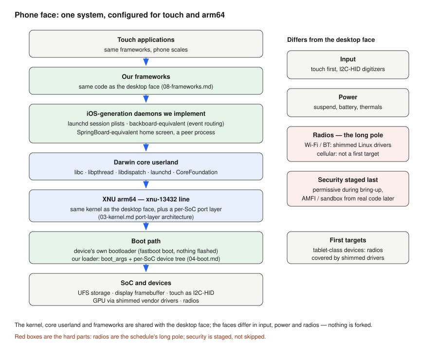

# 10 — Mobility: one OS, two faces

This document covers the phone and tablet face of ravynOS: how the same
kernel and core userland that drive the desktop drive a touch-first,
arm64-first device, what the ios-sweet project proves about the
approach, what we do differently and why, and where the honest limits
are — radios above all. It is for anyone working on boot, drivers,
power, or the shell on mobile targets. The desktop face's graphics and
framework stack live in [07-graphics.md](07-graphics.md) and
[08-frameworks.md](08-frameworks.md); this document assumes both and
does not redefine them.

## The iOS alternative: one OS, two faces

ravynOS is one operating system with two faces. The desktop face is the
one this documentation mostly describes: WindowServer, a pointer and
keyboard, Finder. The phone face is a configuration of the same
system: the same XNU kernel, the same Darwin core userland, the same
Foundation and framework code, running arm64-first and touch-first at
phone scales, behind a home-screen shell instead of Finder.

The split between the faces sits high in the stack. The kernel does not
know which face it is serving. The core userland (libc, libdispatch,
launchd, CoreFoundation) does not either. The faces diverge at the
application framework and the shell — different input model, different
scale, different power behavior — and in the device-specific layers
beneath the kernel: SoC port, device tree, radios. Everything between
is shared code with one source of truth, which is the whole point.
A second kernel or a forked userland would double the maintenance of
every layer below the shell, and the project could not afford it even
if it were otherwise attractive.

This is the same structure Apple ships: macOS and iOS are one kernel
lineage with family splits at the frameworks. We are building the
equivalent architecture because our frameworks already have to serve
one device family; serving two costs the frameworks less than it costs
a forked platform.

## The evidence: ios-sweet

The claim that an open-source XNU can host iOS-generation userland on
commodity ARM hardware is not a hope. It has been demonstrated.
dipa-studio's ios-sweet ported xnu-8796 — the iOS 16 generation of
Apple's open-source kernel — to a Redmi Note 10 Pro (SM7150 /
Snapdragon 732G) and boots unmodified iOS 16.7.16 userland — launchd,
backboardd, SpringBoard — to the home screen, as of 2026-10-18
([github.com/dipa-studio/ios-sweet](https://github.com/dipa-studio/ios-sweet)).

Read the fine print, because it defines the boundary of the proof:

- CPU rendering only — no GPU driver, roughly 20-30 fps.
- Security largely off: permissive AMFI and sandbox.
- No Wi-Fi, Bluetooth or audio yet.
- The userland itself is Apple's; it runs unmodified on Apple's
  open-source components — xnu, IOHIDFamily, libpthread, hfs.

What that proves: iOS-generation userland runs on open-source XNU once
the SoC bring-up exists. The userland is not the risk; it was never the
risk. The blockers are SoC drivers, boot chain, and device plumbing —
exactly the layers our port-layer architecture in
[03-kernel.md](03-kernel.md) isolates behind interfaces. What it does
not prove: GPU acceleration, working security enforcement, or radios.
We claim none of those from their result.

We are not porting their patches. Their tree pins xnu-8796 and a
single device; the value is the playbook, and the playbook is concrete:

| Playbook item | What it means in practice |
|---|---|
| Boot via the device's own bootloader | `fastboot boot` boots a kernel image from the vendor bootloader without flashing anything ([developer.android.com](https://developer.android.com/tools/releases/platform-tools)) — bring-up stays reversible, the device stays recoverable |
| Per-SoC device tree | one device tree per SoC, delivered at boot; a board is data plus a port layer, not a kernel fork |
| UFS storage | the storage path goes through the SoC's UFS controller; our storage stack meets it at the controller driver ([06-filesystem.md](06-filesystem.md)) |
| Touch as I2C-HID | digitizers present as I2C-HID devices, a standard driver surface IOHIDFamily serves natively |
| Framebuffer path first | display comes up as a plain framebuffer before any GPU driver; bring-up is visible early |
| Security staged last | permissive first; AMFI and sandbox enforcement arrive from real code later, after the platform boots |

The last item deserves emphasis because it inverts how most ports are
judged. A booting, touchable, framebuffer-rendered system with
security off is a milestone, not an embarrassment. Security
enforcement that has nothing to protect is decoration; it comes after
the platform exists.

## What we do differently, and why

**The kernel base is current.** ios-sweet pins xnu-8796 because the
userland they boot demands it. Our base is the xnu-13432 line
([03-kernel.md](03-kernel.md)) — the current release generation — and
our userland is ours, so we have no reason to carry an old kernel. The
iOS face rides the same vendor bump as the desktop face.

**No Apple iOS userland binaries, ever.** Their demo boots Apple's
iOS userland; that userland is Apple's copyrighted operating system,
and shipping it is neither our goal nor our right. The distinction to
hold onto: their project proves the *kernel* — that open-source XNU
runs real iOS-generation code on cheap ARM hardware. Our product ships
*our* userland: our launchd configurations, our daemons, our shell,
our frameworks. The proof transfers; the binaries do not.

**GPU designed in from the start.** ios-sweet renders on the CPU
because their SoC's GPU driver did not exist in their tree — the exact
software-rendering trap, at 20-30 fps, that
[07-graphics.md](07-graphics.md) refuses on the desktop. The phone
face does not repeat it. GPU bring-up is part of the phone plan from
the first target device, as a native IOKit GPU driver — the rule
[03-kernel.md](03-kernel.md) sets for every GPU. Phone SoC GPU kernel
drivers in Linux (Adreno's msm, Mali's panfrost/panthor) are GPL, so the
shim is not a path for them; their permissively licensed userspace
counterparts in Mesa are study material for the hardware's behavior.

**Our own daemons, our own shell.** The phone face needs the
iOS-generation daemon set — the ones ios-sweet proves must exist:
launchd configuration for the device session, an event-routing daemon
in the backboard's role, and a home-screen shell in SpringBoard's
role. We implement all three clean-room on our frameworks, as
specified in the stack below.

## The phone face's stack

Figure: the phone face is a configuration of one system — the kernel
and frameworks are shared with the desktop face, the device layers are
phone-specific.

From the top:

**Applications.** Touch-first applications built on our frameworks at
phone scales — same code, different layout and input assumptions.

**Our frameworks.** The same frameworks the desktop face ships
([08-frameworks.md](08-frameworks.md)). The device family splits at
the application framework level, not below it.

**iOS-generation daemons we implement.** launchd session plists for
the device; the backboard-equivalent, which owns event routing and
coordinates with the window server; the SpringBoard-equivalent home
screen, an ordinary process built on our frameworks that can crash and
restart like any other ([02-architecture.md](02-architecture.md)'s
peer-process rule applies here unchanged).

**Darwin core userland.** Unchanged and shared: libc, libpthread,
libdispatch, launchd, CoreFoundation.

**XNU arm64 and the SoC port layer.** The xnu-13432 line, arm64, with
a per-SoC port layer implementing the machine-dependent surface —
interrupts, timers, clocks — the way [03-kernel.md](03-kernel.md)
defines for every board. The arm64 port work the kernel document
describes is the same work the phone face needs; nothing here forks
it.

**Boot path.** The device's own bootloader stays in charge. Our boot
stage is delivered with `fastboot boot` during bring-up — nothing
flashed, device always recoverable — as kite's vendor-bootloader entry
([04-boot.md](04-boot.md), "arm64 devices behind a vendor bootloader"),
which hands the kernel its boot arguments and the per-SoC device tree. A permanently flashed install is an
end-user convenience designed later, after bring-up stabilizes.

**SoC and devices.** UFS storage, the display framebuffer path, touch
digitizers as I2C-HID, and the radios.

The right-hand column of the diagram is where the faces actually
differ, and it is the shortest column on purpose: input, power,
radios. Everything else is the desktop face's code wearing a smaller
screen.

## Input, power, radios

**Input.** The phone face is touch-first. Digitizers expose as
I2C-HID devices, which our HID stack (IOHIDFamily comes from Apple's
releases, per [03-kernel.md](03-kernel.md)) reads like any HID
device; multitouch events flow through the backboard-equivalent into
our framework's gesture recognizers. The desktop face's pointer and
keyboard path keeps working on the same frameworks — a tablet with a
keyboard attached is both faces at once, and we do not treat that as
an exception.

**Power.** Phones live and die by suspend/resume, battery budgets and
thermal limits. The desktop face's power management exists but is
lazy; the phone face's is not. This is real engineering — SoC power
domains, wakeup sources, thermal throttling through the SoC port
layer — and it is scheduled as part of the port layer work, not
retrofitted.

**Radios are the long pole.** Wi-Fi, Bluetooth and cellular on phones
mean SoC- or module-specific drivers, firmware loading, and — for
cellular — modem management that is a project of its own. This is the
honest scope statement: the phone face does not ship until radios
ship, and radios are the slowest item on the list.

## Scope honesty

| Capability | Phone face status | Why |
|---|---|---|
| Kernel boot, framebuffer, touch | design target, playbook proven | ios-sweet demonstrates the pattern ([ios-sweet](https://github.com/dipa-studio/ios-sweet)) |
| GPU acceleration | design target from the first device | native IOKit driver; the Linux kernel drivers for these GPUs are GPL and not eligible for the shim ([03-kernel.md](03-kernel.md)) |
| Wi-Fi, Bluetooth | long pole, required for ship | per-device drivers plus firmware loading; tractable where a permissively licensed Linux driver exists to shim (several Qualcomm and Broadcom Wi-Fi drivers are ISC) |
| Cellular | not a first-target requirement | modem management is a project of its own; defer |
| Security enforcement (AMFI, sandbox) | staged after bring-up | permissive first; real enforcement built from real code once the platform boots |

The first bring-up targets are tablet-class devices, not phones, for
one reason: tablet-class SoCs more often carry Wi-Fi modules whose Linux
drivers are permissively licensed and can run through the driver
environment in [03-kernel.md](03-kernel.md), which moves the long pole off the
critical path. A tablet face — touch, arm64, no cellular dependency —
exercises the whole architecture and defers only the worst driver
work. Phones follow when radio coverage justifies a device.

## Bring-up order

The playbook implies an order, and the order is a commitment about
what gets built first — it is how we keep bring-up reversible and
debuggable instead of a pile of simultaneous unknowns:

1. **Kernel boots on the device.** The vendor's bootloader launches
   kite's vendor-bootloader entry, which hands over the arm64 kernel
   (the xnu-13432 line once published) and the per-SoC device tree; the kernel reaches userspace
   with a serial console. Nothing is flashed; a bad image is a
   reboot away from the last good state.
2. **Framebuffer and touch.** The display comes up as a plain
   framebuffer and the digitizer as I2C-HID. This is the first
   milestone where the system is visibly interactive, and it is
   reachable without GPU, radios or security enforcement.
3. **Storage.** UFS comes up through a native IOKit controller
   driver (Linux's UFS drivers are GPL), and the root volume mounts
   ([06-filesystem.md](06-filesystem.md)).
4. **The phone session.** launchd's device plists stage the
   daemons; the home-screen shell renders through the window
   server into the framebuffer. GPU acceleration lands here or in
   step 3's wake, via the native GPU driver — CPU rendering is a
   fallback for debugging, never a milestone.
5. **Radios.** Wi-Fi, then Bluetooth, in that order — Wi-Fi is
   the one tablet-class devices need to be useful at all.
6. **Enforcement.** AMFI-equivalent policy and sandbox profiles
   switch on, per the staging model below.

Each step has a pass condition that does not depend on any later
step, which is what makes the order honest: a step that could only
be verified by a later step is not a step.

## Security staging

The staged model from the playbook applies to our own face: the
platform boots permissive, and enforcement arrives as real code.
AMFI-equivalent policy enforcement and the sandbox profile system for
the phone face are the same machinery the desktop face needs
([01-principles.md](01-principles.md)'s clean-room protocol governs
how we build what Apple keeps closed). Staging is not a lower standard;
it is an ordering. A sandbox enforced on a system that cannot render
its own home screen protects nothing, and a port that cannot boot
without its security stack cannot debug the security stack.

## Open questions

- Which SoC is the first bring-up target? The criteria are Wi-Fi and
  Bluetooth drivers we may legally shim, public documentation or
  permissively licensed userspace for the GPU and UFS controller (both
  need native drivers), a documented boot path, and mainline device tree
  quality — the device itself is not chosen yet.
- Device tree delivery: what format our bootloader hands XNU's port
  layer, and whether the per-SoC device tree consumes the vendor
  tree's data directly or through a conversion step. This edge
  belongs to [04-boot.md](04-boot.md) and is listed in its open
  questions.
- Is the backboard-equivalent a separate peer process, or a role
  inside the window server? The desktop document owns the window
  server's process boundary ([07-graphics.md](07-graphics.md)); the
  phone face needs an answer before the event-routing design lands.
- Which Android-generation boot constraints (verified boot state,
  unlock warnings) apply to permanently flashed installs on
  consumer devices, and do we document flashing at all for the
  first release?
- The first-device criteria need a license column: a device whose
  Wi-Fi has only a GPL Linux driver needs a native driver before the
  phone track can call it supported.
