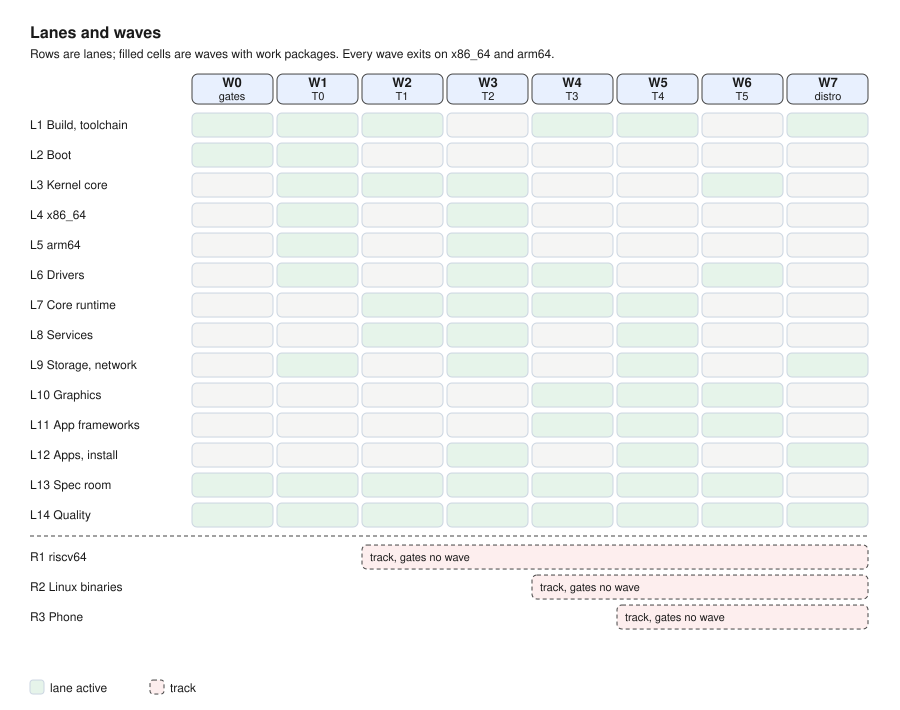

# 12 — Roadmap: work waves

This document orders the work. It replaces the old Roadmap 3.0 phase plans
(now removed), which described the FreeBSD-based path; nothing in the waves
below depends on that plan or on the partial work done under it. Each wave has a goal, exit
criteria that are testable statements rather than moods, its dependencies,
and an honest callout of the hard part. Read it if you want to know what to
build next, what blocks what, and what the project is deliberately not
doing yet.

## How to read this document

Waves are units of work big enough to own, small enough to finish. A wave's
exit criteria are written so that a machine or a skeptical reviewer can
check them; if a criterion cannot be checked, it is a wish and does not
belong here. The owning design document is named for every wave — it
carries the how, this document carries the when and the what-done.

One deliberate absence: there are no dates. Our build fleet is x86_64
Linux boxes with 8 CPUs, 16 GB of RAM and no GPU, the contributor count is
small and mostly unknown in advance, and the hard parts are hard in ways
we cannot schedule. What we can control is order and parallelism, so that
is what this document commits to. Where the earlier plan left finished
artifacts in the repository — a vendored xnu-12377.121.6 tree, build
experiments under `Kernel/build/` — the waves either reuse them or
explicitly redo them; nothing assumes they exist.

## The waves

### W0 — Repository skeleton, `rv`, license gate, CI

Goal: make the tree a place where every later wave is gated from its first
commit. The harness ([05-build-system.md](05-build-system.md)) and the
quality gates ([11-quality.md](11-quality.md)) land before the code they
gate, because a gate added after the code is a negotiation, not a gate.

Exit criteria:

- A clean clone on Linux x86_64 builds a hello-world component with `rv
  build` and no network access beyond fetching pinned sources.
- The dependency graph is data in the tree; `rv graph` prints it, and a
  deliberately planted layer violation fails the build with the offending
  edge named.
- The license audit fails the build on a planted GPL file and on a vendored
  file with a stripped header.
- CI runs on every commit to the main branch; a red run blocks merge, and
  the failing-ci-trumps-everything rule from [11-quality.md]
  (11-quality.md) is in force.
- Per-component clang-format configs exist and the format check gates.

Dependencies: none. This is where everything starts.

The hard part: there is no technical hard part, which is exactly why this
wave is first and short. The risk is that it grows — the harness is the
project's most tempting place to gold-plate. W0 is done when the W1 exit
criteria can be attempted, not when `rv` is pretty.

### W1 — Vendored xnu builds on Linux x86_64

What this wave is: Apple's kernel, compiled by our harness on our hosts,
booting far enough to prove it is alive. The kernel workstream, including
the vendoring policy and the mig problem, is owned by
[03-kernel.md](03-kernel.md).

Exit criteria:

- The vendored xnu source links to a kernel image on an 8-CPU, 16 GB Linux
  host using our toolchain, with no macOS host involved at any step.
- mig runs: the Mach `.defs` files compile and their generated headers are
  produced by an explicit build rule, with the pinned generated headers
  catching any behavior change.
- The kernel boots in QEMU (q35/OVMF, loaded by the reference loader, not
  yet by kite) to a panic-with-output: a structured panic log, symbolicated
  by the harness per [03-kernel.md](03-kernel.md)'s debuggability section.
  "It hangs after three lines" is not an exit state.
- The vendored delta is a patch series with `why:`/`fate:` headers, and
  regenerating the pristine upstream tree works.

Dependencies: W0.

The hard part: mig. Apple no longer publishes it as a standalone release,
so we maintain our own (MIT, pinned by the committed generated headers), and
makedefs assumes a macOS sysroot in several places. The vendor bump to the
xnu-13432 line — the tree carries xnu-12377.121.6 today, and the design
targets xnu-13432.41.4 (Darwin 27.2.0, per [01-principles.md]
(01-principles.md)) — lands in this wave when Apple publishes the source,
and the patch series is what makes that bump hours instead of weeks.

### W2 — kite boots that kernel from the ESP

Goal: our own bootloader replaces the reference loader, per
[04-boot.md](04-boot.md). The kernel stops being a QEMU experiment and
starts being something an arbitrary UEFI machine can run.

Exit criteria:

- kite's `BOOTX64.EFI` loads the W1 kernel from an ESP in QEMU under OVMF
  and hands off; the boot log is versioned and machine-readable.
- The hand-off is verified by a test kernel that checks its own load
  address, walks the memory map it was given, and asserts each hand-off
  precondition — the CI pattern [04-boot.md](04-boot.md) defines.
- `boot_args` correctness is checked by having the kernel print back every
  field kite set and CI compare the two views.
- Every target kite claims (x86_64 first; arm64 and riscv64 firmware paths
  build, even with only test kernels behind them) builds in CI on every
  commit.

Dependencies: W1.

The hard part: the 64→32-bit entry switch and the `boot_args` contract must
be re-verified against the xnu-13432 generation when the vendor bump lands
([04-boot.md](04-boot.md) flags this), and QEMU's firmware is forgiving in
ways real boards are not. Real-hardware boots beyond QEMU are a W2
stretch goal, not an exit criterion — the fleet has no target hardware.

### W3 — Core userland: dyld, libc, libdispatch, launchd, IPC

What we build: the Darwin core userland, running on our kernel. This is where binary
compatibility is won or lost for every program that does not draw a pixel
([02-architecture.md](02-architecture.md)), and where the Mach IPC surface
that everything else messages through first exists end to end. The
frameworks side of userland is owned by [08-frameworks.md](08-frameworks.md);
the process architecture is [02-architecture.md](02-architecture.md)'s.

Exit criteria:

- A statically linked Mach-O binary runs under the W1 kernel in QEMU and
  completes a multi-step task (the historical plan used a shell; any
  program that exercises several syscalls and Mach traps qualifies).
- A dynamically linked Mach-O binary runs: dyld resolves its dylibs from
  our sysroot and the program's imports bind.
- launchd runs as PID 1, reads its plists, and starts two daemons, and one
  of them is restarted by launchd after we kill it.
- Two userland processes complete a Mach IPC round-trip through a bootstrap
  port lookup — the operation the W3 performance budget
  ([11-quality.md](11-quality.md)) then measures and gates.

Dependencies: W1 and W2 for integration. Development can start host-side
while W2 proceeds — dyld and libdispatch build and unit-test on Linux
against the committed headers — which is why the diagram shows W3 starting
in parallel with W2.

The hard part: dyld assumes things about the shared cache and the kernel's
ABI that are only visible when they break, and launchd's early boot has
chicken-and-egg staging (mounting the root volume it is supposed to be
staged from) that [02-architecture.md](02-architecture.md) resolves with
launchd's own run-level machinery but that has not survived contact with a
real kernel yet.

### W4 — APFS: userland library and tools, then VFS backend

What we build: the boot filesystem. One on-disk format implementation, three
frontends — userland tools, kernel VFS backend, bootloader reader — as
[06-filesystem.md](06-filesystem.md) specifies.

Exit criteria:

- Our tools create an APFS volume containing files; our kernel driver mounts
  that volume in QEMU and the files read back byte-identical. That is the
  wave's headline criterion, and it is deliberately two-sided: we made it,
  and we read it.
- Volumes created by Apple's tools — the reference corpus in
  [06-filesystem.md](06-filesystem.md) — mount read-only and pass their
  per-case assertions.
- A crash-kill test (QEMU powered off mid-write) ends in a volume that
  `fsck`-equivalent repair handles or that fails closed, never silently
  serves wrong data.
- The bootloader's APFS reader reads the same volume the kernel mounts —
  same freestanding library, per [06-filesystem.md](06-filesystem.md).

Dependencies: W3 (the tools need libc and a working userland to run) and
W1 (the VFS backend needs the kernel).

The hard part: the format is documented by outside researchers, not Apple,
and the encryption internals are out of reach entirely —
[06-filesystem.md](06-filesystem.md) is blunt about both. Repair semantics
lag Apple's for years and need the refusal policy that document leaves
open. This wave is long, and treating it as anything less is how filesystems
corrupt users' disks.

### W5 — Display: framebuffer console to WindowServer

What this wave delivers: pixels, composited by our window server, as
[07-graphics.md](07-graphics.md) designs it. The window server is a peer
process owning the GPU and compositor, speaking the protocol the target
release's clients expect — a clean-room target, developed against QEMU's
software rendering because the build fleet has no GPU.

Exit criteria:

- A framebuffer console renders the boot log before the window server
  starts (debugging for everything else in this wave depends on it).
- The window server runs as a launchd-started peer process, composites a
  fixed test scene, and publishes its Mach port; a test client connects and
  moves a window at the frame-time budget set at W5's exit per
  [11-quality.md](11-quality.md) — the budget's method (the window server's
  own counters, fixed scene, software rendering) is running from the first
  week, even before the number is set.
- Killing the window server results in launchd restarting it and clients
  reconnecting — the restartability that [02-architecture.md]
  (02-architecture.md) makes the whole point of a userland window server.

Dependencies: W3 (launchd starts it; clients speak Mach IPC to it).

The hard part: the client protocol is a clean-room target — what the
target release's applications actually speak is not public, and
[07-graphics.md](07-graphics.md) owns the decompile-to-understand,
reimplement-cleanly work. Software rendering in QEMU keeps us honest about
the compositor while hiding every GPU question, which is fine for W5 and
precisely what W7 exists to end.

### W6 — Frameworks: CoreFoundation, Foundation, first AppKit apps

What we build: the layer macOS applications actually call. CoreFoundation and
Foundation complete enough to host real apps, the Objective-C runtime
solid, and the first two apps our own: Terminal, then Finder. Owned by
[08-frameworks.md](08-frameworks.md).

Exit criteria:

- CoreFoundation and Foundation pass their test suites built from our tree
  against our kernel and libc — the same suites upstream Apple sources
  carry, plus our own.
- Terminal runs on our window server: text in, text out, scrollback, a
  shell process per tab. It is the first app because it is the smallest
  honest AppKit exercise and the best debugging tool for everything after.
- Finder runs: a window with a view backed by our APFS driver mounts,
  lists and opens files on the boot volume.
- A cold launch of Terminal is measured end to end, setting the W6 budget
  number in [11-quality.md](11-quality.md)'s table.
- The Swift runtime hosts a dynamically linked Swift binary on our kernel,
  and the SwiftUI dependency-graph inventory (SwiftUI, SwiftUICore,
  AttributeGraph and everything below) is recorded from a real SwiftUI
  app's load commands per [Docs/SWIFTUI-FEASIBILITY.md]
  (../../Docs/SWIFTUI-FEASIBILITY.md) — this is the evidence behind
  DESIGN.md's Wave 6 go/no-go verdict. SwiftUI out of the box is a
  committed exit criterion of DESIGN.md's Wave 8 (the distro), not a
  deferred maybe, so this measurement cannot be skipped. Reference
  implementation for the inventory: OpenSwiftUI
  ([github.com/OpenSwiftUIProject/OpenSwiftUI](https://github.com/OpenSwiftUIProject/OpenSwiftUI),
  MIT — license verified 2026-11-26), a source-compatible SwiftUI rebuild;
  it is study material and an API-shape oracle, not a drop-in binary.

Dependencies: W5 (there must be a server to run apps on) and W4 (the
system volume the apps install to must exist).

The hard part is breadth, not depth: the framework surface is enormous and
the honest version of this wave is "a strict subset, complete and honest
about its bounds" — the no-stubs doctrine from [01-principles.md]
(01-principles.md) applied to AppKit, which is where the temptation to stub
is strongest and the cost of stubbing is highest.

### W7 — Metal: API layer, software rasterization, first hardware backend

What this wave attacks: the hardest gap in the project, per [07-graphics.md]
(07-graphics.md). Apple has not released the Metal implementation; the
Apache-2.0 metal-cpp headers (https://developer.apple.com/metal/cpp) define
the ABI through Metal 4 on macOS 27, and the implementation is ours,
clean-room.

Exit criteria:

- The metal-cpp sample suite passes on our software rasterizer — the
  subset of https://developer.apple.com/metal/sample-code/ that needs no
  hardware-only feature, run unmodified against our implementation.
- The API layer is the same code for software and hardware backends; the
  first hardware backend (target chosen by who shows up with hardware and
  which driver path [03-kernel.md](03-kernel.md) lands first) passes the
  same suite on real metal.
- The shader path works end to end for the samples: source to our compiler
  backend to execution.

Dependencies: W5 (a surface to render to and a process model to render
from). Runs alongside W6 — the diagram shows the two branches in parallel —
because the API layer and the software rasterizer do not need AppKit.

The hard part, stated plainly because [07-graphics.md](07-graphics.md)
says it too: shaders, the AIR/metallib formats and the compiler backend.
The API surface is knowable from headers and docs; the compiler is a
multi-year engine of its own. This wave's exit criteria are deliberately
modest (samples on software) because the honest alternative is a demo, and
the project does not ship demos as milestones.

**Prior art: KosmicKrisp.** LunarG's KosmicKrisp
(https://docs.mesa3d.org/drivers/kosmickrisp.html, product page
https://www.lunarg.com/products/kosmickrisp/) is the strongest evidence the
translation-layer approach can reach production quality: a Vulkan-to-Metal
driver started from a blank slate in late 2024, Vulkan 1.3 conformant by
2025 and Vulkan 1.4 conformant as of September 2026, MIT-licensed,
built on Mesa's Vulkan framework and NIR compiler, targeting Metal 4 on
M1–M5 Apple silicon, shipped in the LunarG SDK and upstream in Mesa. Two
lessons we take from it, not its code:

- The NIR compiler stack is why it reached conformance quickly; our shader
  path should adopt (permissively licensed) shared compiler infrastructure
  rather than grow a private one.
- CI on real Apple silicon (LunarG runs M1/M2/M4 machines on macOS 26)
  is what made it production-grade; "conformant" without that
  infrastructure is not, and the same bar applies to our hardware
  backends.

It is not a drop-in for us — it targets macOS on Apple silicon, not
ravynOS, and depends on Apple's closed Metal runtime — but it defines the
quality bar for an API-translation layer and, on Apple-silicon hosts, is a
practical stopgap path for Vulkan applications while our own Metal stack
grows.

### W8 — Compat: Linux/FreeBSD driver shims and the ELF loader

What we build: hardware support and Linux software, without rewriting either. The
driver compatibility layer and the ELF loader are first-class subsystems
under `Compat/`, owned by [09-compat.md](09-compat.md), with contracts,
version pins and tests.

Exit criteria:

- A real Linux driver, run against our kernel through the shim, serves a
  network interface: it passes traffic under iperf in QEMU's user-mode
  networking equivalent, with packets observed on both ends.
- The ELF loader runs an unmodified static Linux binary; then a dynamic
  one against the compat sysroot.
- NVIDIA userspace talks to the shimmed driver: the userspace side of
  NVIDIA's driver initializes and reports — the same feat PureDarwin
  demonstrates with their 580-driver loading and elftrans (per
  [01-principles.md](01-principles.md)'s PureDarwin comparison), which is
  our evidence the approach works and our bar to clear properly.
- The stock-binary compatibility corpus ([09-compat.md](09-compat.md),
  referenced by [11-quality.md](11-quality.md)) exists and gates the
  loader.

Dependencies: W1–W3 (the shim rides our kernel's driver interfaces; the
ELF loader needs our process and VM machinery). Runs alongside W5–W7 with
no dependency on them — different skills, different contributors.

The hard part: driver shim fidelity. A KPI shim that satisfies 90% of a
driver's calls fails in the 10% that touches DMA or interrupts, and NVIDIA
userspace is famously demanding of its kernel counterpart. The corridor
PureDarwin proved exists; keeping it stable as the kernel vendor-bumps is
the ongoing cost.

### W9 — arm64, then riscv64 bring-up

What this wave proves: the portability commitments from [01-principles.md]
(01-principles.md) are real. The kernel port layers are
[03-kernel.md](03-kernel.md)'s design; this wave is the schedule for
exercising them on the other architectures.

Exit criteria:

- The exit criteria of W1 through W4 pass on arm64 in QEMU — same tests,
  same gates, new architecture — then on riscv64.
- kite boots the arm64 kernel with the DTB hand-off
  ([04-boot.md](04-boot.md)'s per-arch interface), verified by the same
  test-kernel CI pattern.
- No wave's x86_64 criteria regressed while the port landed; the per-arch
  gates all run in CI.

Dependencies: W1–W4. The port layers can start host-side as soon as W1's
structure exists, and arm64 leads riscv64 because XNU has arm support to
start from and riscv64 has none. The riscv64 estimate is on the order of a
person-year; the breakdown below ([03-kernel.md](03-kernel.md) owns the
layer design) is why the wave starts early rather than late:

| Piece | Estimate | What it is |
|---|---|---|
| `osfmk` pmap | 3–4 engineer-months | Apple's ARM pmap is welded to PPL, TTE formats and Apple page-table hardware; Sv39/Sv48 is a different machine, rewritten from the RISC-V privileged spec |
| Trap/context-switch assembly | 1.5–2 months | Exception vectors and entry assembly, rewritten from the spec, not lifted from `arm` |
| CPU bring-up via SBI | ~1.5 months | Timers, IPIs, `machine_routines` |
| IOKit/kext arch glue, `pmap_cs` replacement | remainder | No code-signing hardware on early RISC-V boards simplifies this |

Nothing ports "directly" from `osfmk/arm` — what ports is as a template:
structure and invariants are reusable, instruction-level code is not.

The hard part: riscv64 is a from-scratch Mach VM and trap layer, not a
port. arm64 under QEMU is comparatively tame; the long tail is the same
hardware-reality problem as x86_64 (devicetrees, firmware variety), met
through contributors' machines and QEMU's device-tree machines.

License constraint (updated 2026-11-26): the Apple Silicon path follows
Asahi's boot-policy method — a 1TR-enrolled stage-1 loader presenting an
img4-wrapped Mach-O — but m1n1 relicensed MIT → GPLv2 in November 2026,
so the loader is our own clean-room code and Asahi sources are forbidden
input for it, per the license rule in [01-principles.md](01-principles.md).

### W10 — Phone face bring-up

What this wave attempts: the iOS-alternative track ([10-mobility.md](10-mobility.md)) gets
its hardware. The evidence this is possible is ios-sweet's proof that
Apple's open-source XNU plus IOHIDFamily and libpthread hosts unmodified
iOS userland to the home screen on a Snapdragon 732G, CPU-rendered (per
[01-principles.md](01-principles.md)); we are not porting their patches,
but they define the achievable bar.

Exit criteria: defined by [10-mobility.md](10-mobility.md), which owns
the track. The wave's position here — last, after W9 and W6 — is the
schedule's honest statement: phone SoC bring-up needs every port layer
skill the project owns and a framework stack worth putting on the screen.

Dependencies: W9 (per-arch port layers) and W6 (a UI stack to show).

The hard part: per-SoC bring-up with no GPU driver, on hardware whose
firmware we do not control, with the security machinery (AMFI, sandbox)
that ios-sweet had to run permissive. [10-mobility.md](10-mobility.md)
owns the honesty about what "bring-up" means for a first device.

## The timeline

Figure: the waves left to right in start order, with dependencies as
arrows. The kernel spine (W0–W3) is serial; storage, display and compat
fan out from W3; frameworks and Metal proceed as parallel branches; the
architecture wave re-runs everything, and the phone track sits on top of
it.

Reading it as contributor lanes: after W2, three lanes run at once with no
shared files — kernel/storage (W4), graphics (W5, then W7), compat (W8) —
and frameworks (W6) joins them once W5 lands. W9 needs the port-layer
skills from W1–W2 but not the later waves. A new contributor should be able
to join any lane whose owning document they have read; the lanes share
`rv`, the gates and the review rules, and otherwise stay out of each
other's way.

## What we deliberately do not schedule in the first year

These are recorded so their absence is a decision, not an oversight. Each
has a reason and a re-entry path.

- **Real-hardware GPU driver backends beyond the first hardware target.**
  The build fleet has no GPU at all; every hardware backend depends on a
  contributor with the machine. One target when hardware appears, not a
  matrix.
- **MetalFX.** Apple's upscaling technology is part of the public Metal
  documentation (https://developer.apple.com/metal/) but sits on top of a
  working Metal stack and hardware backends we do not have. It lands after
  W7's first hardware backend, and scheduling it earlier would put a
  dependency on nothing.
- **Cellular radios.** Modem bring-up is per-device, carrier-dependent and
  orthogonal to the desktop mission. [10-mobility.md](10-mobility.md)
  may pick it up after its first device is real.
- **The Xcode-equivalent IDE.** A development environment of that size is
  its own multi-year project and is not on the critical path to running
  real macOS software. The first-year tooling story is `rv`, editors, and
  the test rig; an IDE conversation happens when the frameworks it would
  target exist.
- **Self-hosting.** Building ravynOS on ravynOS requires the toolchain,
  frameworks and filesystem to all be real. It is a milestone to want,
  not one to schedule while W3 is unproven.

## Open questions

- Should W4's userland tools start host-side during W2 (they only need a
  Linux host to build and the corpus to test against), pulling real APFS
  work earlier at the cost of splitting the wave? The dependency graph
  says no; the corpus says the tools are testable without our kernel.
- Which hardware target is W7's first backend? Decided 2026-11-26: native
  IOKit drivers have priority always — the Linux DRM KPI shim in
  [03-kernel.md](03-kernel.md) is a compatibility layer for foreign
  drivers, not the native path, so it follows rather than leads. KosmicKrisp
  (W7's prior art above) shows what a translation layer can reach, and
  equally why we aim past it: it translates *to* Apple's Metal runtime,
  which we do not have — our IOKit family *is* the runtime's home.
  The specific chip still waits for contributors with hardware.
- The waves name no dates; what is the mechanism that notices a wave is
  stalled? An exit criterion that no one is working toward is silent, and
  this document does not yet say who re-triages the order when reality
  disagrees with it.
- The historical plan's finished work (the static Mach-O guest shell on
  the old kernel, the build experiments) predates the W0 gates. Does W1
  reuse that kernel build driver under the new harness, or rewrite it —
  and who decides when the honest answer is "rewrite, but steal the
  BLOCKERS list"?
- W10's exit criteria are delegated to [10-mobility.md](10-mobility.md),
  which is not yet written. Until it exists, W10 is a placeholder on the
  timeline and should not be promised to anyone.
