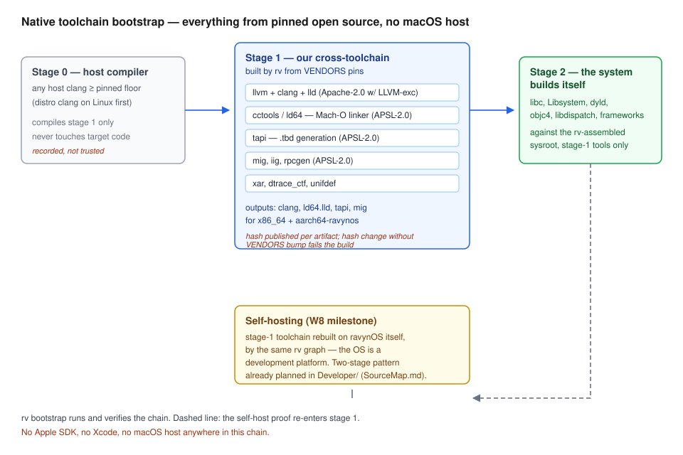
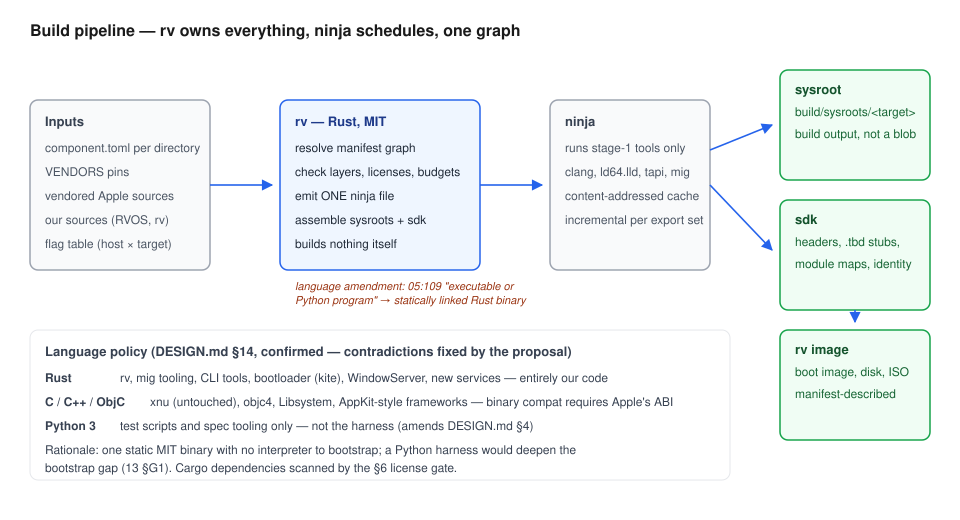
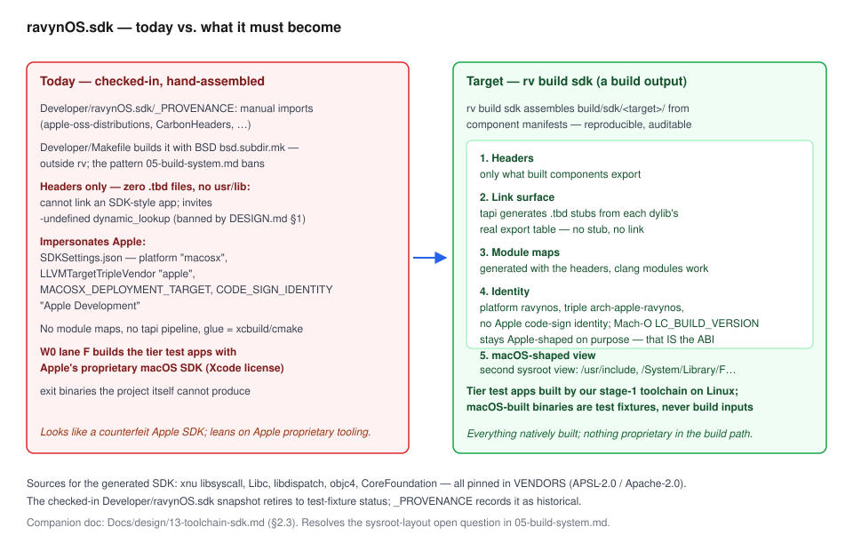
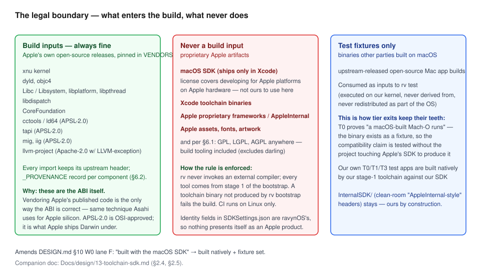

# 13 · Toolchain, SDK and the native-build rule (Proposal)

**Status:** Proposal — pending approval. Not authoritative until approved as a dated
amendment to `Docs/DESIGN.md` §4/§10 (W0 lane F) and `Docs/design/05-build-system.md`
(§ "Toolchain and mig", § "What this does not solve").
**Date:** 2026-11-26
**Driven by:** the owner's standing rule: *everything builds natively from open source;
nothing in our build may depend on Apple's proprietary SDK, on a macOS host, or expose the
project to Apple-proprietary licensing.*

The diagrams referenced here live in `diagrams/`:
`toolchain-bootstrap.svg`, `rv-pipeline.svg`, `sdk-current-vs-target.svg`,
`sdk-legal-boundary.svg`.

---

## 1. The audit: gaps found in the current design

Verified against the tree on 2026-11-26 (branch `darwin-clean`).

### G1 — The toolchain bootstrap is declared out of scope, which contradicts the native-build rule

`05-build-system.md` ("What this does not solve") says reproducibility of the bootstrap —
compiler, mig, host tools — "the harness pins and hashes the toolchain binaries it uses but
does not build them from source in this design." That means the first link of the chain
(clang, lld, mig, tapi) is someone else's artifact: a distro package or, worse, something
produced on a Mac. If everything must build natively from source, the bootstrap is not a
corner case — it is the foundation, and it must be in scope, owned by the same manifest
graph as everything else.

### G2 — The inherited SDK is a checked-in artifact, assembled by hand, built outside the harness

`Developer/ravynOS.sdk/_PROVENANCE` shows a hand-curated import list
(apple-oss-distributions/distribution-macOS, CarbonHeaders, …). `Developer/Makefile` builds
it with BSD `bsd.subdir.mk` — the exact "component builds by invoking its own build system"
pattern `05-build-system.md:151` bans for everything else. `05-build-system.md:200-203`
says sysroots are build outputs, "not a checked-in binary blob." The SDK contradicts the
design it sits inside.

### G3 — The SDK has headers but no link surface

`find Developer/ravynOS.sdk -name '*.tbd'` → 0 files. There is no `usr/lib` either. An SDK
that cannot state what a dylib exports cannot link an app the way the macOS SDK does —
linking against framework sources directly is precisely the
`-undefined dynamic_lookup` failure mode `DESIGN.md` §1 bans. The missing piece is a TAPI
pipeline: every dylib's exported symbol set becomes a text-based `.tbd` stub, generated
from the built dylib, and the SDK links against stubs, never sources.

### G4 — The SDK impersonates Apple's SDK, which invites exactly the confusion the owner rejects

`Developer/ravynOS.sdk/SDKSettings.json` declares itself platform `macosx`, triple vendor
`apple`, `MACOSX_DEPLOYMENT_TARGET`, and `CODE_SIGN_IDENTITY: "Apple Development"`.
Display name: "ravynOS 0.7 (macOS 10.15 compatible)". None of this is a license problem by
itself (the values are uncopyrightable ABI constants), but it *looks* like a counterfeit
Apple SDK and it misleads contributors about which parts are claimed. Identity and ABI must
be separated explicitly.

### G5 — Wave 0 lane F makes Apple's proprietary macOS SDK a build dependency

`DESIGN.md` §10 W0: "tier test apps chosen and built with the macOS SDK (T0 static, T1
dynamic, T3 AppKit window app)". Apple's macOS SDK ships only inside Xcode and its license
permits use to develop for Apple platforms on Apple hardware. Building our exit-criteria
binaries with it means: the project's proof artifacts cannot be produced by the project's
own build, cannot be regenerated in CI, and lean on Apple proprietary tooling. This is the
single largest gap between the docs and the owner's rule.

### G6 — Doc contradiction on the harness language

`DESIGN.md` §14 language policy: "`rv`, mig tooling, CLI tools, tests → Rust. Entirely our
own code." `05-build-system.md:109`: "a plain executable or Python program living at the
tree root." §4 of DESIGN.md: "Python 3 for build tooling." The implemented `rv`
(`tools/rv/`, committed `118c8a66f8`) is Rust. The docs disagree; the code and §14 agree.
The amendment fixes the stragglers.

**Why Rust, decided on evidence from both reference builds:**

- **PureDarwin** does not have a hand-written harness at all: its handbook states "Nix is
  the build system. CMake is a tool that Nix drives," and building a single component by
  hand inside the CMake tree is called out as a debugging escape hatch, not a workflow.
  The top-level driver is therefore a compiled, AOT-evaluated system (Nix + the C++ CMake
  engine) — never an interpreted script — and the toolchain/SDK are built and assembled by
  the project itself from open sources. Our `rv` design reaches the same properties
  (one driver, project-built toolchain, project-assembled SDK) without importing the Nix
  package-manager dependency, which was the owner's stated requirement ("better by design
  than Nix"): `rv` is one static binary, not an ecosystem.
- **Upstream ravynOS** (this repo's ancestor) grew *two* coexisting harnesses — the
  top-level BSD-make `Makefile` (`world` target, bmake) and the CMake + Ninja path in
  `Docs/BUILDING.md` — plus `tools/build.sh` shell glue, with Python 3 listed as a host
  requirement. Nothing in either path is a Python program; Python appears only as inner
  build scripting. The fragmentation (two entry points, "works for me" host setups) is
  exactly the failure mode the single-entry-point design exists to prevent.
- **Precedent, then bootstrap.** Both references keep the top-level driver out of the
  interpreted-scripting layer; the "Python program at the tree root" in the old
  `05-build-system.md` line was the outlier against both. And a Python harness would make
  the bootstrap problem (G1) worse: a CPython version would join the set of host
  requirements that must be pinned to reproduce a build. A statically linked Rust binary
  has no interpreter to pin; rustc is needed only to *build* `rv` (a stage-0 host tool,
  recorded not trusted, shippable as a prebuilt static binary), the same way PureDarwin's
  tree needs Nix and CMake installed to drive anything at all.

One statically linked MIT binary, no interpreter to bootstrap, one dependency license
surface gated by the §6 audit.

### G7 — The inherited `Developer/` toolchain tree is un-manifested

`Default.xctoolchain/` carries the raw material — swiftlang/llvm-project
(swift-6.0-RELEASE, Apache-2.0 WITH LLVM-exception), tapi (tapi-1600.0.11.8), cctools/ld64
(APSL), mig, iig, rpcgen, xar, dtrace_ctf — plus darlings' xcbuild and cmake/make glue. It
is inherited upstream structure, not a component graph: no manifests, no `rv` entry, and
its build glue (xcbuild, cmake) is on the banned list. The material is right; the
packaging is not.

---

## 2. The design

### 2.1 Native three-stage toolchain bootstrap

- **Stage 0 — host compiler (input, not product).** Any clang ≥ the pinned floor on the
  build host (Linux first). It compiles stage 1 and never touches target code, so no host
  library or header can leak into the system. Its exact version is recorded, not trusted
  for reproducibility.
- **Stage 1 — our cross-toolchain, built from pinned open source.** LLVM+clang+lld
  (swiftlang/llvm-project swift-6.0-RELEASE), ld64/cctools (APSL), tapi, mig, iig, xar.
  Each is a component with a manifest and a VENDORS pin. Output: `clang`, `ld64.lld`
  (Mach-O), `tapi`, `mig` for `x86_64-unknown-ravynos` and `aarch64-unknown-ravynos`,
  published as content-addressed artifacts. Every target build uses *only* stage-1 tools.
- **Stage 2 — the system builds itself.** Libc, Libsystem, dyld, objc4, libdispatch build
  against the rv-assembled sysroot with stage-1 tools. Later (W8, self-hosting milestone)
  the same graph builds the stage-1 toolchain *on ravynOS* — the proof that the OS is a
  development platform, matching the two-stage pattern `Developer/` already plans
  (`SourceMap.md:46`).
- Each stage hashes its inputs and outputs; `rv bootstrap` runs and verifies the chain. A
  stage whose hash changes without a VENDORS bump fails the build.

This amendment moves the paragraph "What this does not solve: reproducibility of the
bootstrap" out of `05-build-system.md` and into scope.

### 2.2 Build pipeline and language (G6)

- `rv` stays **Rust** (MIT, `tools/rv/`), manifests stay **TOML**, executor stays **ninja**.
  Amendment text for `05-build-system.md:109`: "One entry point, a statically linked Rust
  binary at `tools/rv/`." Python 3 remains the language of test scripts and spec tooling —
  not the harness.
- The toolchain components (G7) join the graph as ordinary components: manifests under
  `Developer/`, vendored pins, `layer = build-toolchain`. xcbuild and the cmake/make glue
  are dropped; `rv` owns the build steps for the SDK below.

### 2.3 The SDK is a build output, assembled by `rv` (G2, G3, G4)

`rv build sdk` assembles, per target, into `build/sdk/<target>/`:

1. **Headers** — from the `exports.headers` of built components (xnu libsyscall, Libc,
   libdispatch, objc4, CoreFoundation, …). Nothing hand-copied; a header is in the SDK
   because a manifest exports it.
2. **Link surface** — for every dylib the system builds, `tapi` generates a text-based
   `.tbd` stub from the dylib's actual export table. Apps link against stubs. No stub, no
   link; this mechanically enforces the no-undefined-symbols rule of §1.
3. **Module maps** — generated alongside the headers so clang modules work without
   hand-maintained map files.
4. **Identity** — `SDKSettings.json` regenerated with ravynOS identity: platform
   `ravynos`, triple `<arch>-apple-ravynos`, display name ravynOS, no
   `CODE_SIGN_IDENTITY` from Apple. One field group stays macOS-compatible *on purpose*
   and is documented as such: the Mach-O `LC_BUILD_VERSION` platform/minos values our
   linker emits, because matching what macOS binaries carry **is** the ABI we committed to
   (`DESIGN.md` §0). The tree never ships or references Apple's SDK; it emits Apple-shaped
   load commands from its own toolchain.
5. **macOS-shaped view** — resolves the open question at `05-build-system.md:322-323`: the
   compat sysroot gets a second view laid out like macOS (`/usr/include`,
   `/System/Library/Frameworks`) so Mac-built sources build unmodified against our sysroot.

The checked-in `Developer/ravynOS.sdk` header snapshot is retired to test-fixture status;
`_PROVENANCE` records it as historical.

### 2.4 Wave 0 lane F amended — the macOS SDK becomes a test fixture, never a build input (G5)

- Our tier test apps (T0 static, T1 dynamic, T3 AppKit) are **built by our own stage-1
  toolchain against our own SDK, on Linux**. They prove the native-build path from day one.
- The *compatibility* claim — "a binary built by Apple's toolchain on macOS runs" — is
  proven with **test fixtures**: binaries that third parties built on macOS and released
  (upstream open-source Mac app builds). We consume them as inputs to `rv test`; we never
  build with Apple's SDK, never redistribute it, never require Xcode or a Mac in CI.
- W0 lane F exit text becomes: "tier test apps exist as binaries — ours, built by the
  native toolchain — plus the fixture set of macOS-built binaries the tier exits will run."

### 2.5 Legal position, stated once (per §6)

| Class | Examples | Verdict |
|---|---|---|
| Apple **open-source** code, pinned in VENDORS | xnu, dyld, objc4, Libc, libdispatch, CF, cctools/ld64, tapi, mig, llvm-project | Build input, always. APSL-2.0 / Apache-2.0, provenance-recorded |
| Apple **proprietary** artifacts | macOS SDK (Xcode), proprietary frameworks, AppleInternal stubs, assets | Never a build input, never redistributed, never required |
| macOS-built binaries from third parties | open-source Mac app builds | Test fixture only — executed, not derived from; satisfies tier exits without touching Apple licensing |
| Our SDK | generated by `rv build sdk` from the above open-source inputs | Build output, BSD/MIT tooling, ravynOS identity |

`InternalSDK/` (the clean-room "AppleInternal-shaped" header set) stays — it is ours by
construction and the README already says so.

---

## 3. Amendments this proposal makes (APPLIED 2026-11-26, owner-approved)

All six are in force in `DESIGN.md` and `05-build-system.md` as of this revision:1. `DESIGN.md` §10 W0 lane F — replace the "built with the macOS SDK" bullet with §2.4.
2. `DESIGN.md` §4 — "Python 3 for build tooling" → "Python 3 for test and spec tooling;
   the build harness `rv` is Rust per §14".
3. `05-build-system.md:109` — "a plain executable or Python program" → "a statically
   linked Rust binary (`tools/rv/`)".
4. `05-build-system.md` "What this does not solve" — remove the bootstrap bullet; add a
   pointer to §2.1 here.
5. `05-build-system.md` "Open questions" — the sysroot-layout question is answered by
   §2.3 (two views); remove it.
6. New components with manifests: `Developer/toolchain/*` (llvm, cctools, tapi, mig, …),
   `sdk` (assembler component).

## 4. Open questions

- Exact VENDORS pins for llvm-project (swift-6.0-RELEASE is what the inherited tree
  carries; a newer mainline LLVM drop may serve better for clang 21 parity — decided at
  implementation, not now).
- Whether `rv bootstrap` publishes stage-1 artifacts to the optional remote cache
  (unauthenticated, like object cache) or keeps toolchain artifacts node-local.
- arm64 stage-1 timing: with W1 or deferred to W5. Default: defer; the manifest shape does
  not change.
