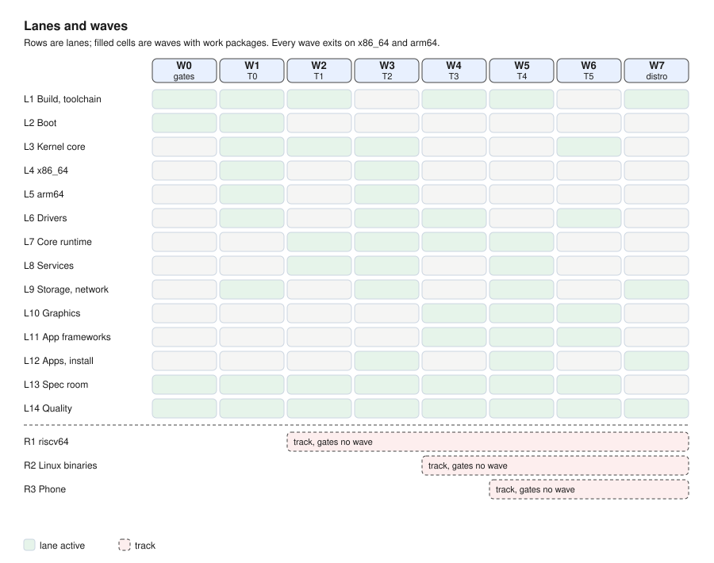

# Roadmap

This document says how ravynOS gets built: what the system can do at the end of each
wave, which lanes of parallel work produce it, and the work packages each lane takes on
in each wave. It turns [SYSTEM-DESIGN.md](SYSTEM-DESIGN.md) section 6 into assignable
work. Read it to pick up a work package, to see what blocks what, or to understand what
the system will be able to do after each wave.

Where this document and SYSTEM-DESIGN.md disagree, SYSTEM-DESIGN.md is right. Progress
against the work packages is recorded only in [STATUS.md](STATUS.md). There are no
dates: order and parallelism are what the plan controls.

## 1. How the work is organized

### 1.1 Waves

A wave ends when its tier passes in CI on x86_64 and on arm64 (ADR-19). A work package
belongs to the wave whose exit needs it; it may start earlier if its inputs exist.

| Wave | Proof | The system at the end of the wave |
|---|---|---|
| W0 | build system | the tree builds Mach-O with our tools; every gate runs |
| W1 | T0 | XNU boots on both architectures and runs our first program |
| W2 | T1 | dynamic Mac programs with Foundation run |
| W3 | T2 | the system boots from disk to a login prompt |
| W4 | T3 | an AppKit app opens a window and takes input |
| W5 | T4 | twenty open-source Mac apps run as downloaded |
| W6 | T5 | closed-source Mac apps run, through Electron |
| W7 | distribution | ravynOS installs, updates and runs SwiftUI apps |

### 1.2 Lanes

A lane is a stream of work with its own directories. Several agents may work in one
lane on different work packages, but two lanes never edit the same directory; a change
that needs another lane's directory goes to that lane as a request.

| Lane | Subsystems | Owns |
|---|---|---|
| L1 Build and toolchain | S01, S02, S03, S34 | `Tools/` except gates, `VENDORS` |
| L2 Boot | S04 | `Boot/` |
| L3 Kernel core | S05, S09, S12 (kernel) | `Kernel/xnu`, `Kernel/patches`, kernel libs |
| L4 x86_64 platform | S06 | `Kernel/port/x86_64-pc`, platform kexts |
| L5 arm64 platform | S07 | `Kernel/port/arm64-virt`, arm64 kexts |
| L6 Drivers | S10, S11 | `Kernel/Extensions`, `Kernel/ForeignKPI` |
| L7 Core runtime | S13–S16 | `Foundation/`, CF, Foundation |
| L8 Services | S17, S18, S21 | `Server/` daemons, their client libraries |
| L9 Storage and network | S19, S20 | file system kexts, disk tools, CFNetwork |
| L10 Graphics | S22, S23, S24, S28 | WindowServer, SkyLight, CG, CT, QC, Metal |
| L11 App frameworks | S25–S27, S29–S31 | AppKit and the remaining frameworks |
| L12 Apps and install | S32, S33 | `Apps/`, `Userland/`, installer |
| L13 Spec room | section 2.3, 5.4 | `Docs/spec/`, `Tests/probes/`, census |
| L14 Quality | section 5 | `Tools/ci/`, `Tests/`, CI, perf, license |

Tracks with their own lanes, gating no wave: R1 riscv64 (S08), R2 Linux and FreeBSD
binaries (S35), R3 phone and tablet (S36).

L13 needs Apple hardware for probes (SYSTEM-DESIGN section 2.3). Every other lane works
on Linux hosts.

### 1.3 Work packages

Each work package (WP) has an identifier `WPw.n` (wave w), a lane, the subsystem it
serves, what it needs, what it delivers and the test that closes it. An agent takes one
work package at a time, works only in its lane's directories, and closes it when the
test passes in CI. Unless a WP lists another WP under **Needs**, it can start as soon
as its wave starts.

### 1.4 Coordination rules

- **Contracts first.** At the start of each wave, the interfaces between lanes for that
  wave — headers, manifest names, file formats, IPC messages — are written and merged
  before implementation starts. SYSTEM-DESIGN.md's **Contracts** fields are the source.
  A change to a frozen contract mid-wave needs the owner of every lane that uses it.
- **One lane per directory**, as in section 1.2.
- **Green main.** Every merge passes CI. A lane that breaks main reverts first and fixes
  second.
- **No stubs, no shortcuts.** A work package is not done if it closes its test with a
  stub, a disabled check or a weakened test (SYSTEM-DESIGN section 2.4).
- **Owner's identity on every commit.** Agents set git's `user.name` and `user.email`
  to the project owner before committing; no AI name, email, co-author trailer or
  session link appears in any commit (ADR-29).
- **Review gate.** A branch merges only with a score of at least 8 out of 10 from a
  reviewer that did not write it (SYSTEM-DESIGN section 2.7).
- **Status in one place.** A lane updates STATUS.md in the same change that closes a
  work package or finds a gap.
- **Specs before closed behavior.** L13 delivers the spec, or a documented
  `pending-probe` spec, before another lane implements a closed behavior.

### 1.5 How many lanes run at once

| Wave | Active lanes |
|---|---|
| W0 | L1, L2, L13, L14 |
| W1 | L1, L2, L3, L4, L5, L6, L9, L13, L14 |
| W2 | L1, L3, L7, L8, L13, L14 |
| W3 | L3, L4, L5, L6, L7, L8, L9, L12, L13, L14 |
| W4 | L1, L6, L7, L10, L11, L13, L14 |
| W5 | L1, L7–L14 |
| W6 | L3, L6, L10, L11, L13, L14 |
| W7 | L1, L9, L12, L14 |

Tracks R1–R3 run whenever their inputs exist and someone owns them.

Figure: lanes (rows) against waves (columns); filled cells are waves in which the lane
has work packages.

## 2. The critical path

The longest chain of dependent work decides how fast the project moves:

1. `rv` produces Mach-O and dylibs (WP0.1–WP0.3).
2. The kernel builds inside `rv` and links without stubs (WP1.3–WP1.6).
3. The loader hands off correctly and XNU reaches its banner (WP1.1, WP1.2, WP1.7).
4. The early-tier harness runs T0 (WP1.12).
5. Libsystem, dyld and objc4 build, and the SDK exists (WP2.1–WP2.6).
6. launchd and the core services start a session (WP3.4–WP3.7).
7. IOSurface, WindowServer, CoreGraphics, QuartzCore and AppKit draw a window
   (WP4.1–WP4.7).
8. Framework width by census (W5), then closed apps (W6).

Everything else runs beside this chain. Work that is not on it should never block it.

## 3. W0 — Build system and gates

**At the end of W0** the tree builds Mach-O for x86_64 and arm64 with pinned tools,
every gate in SYSTEM-DESIGN section 5.6 runs in CI, and the repository contains no GPL
material.

- **WP0.1** (L1, S01) Manifest schema: kinds, versions, re-exports, install path,
  external source roots, hook; unknown keys and duplicate names rejected; same-layer
  edges allowed. Done: `Tests/rv/` schema tests pass.
- **WP0.2** (L1, S01, S02) Target table: Darwin triples (ADR-03), `ld64.lld`, UEFI and
  test-kernel targets; Mach-O assertion in CI. Needs WP0.1. Done: `hello` builds as
  Mach-O for both architectures.
- **WP0.3** (L1, S01) Compile rules for `.c .m .mm .cpp .S`, depfiles, dylib, framework,
  executable, kext and bundle outputs; sysroot assembly; `rv shell` fixed. Needs
  WP0.1. Done: header edit rebuilds dependents only; a two-dylib test links.
- **WP0.4** (L1, S02) Stage-1 toolchain, first part: LLVM from `swiftlang/llvm-project`
  (clang, lld, LLVM tools, libclang), byacc, unifdef, migcom, rvpatch, mkfat, elf2pe;
  `rv bootstrap`; `rust-toolchain.toml`; `rv` built static with musl; CI container from
  `Tools/ci/Containerfile` without bison, flex or m4. Done: `rv bootstrap --verify`
  reproduces its hashes (weekly job); CI uses the cached stage 1.
- **WP0.5** (L14) License audit over the whole tree, every file type; crate scanning;
  host-tool gate over every script with the full deny list. Done: planted cases in
  `Tests/rv/` fail as designed.
- **WP0.6** (L14) Remove GPL material from `Legacy/` and the vendored trees' build
  paths: autotools files, GCC dump files, URW fonts, GCC-built `migcom` binary; record
  regeneration rules for Bison outputs (ADR-17). Needs WP0.5. Done: the audit is green.
- **WP0.7** (L1, L14) `VENDORS` at the root with every pin; correct `_PROVENANCE` for
  every vendored tree. Done: `rv vendors check` passes.
- **WP0.8** (L14) CI matrix: `cargo test`, clippy, both architectures, loader build,
  mig build, boot smokes, pristine checks. Needs WP0.2. Done: every job runs on push.
- **WP0.9** (L2, S04) Fix BUG-01 to BUG-04 and BUG-13; add a Mach-O test kernel. Can
  start at once. Done: the Mach-O test kernel boots in QEMU on x86_64.
- **WP0.10** (L13) Spec room set-up: `Tests/probes/` runner on a Mac, `REQUESTS.md`,
  first specs (system calls used by T0 and T1). Done: one probe runs and its spec is
  merged.

## 4. W1 — The kernel boots and runs T0

**At the end of W1** our loader boots the vendored XNU, built from a pristine tree plus
patches entirely inside `rv`, on QEMU for x86_64 and arm64; the kernel mounts a
memory-disk root and runs a static Mach-O program that reports its result on serial.

- **WP1.1** (L2, S04) x86_64 hand-off: the device tree builder with every required
  node, `boot_args` with video and runtime fields, final memory map, command line.
  Needs WP0.9. Done: the test kernel validates every field it receives.
- **WP1.2** (L2, S04, S07) arm64 hand-off: arm64 `boot_args`, FDT-to-Apple-device-tree
  conversion, cache clean and MMU off at entry. Needs WP0.9. Done: the arm64 test
  kernel validates its hand-off.
- **WP1.3** (L3, S05) Restore `Kernel/xnu` to its pristine tag; move the in-tree edits
  into `Kernel/patches` or generated outputs. Done: the pristine check passes.
- **WP1.4** (L1, L3, S02, S05) XNU host tools (ADR-21): `config` with byacc and a
  hand-written scanner, `doconf` logic in `rv`, `kextsymboltool`, `newvers`; the
  system-call and libsyscall generators re-implemented in Rust in `Tools/xnuhook`.
  Needs WP0.4. Done: configuration and generated tables for x86_64 and RVVIRT match
  golden files.
- **WP1.4a** (L1, S02) Apple `ld64` and `cctools` in stage 1. Needs WP0.4. Done: a
  static Mach-O and a kext bundle link.
- **WP1.5** (L3, S05) The kernel hook: compile and link plan into ninja; mig and
  system-call generation; Bison outputs regenerated with byacc. Needs WP1.3, WP1.4,
  WP1.9.
  Done: `rv build xnu` compiles every selected file.
- **WP1.6** (L3, S05) Vendor libdispatch for `libfirehose_kernel` and BoringSSL for
  `libcc_kext` (ADR-12); zero-stub link with `ld64`. Needs WP1.5, WP1.4a, WP1.11. Done:
  the link report shows no undefined symbols on both architectures.
- **WP1.7** (L4, S06) x86_64 minimum: AMD and TCG timing patch (ADR-20), CPU and
  interrupt bring-up for one CPU. Needs WP1.6, WP1.1. Done: XNU prints its banner
  under QEMU.
- **WP1.8** (L5, S07) RVVIRT minimum: board patches, arm64 not arm64e, PAC hypercalls
  removed, `rorgn_*`, GIC and timer, board library replacement. Needs WP1.6, WP1.2.
  Done: XNU prints its banner under QEMU `virt`.
- **WP1.9** (L6, S10) `Tools/iig` from the public `.iig` files. Done: XNU's DriverKit
  headers generate and compile (needed by WP1.5).
- **WP1.10** (L3, S09) `rv kernelcache`: `MH_FILESET` boot collection with the HFS kext.
  Needs WP1.6. Done: a kernelcache boots on both architectures.
- **WP1.11** (L3, S12) Boot-time policy hooks: `TrustCache/API.h`; the `img4`
  interface, the AMFI trust-cache interface and CoreEntitlements registered from
  `Kernel/port/common/` before `trust_cache_runtime_init`; ad-hoc signatures accepted.
  Done: XNU passes trust-cache initialization; a signed static binary loads and a
  tampered one is refused.
- **WP1.12** (L9, L14, S19, section 5.2) Early-tier harness: `Tools/hfsimage`, image
  manifests in `Tests/images/`, the `RVTEST` protocol, `rv image` and `rv test t0`.
  Needs WP1.10. Done: the harness runs in CI under TCG.
- **WP1.13** (L1, S02) The freestanding T0 program, linked static with `ld64` and signed
  by `rv codesign`. Needs WP1.4a. Done: **T0 passes on x86_64 and arm64.**
- **WP1.14** (L14) Budgets P2, P9, P10 armed; GRUB rig and `Kernel/build/` deleted.
  Needs WP1.13.

## 5. W2 — Dynamic programs and the SDK

**At the end of W2** the SDK exists, and dynamically linked Objective-C and Swift
programs built against it run on XNU on both architectures: dyld, libSystem, objc4,
CoreFoundation, a first slice of Foundation and the Swift runtime work.

- **WP2.1** (L7, S13) Libsystem components at their pinned tags, in initializer order;
  minimal `libxpc`, `libsystem_trace`, `secinit` and container manager. Done: each
  library's own tests pass.
- **WP2.2** (L7, S13) libc++ and libc++abi; the rest of the T1 library set. Done: a C++
  test program runs.
- **WP2.3** (L7, S14) dyld built static; runs without a shared cache. Needs WP2.1.
  Done: a two-dylib program runs.
- **WP2.4** (L7, S15) objc4 and CoreFoundation. Needs WP2.3. Done: objc4 and CF tests.
- **WP2.5** (L7, L13, S15) Foundation slice for the T1 program's classes, with specs
  and the seed audit. Needs WP2.4. Done: Foundation probes for those classes pass.
- **WP2.6** (L1, S03) `rv build sdk`: headers, `.tbd` stubs, framework bundles,
  `SDKSettings.json`, Availability macros, `rv sdk`. Needs WP2.1–WP2.4. Done: T1
  builds against the SDK alone.
- **WP2.7** (L1, L7, S02, S16) Swift compiler in stage 1 (interim: the pinned swift.org
  release); Swift runtime and stdlib. Needs WP2.3. Done: a Swift command-line program
  runs.
- **WP2.8** (L14) Budgets P3, P4, P5 armed. Done: **T1 passes on x86_64 and arm64.**

## 6. W3 — Boot to a login prompt

**At the end of W3** ravynOS boots from an HFS+ disk image on QEMU and on one PC and one
arm64 machine, all CPUs online, launchd running the system services, and a console
login with the BSD userland.

- **WP3.1** (L4, S06) Full x86_64 platform: ACPI platform expert, all CPUs, I/O APIC,
  MSI, PCI, RTC, NVRAM, SMBIOS identity, shutdown and reboot. Done: all CPUs online.
- **WP3.2** (L5, S07) Full RVVIRT: GICv3 kext, PSCI secondary CPUs, PL011, timer.
  Done: all CPUs online under QEMU.
- **WP3.3** (L6, S10) Storage and basic devices: virtio block and net, AHCI, NVMe,
  xHCI with HID keyboard. Done: QEMU tests per driver.
- **WP3.4** (L8, S17) launchd from launchd-842 with modern domains; full `libxpc`.
  Done: job start, restart, on-demand launch, XPC tests.
- **WP3.5** (L8, S18) logd, cfprefsd, notifyd, distnoted, configd, mDNSResponder,
  opendirectoryd, OS version reporting. Needs WP3.4. Done: each service's probes.
- **WP3.6** (L9, S19) HFS+ root from disk through the system collection;
  DiskArbitration and `/Volumes`. Needs WP3.3. Done: boots from disk.
- **WP3.7** (L12, S32) BSD userland and zsh; console login. Done: login prompt.
- **WP3.8** (L8, S21) IOKit.framework, powerd, `sysctl hw.*`, slice policy. Done:
  probes.
- **WP3.9** (L6, S11, track) FreeBSD and OpenBSD environments start: `vtnet` echo test.
- **WP3.11** (L9, S20) Network basics: DHCP through configd, DNS through mDNSResponder,
  `getaddrinfo`. Done: probes.
- **WP3.12** (L3, S12) Containers and `secinitd`/`containermanagerd` once launchd runs.
- **WP3.10** (L14) Boot on one physical PC and one arm64 machine. Done: **T2 passes on
  x86_64 and arm64.**

## 7. W4 — A window on screen

**At the end of W4** an AppKit application built with our SDK opens a window, draws
text and controls, and responds to mouse and keyboard at 60 frames per second, on QEMU
and on the two physical machines.

- **WP4.1** (L10, S22) IOSurface kext and framework. Done: cross-process sharing test.
- **WP4.2** (L6, S10) Display and input: virtio-gpu, GOP framebuffer, USB HID mouse.
  Done: mode set and input events in QEMU.
- **WP4.3** (L10, S22) WindowServer with the CPU compositor; SkyLight client library
  for the census-ordered first functions. Needs WP4.1, WP4.2. Done: fixed scene
  composites; input routed.
- **WP4.4** (L10, S23) CoreGraphics and CoreText with fonts and the name map. Done:
  golden-image tests.
- **WP4.5** (L10, S24) QuartzCore layer trees and commits. Needs WP4.3. Done: layer
  probes.
- **WP4.6** (L11, S25) AppKit: application, windows, views, controls, menus, nibs.
  Needs WP4.3–WP4.5. Done: AppKit probes for the T3 program.
- **WP4.7** (L11, S26) Keyboard layouts and text input for the T3 program.
- **WP4.9** (L11, S29) Minimal `tccd`: policy answers for screen capture and file access.
- **WP4.10** (L1, S34) `actool` and `ibtool` replacements; `Tools/abi-census`.
- **WP4.11** (L13) Census of the T4 set; demand table merged. Needs WP4.10.
- **WP4.8** (L14) Budgets P1, P6, P7 armed. Done: **T3 passes on x86_64 and arm64.**

## 8. W5 — Twenty applications

**At the end of W5** the twenty applications of the T4 set run as downloaded, on both
architectures: networking, keychain, audio, the remaining frameworks, Metal on the CPU,
and `.dmg` and `.pkg` installation.

- **WP5.1** (L1, S34) The `metal` and `metallib` tools for S28.
- **WP5.2** (L11, S25) AppKit width by census: documents, panels, drag and drop,
  pasteboard, LaunchServices, Dock, menu bar.
- **WP5.3** (L9, S20) CFNetwork, NSURLSession, TLS and certificates.
- **WP5.4** (L11, S29) Security framework, keychain, TCC.
- **WP5.5** (L11, S27) Audio stack and permissive codecs.
- **WP5.6** (L10, S28) Metal API and CPU backend; OpenGL.
- **WP5.7** (L11, S26, S31) Text system width, accessibility, notifications, printing,
  the remaining frameworks by census.
- **WP5.8** (L11, S30) JavaScriptCore API over QuickJS-ng.
- **WP5.9** (L12, S33) `.dmg` and `.pkg` installation.
- **WP5.10** (L11, L13) SwiftUI scope from the census, recorded in S25's spec.
- **WP5.11** (L14) Budget P8 armed. Done: **T4 passes on x86_64 and arm64.**

Each of WP5.2–WP5.9 closes when every census entry it owns is implemented, specified
and tested.

## 9. W6 — Closed-source applications

**At the end of W6** closed-source Mac applications run in order — a small AppKit app,
a Qt app, a SwiftUI app, an Electron app — and one GPU backend runs Metal.

- **WP6.1** (L13) Census of the T5 set; specs for their private SPI.
- **WP6.2** (L3, S12) Full security policy: hardened runtime, library validation,
  sandbox profiles, quarantine.
- **WP6.3** (L11, S25, S16) SwiftUI, SwiftUICore, AttributeGraph and Combine.
- **WP6.4** (L10, S28) First GPU backend on a native driver; Metal sample subset.
- **WP6.5** (L11, S30) WKWebView on Ladybird LibWeb.
- **WP6.7** (L6, L11, S10, S31) Bluetooth: FreeBSD-derived stack, IOBluetooth and
  CoreBluetooth.
- **WP6.6** (L10, L11) Electron's needs: cross-process layers, sandbox start, Metal
  through ANGLE. Done: **T5 passes on x86_64 and arm64, in order.**

## 10. W7 — An installable system

**At the end of W7** ravynOS installs from its own image onto an APFS volume group,
updates through an A/B scheme, includes its system applications, and runs a stock
SwiftUI application out of the box.

- **WP7.1** (L9, S19) APFS: library, kernel back end, root volume group.
- **WP7.2** (L12, S32) System applications: Finder, Terminal, System Settings,
  TextEdit, Console, Activity Monitor.
- **WP7.3** (L12, S33) OS installer and A/B updates.
- **WP7.4** (L1, S34) Developer tools on ravynOS.
- **WP7.5** (L14) `LICENSES.md`, final performance report against every budget.
  Done: **W7 exit criteria in SYSTEM-DESIGN section 6.**

## 11. Tracks

- **R1 riscv64 (S08).** Needs W1's kernel build. Works through the S08 stages; joins
  the tier harness at T0 and T1 when ready.
- **R2 Linux and FreeBSD binaries (S35).** Needs W3.
- **R3 phone and tablet (S36).** Needs W4 and an arm64 board port.
- **S11 foreign drivers** continue after WP3.9 as a track inside L6: Linux environment
  with an MIT DRM driver, OpenBSD Wi-Fi on hardware; the optional GPL channel gates
  nothing.

## 12. After W7

Planned work beyond the first distribution. Until each lands, its APIs behave as the
owning subsystem specifies (an error or an empty result, never a fake success): HTTP/3,
NTLM and VPN (S20); App Nap (S21); SMB client (S19); AAC and HEVC once licensing allows
(ADR-25, S27); speech synthesis and a screen reader (S26); SwiftData and Core ML (S31);
Spotlight importers (S31); fast user switching (S18); Endpoint Security (S12); FileVault
(S19).

## 13. Open questions

- Who holds the Apple hardware for L13, and how many machines are needed to keep the
  probe queue short?
- Should W4 and W5 overlap, starting census-driven framework width while the window
  server is still being finished, at the cost of more contract churn?
