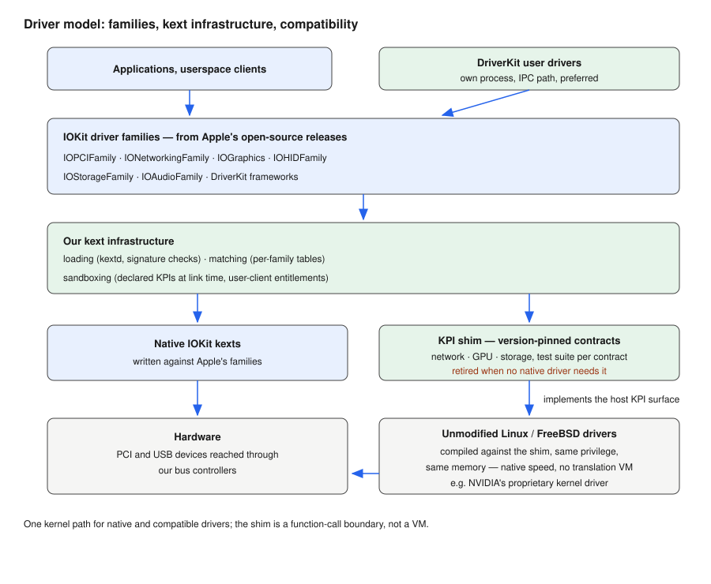

# ravynOS system design

This is the design of ravynOS: what the system must do, how each subsystem works, how
each one is built and tested, and when it counts as done. It is the document to read
first and the one that wins when another document disagrees with it.

It deliberately contains no status and no history. Where the code stands today is in
[STATUS.md](STATUS.md). Why a choice was made, and what was rejected, is in
[DECISIONS.md](DECISIONS.md), cited here as ADR numbers. The older numbered documents
(01–13) and [../DESIGN.md](../DESIGN.md) remain as background reading; where they
disagree with this document, this document is right.

## 0. How to use this document

**If you are implementing.** Find your subsystem in section 4. Every subsystem section
has the same fields, in the same order:

- **Purpose** — what it is for, in one paragraph.
- **How macOS behaves** — what applications observe, which is what we must reproduce.
- **Design** — how our implementation works.
- **Contracts** — the interfaces other code depends on: headers, paths, formats, ABI.
- **Sources** — what we vendor, what we seed from, what we write clean-room, and the
  licenses.
- **Location** — where it lives in the tree and which manifest builds it.
- **Build and test** — the commands and the tests.
- **Done when** — the checkable condition that closes the work.
- **Depends on** — subsystems that must exist first.

Work only inside your subsystem's location, follow the rules in section 2, and check
[STATUS.md](STATUS.md) for the known gaps in your area before you start.

**If you want to understand the system.** Read sections 1 to 3, then the subsystems in
order. Section 3.4 walks one application launch through every subsystem.

**Identifiers.** Subsystems are S01–S31. Compatibility tiers are T0–T5 (section 5.1).
Performance budgets are P1–P10 (section 5.4). Decisions are ADR-01 onward. Gaps in
[STATUS.md](STATUS.md) are GAP-01 onward. No other numbering scheme is used.

## 1. Goal and compatibility contract

ravynOS is an operating system on which Mac applications run unmodified, as they are
downloaded. It is built from Apple's open-source releases — the XNU kernel, dyld, the
Objective-C runtime, Libc and the rest of Libsystem — and from our own implementations of
everything Apple keeps closed: the window server, AppKit, CoreGraphics, Metal, the
platform drivers and the system services. It also has its own SDK, shaped like Apple's,
so that developers can build Mac applications for it without Apple's SDK or a Mac.

**Target generation.** The compatibility target is macOS 27.2.1 (build 26B131) and the
XNU line it ships with, xnu-13432 (ADR-01). Until Apple publishes that kernel source, the
kernel of record is the vendored xnu-12377.121.6, and the newer generation is the ABI
target for user space.

**The contract.** A Mac application is a Mach-O file. It expects the following, and
each line is owned by a subsystem below.

| It expects | We provide | Owner |
|---|---|---|
| `LC_BUILD_VERSION` platform macOS, a minimum OS version | a kernel, dyld and frameworks that accept the macOS platform | S13, S14 |
| Install names such as `/usr/lib/libSystem.B.dylib` | real dylibs at exactly those paths | S13–S15 |
| Framework paths such as `AppKit.framework/Versions/C/AppKit` | real framework bundles at those paths | S21–S23 |
| Exported symbols and Objective-C classes by name | the same names, signatures and object layouts | all user-space subsystems |
| System calls and Mach traps | Apple's XNU, unchanged | S05–S07 |
| A code signature (always on arm64) | signature parsing and ad-hoc acceptance | S12 |
| Observable behavior: return values, ordering, timing, file formats | clean-room implementations, specified from observation | section 2.3 |

The kernel row is why the project runs Apple's XNU: the system-call ABI is inherited,
not reimplemented. The last row is where almost all the work is.

**Our SDK targets the same contract** (ADR-02). An app built with the ravynOS SDK is a
Mac app: macOS platform, Apple install names, Mach-O. The SDK identifies itself as
ravynOS in its name only.

## 2. Rules every subsystem follows

### 2.1 Licensing

- **This repository contains no GPL, LGPL or AGPL code, data or generated output**, in
  any directory, `Legacy/` included (ADR-17).
- Accepted for code: APSL-2.0, BSD (2/3/4-clause), MIT, ISC, Apache-2.0, Zlib, public
  domain, Unicode-3.0. Accepted for fonts only: SIL OFL-1.1 (ADR-16).
- Our own code is BSD-3-Clause. Every file carries `SPDX-License-Identifier`. Every
  vendored file keeps its upstream header. Every vendored tree has a `_PROVENANCE` file:
  upstream URL, tag or commit, license, local patches.
- **GPL code may run on an installed ravynOS system.** It lives in a separate repository,
  is built there against interfaces this repository publishes, and is distributed
  separately; the user installs it. The foreign-driver design (S11) is the main case.
- Apple's proprietary SDK, Xcode, and any file derived from them never enter the
  repository or the build (ADR-13). Apple's `corecrypto` source is not under an open
  license and is treated as forbidden input (ADR-12).

### 2.2 Tooling boundary

Three classes of tool, by what their output becomes:

- **Build tooling** — anything whose code or output ends up in a committed file, an
  artifact, the SDK or an image: compilers, linkers, assemblers, parser and lexer
  generators, archivers, image tools. These must be permissively licensed. Allowed:
  clang, lld, llvm tools, byacc, ninja, our own tools. Not allowed: GCC, GNU binutils,
  GNU make, bison, flex (it runs GNU m4), GRUB.
- **Host environment** — the build machine's kernel, shell, coreutils and git. Allowed;
  recorded, never vendored, never producing shipped bytes.
- **Test executors** — QEMU and firmware images used only to run tests. Allowed in CI;
  never shipped.

`Tools/ci/check-host-tools.sh` enforces the first class over every script in the tree.

### 2.3 How we build what Apple keeps closed

Every closed component is built the same way, and nothing else is acceptable:

1. **Observe.** On a real Apple machine (macOS may only run on Apple hardware), a probe
   program calls the API or exercises the format under study and records what happens:
   return values, errors, notifications and their order, files touched, IPC messages
   sent, timing. For hardware, observe the device side: register accesses and DMA, the
   way Asahi Linux traces macOS drivers under a hypervisor.
2. **Specify.** Write `Docs/spec/<subsystem>/<topic>.md` from the observations, using
   the template in `Docs/spec/TEMPLATE.md`: the behavior, state machines, data formats,
   and for every claim the probe run that established it.
3. **Implement** from the spec, Apple's public headers and documentation, and Apple's
   open-source code. Never from Apple's compiled code: no disassembly or decompilation of
   Apple binaries feeds a spec or a commit.
4. **Verify.** The probe becomes a test that runs on ravynOS. It is the compatibility
   check for that behavior permanently.

Public headers and documentation may be read to learn names, signatures and layouts.
Apple's SDK files themselves (headers, `.tbd` stubs) are never copied into the tree; our
headers are written by us, and our `.tbd` stubs are generated from our own libraries
(S03).

### 2.4 No stubs

A function that reports success without doing the work is forbidden. When something is
not ready, it is either absent (callers fail to link, loudly) or present and marked
`state = "incomplete"` in its manifest, returning a real error, with the missing pieces
listed in the component's README. A test that documents a gap fails when the gap closes,
so the documentation is updated with the code.

### 2.5 Vendored code

Vendored trees are never edited in place. Changes are patch files in a `patches/`
directory next to the vendored tree, applied by the build with `rvpatch`, each starting
with:

```
# why: <the reason this change exists>
# fate: retire | upstream | permanent
```

For XNU that directory is `Kernel/patches/`. Generated files (system call tables, mig
output) are build outputs, not edits to the vendored tree; a reference copy may be
committed under `Tests/fixtures/` to detect changes.

### 2.6 Layers and dependency direction

Every component declares a layer in its manifest. Dependencies point down only:

```
apps → frameworks → foundation → kernel
server → frameworks, foundation
compat → kernel                (never foundation)
bootloader                      (depends on nothing in-tree)
build-toolchain                 (host tools; nothing in the image links it)
```

`rv` rejects any other edge at graph time. A framework never includes kernel-internal
headers; it reaches the kernel through `foundation` (Libsystem).

## 3. Architecture

### 3.1 The stack


From the bottom:

| Layer | Contents | Subsystems |
|---|---|---|
| Firmware | UEFI on PCs and QEMU; SBI on riscv64 | — |
| Bootloader | our UEFI loader | S04 |
| Kernel | XNU, our platform code, IOKit families, drivers | S05–S12 |
| Core user space | Libsystem, dyld, objc4, CoreFoundation, launchd, XPC, daemons | S13–S17 |
| Storage and network | filesystems, network stack and frameworks | S18, S19 |
| Graphics and frameworks | window server, CoreGraphics, CoreText, QuartzCore, AppKit, Metal, audio | S20–S27 |
| Applications | ours and everyone else's | S28, S29 |

### 3.2 Repository layout

```
ravynos/
├── Kernel/
│   ├── xnu/                 Apple XNU, pristine                       kernel
│   ├── patches/             patch series applied to xnu/              kernel
│   ├── port/<board>/        our platform code per board               kernel
│   ├── Extensions/          IOKit families and drivers (kexts)        kernel
│   ├── ForeignKPI/          FreeBSD and Linux driver interfaces       kernel
│   └── IOKitUser/           IOKit user library                        foundation
├── Boot/                    UEFI loader, image tools, test kernels    bootloader
├── Foundation/              Libsystem components, dyld, objc4, CF     foundation
├── Frameworks/              CoreGraphics … AppKit, Metal              frameworks
├── Server/                  launchd, WindowServer, system daemons     server
├── Compat/                  Linux/FreeBSD binary support (future)     compat
├── Apps/                    our applications and tier test apps       apps
├── Tests/                   tests, fixtures, specs' probes            (test)
├── Tools/                   rv, mig, rvpatch, census, CI gates        build-toolchain
├── Legacy/                  imported upstream ravynOS, outside the build graph
└── Docs/                    this documentation, Docs/spec/
```

`Frameworks/`, `Server/`, `Compat/`, `Kernel/patches/` and `Kernel/ForeignKPI/` are
created by the first component that needs them. `Legacy/` holds the upstream ravynOS
tree; a component leaves it only by gaining a manifest, passing the license audit and
the quality gate (no unresolved symbols, no stubs), and getting a spec where it
implements closed behavior. Nothing in the build references `Legacy/`.

### 3.3 Processes at run time

The kernel starts `launchd` as PID 1. Every other long-running process is a launchd job:
the window server, the system daemons, per-user agents. Processes talk through Mach
ports looked up in launchd's bootstrap namespace, with XPC as the message format for
services; bulk data (pixels, audio) moves through shared memory (IOSurface, mapped
buffers), control through messages. A daemon that crashes is restarted by launchd.

### 3.4 One application launch, end to end

What happens when a user opens a Mac app on ravynOS, with the subsystem responsible:

1. The Dock or Finder calls LaunchServices to open the bundle (S23), which asks launchd
   to start the process (S16).
2. XNU loads the Mach-O, checks its code signature against policy (S12) and maps dyld
   (S05, S14).
3. dyld maps the shared cache (S14), binds the app to libSystem and the frameworks, and
   runs initializers: libSystem's initializer brings up libdispatch, os_log and libxpc
   (S13, S16, S17).
4. objc4 registers the app's classes; CoreFoundation and Foundation initialize (S15),
   reading preferences through the preferences service (S17).
5. `NSApplicationMain` loads the main nib (S23), connects to the window server through
   its client library (S20), and registers the app with LaunchServices.
6. Views draw with CoreGraphics and CoreText into layers (S21); QuartzCore commits the
   layer tree to the window server (S22), which composites with Metal or the software
   renderer (S20, S26) and scans out through the display driver (S10).
7. Keyboard and mouse events arrive from IOHIDFamily (S10) at the window server, which
   routes them to the app; the text-input system turns keys into text (S24).

Every step names a subsystem; there is no step that "just works".

## 4. Subsystems

### S01 — Build harness (`rv`)

**Purpose.** One tool builds everything, from one component to a bootable image, the
same way on a developer's machine and in CI.

**Design.** `rv` is a Rust program (`Tools/rv/`) that reads a `manifest.toml` in every
component directory, resolves them into one dependency graph, checks the graph (layers,
cycles, licenses, duplicate names), and writes a single `build.ninja`. Ninja does the
building; `rv` never compiles anything itself. Every compiler and linker invocation is
generated from one flag table inside `rv`, keyed by target and host, so a component
cannot pick up host headers or flags by accident.

Commands:

| Command | Does |
|---|---|
| `rv build [-t T] [name…]` | builds components or whole layers and their dependencies |
| `rv build kernel` | the kernel (S05) — an ordinary component |
| `rv build sdk` | assembles the SDK (S03) |
| `rv bootstrap` | builds and verifies the stage-1 toolchain (S02) |
| `rv image` | assembles boot and disk images from manifests |
| `rv test [name…]` | runs component tests, host-side and in QEMU |
| `rv shell name` | opens a shell with that component's exact compiler environment |
| `rv graph [--reverse]` | prints the graph |
| `rv audit license` / `rv audit size` | runs the gates by hand |
| `rv vendors check` | reports vendored pins that are stale |

**Contracts.** The manifest schema:

```toml
name    = "CoreFoundation"          # unique across the tree; duplicates are an error
layer   = "foundation"              # one of the layers in section 2.6
license = "APSL-2.0"                # SPDX expression
state   = "incomplete"              # working | incomplete | experimental
sources = ["Sources/**.c", "Sources/**.m"]
exports.headers = ["include/**.h"]
exports.libs    = ["CoreFoundation.dylib"]
install_name    = "/System/Library/Frameworks/CoreFoundation.framework/Versions/A/CoreFoundation"
deps.internal   = ["libdispatch", "Libc"]
targets = ["x86_64-ravynos", "arm64-ravynos"]
tests   = ["Tests/**"]
vendored = { upstream = "github.com/apple-oss-distributions/CF", tag = "<tag>" }
```

Unknown keys are an error. Sources of every language the system uses compile: `.c`,
`.m`, `.mm`, `.cpp`, `.S`, `.s`, `.swift` (when the Swift toolchain exists). The
compile rule emits dependency files, so editing a header rebuilds exactly its
dependents. Output kinds are static library, dylib, framework bundle, executable, kext
bundle and loader image.

Pinned external sources are listed in one `VENDORS` file at the repository root and
read by `rv vendors`.

**Sources.** Ours, BSD-3-Clause. Built as a static binary against musl so no LGPL code
ships inside it.

**Location.** `Tools/rv/`, layer `build-toolchain`.

**Build and test.** `cargo build --locked`, `cargo test`, `cargo clippy -- -D warnings`
in CI. Negative tests live in `Tests/rv/` (a planted layer violation, an undeclared
dependency, a duplicate name, a GPL header, a missing SPDX header, an unknown manifest
key) and each must fail with a named error.

**Done when** every row of the command table works, the negative tests run in CI, and
an edit to an exported header rebuilds its dependents and nothing else.

**Depends on** nothing.

### S02 — Toolchain

**Purpose.** The compilers, linkers and tools that build the system, themselves built
from pinned open source.

**Design.** Three stages.

- **Stage 0** is whatever clang the host has. It only builds stage 1.
- **Stage 1** is our toolchain, built by `rv bootstrap` from pinned sources: LLVM with
  clang, lld (`ld64.lld`), llvm-objdump, llvm-readtapi and dsymutil; Apple's `ld64` and
  `cctools` (APSL); Apple's migcom (`Tools/mig/`); our `rvpatch`, `mkfat`, `elf2pe`;
  later the Swift compiler. Every system build uses only stage-1 tools, and each stage's
  outputs are hashed.
- **Stage 2** is the system building itself; once ravynOS is self-hosting, the same
  graph builds stage 1 on ravynOS.

**Contracts.**

- Harness targets map to clang triples (ADR-03): `x86_64-ravynos` →
  `x86_64-apple-macosx<min>`, `arm64-ravynos` → `arm64-apple-macosx<min>`. `<min>` is
  the SDK's minimum deployment target. `riscv64-ravynos` has no Mach-O triple in LLVM;
  user-space riscv64 waits for an LLVM patch that adds one (S08).
- Linking (ADR-04): `ld64.lld` for executables, dylibs and frameworks; Apple's `ld64`
  for what lld cannot produce today — fully static executables (T0) and kernel and
  kernelcache links — until lld can.
- CI asserts on every linked output that it is Mach-O with `LC_BUILD_VERSION` platform
  macOS (`llvm-objdump --macho --private-headers`).
- Parsers are generated with byacc; lexers are written by hand or generated by a
  non-GPL tool. No generated file in the tree comes from a GPL tool.

**Sources.** LLVM (Apache-2.0 with LLVM exception), ld64 and cctools (APSL), migcom
(APSL), Swift (Apache-2.0).

**Location.** `Tools/` for our tools; `Tools/toolchain/<name>/` manifests for the
stage-1 components, vendored per `VENDORS`.

**Build and test.** `rv bootstrap` then `rv bootstrap --verify` (rebuild, compare
hashes). CI pins the stage-0 compiler version and the Rust toolchain
(`rust-toolchain.toml`).

**Done when** a clean machine with only a stage-0 clang produces the stage-1 toolchain,
and every target build in CI uses it.

**Depends on** S01.

### S03 — The SDK

**Purpose.** The headers and link stubs that applications build against, laid out like
Apple's macOS SDK so existing build systems work unchanged.

**Design.** `rv build sdk` assembles `build/sdk/<target>/ravynOS.sdk` from components'
manifests. Nothing in it is hand-copied.

```
ravynOS.sdk/
├── SDKSettings.json
├── usr/include/…                    headers exported by foundation-layer components
├── usr/lib/libSystem.B.tbd          one stub per dylib we build
├── usr/lib/swift/…                  Swift module interfaces and stubs (with S15)
└── System/Library/Frameworks/
    └── AppKit.framework/
        ├── Headers/  Modules/module.modulemap
        └── AppKit.tbd
```

- Headers come only from `exports.headers`. Framework public headers are written by us
  to match the names and layouts applications compile against (section 2.3).
- `.tbd` stubs are generated from our built dylibs with `llvm-readtapi --stubify`, so
  the SDK can never promise a symbol the system lacks. Install names, current and
  compatibility versions, re-exports (libSystem re-exports `libsystem_*`) and umbrella
  structure match Apple's for the same library, or Mac binaries will not bind. Stubs list
  both architectures so universal apps link.
- `SDKSettings.json` declares the macOS platform, our version, `CanonicalName`, the
  deployment-target range and the `VersionMap` clang reads. `Availability.h`,
  `AvailabilityMacros.h` and `TargetConditionals.h` are ours, with the same macros.
- `rv sdk` is the developer entry point, like `xcrun`: `rv sdk --show-sdk-path`,
  `rv sdk clang …`. A CMake toolchain file and a `pkg-config` directory ship with the SDK.

**Contracts.** The SDK path layout, `SDKSettings.json` fields, and every install name
are public contract. Changing one is an ABI event.

**Sources.** Generated from our components; licenses are those of the components.

**Location.** The assembler lives in `Tools/rv/`; output in `build/sdk/`.

**Build and test.** `rv build sdk`; the T1 and T3 test apps (section 5.2) build against
the SDK alone, with no host headers and nothing from `Legacy/`.

**Done when** the T1 test app builds against the SDK alone and runs (S14).

**Depends on** S01, S02, and each component that exports into it.

### S04 — Bootloader

**Purpose.** Load the kernel from disk and hand the machine over in exactly the state
XNU expects, on every architecture we support.

**Design.** A freestanding UEFI application (`Boot/loader/`, C; ADR-15) with a small
core and per-architecture platform code:

1. Read the kernelcache (S09) from the EFI system partition, later from the root volume.
2. Parse the Mach-O: `LC_SEGMENT_64` fields at their real offsets (vmaddr 24, vmsize 32,
   fileoff 40, filesize 48), entry from `LC_UNIXTHREAD` (`rip`, index 16 of the x86
   thread state) or `LC_MAIN` (`0x80000028`, entry as file offset). Bounds-check every
   field against the file.
3. Copy segments to their physical addresses.
4. Build the architecture's hand-off structures (below).
5. Get the final memory map into the `boot_args` buffer, call `ExitBootServices` with
   that map's key, retry on key change.
6. Enter the kernel.

An ELF path loads our own test kernels, which check the hand-off and fail loudly in CI.

**Contracts — x86_64.** `boot_args` as in `pexpert/pexpert/i386/boot.h` (version 2),
including video from UEFI GOP, `efiSystemTable`, the runtime-services fields, `kaddr`,
`ksize`, `kslide`, and `deviceTreeP`/`deviceTreeLength` pointing at a device tree in XNU's
format (`pexpert/pexpert/device_tree.h`, not FDT). Required nodes and properties are the
ones XNU reads: `/chosen` (with `boot-uuid` or `root-matching`), `/chosen/memory-map`,
`/efi/platform` (`FSBFrequency`, `InitialTSC`), `/product`. Entry is `pstart` in 32-bit
protected mode with paging off and flat segments, `eax` holding the `boot_args` physical
address (`osfmk/x86_64/start.s`). The loader's 64→32 switch reloads data segments and
jumps to the kernel entry, not to `boot_args`.

**Contracts — arm64.** The arm64 `boot_args` from `pexpert/pexpert/arm64/boot.h`
(`virtBase`, `physBase`, `memSize`, `topOfKernelData`, `deviceTreeP`, command line),
pointer in `x0`, entry at EL1, MMU and data cache off after cleaning the cache to the
point of coherency. The device tree is an Apple device tree generated from the firmware's
FDT, with the nodes S07 lists.

**Contracts — riscv64.** Defined by S08.

**Sources.** Ours, BSD-3-Clause. No GNU-EFI.

**Location.** `Boot/loader/`, `Boot/testkernel/`, `Boot/mkfat/`, `Boot/elf2pe/`; layer
`bootloader`. Built by an `rv` manifest.

**Build and test.** `rv build bootloader`; `Tests/boot/` smokes boot a test kernel under
QEMU (OVMF, AAVMF, edk2) and assert on serial output; a Mach-O test kernel exercises the
Mach-O path and the 32-bit entry; the test kernel parses the device tree it receives.
All run in CI.

**Done when** the x86_64 kernel built by S05 prints its version banner on serial under
QEMU after being loaded by this loader, and the same holds on arm64 under S07.

**Depends on** S01; S05 for the real kernel; S09 for the kernelcache.

### S05 — Kernel build

**Purpose.** Build Apple's XNU from pristine source, with our patches, into a linked
kernel per architecture.

**Design.** The kernel is an ordinary `rv` component (ADR-09). Its manifest uses a build
hook that:

1. Builds XNU's own host tools (`SETUP/config`, `kextsymboltool`, `newvers` and the
   rest) with stage 0.
2. Runs `config` over `config/MASTER*` for the selected board and kernel configuration,
   producing the configuration headers and the list of files to compile. No configuration
   header is written by hand.
3. Runs mig (S02) over the kernel's `.defs` files; generates the system-call tables from
   `bsd/kern/syscalls.master`. These are build outputs.
4. Applies `Kernel/patches/` with `rvpatch` to a copy of `Kernel/xnu/` in the build
   directory.
5. Emits compile and link steps into the ninja graph, with XNU's own flags and defines
   per architecture (for x86_64: `-D__x86_64__`, never `__i386__`).
6. Links with the layout XNU expects (`__HIB` base, PIE, its export lists).

**Closed link-time libraries.** XNU's makefiles link `libfirehose_kernel`,
`libcc_kext` (corecrypto) and, on arm64, a board library from Apple's kernel debug kit;
none is open. Each is replaced by our own implementation of the interface the kernel
calls (ADR-12): firehose as our kernel log buffer feeding `os_log` (S17); `cc_kext` as
a thin layer over a permissively licensed crypto library providing the digests and
ciphers the kernel uses for code signing and APFS; the board library as our board code
(S07).

**Contracts.** The linked kernel exports the symbol sets in `config/*.exports`, which
kexts link against (S09). Its version strings come from `newvers`.

**Sources.** XNU (APSL-2.0), vendored at `Kernel/xnu/` with `_PROVENANCE`. Patches ours.

**Location.** `Kernel/xnu/` (pristine), `Kernel/patches/`, `Kernel/manifest.toml`;
layer `kernel`. `Kernel/build/` is the earlier separate driver and is retired once this
works.

**Build and test.** `rv build kernel -t x86_64-ravynos`; the symbol report has zero
undefined symbols; budgets P9 and P10 are measured on each build; CI checks that
`Kernel/xnu/` is byte-identical to its upstream tag.

**Done when** the kernel links with no stub object on x86_64 and arm64 and boots to its
banner through S04.

**Depends on** S01, S02.

### S06 — x86_64 platform

**Purpose.** Everything a PC needs below the generic kernel: ACPI, interrupt controllers,
CPU enumeration, timers, power.

**How macOS behaves.** On a Mac these come from closed kexts: the ACPI platform expert,
CPU and interrupt-controller drivers, power management. XNU's `osfmk/i386` expects them
to register processors (`ml_processor_register`), route interrupts and provide the
time base.

**Design.** Our own kexts, prelinked in the kernelcache (S09):

- **Platform expert**: parses ACPI tables (RSDP from the EFI system table), publishes the
  device tree of ACPI devices into IOKit, handles shutdown and reboot.
- **CPU driver**: enumerates processors from the MADT and registers them; starts
  application processors.
- **Interrupt controllers**: local APIC and I/O APIC, MSI and MSI-X for PCIe.
- **Time base**: TSC frequency from the loader's `/efi/platform` properties, calibrated
  against the HPET or ACPI PM timer.
- **Power**: ACPI sleep states and the IOPMrootDomain hooks; S3 sleep later.
- **PCI**: IOPCIFamily (APSL) with an ACPI-aware host bridge driver.

Seeds in the tree: `IOACPIFamily`, `AppleAPIC`, `AppleI386PCI`, `IOPCIFamily` under
`Kernel/Extensions/`, each audited before use.

**Contracts.** IOKit's platform-expert and interrupt-controller interfaces in XNU's
`iokit/` headers.

**Sources.** APSL families; our kexts BSD-3-Clause; ACPI specification (public).

**Location.** `Kernel/Extensions/<kext>/`, `Kernel/port/x86_64-pc/`.

**Build and test.** In the kernelcache; boot test in QEMU q35 asserts all CPUs online
and timers calibrated; later on a physical PC.

**Done when** XNU boots to launchd on QEMU q35 with all CPUs, and on one physical PC.

**Depends on** S05, S09.

### S07 — arm64 platform

**Purpose.** Run XNU on arm64 machines that are not Apple's: QEMU `virt` first, then
generic arm64 hardware.

**How XNU behaves.** XNU's arm64 code targets Apple systems. Its only open board that
uses standard ARM parts is `VMAPPLE` (the board for macOS virtual machines): a GICv3
interrupt controller found at `/arm-io/gic`, a PL011 UART, 16K pages. VMAPPLE also calls
Apple's hypervisor (`hvc #0`) for paravirtual pointer-authentication and CTRR setup, is
built with `-march=armv8.5a+sme2`, and links Apple's closed board library.

**Design.** A new board, `RVVIRT`, defined in our patches (ADR-11):

- Start from VMAPPLE's board configuration; remove the paravirtual PAC and CTRR
  hypercalls (pointer authentication off for the kernel on hardware without it; CTRR
  replaced by ordinary page protections); target `armv8.0a` plus the features QEMU
  `-cpu max` provides.
- Use the classic arm pmap (`osfmk/arm/pmap`) with the page-table monitor off, never the
  SPTM path.
- Interrupts through VMAPPLE's existing GICv3 code; timer from the ARM generic timer;
  CPUs started with PSCI (from the FDT); UART PL011.
- The board library's interface is implemented by our code in `Kernel/port/rvvirt/`.
- The loader (S04) converts QEMU's FDT into an Apple device tree with `/chosen`,
  `/chosen/memory-map`, `/cpus`, `/arm-io` with `ranges`, `/arm-io/gic` (32-byte `reg`:
  GICD base and size, GICR base and size), the UART, and the timer.

**Contracts.** The patched board configuration and the device-tree nodes above.

**Sources.** XNU (APSL); patches and board code ours.

**Location.** `Kernel/patches/` (board configuration), `Kernel/port/rvvirt/`.

**Build and test.** `rv build kernel -t arm64-ravynos`; QEMU `virt -cpu max` boot smoke
in CI.

**Done when** the arm64 kernel boots to launchd on QEMU `virt`.

**Depends on** S04, S05, S09. Apple Silicon hardware is a later target with its own
loader requirements (ADR-18).

### S08 — riscv64 platform

**Purpose.** A full port of XNU to riscv64.

**Design.** XNU has no riscv64 support, so this is a new architecture: `osfmk/riscv64`
(pmap on Sv39 with Sv48 where present, trap entry, context switch, atomics),
`pexpert/riscv64` (platform expert over SBI and a device tree converted from FDT), and
the IOKit glue. It is written as a patch series adding new files, using the arm64 code as
a structural template. User space needs a Mach-O riscv64 triple, which LLVM lacks; the
toolchain carries a patch that adds riscv64 to the Darwin family with Mach-O as its
object format.

**Sources.** RISC-V privileged and SBI specifications (public). Our code, BSD-3-Clause.

**Location.** `Kernel/patches/` (new files), `Kernel/port/riscv64-virt/`.

**Build and test.** QEMU `virt` with OpenSBI firmware.

**Done when** the riscv64 kernel boots to launchd under QEMU.

**Depends on** S05, S07 for shared structure, S02 for the triple. Scheduled after S07.

### S09 — Kexts and the kernelcache

**Purpose.** Get drivers into the kernel at boot.

**How XNU behaves.** XNU in the shipped configurations has no in-kernel linker
(`CONFIG_KXLD` is not enabled); kexts arrive prelinked in a kernelcache, an `MH_FILESET`
Mach-O containing the kernel and its extensions. Apple builds it with the closed
`kmutil`.

**Design.** `rv kernelcache` (our tool, in `Tools/kernelcache/`) reads each kext bundle
(`Info.plist` with `OSBundleLibraries`, its Mach-O), resolves its symbols against the
kernel's export lists and other kexts, applies relocations, and writes an `MH_FILESET`
kernelcache. Three collections, as on macOS: the boot collection (in the loader's
image), the system collection (on the root volume), and an auxiliary collection for
drivers the user installs. `kextd`'s run-time role (matching personalities, loading from
collections) comes from IOKit and our daemon.

**Contracts.** The `MH_FILESET` format as XNU parses it (`mach_loader.c`,
`EXTERNAL_HEADERS/mach-o/`), kext `Info.plist` keys, export lists.

**Sources.** Our tool. Kext tooling seeds in `Kernel/kext_tools/` (APSL, old).

**Location.** `Tools/kernelcache/`; `rv image` invokes it.

**Build and test.** A kernelcache with the storage and filesystem kexts boots in QEMU
and mounts the root volume.

**Done when** W3's boot from a disk image uses a kernelcache built by this tool.

**Depends on** S05.

### S10 — Native drivers

**Purpose.** The drivers the system needs, as IOKit drivers.

**Design.** Apple's open IOKit families are vendored and built: IOPCIFamily,
IOStorageFamily, IOAHCIFamily equivalents, IONVMeFamily equivalent, IOUSBFamily /
IOUSBHostFamily, IOHIDFamily, IONetworkingFamily, IOGraphics, IOAudioFamily. Drivers
for the hardware we target are written against them, in this order: virtio (block, net,
gpu, input) for QEMU; AHCI and NVMe; xHCI and USB HID; Intel and AMD display output
(modesetting only); Intel Ethernet. User-space drivers (DriverKit model, using XNU's
`IOUserServer`) are preferred for HID and audio, where a crash must not take down the
kernel. Apple's `iig` interface compiler is not open; we write one from the public
`.iig` files in `iokit/DriverKit/`.

**Contracts.** IOKit family interfaces; our GPU family's user client (S20, S26).

**Sources.** Families APSL; our drivers BSD-3-Clause; device documentation from vendors
and specifications (NVMe, AHCI, xHCI, virtio are public).

**Location.** `Kernel/Extensions/<family or driver>/`.

**Build and test.** Each driver has a QEMU test where QEMU emulates the device.

**Done when** the T3 configuration (section 5.1) runs on QEMU and on the reference PC
with native drivers only.

**Depends on** S05, S06 or S07, S09.

### S11 — Foreign drivers: FreeBSD and Linux

**Purpose.** Extend hardware support with existing FreeBSD and Linux drivers, running
natively in our kernel, while no GPL code enters this repository (ADR-14).

**Design.** Native IOKit drivers always win matching; foreign drivers fill gaps.



- **`kpi-core`** (kext `org.ravynos.kpi.core`): what both environments need, built only
  on XNU's public KPIs (`IOKit`, `Libkern`, `BSDKernel`, `Mach` export sets) — DMA through
  `IODMACommand`, interrupts through `IOInterruptEventSource` on a per-device work loop,
  timers through `thread_call`, locks through `lck_*`, PCI through `IOPCIDevice`,
  firmware loading, and a `ForeignDeviceNub` IOService that owns one device.
- **FreeBSD environment** (`org.ravynos.kpi.freebsd`, FreeBSD 15.1 interfaces): newbus
  with method dispatch, `bus_space`, `bus_dma`, mbufs over XNU's `mbuf_t`, `ifnet`/iflib
  over a network bridge, CAM over a storage bridge, taskqueue, callout, sysctl mapped to
  IORegistry properties.
- **Linux environment** (`org.ravynos.kpi.linux`, Linux 6.18 longterm interfaces):
  `struct device` and `pci_driver`, `dma_*`, netdev and NAPI, a DRM/KMS subset, cfg80211
  later, workqueues, `kref`, `idr`/`xarray`, firmware, `request_irq`.
- **Bridges** publish the driver's service into the normal IOKit family, so the rest of
  the system sees an ordinary `en0`, disk, framebuffer or HID device: network through an
  `IOEthernetController` subclass; storage through `IOBlockStorageDevice`; display
  through an `IOFramebuffer` subclass plus our GPU family's user client; input through
  an `IOHIDDevice` that forwards raw reports.
- **Matching**: a generator turns a driver's device-ID tables into IOKit personalities
  with a low probe score and `RavynForeignDriver = true`, so a native driver always wins.
- **User-space hosting**: risky classes (Wi-Fi control, USB peripherals, HID, audio)
  can run in `rvdriverhost`, a DriverKit-style process using `IOUserServer`, so a crash
  restarts a process instead of panicking the kernel.

**Network data path.** Transmit: BSD stack → `ifnet_output` → IONetworkingFamily output
queue → bridge → shim wraps the `mbuf_t` without copying → driver's transmit function
→ DMA mapping via `IODMACommand` → doorbell write via `IOMemoryMap`. Receive: MSI-X
interrupt → work loop runs the driver's poll → driver builds packets → bridge calls
`inputPacket` → `ifnet_input`.

**Display data path.** The DRM driver attaches through `pci_driver`; buffer objects are
`IOBufferMemoryDescriptor`s; mode setting publishes through the framebuffer bridge, so
the window server sees a normal display; command submission reaches the driver through
our GPU family's user client.

**Repository split.** In this repository, all BSD-3-Clause:

- `kpi-core`, both environments and the bridges.
- Headers with Linux and FreeBSD names, written by us from documentation and from what
  drivers call — never copied from GPL headers.
- Drivers whose license is BSD, MIT or ISC, or dual-licensed drivers taken under the
  permissive option: FreeBSD drivers; the amdgpu, i915 and nouveau DRM drivers (MIT);
  NVIDIA's open kernel modules (dual MIT/GPL).
- `Tools/driverkit-sdk/`, which packages the headers, symbol sets, build rules and
  personality generator as a versioned driver kit.

In the separate repository `ravynos-gpl-drivers`, GPL:

- GPL-only Linux driver sources, verbatim, with their patches.
- Per-driver glue and `Info.plist` templates.
- Build recipes that consume the published driver kit.
- Its own CI, license file and written source offer.

This repository never includes, fetches or builds the GPL repository. GPL drivers are
distributed through a separate, opt-in package channel, installed by the user to
`/Library/Extensions/`, loaded from the auxiliary kernelcache collection or the user-space
host, and never placed in the shipped image or boot collection. Whether a GPL module
loaded into an APSL kernel creates obligations beyond distributing its source is a legal
question this design does not settle; the separation above is the engineering position,
and it is reviewed by counsel before the channel ships.

**Contracts.** The driver kit's interface is versioned by the kexts'
`OSBundleCompatibleVersion`: major version changes only when the pinned upstream
version changes; minor versions only add; exported symbols and the structure layouts
drivers see are frozen per major version and checked by a symbol and `offsetof` diff in
CI.

**Sources.** Ours (BSD-3-Clause); FreeBSD's LinuxKPI (BSD-2-Clause) is a reference and a
seed file by file, excluding its GPL module; FreeBSD drivers (BSD).

**Location.** `Kernel/ForeignKPI/{core,freebsd,linux,bridges}/`,
`Kernel/Extensions/ForeignDrivers/<driver>/`, `Tools/driverkit-sdk/`,
`Server/rvdriverhost/`, `Tests/kpi/<class>/`. The existing
`Kernel/Extensions/FreeBSDPort/` moves into this layout.

**Build and test.** Contract tests per class in QEMU: DMA and IOMMU, work queue ordering,
timers, locks (`core`); a virtio-net and an e1000 device driven through each environment,
with offloads, multicast, link changes and unload under traffic (`network`); virtio-gpu
mode set, buffer objects and fences (`drm`); AHCI and NVMe (`storage`); HID report replay
(`hid`); symbol and layout diff (`abi`).

**Done when** FreeBSD `vtnet` and `em` pass traffic in QEMU from this repository; an MIT
DRM driver sets a mode; and one GPL-only Wi-Fi driver, built in the separate repository
from the published driver kit alone, loads and passes traffic on a test machine while
this repository's license gate stays green.

**Depends on** S05, S09, S10.

### S12 — Code signing and security policy

**Purpose.** Accept the signatures Mac binaries carry, and enforce the security
behaviors applications depend on.

**How macOS behaves.** Every arm64 binary is signed, at least ad hoc. The kernel checks
code-directory hashes page by page; AMFI (closed) decides policy; the sandbox kext
(closed) applies profiles; TCC (closed) gates camera, microphone, files; quarantine
marks downloaded files. Chromium refuses to start its renderers if `sandbox_init` fails.

**Design.**

- **Signatures**: XNU's code-signing paths (`bsd/kern/ubc_subr.c`, `osfmk/kern/cs_blobs.h`)
  verify hashes using the `cc_kext` replacement (S05). Our policy kext (in AMFI's role)
  accepts ad-hoc signatures and records team identifiers; it does not validate Apple's
  certificate chains, because it cannot.
- **Signing tool**: `rv codesign` (our tool) signs bundles ad hoc, embeds entitlements
  and seals resources, compatible with `codesign`'s output format, so our builds and the
  SDK's users produce signed apps.
- **Sandbox**: a MACF policy kext and `libsandbox` that implement the profile language
  for the operations apps actually request, starting with what `sandbox_init` callers
  need to start; profiles from Apple's documentation and observation.
- **TCC**: `tccd` answers from configured policy and a user-prompt agent.
- **Quarantine**: the `com.apple.quarantine` extended attribute is preserved and shown to
  the user on first open.

**Contracts.** The code-signature blob formats (Apple TN3126, TN3127), entitlement
plists, the `sandbox_init` family, the TCC client API.

**Sources.** XNU's code-signing code (APSL); everything else ours, from documentation and
section 2.3.

**Location.** `Kernel/Extensions/RVPolicy/`, `Foundation/libsandbox/`, `Server/tccd/`,
`Tools/codesign/`.

**Build and test.** Signed and unsigned fixtures; ad-hoc arm64 binaries load; a binary
with a bad page hash is killed; Chromium-style `sandbox_init` calls succeed.

**Done when** every binary in the tier test set runs signed as it shipped, and a tampered
one does not.

**Depends on** S05, S09.

### S13 — Libsystem

**Purpose.** The C library and system interfaces every Mac binary links: `libSystem.B.dylib`
and the `libsystem_*` libraries it re-exports.

**How macOS behaves.** `/usr/lib/libSystem.B.dylib` is an umbrella that re-exports about
two dozen libraries. Its initializer runs before any other code in the process and
brings up, in order, the kernel interface, platform and pthread support, malloc,
libdispatch, os_log (`libsystem_trace`), XPC (`libxpc`), the security initializer
(`libsecinit`) and the container manager.

**Design.** Each library is a separate component built from Apple's open source at the
tag matching the target generation, installed at Apple's path with Apple's install name:

| Library | Source |
|---|---|
| `libsystem_kernel` | XNU `libsyscall/` |
| `libsystem_platform` | `libplatform` |
| `libsystem_pthread` | `libpthread` |
| `libsystem_malloc` | `libmalloc` |
| `libsystem_c`, `libsystem_m` | `Libc`, `Libm` |
| `libdispatch` | `libdispatch` (Apache-2.0) |
| `libsystem_info` | `Libinfo` |
| `libsystem_notify` | `Libnotify` |
| `libsystem_blocks` | `libclosure` |
| `libunwind`, `libcompiler_rt` | `libunwind`, LLVM |
| `libcommonCrypto` | `CommonCrypto`, over our crypto backend (ADR-12) |
| `libcopyfile`, `libremovefile` | `copyfile`, `removefile` |
| `libsystem_trace` | ours (S17); seed `Legacy/Libraries/Libsystem/libsystem_trace` |
| `libxpc` | ours (S16) |
| `libsystem_secinit`, `libsystem_containermanager` | ours (S12), minimal |
| `libicucore` | Apple's `ICU` project (un-suffixed symbol names) |

The closed pieces the initializer calls (`libxpc`, `libsystem_trace`, `libsecinit`,
container manager) are ours and must exist before T1, because the initializer calls them
unconditionally.

**Contracts.** Install names, current and compatibility versions, exported symbols and
re-export structure identical to Apple's for the target generation.

**Sources.** Apple open source (APSL, Apache-2.0); seeds in `Legacy/Libraries/Libsystem`
(macOS 12 era — updated to current tags, not used as-is).

**Location.** `Foundation/Libsystem/<library>/`.

**Build and test.** Apple's own test suites where they ship with the source; the T1 test
app (section 5.1).

**Done when** T1 passes.

**Depends on** S02, S03, S05.

### S14 — dyld and the shared cache

**Purpose.** Load and link every Mach-O program and library at run time.

**Design.** Apple's dyld from the `dyld` project at the target-generation tag, built
static and installed at `/usr/lib/dyld`. It handles chained fixups, the Objective-C
metadata optimizations, `@rpath`, re-exports, universal binaries and two-level
namespaces exactly as on macOS, because it is the same code. The same project contains
the shared-cache builder: `rv image` builds a dyld shared cache of the system libraries
and frameworks for each architecture, which applications expect for launch time (budget
P8).

**Contracts.** dyld's interfaces in `mach-o/dyld.h` and `dlfcn.h`; the shared-cache
format of the vendored version.

**Sources.** `dyld` (APSL). Seed `Legacy/Libraries/dyld` (dyld-1066.8) is a reference;
the component tracks the current tag.

**Location.** `Foundation/dyld/`.

**Build and test.** dyld's own tests; the T1 app; a test that the shared cache loads and
that a binary with chained fixups binds.

**Done when** T1 passes with the shared cache in use.

**Depends on** S13.

### S15 — Objective-C, CoreFoundation, Foundation and Swift

**Purpose.** The object runtimes and the base frameworks every app uses.

**Design.**

- **objc4**: Apple's runtime (ADR-05), current tag, at `/usr/lib/libobjc.A.dylib`. It
  must decode the metadata current compilers emit (small method lists, relative
  selectors), which only Apple's runtime does.
- **CoreFoundation**: Apple's open CF is old; the modern CF lives in
  `swift-corelibs-foundation` (Apache-2.0). We build CF from the newer source, with the
  Darwin-specific parts (run loop on Mach ports, `CFPreferences` talking to S17,
  `CFBundle`) checked against Apple's documentation and the census.
- **Foundation** (Objective-C) is closed. It is ours: the Cocotron-lineage Foundation in
  `Legacy/Frameworks/Foundation` (MIT) is a seed for API shape after audit; behavior is
  specified per section 2.3; `swift-foundation` (Apache-2.0) is a reference for
  semantics. T1 needs only the classes the T1 app uses, so Foundation grows by census.
- **Swift**: the Swift runtime and standard library from `swiftlang/swift` at the version
  matching the target generation, built for the macOS triple, installed under
  `/usr/lib/swift/`, included in the shared cache. `swift-foundation` provides Swift
  Foundation. Apple's closed Swift overlays (for AppKit, Combine, SwiftUI) are
  clean-room work under S23.

**Contracts.** Apple's install names and exported symbols for each; Objective-C class
names and instance layouts where apps subclass them.

**Sources.** objc4 (APSL), CF and swift-corelibs-foundation (APSL, Apache-2.0), Swift
(Apache-2.0); Foundation ours.

**Location.** `Foundation/objc4/`, `Frameworks/CoreFoundation/`,
`Frameworks/Foundation/`, `Foundation/swift/`.

**Build and test.** objc4's and CF's own tests; Foundation behavior probes; a Swift
command-line program built with our SDK runs.

**Done when** T1 passes and a dynamically linked Swift program runs.

**Depends on** S13, S14.

### S16 — launchd, XPC and the bootstrap namespace

**Purpose.** Process 1, service management, and the way every process finds services.

**How macOS behaves.** launchd starts and supervises jobs from property lists in
`/System/Library/LaunchDaemons`, `/Library/LaunchDaemons` and the user's `LaunchAgents`,
starts services on demand when their Mach service name is looked up, and manages
per-user sessions. Applications talk to services through XPC: dictionaries of typed
values sent over Mach messages, with connections, replies and event handlers.

**Design.**

- **launchd** is ours, seeded from Apple's last open-source launchd (`launchd-842`,
  Apache-2.0, in `Legacy/BSD/old-launchd`), which already implements the job model,
  plist parsing, Mach service registration and on-demand launch. Modern behavior
  (domains, `launchctl bootstrap`/`bootout`, XPC services inside app bundles) is added
  from specs.
- **libxpc** is ours. The API is Apple's public `xpc/` headers. The wire format is ours
  (ADR-06): both ends of every XPC connection on ravynOS are our code, so it need not
  match Apple's private format. Seed: the BSD-licensed libxpc in
  `Legacy/Libraries/Libsystem/libxpc`.
- **Bootstrap**: Mach service lookup, per-user and per-session namespaces.

**Contracts.** launchd.plist keys, `launchctl` commands, the `xpc_*` and `bootstrap_*`
APIs, the `NSXPCConnection` behavior (S15).

**Sources.** launchd-842 (Apache-2.0); libxpc seed (BSD-2); ours.

**Location.** `Server/launchd/`, `Foundation/libxpc/`.

**Build and test.** Job start, restart on crash, on-demand launch, XPC request-reply,
XPC services inside a bundle.

**Done when** T2 passes.

**Depends on** S13.

### S17 — System services

**Purpose.** The daemons and libraries every app touches indirectly.

**Design.** Each is a launchd job with its client library:

| Service | macOS role | Our implementation |
|---|---|---|
| `logd` and `os_log` | unified logging | ours; kernel side replaces `firehose_kernel` (S05); `log` tool |
| `cfprefsd` | preferences, `NSUserDefaults` | ours; plist files per domain, the documented search order |
| `notifyd` | `notify_post` notifications | Apple's open `Libnotify` |
| `distnoted` | distributed notifications | ours |
| `configd` | network and system configuration | Apple's open `configd` |
| `mDNSResponder` | DNS resolution, Bonjour | Apple's open source (Apache-2.0) |
| `opendirectoryd` | users and groups | ours; local users from plist files |
| `loginwindow` | login and sessions | ours |
| `fseventsd` | file-system events (`FSEvents`) | ours, over XNU's fsevents |
| `syslogd` | legacy syslog | Apple's open source |
| `UserEventAgent`, `coreservicesd`, `runningboardd` | event dispatch, process roles | ours, minimal, by census |

**Sources.** Apple open source where listed; ours elsewhere, from specs.

**Location.** `Server/<daemon>/`, client libraries under `Foundation/`.

**Build and test.** Each service's API probes.

**Done when** T2 passes and every service the T3 app reaches answers correctly.

**Depends on** S16.

### S18 — Filesystems and disk images

**Purpose.** Storage the system boots from and applications use.

**Design.**

- **HFS+** first: Apple's open `hfs` kext (vendored in `Kernel/Extensions/hfs`). It is
  the root filesystem until APFS is ready.
- **APFS**: ours. Apple publishes the format in the *Apple File System Reference*; the
  write-side behavior is learned by observation. One format library with three uses:
  user-space tools (`newfs_apfs`, `fsck_apfs`), the kernel VFS backend, and the
  bootloader's read-only reader. Built and tested against a corpus of volumes made by
  Apple's tools, stored as hash-pinned fixtures. Encryption is ours, block-level; volumes
  encrypted by macOS are reported as unsupported.
- **FAT**: Apple's open `msdosfs`.
- **ext4**: FreeBSD's `ext2fs` (BSD) through S11.
- **NTFS**: no permissive implementation exists; out of scope until someone owns a
  clean-room reader.
- **Disk images**: `.dmg` (UDIF) is read by our `hdiutil`-equivalent and attached through
  a vnode-backed disk driver; the format is specified by observation (open
  implementations are GPL and are not read).
- **Volume layout**: system, data, preboot and recovery volumes in one container, with
  firmlinks, as on macOS.

**Sources.** `hfs`, `msdosfs` (APSL); APFS and disk images ours.

**Location.** `Kernel/Extensions/{hfs,msdosfs,apfs}/`, `Foundation/libapfs/`,
`Server/diskimages/`.

**Build and test.** The APFS corpus; crash tests (power off mid-write in QEMU); `.dmg`
fixtures from real app downloads.

**Done when** W3 boots from HFS+, and the installed system's root is APFS (W8).

**Depends on** S05, S09.

### S19 — Networking

**Purpose.** Everything an app needs to reach the network.

**Design.** The TCP/IP stack is XNU's. Above it:

- **TLS and certificates**: a permissively licensed TLS library (BoringSSL or BearSSL,
  ADR-12) behind Apple's `Security` trust APIs (S27); root certificates from Apple's
  open `security_certificates`.
- **CFNetwork and NSURLSession**: ours; HTTP/1.1 and HTTP/2 over the TLS library;
  proxies from `configd`; DNS from mDNSResponder. swift-corelibs-foundation's
  URLSession (Apache-2.0) is a reference.
- **Network.framework**: ours, by census.

**Location.** `Frameworks/CFNetwork/`, `Frameworks/Network/`.

**Build and test.** HTTPS fetches with certificate validation; proxy configuration.

**Done when** the network requests of the W6 app set succeed.

**Depends on** S15, S17, S27.

### S20 — Window server and IOSurface

**Purpose.** Own the displays, composite every window, and route input to applications.

**How macOS behaves.** WindowServer is a closed process. Applications reach it through
the private SkyLight framework (`SLS*` and older `CGS*` functions) which CoreGraphics,
QuartzCore and AppKit call; Core Animation layer trees are committed to a render server
inside WindowServer; window contents live in IOSurfaces; a WindowServer crash ends the
user's session.

**Design.**

- **IOSurface**: our kernel extension and user library implementing Apple's public
  IOSurface API: allocation, sharing between processes by Mach port, locking, mapping into
  the GPU. Every pixel buffer in the graphics stack is an IOSurface.
- **WindowServer**: our process, written in Rust (ADR-15 covers languages), started by
  launchd. It owns displays through the display drivers (S10), composites window
  surfaces and committed layer trees each frame with Metal (S26) or a CPU renderer,
  routes input from IOHIDFamily to the right application, and manages windows, levels,
  spaces, the cursor and the menu bar's ownership.
- **SkyLight**: our client library, installed as the private framework applications
  expect, exporting the `SLS*`/`CGS*` functions that CoreGraphics, QuartzCore, AppKit
  and third-party apps call. The ABI census (section 5.3) decides which ones, and each
  is specified by section 2.3.
- **The wire protocol** between SkyLight and WindowServer is ours and private (ADR-07).
  Compatibility lives in SkyLight's functions and the frameworks' behavior, never in the
  wire.
- **Restart**: when WindowServer restarts, the session ends and the login window returns,
  as on macOS; restartability without losing apps is a later improvement, not a
  requirement.

**Contracts.** IOSurface's public API; the SkyLight functions in the census; frame
timing for budgets P6 and P7.

**Sources.** Ours. The Objective-C WindowServer in `Legacy/CoreServices/WindowServer`
targets FreeBSD devices and is not reused.

**Location.** `Kernel/Extensions/IOSurface/`, `Frameworks/IOSurface/`,
`Server/WindowServer/`, `Frameworks/SkyLight/`.

**Build and test.** A fixed scene composites in QEMU with the CPU renderer; input
latency and frame pacing instrumented at each stage.

**Done when** T3 passes with P6 and P7 measured.

**Depends on** S10, S16.

### S21 — CoreGraphics, CoreText, fonts and images

**Purpose.** 2D drawing, text and image formats.

**Design.**

- **CoreGraphics**: ours. Contexts (bitmap, PDF, window), paths, transforms, gradients,
  images, color spaces with ICC profiles (ColorSync's role), and the event-tap API.
  Rendering through a permissively licensed rasterizer or our own.
- **CoreText**: ours. Font loading with FreeType (FTL), shaping with HarfBuzz (MIT),
  layout to Apple's `CTLine`/`CTFrame` semantics.
- **Fonts** (ADR-16): applications request fonts by name — the system UI font,
  Helvetica, Menlo, Lucida Grande. We ship permissively licensed fonts (OFL or similar)
  and a name-mapping table to them; none of Apple's fonts ship. Font files whose license
  is GPL or AGPL are removed from the tree.
- **ImageIO**: ours, over permissive codecs (libpng, libjpeg-turbo, giflib, libwebp).
- **PDF**: ours, by census.

**Location.** `Frameworks/CoreGraphics/`, `Frameworks/CoreText/`, `Frameworks/ImageIO/`,
`System/Library/Fonts/` in the image.

**Build and test.** Golden-image tests: the same drawing probes run on macOS produce
reference images; ours must match within a tolerance.

**Done when** the T3 app and the W6 app set render text and images matching the
references.

**Depends on** S15, S20.

### S22 — QuartzCore (Core Animation)

**Purpose.** Layer trees, animation and the commit to the window server.

**Design.** Ours: `CALayer` and its subclasses, implicit and explicit animations,
transactions, and the commit of the layer tree to WindowServer's render server through
SkyLight. Cross-process layer hosting (`CAContext`, `CALayerHost`), which Chromium and
others use, is included by census.

**Location.** `Frameworks/QuartzCore/`.

**Build and test.** Layer-tree probes compared with macOS; animation timing tests.

**Done when** the T3 app's layer-backed views composite correctly.

**Depends on** S20, S21.

### S23 — AppKit and the application model

**Purpose.** The framework Mac applications are written against, and the system pieces
that make an app an app.

**Design.**

- **AppKit**: ours. `NSApplication` on a CFRunLoop with a Mach-port source from
  WindowServer; windows, views, controls, menus, the responder chain, drag and drop,
  printing panels. The MIT Cocotron-lineage AppKit in `Legacy/Frameworks/AppKit` is a seed
  for API shape after audit; its window-server backend is replaced.
- **Nibs and storyboards**: compiled NIBArchive nibs and `.storyboardc` bundles are
  loaded by our implementation, specified by observation from third-party app bundles.
- **Asset catalogs**: an `Assets.car` reader (CoreUI's format, specified by observation)
  for `NSImage imageNamed:` and app icons; `.icns` support.
- **Appearance**: light and dark appearances and dynamic system colors, with our own
  artwork. Apple's assets and SF Symbols never ship; a symbol-name mapping to our own
  icon set covers common names.
- **LaunchServices and UTIs**: ours — bundle registration, the UTI database, `LSOpen*`,
  `NSWorkspace`, the `open` command, document bindings. Seed: the MIT LaunchServices in
  `Legacy/Frameworks/CoreServices/LaunchServices`.
- **Pasteboard**: a `pboard` daemon and `NSPasteboard`, plus the Carbon `PasteboardRef`
  API that Qt uses.
- **Menu bar, Dock, app switching**: the menu bar is drawn by a system process from each
  app's menu, the Dock is our app; ownership between them and WindowServer is specified
  before code.
- **Carbon remnants** used by current apps (HIToolbox events, Apple Events, keyboard
  layout APIs) are implemented by census.
- **SwiftUI**: ours, with SwiftUICore and AttributeGraph, built after the go decision in
  W6 (section 6); OpenSwiftUI (MIT) is an API-shape reference.

**Location.** `Frameworks/AppKit/`, `Frameworks/CoreServices/`, `Server/pboard/`,
`Apps/Dock/`, `Frameworks/SwiftUI/`.

**Build and test.** The T3 and T4 app sets; behavior probes per class.

**Done when** T4 passes.

**Depends on** S20–S22, S17.

### S24 — Text input and accessibility

**Purpose.** Turning keys into text in every language, and letting assistive software
read and control the interface.

**Design.** Keyboard layouts in Apple's `uchr` format (the structure is in public
headers), converted from permissively licensed layout data; the Text Input Sources API
(`TIS*`, `UCKeyTranslate`); input-method support through `NSTextInputClient`. The
accessibility API (`NSAccessibility` inside apps, `AXUIElement` across processes) is
ours, with a server side in WindowServer.

**Location.** `Frameworks/HIToolbox/`, `Frameworks/ApplicationServices/`.

**Done when** the T4 apps accept typed text in three keyboard layouts and expose their
controls through `AXUIElement`.

**Depends on** S23.

### S25 — Audio and media

**Purpose.** Sound in and out, and the media frameworks apps use.

**Design.** `coreaudiod` and the Core Audio HAL (ours) over IOAudioFamily drivers
(S10); AudioToolbox and AudioUnit by census. Video decoding (VideoToolbox, AVFoundation)
comes later; apps that decode in software (Chromium) need only the audio path first.

**Location.** `Server/coreaudiod/`, `Frameworks/CoreAudio/`, `Frameworks/AudioToolbox/`.

**Done when** the W6 app set plays and records audio.

**Depends on** S10, S16.

### S26 — Metal

**Purpose.** Apple's GPU API, which the window server, Core Animation and many apps use.

**Design.** Ours, in three layers. The API framework matches the public headers
(`metal-cpp` defines the surface through Metal 4). A CPU backend runs the whole API in
CI. Hardware backends, starting with one GPU family, use a native IOKit GPU driver (S10)
or a foreign DRM driver (S11). Shaders: applications ship compiled `.metallib` files
containing Apple's AIR intermediate form, whose format is learned by compiling known
shaders with Apple's public tools on a Mac and studying the output files; our compiler
translates AIR to the CPU backend and to each GPU's instruction set, built on shared
permissively licensed compiler infrastructure (Mesa's NIR, MIT) rather than a private
one.

**Location.** `Frameworks/Metal/`, `Kernel/Extensions/RVGPUFamily/`.

**Build and test.** The subset of Apple's Metal sample code that needs no
hardware-only feature runs unmodified on the CPU backend.

**Done when** that subset passes on the CPU backend (by W6) and on one hardware backend
(by W7).

**Depends on** S20.

### S27 — Security framework and keychain

**Purpose.** Keychain, trust evaluation, randomness and cryptography for apps.

**Design.** Apple's open `Security` sources where they build without corecrypto,
backed by our crypto library (ADR-12); `securityd` and the keychain store (file or
SQLite based) ours; `SecTrust` with roots from `security_certificates`;
`LocalAuthentication` by census. The NSS-derived files in Apple's Security tree carry
GPL as one of three licenses and are excluded.

**Location.** `Frameworks/Security/`, `Server/securityd/`.

**Done when** apps in the W6 set store and read keychain items and validate TLS
certificates.

**Depends on** S15, S16.

### S28 — Installing apps and the operating system

**Purpose.** Getting software onto a ravynOS machine.

**Design.**

- Apps: `.app` bundles copied anywhere; `.dmg` images opened by S18; `.pkg` installers
  (xar archives with payloads and BOM files) run by our `installer`, whose scripts need
  a JavaScript engine (QuickJS, MIT) for distribution logic.
- The OS: a bootable installer image built by `rv image`, a disk installer that creates
  the volume group (S18), and an A/B update path so a failed update cannot leave the
  machine unbootable.

**Location.** `Apps/Installer/`, `Server/installd/`.

**Done when** a downloaded `.dmg` and a `.pkg` from the W6 set install and run, and the
OS installs from its image (W8).

**Depends on** S18, S23.

### S29 — Developer tools on ravynOS

**Purpose.** Building and debugging software on ravynOS itself, and building for it
elsewhere.

**Design.** The SDK (S03) with `rv sdk`; `rv codesign` (S12); `lipo` for universal
binaries; `lldb` and `debugserver` from LLVM; `dsymutil`; `actool` and `ibtool`
replacements for asset catalogs and nibs; the Metal shader compiler (S26). An IDE is out
of scope.

**Location.** `Tools/`, installed under `/usr/bin` in the image.

**Done when** a project using CMake builds a universal, signed `.app` with the SDK on
Linux, and the same project builds on ravynOS.

**Depends on** S02, S03.

### S30 — Linux and FreeBSD binaries (later track)

Running unmodified Linux and FreeBSD programs natively: an ELF loader, the Linux system
call interface served by kernel code behind a per-process personality (a permanent XNU
patch), `/proc` and `/sys` as synthetic filesystems, and the Linux C library installed
by the user from the separate repository's channel, never shipped from this one. This
track does not gate any tier. Background: [09-compat.md](09-compat.md).

### S31 — Phone and tablet (later track)

The same system on arm64 tablets and phones: board ports, touch input, power management,
radios. It starts after S07 and T4. Background: [10-mobility.md](10-mobility.md).

## 5. Verification

### 5.1 Compatibility tiers

| Tier | Proof | Built by |
|---|---|---|
| T0 | A static Mach-O built by our toolchain runs on XNU and exits with the right status | S02, S04, S05 |
| T1 | A dynamic Objective-C program using Foundation, built against our SDK, runs | S13–S15 |
| T2 | Boot from a disk image to a login prompt with launchd and BSD userland | S16–S18 |
| T3 | An AppKit app built with our SDK opens a window and responds to input at 60 fps | S20–S23 |
| T4 | A fixed set of 20 open-source Mac apps, as downloaded, launch and work | S19–S27 |
| T5 | Closed-source apps, in order: a small AppKit app, a Qt app, a SwiftUI app, an Electron app (ADR-08) | all |

### 5.2 Test applications and fixtures

`Tests/apps/` holds the tier test programs (sources built by our toolchain) and a fixture
set of third-party Mac binaries, as distributed, stored by hash. Fixtures are test
inputs only: they are run, never derived from.

### 5.3 The ABI census

`Tools/abi-census` reads an application bundle and lists every library it loads, every
symbol it imports and every Objective-C class and selector it references, from the app's
own load commands, binding tables and metadata. Run over the T4 and T5 sets, it produces
the demand table that orders all framework work, and it makes "done" checkable: every
demanded symbol exists and its behavior is specified and tested. It reads applications,
never Apple's libraries.

### 5.4 Performance budgets

| Budget | Target | Measured in |
|---|---|---|
| P1 power to first app frame, bare metal | ≤ 3 s | T3 rig |
| P2 boot to shell, QEMU | ≤ 10 s, trend | every build |
| P3 null system call | ≤ 300 ns | QEMU as ratio; absolute on hardware |
| P4 Mach IPC round trip | ≤ 2 µs | same |
| P5 context switch | ≤ 1 µs | same |
| P6 input to photon | ≤ 16.6 ms | WindowServer instrumentation |
| P7 frame pacing | < 0.5 % dropped over 60 s | same |
| P8 cold launch, small app | ≤ 500 ms | T3 app |
| P9 full kernel build, 8 cores | ≤ 5 min | `rv build kernel` |
| P10 per-file compile, p95 | ≤ 1 s | `rv` |

A budget gate fails the build when a change regresses more than 5 % against the
baseline recorded when the gate was armed.

### 5.5 CI gates

On every push: `rv` unit and negative tests, clippy; `rv build` for x86_64 and arm64;
the Mach-O format assertion; the license audit over the whole tree; the host-tool gate
over every script; the format check; the boot smokes in QEMU for all architectures; the
mig output comparison; the vendored-tree pristine check. A red main branch is fixed or
reverted before other work.

## 6. Order of work

The work runs in waves; each ends when its tier's proof passes in CI.

| Wave | Delivers | Subsystems |
|---|---|---|
| W0 | the build system, gates and toolchain mapping | S01, S02 |
| W1 | the kernel links and runs T0 | S04, S05, S09 |
| W2 | T1 | S03, S13–S15 |
| W3 | T2 | S06, S16–S18 |
| W4 | T3 on QEMU and one PC | S10, S20–S23 |
| W5 | arm64 | S07 |
| W6 | T4, the Swift go/no-go decision, Metal on CPU | S19, S24–S27 |
| W7 | T5, Metal on one GPU | S11, S26 |
| W8 | installable distribution | S28, S29 |

S08 (riscv64), S11 (foreign drivers), S30 and S31 run as parallel tracks once their
dependencies exist. Detailed exit criteria per wave are in [12-roadmap.md](12-roadmap.md).

## 7. References

- Apple open source by project: https://github.com/apple-oss-distributions
- Apple release index: https://opensource.apple.com/releases/
- Mach-O: `Kernel/xnu/EXTERNAL_HEADERS/mach-o/`
- APFS format: https://developer.apple.com/support/apple-file-system/Apple-File-System-Reference.pdf
- Code signing: https://developer.apple.com/documentation/technotes/tn3126-inside-code-signing-hashes
  and https://developer.apple.com/documentation/technotes/tn3127-inside-code-signing-requirements
- Metal: https://developer.apple.com/metal/ and https://developer.apple.com/metal/cpp
- UEFI: https://uefi.org/specifications
- Arm GICv3: https://developer.arm.com/documentation/ihi0069/latest
- RISC-V: https://github.com/riscv/riscv-isa-manual and https://github.com/riscv-non-isa/riscv-sbi-doc
- Behavioral study by example (Asahi Linux): https://asahilinux.org/2022/11/tales-of-the-m1-gpu/
  and https://rosenzweig.io/blog/asahi-gpu-part-4.html
