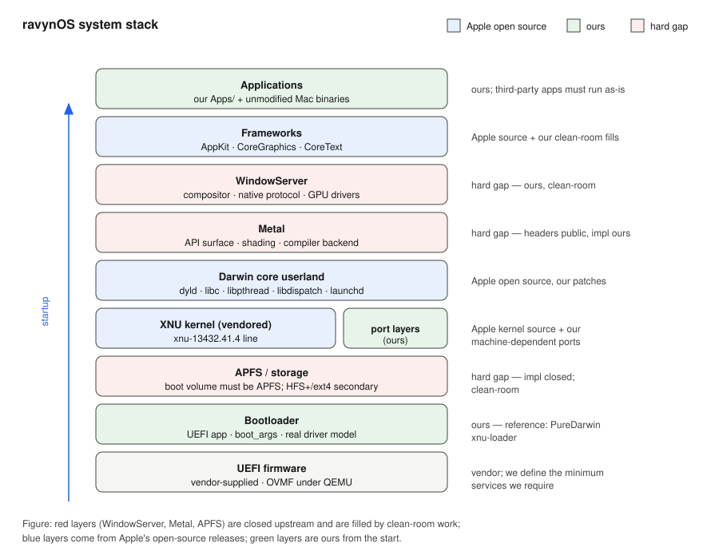

# ravynOS system design

This is the design of ravynOS: what the system must do, how each subsystem works, how
each one is built and tested, and when it counts as done. Read it first. When another
document disagrees with it, this one is right.

It contains no status and no history. Where the code stands is in
[STATUS.md](STATUS.md). Why each major choice was made, and what was rejected, is in
[DECISIONS.md](DECISIONS.md), cited here as ADR numbers. The numbered documents 01–13
and [../DESIGN.md](../DESIGN.md) are background reading.

## 0. How to use this document

**Implementing a subsystem.** Read sections 1 to 3, then your subsystem in section 4,
then the gaps and bugs its **Start here** field lists in STATUS.md. Every subsystem has
the same fields in the same order:

- **Purpose** — what it is for.
- **How macOS behaves** — what applications observe, which is what we reproduce.
- **Design** — how our implementation works.
- **Contracts** — what other code depends on: headers, paths, formats, ABI.
- **Sources** — what is vendored, what is seeded from `Legacy/`, what is written
  clean-room, and the licenses.
- **Location** — directories, manifest names, layer.
- **Build and test** — commands and tests.
- **Done when** — checkable conditions, staged by wave where the work spans waves.
- **Depends on** — what must exist first, and exactly what is needed from it.
- **Start here** — the first steps, the STATUS items to read, and the interim tools
  allowed until the final ones exist.
- **Open questions** — what is genuinely undecided.

Work inside your subsystem's location, follow section 2, and record status only in
STATUS.md.

**Understanding the system.** Read sections 1 to 3, then the subsystems in order.
Section 3.4 follows one application launch through every subsystem.

**Identifiers.** Subsystems S01–S36. Waves W0–W7 (section 6). Tiers T0–T5 (section
5.1). Budgets P1–P10 (section 5.5). Decisions ADR-01 onward. In STATUS.md: GAP-01
onward and BUG-01 onward. No other numbering is used.

## 1. Goal and compatibility contract

ravynOS is an operating system on which Mac applications run unmodified, as they are
downloaded. It is built from Apple's open-source releases — the XNU kernel, dyld, the
Objective-C runtime and Libsystem — and from our own implementations of everything
Apple keeps closed: the window server, AppKit, CoreGraphics, Metal, platform drivers
and system services. It has its own SDK, shaped like Apple's, so developers build Mac
applications for it without Apple's SDK or a Mac.

**Architectures** (ADR-19). arm64 and x86_64 are both primary: every tier must pass on
both. riscv64 is secondary and gates nothing. Current Mac software is arm64 first, and
much of it is universal; x86_64 keeps PCs and older or universal software in reach.

**Target generation** (ADR-01). The user-space ABI target is macOS 27.2.1 (build
26B131). The kernel of record is the vendored XNU named in ADR-01.

**The contract.** A Mac application is a Mach-O file that expects:

- `LC_BUILD_VERSION` with platform macOS and a minimum OS version — S13, S14.
- Libraries at Apple's install names, such as `/usr/lib/libSystem.B.dylib` — S13–S15.
- Framework bundles at Apple's paths, such as
  `/System/Library/Frameworks/AppKit.framework/Versions/C/AppKit` — S15, S22–S31.
- Exported symbols and Objective-C classes with Apple's names, signatures and object
  layouts — every user-space subsystem.
- System calls and Mach traps — Apple's XNU, unchanged (S05).
- A code signature, always present on arm64 — S12.
- The operating-system version it checks for — S18.
- Observable behavior: return values, ordering, timing, file formats — clean-room
  implementations specified by section 2.3.

Our SDK targets the same contract (ADR-02): an application built with it is a Mac
application. The SDK says ravynOS only in its name.

## 2. Rules every subsystem follows

### 2.1 Licensing

- No GPL, LGPL or AGPL code, data, or output generated by a GPL tool anywhere in this
  repository, `Legacy/` included (ADR-17).
- Accepted for code: APSL-2.0, BSD (2-, 3- and 4-clause), MIT, ISC, Apache-2.0, Zlib,
  BSL-1.0, Unicode-3.0, CC0, public domain, and the FreeType (FTL) and libpng licenses
  (ADR-24). Apple's own releases under APSL-1.x are accepted
  (ADR-22). CDDL is accepted only for XNU's DTrace files (ADR-22). Fonts may also use
  the SIL Open Font License (ADR-16). Anything else needs a new ADR.
- Our code is BSD-3-Clause. Every file carries `SPDX-License-Identifier`. Vendored files
  keep their upstream headers. Every vendored tree has a `_PROVENANCE` file: upstream
  URL, tag or commit, license, local patches.
- **Permissive first** (ADR-24). Wherever a permissively licensed implementation exists
  or can be written, the design uses it, and nothing the system needs — no tier, no wave
  exit, nothing in the default image — depends on GPL or LGPL software.
- GPL and LGPL software may still run on an installed system as an optional extra the
  user chooses. It lives in a separate repository, is built there against interfaces this
  repository publishes, and is installed from a separate opt-in channel. Three such
  extras are designed, each with a permissive default beside it: GPL-only drivers (S11),
  Apple's LGPL WebKit (S30), and the GNU C library for Linux binaries (S35).

Where the usual choice is GPL or LGPL, the design uses:

| Usual GPL/LGPL choice | Our permissive choice |
|---|---|
| GCC, binutils | clang, lld, LLVM tools, Apple ld64 |
| GNU make, bison, flex | ninja, byacc, hand-written scanners |
| GRUB | our UEFI loader (S04) |
| Linux drivers | native IOKit; FreeBSD, OpenBSD drivers (S11) |
| bash, readline | zsh, libedit |
| GNU coreutils | Apple `*_cmds`, FreeBSD userland (S32) |
| glibc | Libsystem; musl for Linux binaries (S35) |
| GNU libiconv | FreeBSD Citrus iconv (S13) |
| WebKit, JavaScriptCore | our APIs over permissive engines (S30) |
| FFmpeg | dav1d, libvpx, openh264, Opus, FLAC (S27) |
| Ghostscript | our PDF renderer or PDFium (S31) |
| Samba | our SMB client (S19) |
| Hunspell | our checker, permissive dictionaries (S26) |
| GPL fonts | OFL fonts (S23) |
- Apple's proprietary SDK, Xcode, and anything derived from them never enter this
  repository or its builds (ADR-13). Apple's corecrypto is not under an open license and
  is not used (ADR-12).

### 2.2 Tooling boundary

Tools fall into three classes by what their output becomes.

- **Build tooling**: anything whose code or output ends up in a committed file, an
  artifact, the SDK or an image — compilers, linkers, assemblers, parser and lexer
  generators, archivers, image tools. Must be permissively licensed. Allowed: clang,
  lld and the LLVM tools, Apple's ld64 and cctools, byacc, unifdef, ninja, our own tools.
  Not allowed: GCC, GNU binutils, GNU make, bison, flex (it runs GNU m4), GNU patch,
  GRUB.
- **Host environment**: the build machine's kernel, shell, coreutils and git. Allowed;
  recorded in the build log; never vendored; never producing bytes that ship.
- **Test executors**: QEMU and firmware images that only run tests. Allowed in CI;
  never shipped.

`Tools/ci/check-host-tools.sh` checks every script and build file in the tree against
the first class.

### 2.3 How closed behavior is specified

Every closed component is built the same way.

1. **Observe.** On Apple hardware (macOS runs only there), a probe program in
   `Tests/probes/<subsystem>/` exercises the API or format and records what happens:
   return values, errors, notifications and their order, files touched, IPC messages,
   timing. For hardware, observe the device side — register accesses and DMA — the way
   Asahi Linux traces macOS drivers under a hypervisor.
2. **Specify.** Write `Docs/spec/<subsystem>/<topic>.md` from
   [../spec/TEMPLATE.md](../spec/TEMPLATE.md). Each claim cites the probe run or the
   public document that established it.
3. **Implement** from the spec, Apple's public headers and documentation, and Apple's
   open-source code. Never from Apple's compiled code: no disassembly or decompilation
   of Apple binaries feeds a spec or a commit.
4. **Verify.** The probe runs on ravynOS as a test, permanently.

Claims taken from Apple's public documentation alone may be implemented before a probe
exists. They are marked `pending-probe` in the spec, and the probe is requested in
`Tests/probes/REQUESTS.md`, which whoever holds Apple hardware works through. A claim
marked `pending-probe` cannot close a tier.

Public headers and documentation may be read for names, signatures and layouts. Files
from Apple's SDK — headers, `.tbd` stubs — are never copied into the tree; our headers
are written by us and our stubs are generated from our libraries (S03).

### 2.4 No stubs

A function that reports success without doing the work is forbidden. A component that
is not ready is either absent — callers fail to link — or present with
`state = "incomplete"` in its manifest, returning real errors for what it does not do,
with the missing pieces listed in its README. A test that documents a gap fails when the
gap closes, so the documentation changes with the code.

### 2.5 Vendored code

Vendored trees are never edited (ADR-10). A vendored component keeps the upstream tree
in `<component>/upstream/` and its changes in `<component>/patches/`, with the manifest
beside them; XNU is the one exception, at `Kernel/xnu/` and `Kernel/patches/` with
`Kernel/manifest.toml`. Patches are applied to a copy in the build directory by
`rvpatch`, and each starts with:

```
# why: <the reason this change exists>
# fate: retire | upstream | permanent
```

Generated files are build outputs. Where a vendored tree ships a file generated by a GPL
tool (for example a Bison-generated parser), the build regenerates it from its grammar
with byacc and never compiles the shipped copy (ADR-17). CI checks that every vendored
tree is byte-identical to its upstream tag.

### 2.6 Layers and dependency direction

Every component declares a layer. Allowed edges:

```
apps      → frameworks, foundation, server (client headers only)
server    → frameworks, foundation
frameworks→ foundation
foundation→ kernel (exported headers only, through the SDK)
compat    → kernel
kernel, bootloader, build-toolchain, test → nothing outside their own layer
```

Edges within one layer are allowed when the graph stays acyclic. `rv` rejects any other
edge before anything compiles. A framework never includes kernel-internal headers; it
reaches the kernel through Libsystem.

## 3. Architecture

### 3.1 The stack



| Layer | Subsystems |
|---|---|
| Firmware: UEFI, or SBI on riscv64 | — |
| Bootloader | S04 |
| Kernel, platforms, drivers, security policy | S05–S12 |
| Core user space: Libsystem, dyld, runtimes | S13–S16 |
| Services: launchd, XPC, system daemons | S17, S18 |
| Storage, network, power and hardware | S19–S21 |
| Graphics, UI frameworks, media | S22–S28 |
| Security, web, other app frameworks | S29–S31 |
| Applications, installation, tools | S32–S34 |
| Later tracks | S35, S36 |

### 3.2 Project structure

Every directory, its layer, and the subsystem that owns it. Directories marked *new*
are created by the first component that needs them.

```
ravynos/
├── VENDORS                   pinned upstream sources (S01)
├── Kernel/
│   ├── xnu/                  Apple XNU, pristine (S05)
│   ├── patches/              patch series for xnu/ (S05, S06–S08) — new
│   ├── port/
│   │   ├── x86_64-pc/        PC platform code (S06) — new
│   │   ├── arm64-virt/       RVVIRT board code (S07) — new
│   │   └── riscv64-virt/     riscv64 port (S08)
│   ├── libcc_kext/           corecrypto-interface replacement (S05) — new
│   ├── libfirehose_kernel/   kernel log buffer, from libdispatch (S05) — new
│   ├── Extensions/<kext>/    IOKit families and drivers (S06, S07, S10, S12, S19)
│   ├── Extensions/ForeignDrivers/<driver>/   (S11) — new
│   └── ForeignKPI/           FreeBSD and Linux driver interfaces (S11) — new
├── Boot/                     loader, image tools, test kernels (S04)
├── Foundation/<component>/   Libsystem libraries, dyld, objc4, libc++,
│                             libxpc, Swift runtime (S13–S17) — new
├── Frameworks/<Name>/        CoreFoundation, Foundation, IOKit, Security,
│                             CoreGraphics … AppKit, Metal (S15, S21–S31) — new
├── Server/<daemon>/          launchd, WindowServer, system daemons
│                             (S17, S18, S22, …) — new
├── Userland/<project>/       BSD commands, zsh (S32) — new
├── Apps/<App>/               Finder, Terminal, Settings, Dock, Installer (S32, S33)
├── Compat/                   Linux and FreeBSD binaries (S35) — new
├── Tools/<tool>/             rv, mig, rvpatch, kernelcache, codesign,
│                             abi-census, driverkit-sdk, xnu host tools (S01, S02 …)
├── Tests/
│   ├── rv/                   harness negative tests (S01)
│   ├── boot/                 boot smokes (S04)
│   ├── apps/                 tier programs and app fixtures (section 5)
│   ├── probes/               behavior probes and REQUESTS.md (section 2.3)
│   ├── kpi/                  driver contract tests (S11)
│   ├── perf/                 budget benchmarks (section 5.5)
│   └── fixtures/             hash-pinned test inputs
├── Docs/design/              this document, STATUS, DECISIONS, background
├── Docs/spec/<subsystem>/    behavior specifications (section 2.3)
└── Legacy/                   upstream ravynOS, outside the build graph
```

Layers by directory: `Kernel/` is `kernel`; `Boot/` is `bootloader`; `Foundation/` is
`foundation`; `Frameworks/` is `frameworks`; `Server/` is `server`; `Userland/` and
`Apps/` are `apps`; `Compat/` is `compat`; `Tools/` is `build-toolchain`; `Tests/` is
`test`. `Kernel/IOKitUser/` moves to `Frameworks/IOKit/` (S21). `Kernel/build/` and
`Kernel/port/arm64/` are retired (S05, S07).

`Legacy/` holds the imported upstream tree. Nothing in the build references it. A
component leaves it by passing the seed audit — license of every file, no unresolved
symbols, no stubs, no `-undefined dynamic_lookup`, spec coverage for closed behavior —
recorded in `Docs/spec/<subsystem>/AUDIT.md`, and by gaining a manifest in its new
directory.

### 3.3 Processes at run time

XNU starts `launchd` as process 1. Every long-running process is a launchd job: the
window server, system daemons, per-user agents. Processes find each other through Mach
ports registered in launchd's bootstrap namespace and talk with XPC messages; bulk data
(pixels, audio) moves through shared memory, control through messages. launchd restarts
a daemon that crashes. If the window server crashes, the user's session ends and the
login window returns, as on macOS.

### 3.4 One application launch, end to end

1. Finder or the Dock asks LaunchServices to open the bundle (S25); launchd starts the
   process (S17).
2. XNU checks the binary's architecture slice (S14, S21) and code signature (S12),
   loads it and maps dyld (S05, S14).
3. dyld maps the shared cache, binds the app to libSystem and the frameworks, and runs
   initializers. libSystem's initializer brings up malloc, libdispatch, libxpc and
   os_log (S13, S17, S18).
4. objc4 registers the app's classes; CoreFoundation and Foundation start, reading
   preferences from cfprefsd (S15, S18). If the app is Swift, the Swift runtime loads
   (S16). The app checks the OS version (S18).
5. `NSApplicationMain` loads the main nib and asset catalog, connects to the window
   server through SkyLight, and registers with LaunchServices (S25, S22).
6. Views draw with CoreGraphics and CoreText (S23) into layers; QuartzCore commits the
   layer tree (S24); the window server composites with Metal or its CPU renderer
   (S22, S28) and the display driver scans out (S10).
7. Input arrives from IOHIDFamily (S10) at the window server, which routes it to the
   app; the text system turns keys into text (S26).

## 4. Subsystems
### S01 — Build harness (`rv`)

**Purpose.** One tool builds every component, from one library to a bootable image, the
same way on a developer machine and in CI. `rv` reads one manifest per component,
checks the whole graph, and writes one ninja file. Nothing in the system builds outside
it.

**How macOS behaves.** Not applicable: `rv` is a build tool. What it produces must match
macOS (Mach-O, install names, bundle layouts); those contracts belong to S02, S03, S09
and S13.

**Design.**

- `rv` is a Rust program in `Tools/rv/`. It walks the tree for `manifest.toml` files,
  skipping `Legacy/`, `build/`, `target/` and dot directories.
- It parses each manifest with unknown keys rejected (`#[serde(deny_unknown_fields)]`),
  builds the graph, and runs the checks: unique names, known layers, layer direction,
  acyclic same-layer edges, every `#include` and link resolved through declared deps,
  SPDX header on every source, license allowlist (S01 `rv audit license`).
- It writes `build/<target>/build.ninja` and runs ninja. `rv` never compiles. Every
  compile and link command comes from one flag table in `Tools/rv/src/flags.rs`, keyed
  by target and `kind`. Components add flags only through the `flags` key.
- Each build gets a per-build sysroot, `build/<target>/sysroot/`. Exported headers and
  libraries are staged there as their producers finish. A component sees only the
  sysroot paths of its declared deps (`-isysroot` plus per-dep `-I` and `-L`). Host
  headers are never on the path for Darwin targets (`-nostdinc`, `-nostdlib`).
- Components with a build that is not a list of sources (the kernel) name a `hook`.
  `rv` runs the hook at graph time; the hook returns a plan; `rv` turns the plan into
  ninja edges. Contract below.
- Depfile rule: every C-family and assembler compile runs with `-MD -MF $out.d` and
  ninja `deps = gcc`. Editing a header rebuilds exactly the objects that included it.
  Swift compiles use `-emit-dependencies`. Hook plans declare their own inputs, and
  `rv` re-runs the hook when one changes (ninja generator edge with `restat = 1`).
- Source languages, by extension: `.c`, `.m`, `.cpp`/`.cc`, `.mm`, `.S` (preprocessed
  assembler), `.s`, `.swift` (once S16 provides the compiler), `.defs` (mig, S02),
  `.y` (byacc, S02), `.iig` (S10). `.h` entries in `sources` are inputs for the
  license audit only.
- Output kinds come from `kind`: static archive, dylib (plus `.tbd` stub, S03),
  framework bundle, executable, kext bundle, UEFI PE application, test kernel, host
  tool, data bundle.

**Contracts.** Manifest schema (every key; anything else is an error):

```toml
name     = "libdispatch"      # unique across the tree
layer    = "foundation"       # bootloader kernel foundation frameworks server
                              # compat apps build-toolchain test
license  = "Apache-2.0"       # SPDX expression; checked against file headers
state    = "incomplete"       # working | incomplete | experimental
kind     = "dylib"            # see list below
sources  = ["src/**.c", "src/**.s"]
source_root = "Foundation/libdispatch/upstream"   # "" = this directory
install_name = "/usr/lib/system/libdispatch.dylib"
install_path = "/usr/lib/system"
current_version       = "1.0.0"     # (verify Apple's value)
compatibility_version = "1.0.0"     # (verify Apple's value)
reexports = []                # internal deps re-exported (-reexport_library)
umbrella  = "System"          # -umbrella; libSystem pieces name "System"
targets  = ["x86_64-ravynos", "arm64-ravynos"]
tests    = ["tests/**.c"]
hook     = ""                 # repo path of a build-hook component (host-tool)

[exports]
headers = ["dispatch/**.h", "os/**.h"]  # staged to sysroot and SDK
libs    = ["libdispatch.dylib"]         # products other components may link

[deps]
internal = ["libsystem_kernel", "libsystem_platform", "libsystem_pthread"]
system   = []                 # host libraries; host-tool kind only

[flags.x86_64-ravynos]        # per-target extras, appended after the flag table
cflags  = []
ldflags = []

[vendored]                    # vendored trees only; pins live in VENDORS
upstream = "https://github.com/apple-oss-distributions/libdispatch"
tag      = "libdispatch-<ver>"  # exact tag from VENDORS
license  = "Apache-2.0"
patches  = "Foundation/libdispatch/patches"   # rvpatch series
```

Key reference:

- `name`: unique; a duplicate is error `E-DUP-NAME`. `layer`: one of the nine layers.
- `license`, `state`: required. `state = "experimental"` keeps a component out of
  images.
- `kind`: `static-lib`, `dylib`, `framework`, `executable`, `kext`, `uefi-app`,
  `test-kernel`, `host-tool`, `data`.
- `sources`: globs relative to `source_root`. `source_root`: used for sources outside
  the component directory, such as `Kernel/xnu/libsyscall` for `libsystem_kernel`.
  When it points into a vendored tree, `rv` reads the patched build copy, not the
  pristine tree. Convention: a vendored tree sits in `<component>/upstream/` with
  its series in `<component>/patches/`; the manifest sits beside them, never inside.
  `Kernel/xnu` and `Kernel/patches` are the fixed exception.
- `exports.headers`, `exports.libs`: what dependents may see. Nothing else leaks.
- `install_name`, `install_path`, `current_version`, `compatibility_version`,
  `reexports`, `umbrella`: passed to the linker; must match Apple's values (S03).
- `deps.internal`: edges. `deps.system`: allowed only for `kind = "host-tool"`.
- `targets`: subset of the target table. `flags`: per-target `cflags`, `ldflags`.
- `tests`: test sources, built by `rv test`. `vendored`: upstream, tag, license,
  patches. `hook`: path of the hook component; `sources` must then be empty.
- Edges: `apps → frameworks → foundation → kernel`; `server → frameworks,
  foundation`; `compat → kernel`. Same-layer edges are allowed when acyclic.

Target table:

| Target | Clang triple | Linker | Format |
|---|---|---|---|
| `x86_64-ravynos` | `x86_64-apple-macosx27.2` | ld64.lld; ld64 static/kernel | Mach-O |
| `arm64-ravynos` | `arm64-apple-macosx27.2` | ld64.lld; ld64 static/kernel | Mach-O |
| `riscv64-ravynos` | `riscv64-apple-macosx27.2` (S08) | ld64.lld after patch | Mach-O |
| `x86_64-uefi` | `x86_64-pc-windows-gnu` | lld-link | PE32+ |
| `arm64-uefi` | `aarch64-pc-windows-gnu` | lld-link | PE32+ |
| `riscv64-uefi` | `riscv64-unknown-elf` | ld.lld, then `elf2pe` | PE32+ |
| `x86_64-testkernel` | `x86_64-apple-macosx27.2` | ld64.lld (interim) | Mach-O |
| `arm64-testkernel` | `arm64-apple-macosx27.2` | ld64.lld (interim) | Mach-O |
| `riscv64-testkernel` | `riscv64-unknown-elf` | ld.lld | ELF |
| `host` | host triple | host clang driver | host |

The deployment version in the triple is the OS version (ADR-01) for components; apps
choose their own through the SDK. The riscv64 Mach-O triple needs the LLVM patch from
ADR-03; until then `riscv64-ravynos` is not buildable.

Commands:

| Command | Does |
|---|---|
| `rv build [-t T] [name…]` | builds components and their deps |
| `rv build xnu -t T` | the kernel via its hook (S05) |
| `rv build sdk` | assembles the SDK (S03) |
| `rv bootstrap [--verify]` | builds stage-1 toolchain (S02) |
| `rv image [--target T] name` | boot or disk image from an image manifest |
| `rv kernelcache` | runs `Tools/kernelcache` (S09) |
| `rv codesign` | runs `Tools/codesign` (S12) |
| `rv test [name…]` | host tests and QEMU tests |
| `rv shell name` | shell with that component's compile env |
| `rv graph [--reverse] [name]` | prints the graph |
| `rv audit license` / `rv audit size` | license and size gates |
| `rv vendors check` | pristine check of vendored trees |
| `rv vendors import name --tag T` | replaces a tree from upstream |
| `rv sdk …` | xcrun-like front end (S03) |

`VENDORS` (repository root, TOML) pins every external tree:

```toml
[[vendor]]
name     = "xnu"
path     = "Kernel/xnu"
upstream = "https://github.com/apple-oss-distributions/xnu"
tag      = "xnu-12377.121.6"
commit   = "<40-hex commit of the tag>"
tree     = "<40-hex git tree id of path>"
license  = "APSL-2.0"
patches  = "Kernel/patches"
```

`rv vendors check` compares `git rev-parse HEAD:<path>` with `tree`. Any difference
fails CI.

Hook contract (frozen, version 1). `rv` runs
`<hook> --request build/<target>/<name>/request.json`. The request holds `version`,
`component`, `target`, `config`, `board`, `src` (patched copy), `out`, and `tools`
(absolute paths of `cc`, `ld`, `ld64`, `mig`, `byacc`, `unifdef`, `config`). The hook
writes `<out>/plan.json` with `version`, `inputs` (files that trigger a re-run),
`generate` (edges: `outputs`, `inputs`, `argv`), `compile` (`source`, `lang`,
`flags`), `link` (`output`, `inputs`, `argv`), `install` (`from`, `to`). The hook does
not compile or link; it only plans. It is deterministic: same request, same bytes.

**Sources.** Ours, BSD-3-Clause. Rust crates from crates.io, versions locked in
`Tools/rv/Cargo.lock`; each crate license must be on the allowlist (MIT, Apache-2.0,
BSD, ISC, Unicode-3.0, Zlib).

**Location.** `Tools/rv/`, component `rv`, layer `build-toolchain`, kind `host-tool`.
Negative tests in `Tests/rv/`.

**Build and test.** `cargo build --locked --release`, `cargo test --locked`,
`cargo clippy --locked -- -D warnings` in `Tools/rv/`. `rv test rv-negative` runs
each case in `Tests/rv/<case>/` with its own tree root; each must exit non-zero with
its named error:

- `dup-name` → `E-DUP-NAME`; `unknown-key` → `E-UNKNOWN-KEY`
- `layer-violation` (foundation depends on frameworks) → `E-LAYER`
- `same-layer-cycle` → `E-CYCLE`; `undeclared-include` → `E-UNDECLARED-DEP`
- `gpl-header` → `E-LICENSE`; `missing-spdx` → `E-NO-SPDX`
- `host-header-leak` (`#include <linux/types.h>`) → `E-HOST-HEADER`
- `elf-output` (Darwin target emits ELF) → `E-FORMAT`
- `hook-nondeterministic` → `E-HOOK-DETERMINISM`

Positive tests: `same-layer-acyclic` builds; `header-edit` touches one exported header
and asserts ninja rebuilds only its includers (`ninja -n -d explain`).

**Done when.** Wave W0.

1. Every command in the table exists and has a test (kernelcache and codesign may
   report "tool not built" until S09/S12).
2. All negative tests run in CI and fail with their named error.
3. `rv build -t x86_64-ravynos libhello` and `-t arm64-ravynos` produce Mach-O
   (S02 assertion passes).
4. The header-edit test passes.
5. `rv vendors check` runs in CI.

**Depends on.** S02 for the stage-1 tool paths in the flag table (stage 0 until then).
S05 consumes the hook contract.

**Start here.**

1. Add `deny_unknown_fields` and all schema keys to `Tools/rv/src/manifest.rs`; make
   duplicates an error (BUG-09, GAP-05).
2. Replace the same-layer rejection in `Tools/rv/src/graph.rs` with a cycle check.
3. Move flags into `flags.rs` with the target table; emit Mach-O triples and depfiles
   from `Tools/rv/src/ninja.rs`; add all languages (GAP-01, GAP-02, GAP-03).
4. Add the per-build sysroot (GAP-04), then `rv shell` (BUG-10) and the missing
   commands (GAP-06).
5. Write `Tests/rv/` cases and the `VENDORS` file.

Read BUG-09, BUG-10, GAP-01..GAP-06, GAP-09, GAP-10. Interim: `Boot/build.sh` and
`Kernel/build/` keep working until `rv` replaces them; nothing new is added to them.

**Open questions.** None.

### S02 — Toolchain

**Purpose.** The compilers, linkers and generators that build the system, built from
pinned open source with no GPL tool in the chain, so every output is reproducible.

**How macOS behaves.** Not applicable as behavior. The outputs must be what Apple's
toolchain emits for macOS: Mach-O with `LC_BUILD_VERSION` platform 1 (`PLATFORM_MACOS`),
Apple install names, ad hoc signatures on arm64.

**Design.** Three stages.

- **Stage 0** is the host's clang, lld and Rust, at the versions pinned in CI (clang
  18 or newer; Rust per `rust-toolchain.toml`). Stage 0 builds only `rv` and stage 1.
- **Stage 1** is built by `rv bootstrap` into `build/toolchain/<hash>/`:
  - LLVM: clang, lld (`ld64.lld`, `ld.lld`, `lld-link`), `llvm-ar`, `llvm-objdump`,
    `llvm-readtapi`, `llvm-lipo`, `dsymutil`, `llvm-nm`, `llvm-strip`.
  - Apple `ld64` and `cctools` (APSL) for links lld cannot do (ADR-04).
  - `migcom` from `Tools/mig/` (APSL) with a hand-written lexer (GAP-11).
  - `byacc` (public domain) for every grammar.
  - `unifdef` (BSD-2-Clause) for XNU and header generation.
  - XNU host tools (below), `rvpatch`, `mkfat`, `elf2pe`.
  - Swift compiler later (S16).
- **Stage 2** is the system built with stage 1. Once ravynOS self-hosts, the same graph
  builds stage 1 on ravynOS.
- Each stage-1 tool is hashed. `rv bootstrap --verify` rebuilds and compares hashes.

Linker selection (ADR-04):

- `ld64.lld` links dylibs, frameworks, dynamic executables and bundles.
- Apple `ld64` links fully static executables (`-static`, T0), the kernel (`-kernel`,
  `-alias_list`), relocatable `-r` objects and the kernelcache. LLVM 18 `ld64.lld`
  lacks those four options.
- Interim: `ld64.lld` may link test kernels (`*-testkernel`) and compile-only kernel
  stages until `ld64` is in stage 1.

Generators:

- No flex, no bison, no GNU m4 anywhere in the build. Grammars use `byacc`. Lexers are
  hand-written C.
- XNU host tools (ADR-21): `Tools/config/` builds `SETUP/config` from
  `Kernel/xnu/SETUP/config/*.c` plus `parser.y` through byacc. XNU's own makefile runs
  `bison -y -d` and `flex` (`SETUP/config/Makefile:30-35`); a patch in
  `Kernel/patches/` replaces `lexer.l` with a hand-written `lexer.c` that keeps the
  `yylex` interface and token set. `doconf` (csh) is not used; its logic lives in the
  S05 hook. `kextsymboltool`, `setsegname`, `decomment`, `installfile` and
  `replacecontents` build as host tools from `Kernel/xnu/SETUP/`. CTF tools
  (`ctfconvert`, `ctfmerge`) are not used; the build sets no CTF variables.
- `rv` is a static binary: target `x86_64-unknown-linux-musl` (or `aarch64-…-musl`
  on arm64 hosts), so no glibc (LGPL) is linked into it. On macOS hosts it links
  `libSystem` normally.

Rust: `rust-toolchain.toml` at the repository root pins the channel and adds the musl
targets. Every cargo call uses `--locked`. CI fails if `Cargo.lock` changes.

**Contracts.**

- Triples per ADR-03 (target table in S01).
- Mach-O assertion: after every link, `rv` runs `llvm-objdump --macho --private-headers`
  on Darwin-target outputs and checks the magic (`MH_MAGIC_64`), the CPU type for the
  target, and `LC_BUILD_VERSION` with `platform 1` and the expected `minos`. Kernel and
  kext outputs are checked for magic and file type only (verify whether XNU's link
  emits `LC_BUILD_VERSION`; `-version_load_command` is in `MakeInc.def:910`).
- Tool pins live in `VENDORS`: LLVM (tag `llvmorg-<ver>`; ≥ 18, exact pin verify),
  ld64 and cctools (apple-oss-distributions tags; verify which builds without
  Xcode), byacc, unifdef, migcom (`Tools/mig/_PROVENANCE`).
- The host-tool gate (`Tools/ci/check-host-tools.sh`) rejects calls to `gcc`, `cc`,
  `make`, `bison`, `yacc`, `m4`, `patch`, `ld`, `ar` and the other denied names in
  build scripts and in `Tools/rv/src`.

**Sources.**

- LLVM: vendored by pin, Apache-2.0 WITH LLVM-exception. riscv64 Mach-O patch ours.
- ld64, cctools: vendored, APSL-2.0. Build files ours (no autotools).
- migcom: vendored in `Tools/mig/upstream/`, APSL; patches in `Tools/mig/patches/`.
- byacc: vendored, public domain. unifdef: vendored, BSD-2-Clause.
- XNU host tools: from `Kernel/xnu/SETUP` (APSL-2.0); scanner ours (BSD-3-Clause).
- `rvpatch` (seed `Tools/mig/rvpatch.c`; component in `Tools/rvpatch/`), `mkfat`,
  `elf2pe`: ours, BSD-3-Clause.

**Location.** `Tools/toolchain/<tool>/manifest.toml` for vendored tools (layer
`build-toolchain`, kind `host-tool`): `llvm`, `ld64`, `cctools`, `byacc`, `unifdef`.
`Tools/mig/` (`mig`), `Tools/config/` (`xnu-config`), `Tools/xnu-setup/`
(`kextsymboltool`, `setsegname`, `decomment`, `installfile`, `replacecontents`),
`Tools/rvpatch/` (`rvpatch`). `rust-toolchain.toml` at the root.

**Build and test.**

- `rv bootstrap` then `rv bootstrap --verify`.
- `rv test toolchain`: compile and link a C, Objective-C and assembler fixture
  (`Tests/fixtures/toolchain/`) for each Darwin target; assert the Mach-O checks.
- `rv test byacc-grammars`: regenerate `parser.c` and the libkern parsers; compile.
- `rv test mig`: run mig on `Tests/fixtures/mig/*.defs`, compare with golden output.
- `Tools/ci/check-host-tools.sh` in CI.

**Done when.**

1. (W0) A clean machine with only stage 0 runs `rv bootstrap` and `--verify` passes.
2. (W0) Every Darwin-target output in CI passes the Mach-O assertion.
3. (W0) No flex or bison is installed in the CI image and the build passes.
4. (W1) `ld64` from stage 1 links a static T0 test program and the kernel (S05).

**Depends on.** S01 for the graph and `rv bootstrap`.

**Start here.**

1. Add `rust-toolchain.toml` and musl static linking for `rv`; add `--locked` to CI.
2. Write `Tools/toolchain/{byacc,unifdef}` manifests and pins (GAP-08).
3. Replace the flex lexer in mig with a hand-written one; keep one mig (GAP-11,
   GAP-13).
4. Build `SETUP/config` with byacc and the scanner patch.
5. Add the Mach-O assertion to the ninja link rule.

Read GAP-08, GAP-10, GAP-11, GAP-13, BUG-08. Interim: host clang 18, `ld64.lld` for
test kernels, and `Kernel/build/mig/` until `Tools/mig` replaces it.

**Open questions.**

- Which ld64 and cctools tags build without Xcode, and what ld64 needs from `libtapi`
  and LLVM `libLTO`.

### S03 — SDK

**Purpose.** The headers, link stubs and metadata that applications build against,
laid out like Apple's macOS SDK so clang, CMake, SwiftPM and Xcode-style projects work
without changes.

**How macOS behaves.** Apple's SDK is a directory with `SDKSettings.json`, headers under
`usr/include` and in framework bundles, `.tbd` text stubs instead of dylibs, module
maps, and Swift interfaces. clang reads `SDKSettings.json` for the platform and version
map; the linker reads `.tbd` install names, versions and re-exports and records them in
the app. A Mac app binds by install name and symbol name, so the SDK defines which
binaries load.

**Design.** `rv build sdk` assembles `build/sdk/ravynOS.sdk` from component manifests.
It holds both arm64 and x86_64. Nothing is hand-copied.

```
ravynOS.sdk/
  SDKSettings.json
  usr/include/                      exports.headers of foundation components
  usr/include/{sys,mach,machine,i386,arm,arm64,libkern,os,net,netinet}/
                                    XNU installed headers (S05 hook)
  usr/lib/libSystem.B.tbd           libSystem and its re-exports
  usr/lib/libSystem.tbd -> libSystem.B.tbd
  usr/lib/swift/                    Swift overlays (S16)
  System/Library/Frameworks/
    Foundation.framework/
      Foundation.tbd -> Versions/Current/Foundation.tbd
      Headers        -> Versions/Current/Headers
      Modules        -> Versions/Current/Modules
      Versions/Current -> A
      Versions/A/{Foundation.tbd,Headers/,Modules/module.modulemap}
      Versions/A/Modules/Foundation.swiftmodule/
        arm64-apple-macos.swiftinterface
        x86_64-apple-macos.swiftinterface
    Kernel.framework/Headers/       XNU kernel headers for kexts (S09)
```

- Headers come only from `exports.headers`. Kernel headers come from the S05 hook's
  `install` list, built from XNU's `INSTALL_MI_LIST`, `INSTALL_MD_LIST` and
  `INSTALL_KF_MI_LIST` variables (e.g. `bsd/sys/Makefile:280-320`), with generated
  headers such as `sys/syscall.h`.
- Availability headers: `Availability.h`, `AvailabilityMacros.h`,
  `AvailabilityInternal.h`, `AvailabilityVersions.h` and `TargetConditionals.h` belong
  to component `AvailabilityVersions` (layer foundation). Version constants are
  generated from one table. XNU's `EXTERNAL_HEADERS/Availability*.h` are kernel-only
  copies and are not exported.
  - Constants: `__MAC_10_0` … `__MAC_26_0` (value `260000`), `__MAC_27_0`,
    `__MAC_27_2` (value `270200`, verify), and `MAC_OS_X_VERSION_*`,
    `MAC_OS_VERSION_*` equivalents.
  - Macros: `__API_AVAILABLE`, `__API_UNAVAILABLE`, `__API_DEPRECATED`,
    `API_AVAILABLE`, `API_UNAVAILABLE`, `API_DEPRECATED`, `__OSX_AVAILABLE_STARTING`,
    `__MAC_OS_X_VERSION_MIN_REQUIRED`, `__MAC_OS_X_VERSION_MAX_ALLOWED`,
    `MAC_OS_X_VERSION_MIN_REQUIRED`, `__ENVIRONMENT_MAC_OS_X_VERSION_MIN_REQUIRED__`
    (from clang).
  - `TargetConditionals.h`: `TARGET_OS_MAC=1`, `TARGET_OS_OSX=1`,
    `TARGET_OS_IPHONE=0`, `TARGET_CPU_X86_64`/`TARGET_CPU_ARM64`, `TARGET_RT_64_BIT`.
- Stubs: each dylib link edge is followed by
  `llvm-readtapi --stubify --filetype=tbd-v5`. Per-arch stubs are merged into one
  multi-arch TBD v5 document (`llvm-readtapi --merge`, verify flag). The SDK can never
  promise a symbol the system lacks.
- libSystem: `/usr/lib/libSystem.B.dylib` re-exports `/usr/lib/system/libsystem_*.dylib`
  plus `libdispatch`, `libdyld`, `libxpc`, `libcompiler_rt`, `libunwind` and the rest
  of S13's list. The TBD inlines each re-exported library as its own entry, so apps
  bind to the real install name of each symbol.
- Module maps: every framework has `Modules/module.modulemap` (`framework module X
  { umbrella header "X.h" export * module * { export * } }`). `usr/include` has
  module maps for Darwin modules (S13).
- `SDKSettings.json` fields: `Version` (`"27.2"`), `CanonicalName` (`"macosx27.2"`),
  `DisplayName` (`"ravynOS 27.2"`), `MaximumDeploymentTarget` (`"27.2.99"`),
  `DefaultDeploymentTarget` (`"27.2"`), `SupportedTargets.macosx` (`Archs`
  `["x86_64","arm64"]`, `LLVMTargetTripleVendor` `"apple"`, `LLVMTargetTripleSys`
  `"macos"`, `BuildVersionPlatformID` `"1"`, `MinimumDeploymentTarget`,
  `DefaultDeploymentTarget`, `MaximumDeploymentTarget`, `ValidDeploymentTargets`),
  `VersionMap` (`macOS_iOSMac`, `iOSMac_macOS`; clang's SDK info parser reads it,
  verify required).
- Build order: components link against the per-build sysroot
  (`build/<target>/sysroot`), which stages real dylibs and their `.tbd` as producers
  finish. Dependents link against the `.tbd`, so they relink only when the interface
  changes (`restat`). A component never links before its deps are built; there are no
  pre-made stubs. A link cycle is a graph error. Apps and tier tests build against the
  SDK only.
- `rv sdk` is the xcrun-like front end: `--show-sdk-path`, `--show-sdk-version`,
  `--show-sdk-platform-path`, `--find <tool>`, and `rv sdk clang …` / `clang++`,
  `swiftc`, which add `-isysroot`, `-target` and the stage-1 tool path.
- `build/sdk/cmake/ravynOS.toolchain.cmake` sets `CMAKE_SYSTEM_NAME Darwin`,
  `CMAKE_OSX_SYSROOT`, `CMAKE_OSX_ARCHITECTURES`, compilers and `CMAKE_LINKER`.
  `build/sdk/pkgconfig/*.pc` describe exported libraries; both sit outside the SDK so
  the SDK keeps Apple's shape.

**Contracts.** The SDK path layout, `SDKSettings.json` fields, every install name,
`current_version`, `compatibility_version` and re-export list are public. A change to
any is an ABI event recorded in the ABI census (S34). Install names and versions must
equal Apple's for the same library (ADR-02).

**Sources.** Generated from components; licenses are theirs. Availability headers:
vendored from apple-oss-distributions/AvailabilityVersions (APSL-2.0, verify the
generator script license) or clean-room. The SDK assembler is ours, BSD-3-Clause.
`Legacy/Developer/ravynOS.sdk` is a seed for nothing; it declares macOS 10.15–13.1.

**Location.** Assembler in `Tools/rv/src/sdk.rs`. Availability headers in
`Foundation/AvailabilityVersions/` (name `AvailabilityVersions`, layer `foundation`).
Output `build/sdk/`.

**Build and test.**

- `rv build sdk`.
- `rv test sdk-shape`: every framework has the symlinks, a module map and a TBD with
  both arches; every TBD install name equals the dylib's `LC_ID_DYLIB`.
- `rv test sdk-headers`: compile `Tests/fixtures/sdk/import-all.m` (imports every
  public header) for both arches with `rv sdk clang -fmodules`.
- `rv test sdk-cmake`: configure and build `Tests/fixtures/sdk/cmake-hello`.
- `rv test sdk-availability`: `__MAC_OS_X_VERSION_MIN_REQUIRED` and `@available`
  behave as on macOS for `-mmacos-version-min=11.0` and `27.2`.

**Done when.** Wave W2.

1. The T1 test program (`Tests/apps/t1-foundation`) builds against the SDK alone for
   arm64 and x86_64, with no host headers and nothing from `Legacy/`.
2. All `sdk-*` tests pass.
3. `llvm-readtapi --compare` of each TBD with its dylib reports no difference.

**Depends on.** S01 (sysroot, `rv sdk`), S02 (`llvm-readtapi`), S05 (kernel header
install list), S13 (libSystem layout and versions), S15 and S16 (framework headers and
Swift interfaces).

**Start here.**

1. Write the SDK assembler against `Foundation/libhello` to prove the layout.
2. Add the `.tbd` edge after each dylib link and the per-build sysroot (GAP-04).
3. Create `Foundation/AvailabilityVersions` with the version table.
4. Emit `SDKSettings.json` and the CMake toolchain file.
5. Pull the XNU header list from the S05 hook.

Read GAP-04, GAP-26. Interim: none; `Legacy/Developer/ravynOS.sdk` is not used.

**Open questions.**

- The lowest `MinimumDeploymentTarget` the SDK accepts (11.0 or older).

### S04 — Bootloader

**Purpose.** Load the kernelcache from the EFI system partition and hand the machine to
XNU in exactly the state XNU expects, on x86_64 and arm64 (riscv64 in S08).

**How macOS behaves.** On Intel Macs `boot.efi` loads the kernelcache, builds
`boot_args` and a flattened device tree, exits boot services and enters XNU in 32-bit
protected mode. On Apple silicon iBoot enters XNU at EL1 with the MMU off and `x0`
holding `boot_args`. XNU relies only on these structures.

**Design.** A freestanding UEFI application in C (ADR-15), `Boot/loader/`:

1. Read `\ravynos\kernelcache` (and optional `\ravynos\ramdisk.dmg`) from the ESP.
   Test kernels are `\ravynos\testkernel`.
2. Parse Mach-O (`MH_EXECUTE` or `MH_FILESET`): `LC_SEGMENT_64` vmaddr at offset 24,
   vmsize 32, fileoff 40, filesize 48; entry from `LC_UNIXTHREAD` (`rip`, word 16 of
   the x86 thread state; `pc` for arm64). Bounds-check every field. For `MH_FILESET`,
   walk `LC_FILESET_ENTRY` to find `com.apple.kernel` (verify the entry id).
3. Copy segments to PA = VA − base (rules below); zero the vmsize−filesize tail.
4. Build `boot_args`, device tree, memory map (below).
5. `GetMemoryMap`, `ExitBootServices(key)`; on `EFI_INVALID_PARAMETER` repeat both.
6. Call `SetVirtualAddressMap` (policy below), then enter the kernel.

The device tree is XNU's flattened format (`pexpert/pexpert/device_tree.h`), not FDT.
`Boot/loader/dt.c` builds it from a node list. `Boot/include/boot_args.h` is our copy of
the layout; `Tests/boot/boot_args_layout.c` checks every `offsetof` and `sizeof`
against `pexpert/pexpert/i386/boot.h` and `pexpert/pexpert/arm64/boot.h` with
`_Static_assert`.

**Contracts — x86_64.**

- `boot_args`: `pexpert/pexpert/i386/boot.h:150-221`, 4096 bytes. `Version = 2`,
  `Revision = 1`, `efiMode = 64`. `KC_hdrs_vaddr` = VA of the `MH_FILESET` header;
  XNU slides fileset headers only when `Version >= 2 && Revision >= 1 &&
  KC_hdrs_vaddr != 0` (`osfmk/i386/i386_init.c:743-744`).
- Fields filled: `CommandLine`, `MemoryMap*` (final UEFI map), `Video` from GOP,
  `deviceTreeP`, `deviceTreeLength`, `kaddr`, `ksize`, `efiSystemTable`,
  `efiRuntimeServices*`, `kslide`, `PhysicalMemorySize`, `FSBFrequency`,
  `pciConfigSpace*` from ACPI MCFG, `csrActiveConfig`.
- VA→PA: PA = VA − `0xffffff8000000000`. The kernel links `__HIB` at
  `0xffffff8000100000` and text at `0xffffff8000200000` (`makedefs/MakeInc.def:
  932-945`). `kaddr` = PA of the lowest segment (`0x100000`).
- kslide policy: `kslide = 0`. XNU computes the slide from `kaddr` and ignores it when
  `kslide` is 0 (`osfmk/i386/i386_vm_init.c:281-294`). Nonzero slides wait for S12.
- Placement: `boot_args`, device tree, memory map and ramdisk follow the kernelcache,
  below 4 GB, and `ksize` covers all of them. XNU allocates from `kaddr + ksize`
  (`osfmk/i386/i386_init.c:723`). The 32-bit PA fields require < 4 GB.
- `SetVirtualAddressMap`: each `EFI_MEMORY_RUNTIME` descriptor gets
  `VirtualStart = PhysicalStart | 0xffffff8000000000`; XNU maps runtime ranges at that
  address (`osfmk/i386/AT386/model_dep.c:441-455`; verify against `boot.efi`).
- Entry (`osfmk/x86_64/start.s:125-163`): 32-bit protected mode, paging off, flat
  segments, `eax` = `boot_args` PA. The switch from UEFI long mode:
  1. Copy a trampoline and a GDT to one page below 4 GB, identity mapped; `cli`.
  2. GDT: 64-bit code, 32-bit compatibility code (L=0, D=1), flat 32-bit data.
  3. `lretq` to the compatibility selector at the trampoline.
  4. Clear CR0.PG; clear EFER.LME (MSR `0xC0000080` bit 8); clear CR4.PAE.
  5. Load `ds`, `es`, `fs`, `gs`, `ss` with the flat data selector.
  6. `mov eax, boot_args_pa`; `jmp` to the entry PA (`rip` − `0xffffff8000000000`).

Device tree nodes (x86_64):

| Node | Properties |
|---|---|
| `/` | `compatible`, `model` |
| `/chosen` | `random-seed` (64 bytes), `boot-uuid` or `root-matching` |
| `/chosen/memory-map` | `RAMDisk`, `DeviceTree` (8 bytes: PA, size) |
| `/efi` | `firmware-vendor`, `firmware-revision` (verify) |
| `/efi/platform` | `FSBFrequency`, `InitialTSC`, `ARTFrequency` |
| `/efi/configuration-table` | ACPI and SMBIOS GUID entries (verify) |
| `/product` | optional |

- `random-seed`: XNU panics without it (`pexpert/gen/pe_gen.c:177-188`).
- `/chosen/memory-map` entries are two `uint32_t` (PA, length); `IODTGetLoaderInfo`
  reads them (`iokit/Kernel/IODeviceTreeSupport.cpp:320-345`). `RAMDisk` becomes
  `/dev/md0` (`iokit/bsddev/IOKitBSDInit.cpp:775-778`). `DeviceTree` lets XNU free the
  tree (`IODeviceTreeSupport.cpp:189-193`). `Kernel-__HEADER`, `Kernel-__SYMTAB`,
  `Kernel-__KLD`, `Kernel-__KLDDATA`, `Kernel-__LINKEDIT` (`libkern/c++/OSKext.cpp:
  1162-1373`), `BootCLUT` and `Pict-FailedBoot` (`pexpert/i386/pe_init.c:138-146`) are
  optional and not emitted.
- `/efi/platform`: `tsc.c:105-118` reads `InitialTSC`; `FSBFrequency` and
  `ARTFrequency` (Skylake and later) at `tsc.c:186,236`.

**Contracts — arm64.**

- `boot_args`: `pexpert/pexpert/arm64/boot.h:50-64`. `Revision = 2`, `Version = 2`.
  `virtBase`, `physBase`, `memSize`, `topOfKernelData` (end of all loader data, PA),
  `Video`, `machineType`, `deviceTreeP` (a **virtual** address:
  `virtBase + (PA − physBase)`), `deviceTreeLength`, `CommandLine` (1024 bytes),
  `bootFlags`, `memSizeActual`.
- VA→PA: PA = `physBase` + (VA − `virtBase`). The kernel links at
  `0xfffffe0007004000` (`MakeInc.def:446`). Policy: load so the kernel header lands at
  its link VA, which gives slide 0 (`osfmk/arm/arm_init.c:285,304`; verify for
  `MH_FILESET`).
- Hand-off (`osfmk/arm64/start.s:231`, `start_first_cpu` at `:468`): clean the data
  cache to the point of coherency for all loaded ranges; invalidate the I-cache;
  disable MMU and caches (`SCTLR_EL1.M`, `.C`, `.I` = 0); enter at EL1 (drop from EL2
  with `ERET` if the firmware runs at EL2); `x0` = `boot_args` PA; branch to entry PA.
- Device tree: built from the firmware's FDT (UEFI configuration table). Nodes listed
  in S07: `/chosen` (`random-seed`, `boot-uuid`), `/chosen/memory-map`, `/cpus`,
  `/arm-io` with `ranges`, `/arm-io/gic` (`reg` 32 bytes,
  `pexpert/arm/pe_fiq.c:81-104`), UART and timer nodes.

**Contracts — riscv64.** Defined by S08.

Smoke-test command line: `debug=0x4e serial=3 -v keepsyms=1`. `serial=3` is
`SERIALMODE_OUTPUT|SERIALMODE_INPUT` (`osfmk/console/serial_protos.h:53-56`); `debug`
bits 0x2, 0x4, 0x8, 0x40 (`osfmk/kern/debug.h:579-586`; 0x100 is obsolete); `-v`
verbose (verify how x86 XNU reads it). Ramdisk boots add `rd=md0`
(`iokit/bsddev/IOKitBSDInit.cpp:730`).

**Sources.** Ours, BSD-3-Clause. EFI definitions written from the UEFI specification.
No GNU-EFI, no Clover, no OpenCore code.

**Location.** `Boot/loader/` (`loader`, kind `uefi-app`, targets `*-uefi`),
`Boot/testkernel/` (`testkernel`, kind `test-kernel`), `Boot/mkfat/` (`mkfat`),
`Boot/elf2pe/` (`elf2pe`), `Boot/include/`. Layer `bootloader`.

**Build and test.**

- `rv build -t x86_64-uefi loader`; `rv build -t x86_64-testkernel testkernel`.
- `rv image boot-smoke -t x86_64` builds a FAT ESP image with `mkfat`.
- `rv test boot-smoke` runs `Tests/boot/smoke.sh` and `smoke-arm64.sh`: QEMU with
  OVMF (`-machine q35 -cpu Skylake-Client-v4,+invtsc,vmware-cpuid-freq=on`, ADR-20)
  and AAVMF (`-machine virt,gic-version=3 -cpu max`). The test kernel prints `TK-OK`
  plus each check result on serial.
- The test kernel checks: entered in 32-bit mode with paging off (x86_64) or EL1 MMU
  off (arm64); `boot_args` version and revision; `deviceTreeP` parses; `/chosen/
  random-seed` present; memory map covers the kernel; `ksize` covers loader data.
- `rv test boot-args-layout` compiles `Tests/boot/boot_args_layout.c`.

**Done when.**

- a) (W1) A Mach-O `x86_64-testkernel` and `arm64-testkernel` boot through the loader
  and pass every check in CI. The ELF path is removed.
- b) (W1, with S05) The x86_64 XNU kernel prints its version banner on serial.
- c) (W1, with S07) The arm64 XNU kernel prints its version banner on serial.

**Depends on.** S01 (targets `*-uefi`, `*-testkernel`). S05 (kernel). S07 (arm64 device
tree content). S09 (kernelcache file; until then the bare kernel). S06 (ACPI and SMBIOS
expectations).

**Start here.**

1. Fix Mach-O offsets and entry in `Boot/loader/macho.c` (BUG-01..04).
2. Fix the `ljmp` target and segment reloads in `Boot/loader/handoff.S` (BUG-04).
3. Add `Boot/loader/dt.c` and the x86 node table (BUG-05).
4. Give arm64 its own `boot_args` and MMU-off hand-off (BUG-06).
5. Make the test kernel Mach-O and add the layout test.

Read BUG-01..06, GAP-17. Interim: `ld64.lld` links test kernels (ADR-04).

**Open questions.**

- Whether nonzero `kslide` is used before S12 (affects `KC_hdrs_vaddr` sliding).

### S05 — Kernel build

**Purpose.** Build Apple's XNU from a pristine vendored tree, with our patches and
generated files, into a linked kernel for x86_64 and arm64, inside `rv`.

**How macOS behaves.** The kernel reports `Darwin Kernel Version …; root:xnu-…` through
`uname` and `kern.version`, exports the KPI symbol sets kexts link against, and boots
from a kernelcache. Apps see only its system calls and Mach traps (S13).

**Design.** The kernel is component `kernel` (ADR-09) with
`hook = "Tools/xnuhook"`. The hook (Rust, BSD-3-Clause) follows the S01 contract.

Inputs (request): `target` (`x86_64-ravynos`, `arm64-ravynos`), `board` (`none` for
x86_64; `RVVIRT` for arm64, ADR-11), `config` (`RELEASE` or `DEVELOPMENT`), the patched
source copy, tool paths. The MASTER files are found by the doconf rule:
`config/MASTER` plus the first that exists of `MASTER.<cpu>.<soc>.<platform>`,
`MASTER.<cpu>.<soc>`, `MASTER.<cpu>.<platform>`, `MASTER.<cpu>`
(`SETUP/config/doconf:189-195`). With platform `MacOSX`: x86_64 uses
`config/MASTER.x86_64`; arm64 uses `config/MASTER.arm64.MacOSX`.

Steps the plan encodes:

1. Configure (replaces `doconf`): concatenate the MASTER files, run `unifdef -t` with
   `-DPLATFORM_MacOSX -DCPU_<cpu> -DSOC_CONFIG_<soc> -DSYS_<CONFIG>`, then the
   attribute expansion done by doconf's `sed`/`awk` (`doconf:204-282`), in Rust. arm64
   RVVIRT adds `-DSOC_IS_VIRTUALIZED` explicitly (doconf sets it only for `vm*` socs).
   No `-sptm`, `-exclaves`, `-tag`: `MASTER.arm64.MacOSX:17-23` then selects
   `config_pmap_ppl` (ADR-11 classic pmap; verify PPL runs without Apple hardware).
2. Run `xnu-config` (S02) per component in `osfmk bsd libkern iokit pexpert libsa
   security san` (`MakeInc.def:78`), producing option headers and file lists from
   `<comp>/conf/files` and `files.<arch>`. No configuration header is hand-written.
3. Generate:
   - `bsd.syscalls.master` = `unifdef` over `bsd/kern/syscalls.master`
     (`makedefs/MakeInc.rule:553-559`); then `bsd/kern/makesyscalls.sh` (APSL) with
     modes `table`, `names`, `audit`, `systrace`, plus the `syscall.h`, `sysproto.h`
     and `syscall.codes` outputs (`bsd/conf/Makefile.template:619-635`,
     `bsd/sys/Makefile:322-342`).
   - mig over every kernel `.defs` with `MIGKSFLAGS`/`MIGKUFLAGS`
     (`MakeInc.def:1248-1256`) using `Tools/mig`.
   - Parsers (ADR-17): `libkern/c++/OSUnserialize.y` → `OSUnserialize.cpp` and
     `libkern/c++/OSUnserializeXML.y` → `OSUnserializeXMLSharedImplementation.h`
     (installed to `libkern/libkern/c++/` and `iokit/System/`), with `byacc -p
     <prefix>` and the post-steps in the `.y` header comments (`OSUnserialize.y:41-43`,
     `OSUnserializeXML.y:38-40`). The vendored Bison outputs are never compiled.
   - `version.c` from `config/version.c.template` with `xnuVersion`; the hook does the
     `newvers.pl` substitution itself.
   - Export lists from `config/*.exports` via `generate_linker_exports.sh` and
     `generate_linker_aliases.sh` logic; symbol-set plists for S09 via
     `kextsymboltool`.
4. Compile every listed file with XNU's flags and defines per arch (`-mkernel`,
   `-DKERNEL`, `-DXNU_KERNEL_PRIVATE`, `-D__x86_64__`, never `-D__i386__`; arm64
   `-DARM64_BOARD_CONFIG_RVVIRT`, `-march=armv8.5a` without `+sme2` (verify), no PAC).
5. Link with Apple `ld64` (ADR-04): `-kernel`, `-static`, `-alias_list`,
   `-exported_symbols_list`, `-e __start`, `-pagezero_size 0`, x86 `-segaddr __HIB`
   and `-image_base` (`MakeInc.def:899-960,1036-1142`), arm64 link at
   `0xfffffe0007004000`. Libraries: `libfirehose_kernel.a`, `libcc_kext.a`, and on
   arm64 `librvvirt.a` (our board library in place of `lib<SOC>.os.<CONFIG>.a`,
   `MakeInc.def:1155`). Until `ld64` is in stage 1, `ld64.lld` may compile and test
   undefined-symbol reports but not produce the boot kernel.

Outputs: `build/<target>/kernel/kernel.<config>` (Mach-O `MH_EXECUTE`), its dSYM,
`symbolsets.plist`, the export lists, the kernel header install list (S03), and
`undefs.txt` (must be empty).

Closed link libraries replaced:

- `firehose_kernel` (`Kernel/libfirehose_kernel/`, layer `kernel`, kind `static-lib`):
  `source_root = "Foundation/libdispatch/upstream"`, compiles `src/firehose/firehose_buffer.c`
  with `-DKERNEL=1 -DDISPATCH_USE_DTRACE=0
  -DOS_ATOMIC_CONFIG_MEMORY_ORDER_DEPENDENCY=1`. Apache-2.0. Seeds:
  `Legacy/Libraries/libfirehose_kernel/Makefile` (flags) and
  `Legacy/Libraries/Libsystem/libdispatch` (source). `hack.s` (alias stubs) is not
  carried.
- `cc_kext` (`Kernel/libcc_kext/`, layer `kernel`, kind `static-lib`): implements
  the corecrypto functions the kernel references, declared in
  `Kernel/xnu/EXTERNAL_HEADERS/corecrypto/*.h`, over the permissive library chosen by
  ADR-12. The exact list is the kernel's undefined `_cc*` symbols.
- Board library (arm64): S07 owns `Kernel/port/arm64-virt/` (`librvvirt.a`).

Pristine tree (ADR-10):

- `Kernel/xnu` must equal tag `xnu-12377.121.6` of
  github.com/apple-oss-distributions/xnu (verify the tag exists there). The import
  commit is `fde4c1051`; 19 files changed after it.
- 6 added files are `makesyscalls.sh` outputs (`bsd/kern/{init_sysent.c,syscalls.c,
  audit_kevents.c,syscall.codes}`, `bsd/sys/{syscall.h,sysproto.h}`): delete; the
  hook generates them.
- 2 added headers `EXTERNAL_HEADERS/CoreEntitlements/V2/{API.h,Kernel.h}`: become a
  patch that adds them, with an SPDX header.
- 11 modified files (`kern_descrip.c`, `tcp_var.h`, `mptcp_var.h`, `corpse.c`,
  `proc_reg.h`, `host_notify.c`, `machine.c`, `task.c`, `libsa/types.h`, `vm_map.c`,
  `pexpert/i386/pe_init.c`) add includes and guards for the hand-written
  `Kernel/build/config-include` headers. Revert each; re-add as a patch only if the
  generated config still needs it.
- Patches live in `Kernel/patches/` with a `series` file; each starts with a header:
  purpose, upstream status, owner subsystem. `rvpatch` applies them to
  `build/<target>/kernel/src/`.
- The AMD patch (ADR-20) is permanent: `osfmk/i386/cpuid.c:960-964` panics on
  non-Intel vendors; `tsc.c` needs a non-Intel frequency path. CI uses an Intel QEMU
  model (S04 command line); AMD hosts are tested separately.

**Contracts.**

- `rv build xnu -t T [--config RELEASE|DEVELOPMENT]`.
- Kernel exports the symbol sets in `config/*.exports` for the target (S09).
- `Kernel/patches/series` order is the only way to change XNU behavior.
- Hook plan format: S01 contract version 1.

**Sources.** XNU, APSL-2.0, vendored. `makesyscalls.sh` and `SETUP/` APSL-2.0. Hook,
`cc_kext`, board library: ours, BSD-3-Clause. libdispatch firehose: Apache-2.0. DTrace
files in XNU: CDDL, ADR-22.

**Location.** `Kernel/manifest.toml` (`xnu`, layer `kernel`, kind `executable`,
`source_root = "Kernel/xnu"`, `vendored.patches = "Kernel/patches"`).
`Kernel/patches/`. `Tools/xnuhook/` (`xnuhook`, layer `build-toolchain`).
`Kernel/libfirehose_kernel/` (`firehose_kernel`). `Kernel/libcc_kext/` (`cc_kext`).
`Kernel/build/` stays as a reference during migration and is deleted when stage (b)
passes; nothing new goes into it.

**Build and test.**

- `rv build xnu -t x86_64-ravynos` and `-t arm64-ravynos`.
- `rv test kernel-undefs`: `undefs.txt` is empty; no object named `*stub*` is linked.
- `rv test kernel-pristine`: `rv vendors check xnu`.
- `rv test kernel-no-bison`: no compiled file contains `GNU Bison` or `flex`.
- `rv test doconf-golden`: configure output equals fixtures in
  `Tests/fixtures/doconf/` (produced once with `doconf` under BSD `tcsh`).
- Boot: `rv test boot-smoke --kernel` (S04) expects `Darwin Kernel Version` on
  serial.

**Done when.**

- a) (W1) `Kernel/xnu` is pristine and the CI check passes; the 19 edits are patches
  or generated outputs.
- b) (W1) x86_64 kernel links with `ld64`, zero undefined symbols, no stubs, and prints
  its banner through S04.
- c) (W1, with S07) the same on arm64 RVVIRT.

**Depends on.** S10's `Tools/iig`: XNU's own build runs `iig` over
`iokit/DriverKit/*.iig` (`iokit/DriverKit/Makefile`), so the interface generator is a W1
prerequisite of the kernel link. S01 (hook contract, sysroot), S02 (`ld64`, byacc, unifdef, mig,
`xnu-config`), S04 (boot test), S07 (board library, RVVIRT patches), S13
(`Foundation/libdispatch` vendored for firehose source), S12 (ADR-12 crypto choice).

**Start here.**

1. Restore `Kernel/xnu` to the tag and write `VENDORS`; fix `_PROVENANCE` (GAP-14,
   GAP-31).
2. Sort the 19 edits into patches and generated outputs.
3. Write `Tools/xnuhook` configure step and the doconf golden test.
4. Add syscall, mig and byacc generation; compile x86_64 (GAP-12, BUG-08).
5. Build `firehose_kernel` and `cc_kext`; link with `ld64` (GAP-15, GAP-16).

Read GAP-12..GAP-16, BUG-08. Interim: `Kernel/build/link/kernel-link.sh` and
`REAL-KERNEL-UNDEFS.txt` as references; `ld64.lld` for undefined-symbol reports.

**Open questions.**

- Whether boot needs `g_crypto_funcs` filled before a corecrypto kext loads
  (`libkern/crypto/register_crypto.c:35-38`), so that `cc_kext` must call
  `register_crypto_functions` at startup.
- Where the ADR-12 crypto library is vendored so both `cc_kext` and user space use it.
### S06 — x86_64 platform

**Purpose.** Run XNU on PCs and on QEMU `q35`: the CPU support XNU needs before any kext
runs, and the platform kexts that a Mac gets from closed Apple drivers (ACPI platform
expert, CPU, interrupt controllers, PCI host bridge, RTC, NVRAM, SMBIOS identity,
shutdown and reboot).

**How macOS behaves.** Apps observe the platform through `sysctl hw.*` and
`machdep.cpu.*`, the IORegistry (`IOPlatformExpertDevice` with `IOPlatformUUID`,
`IOPlatformSerialNumber`, `model`), NVRAM variables, correct `mach_absolute_time()`, all
CPUs online, and working sleep, shutdown and restart. On a Mac, closed kexts provide this:
`AppleACPIPlatform` (platform expert, AML interpreter), `AppleACPICPU`
(`ml_processor_register`), `AppleAPIC` (I/O APIC), `AppleEFINVRAM`,
`AppleIntelCPUPowerManagement` (registers through `pmKextRegister`,
`osfmk/i386/pmCPU.c:964`). The local APIC, TSC-deadline timer and `rtclock` live in
`osfmk` itself (`osfmk/i386/lapic_native.c`, `rtclock_native.c:111-116`).

**Design.**

*Before any kext: CPU identification and time base (ADR-20).*

- `cpuid_set_info()` panics with "Unsupported CPU" unless the vendor string is Intel and
  the family maps to a known `CPUFAMILY_INTEL_*` (`osfmk/i386/cpuid.c:958-964`).
- `tsc_init()` (`osfmk/i386/tsc.c:140-290`) picks the TSC frequency in this order:
  1. Hypervisor leaf `0x40000010` (TSC kHz, bus kHz), read when a VMM is present
     (`cpuid.c:1465-1468`, `tsc.c:143-160`).
  2. Skylake-class families: ART frequency from `/efi/platform` `ARTFrequency` times the
     CPUID leaf `0x15` ratio (`tsc.c:167-215`; `assert(N != 0)`).
  3. Other families: `MSR_PLATFORM_INFO`, `MSR_FLEX_RATIO` and `/efi/platform`
     `FSBFrequency` (`tsc.c:217-244`); panic if the bus frequency is zero.
- `InitialTSC` is read from `/efi/platform` on the first lookup (`tsc.c:113-119`).
- QEMU with KVM: an Intel CPU model with invariant TSC and the VMware frequency leaf:

```
-accel kvm -cpu Skylake-Client,+invtsc,vmware-cpuid-freq=on
```

  QEMU fills leaf `0x40000010` only under KVM with `invtsc` set (verify flag names and
  the KVM-only condition against the pinned QEMU version).
- QEMU with TCG, and AMD hosts, cannot satisfy paths 1–3. One permanent patch series,
  `Kernel/patches/x86-cpu-vendor/` (fate: permanent), covers:
  - `osfmk/i386/cpuid.c`: accept `AuthenticAMD`; add an AMD family value; skip
    Intel-only leaves and MSRs.
  - `osfmk/i386/tsc.c`: a fourth path that reads `/efi/platform` `TSCFrequency` and
    `FSBFrequency`, which the loader (S04) measures against the HPET or ACPI PM timer.
  - Every other Intel-only MSR read found by booting under `-cpu EPYC` and under TCG
    (verify the full list; expect `pmCPU.c` and microcode paths).
- `osfmk/i386/hpet.c` is not listed in `osfmk/conf/files.x86_64`. The kernel time base is
  TSC plus LAPIC; HPET and the PM timer serve only calibration and IOKit nubs.

*Platform kexts, prelinked in the boot collection (S09).*

- **ACPI platform expert** (`RVACPIPlatform`, class `ACPIPlatformExpert`): matches
  `IOPlatformExpertDevice` with `IONameMatch` `ACPI`. Finds the RSDP through the EFI
  system table, parses RSDT/XSDT, MADT, FADT, MCFG, HPET, DMAR; runs AML through a
  vendored interpreter; publishes ACPI namespace devices as `IOACPIPlatformDevice` nubs;
  implements `haltRestart` (FADT reset register, `_S5` via AML, EFI `ResetSystem` as
  fallback); registers the NVRAM controller; provides `IOACPIPlatformDevice::evaluateObject`
  and friends to third-party kexts that link `com.apple.iokit.IOACPIFamily`.
- **CPU** (`ACPICPU`, `IOCPU` subclass): one per enabled MADT processor; calls
  `ml_processor_register()` twice per CPU, first with `start == false`, then with
  `start == true` after XNU sorts the topology (`osfmk/i386/machine_routines.c:580-600`).
- **Interrupt controllers**: `AppleAPIC` (I/O APIC, MADT interrupt source overrides),
  MSI and MSI-X through `IOPCIMessagedInterruptController` in IOPCIFamily.
- **PCI host bridge** (`ACPIPCIBridge`): ECAM from MCFG, `_CRS` windows, `_PRT` routing;
  IOPCIFamily does enumeration and resource assignment. VT-d (`IOPCIFamily/vtd.c`) is off
  until W3 proves it under QEMU `intel-iommu`.
- **RTC** (`ACPIRTC`): CMOS RTC for `IOPMrootDomain` wall clock and wake alarms.
- **EFI runtime and NVRAM** (`EFINVRAM`): XNU maps runtime services in
  `efi_set_tables_64()` (`osfmk/i386/AT386/model_dep.c:354-411`); the kext calls
  `GetVariable`/`SetVariable` and registers an `IONVRAMController`
  (`IOPlatformExpert::registerNVRAMController`, `IOPlatformExpert.cpp:1491`). Variables
  use Apple's GUIDs and names (`boot-args`, `csr-active-config`) so `nvram(8)` behaves.
- **SMBIOS identity** (contract shared with S21): the loader copies SMBIOS type 1 UUID
  into `/efi/platform` `system-id` (16 bytes). XNU hashes it into `IOPlatformUUID`
  (`IOPlatformExpertDevice::generatePlatformUUID`, `IOPlatformExpert.cpp:2218-2296`,
  x86 branch at `:2255-2290`; fallback `/options` `platform-uuid` at `:2284`). The
  platform expert sets the root `serial-number` from SMBIOS type 1, which becomes
  `IOPlatformSerialNumber` (`IOPlatformExpert.cpp:1453-1475`), and the root `compatible`
  string, which becomes `hw.model` via `IODTPlatformExpert::getModelName`
  (`IOPlatformExpert.cpp:1787`). S21 owns the model string policy.
- **Power**: S5 and restart in W1–W3; S3 sleep and CPU power management
  (`pmKextRegister`) belong to S21.

*Minimal W1 slice.* `RVACPIPlatform` (MADT, FADT, MCFG only, no AML), `ACPICPU` for the
boot CPU, serial console on COM1, ramdisk root. W3 adds APs, I/O APIC, MSI/MSI-X, AML,
PCI, RTC, NVRAM, SMBIOS identity, ACPI shutdown, and one physical PC.

**Contracts.**

- `/efi/platform` properties `FSBFrequency`, `InitialTSC`, `ARTFrequency`, `system-id`,
  and ours `TSCFrequency` (all `uint64_t` except `system-id`): written by S04.
- Bundle IDs: `com.apple.iokit.IOACPIFamily` (family API, kept for third-party kexts that
  link it), `org.ravynos.driver.ACPIPlatform`, `com.apple.driver.AppleAPIC` (verify the
  ID third-party kexts expect).
- IORegistry: root `IOPlatformExpertDevice` properties `IOPlatformUUID`,
  `IOPlatformSerialNumber`, `model`, `compatible`; `IOACPIPlatformDevice` nubs with
  `name`, `compatible`, `_HID`-derived matching.
- Patch series `Kernel/patches/x86-cpu-vendor/` with `# fate: permanent` headers.

**Sources.**

- `Kernel/Extensions/IOACPIFamily/` — seed, APSL-2.0 with PureDarwin and ravynOS changes
  (ADR-22). Keep: `ACPIPlatformExpert`, `ACPICPU`, `ACPIPCIBridge`, `ACPIRTC`,
  `EFINVRAM`, `IOACPIPlatformDevice`. Change: split the platform expert into its own
  kext; add AML; add SMBIOS; remove hard-coded tables.
- `Kernel/Extensions/AppleAPIC/`, `AppleI386PCI/` — seeds, APSL-1.1 (ADR-22). `AppleI386PCI`
  (legacy config-space access, AGP) is replaced by `ACPIPCIBridge`; AGP is dropped.
- `Kernel/Extensions/IOPCIFamily/` — vendored, IOPCIFamily-370.141.1, APSL-1.1/2.0.
- AML interpreter — vendored ACPICA, taken under its BSD-3-Clause option (verify every
  file header offers it).
- Patches to XNU — ours, BSD-3-Clause.

**Location.** `Kernel/port/x86_64-pc/` (kernel-linked code and the patch sources);
`Kernel/patches/x86-cpu-vendor/`; kexts `Kernel/Extensions/{IOACPIFamily,ACPIPlatform,
AppleAPIC,IOPCIFamily}/`, manifests `name = "IOACPIFamily"`, `"ACPIPlatform"`,
`"AppleAPIC"`, `"IOPCIFamily"`, `"acpica"`; layer kernel.

**Build and test.**

- `rv build -t x86_64-ravynos kernel ACPIPlatform IOACPIFamily AppleAPIC IOPCIFamily`
- `rv test boot-x86_64-kvm` and `rv test boot-x86_64-tcg`
  (`Tests/boot/x86_64/`): serial log shows the TSC path taken, CPU count equals
  `-smp`, `hw.ncpu` matches, T0 program exit status printed.
- `rv test platform-x86_64` (`Tests/boot/x86_64/platform/`): IORegistry dump contains
  `IOPlatformUUID` equal to the expected SHA-1 hash of the QEMU `-uuid`, serial number
  from `-smbios type=1,serial=...`, `nvram boot-args` round-trips, `shutdown -h` exits
  QEMU with status 0, `reboot` restarts.

**Done when.**

- (a, W1) The x86_64 kernel boots T0 under QEMU `q35` with KVM and with TCG, one CPU.
- (b, W3) All CPUs online on `q35` (KVM, TCG) and under `-cpu EPYC`; AML, PCI, MSI-X,
  RTC, NVRAM, SMBIOS identity and ACPI shutdown pass `platform-x86_64`; T2 boots on one
  physical Intel PC.

**Depends on.** S04 (`/efi/platform` properties, SMBIOS copy, TSC measurement, EFI memory
map, boot_args v2); S05 (patch application, kernel link); S09 (boot collection holding
the platform kexts); S21 (model and serial policy, power management).

**Start here.**

1. Boot the W1 kernel under KVM with the `-cpu` line above and read which `tsc_init` path
   runs; then under TCG, record the panic.
2. Write `Kernel/patches/x86-cpu-vendor/0001-tsc-from-loader.patch` and the loader side.
3. Split `IOACPIFamily` into family and `ACPIPlatform`; build both as kexts.
4. Register the boot CPU through `ACPICPU`; confirm IOKit matching completes.
5. Read GAP-18, GAP-12, GAP-21, BUG-05. Interim: ld64.lld test kernels and a hand-made
   prelinked image are allowed until `rv kernelcache` exists (ADR-04).

**Open questions.**

- ACPICA versus another permissive AML interpreter, after the per-file license check.

### S07 — arm64 platform

**Purpose.** Run XNU on arm64 machines that are not Apple's: QEMU `virt` first, generic
arm64 hardware with GICv3 and PSCI later, through a new board `RVVIRT` derived from
`VMAPPLE` (ADR-11), and define how arm64 and arm64e binaries are treated.

**How macOS behaves.** Apps observe 16 KiB pages (`vm_page_size`, `hw.pagesize`),
`hw.optional.arm.FEAT_*` flags, `hw.cputype` `CPU_TYPE_ARM64`, and a monotonic
`mach_absolute_time()` from the generic timer. Apple's kernel is arm64e and runs both
arm64 and arm64e user binaries. XNU's only open board with standard ARM parts is
`VMAPPLE` (`pexpert/pexpert/arm64/VMAPPLE.h`): GICv3, PL011, 16K pages (`:41-48`),
`CPU_HAS_APPLE_PAC` and `HAS_PARAVIRTUALIZED_PAC` (`:39-40`), `HAS_PARAVIRTUALIZED_CTRR`
(`:33`), built with `-march=armv8.5a+sme2` (`makedefs/MakeInc.def:95`), linking Apple's
closed board library with `-force_load` (`MakeInc.def:1153-1156`).

**Design.**

*Patch list (`Kernel/patches/arm64-rvvirt/`, fate: permanent).*

1. `pexpert/pexpert/arm64/board_config.h`: add an `ARM64_BOARD_CONFIG_RVVIRT` block next
   to VMAPPLE's (`:307-319`): include `RVVIRT.h`, `MAX_L2_CLINE 7`, `MAX_CPUS 32`,
   `MAX_CPU_CLUSTERS 1`, `USE_APPLEARMSMP 1`, `NO_XNU_PLATFORM_ERROR_HANDLER 1`.
2. `pexpert/pexpert/arm64/RVVIRT.h`: copy of `VMAPPLE.h` with these changes:
   - remove `CPU_HAS_APPLE_PAC`, `HAS_PARAVIRTUALIZED_PAC`, `HAS_PARAVIRTUALIZED_CTRR`;
   - remove `HAS_ARM_FEAT_SME`, `HAS_ARM_FEAT_SME2` for W1 (W3 decides);
   - keep `APPLEVIRTUALPLATFORM 1` (it keeps XNU away from Apple implementation-defined
     registers, e.g. `caches_asm.s:174`); remove `VMAPPLE 1`; add `RVVIRT 1`;
   - keep `NO_MONITOR`, `NO_ECORE`, `HAS_GIC_V3`, `__ARM_16K_PG__`,
     `ARM_PARAMETERIZED_PMAP`, `__ARM_MIXED_PAGE_SIZE__`, `PL011_UART`.
3. Hypercalls: with `HAS_PARAVIRTUALIZED_PAC` gone, the `hvc #0` PAC calls in
   `osfmk/arm64/machine_routines_asm.s:110-134`, `cswitch.s:258-296` and `pac_asm.h`
   compile out. `osfmk/arm64/arm64_hypercall.c:35` becomes
   `#if APPLEVIRTUALPLATFORM && !RVVIRT`, selecting the "unsupported" stubs
   (`:293-313`). Review every other `APPLEVIRTUALPLATFORM` site for `hvc`:
   `machine_routines.c:3224,3253`, `machine_routines_asm.s:1552`, `sleh.c:3076,3122`,
   `cswitch.s:62`, `sme.c:82,105`, `loose_ends.c:380`, `start.s:755` (verify each).
4. Architecture: the kernel builds as `arm64`, not `arm64e`. rv's flag table uses
   `--target=arm64-apple-macosx<min> -march=armv8.5-a -DARM64_BOARD_CONFIG_RVVIRT`
   and never follows `MakeInc.def:370-372`, which forces `arm64e`. Without
   `HAS_APPLE_PAC`, `osfmk/arm/cpuid.c:92-96` reports `CPU_ARCH_ARMv8` and the CPU
   subtype becomes `CPU_SUBTYPE_ARM64_V8` (`osfmk/arm64/cpu.c:728-735`).
5. `rorgn_*`: `osfmk/conf/files.arm64:38-41` lists `amcc_rorgn_ppl.c`,
   `amcc_rorgn_ppl_amcc.c`, `amcc_rorgn_common.c`, `amcc_rorgn_pv_ctrr.c`; none exist.
   `Kernel/port/arm64-virt/rorgn.c` implements `rorgn_stash_range`, `rorgn_lockdown`,
   `rorgn_contains`, `rorgn_validate_core` (`osfmk/arm64/amcc_rorgn.h:42-45`; callers
   `machine_routines.c:616,1542`, `kern/zalloc.c:6632`) and defines `rorgn_begin` and
   `rorgn_end` as 0: no CTRR region; kernel text protection comes from page tables.
   The patch removes the four absent files from `files.arm64` and adds ours.
6. Board library: nothing is force-loaded. The undefined symbols of the first RVVIRT
   link define the interface `Kernel/port/arm64-virt/` must provide (verify list).
7. Kernel configuration (rv replaces `doconf`, ADR-21). Use the non-SPTM set of
   `config/MASTER.arm64.MacOSX`: `ARM_EXTRAS_BASE = [ config_pmap_ppl ]` (`:22`), which
   builds the classic pmap (`osfmk/arm/pmap/*.c`, `files.arm64:10-15`), `arm_init.c`,
   `arm_vm_init.c` and `start.s` (`:53-65`). Never pass `-sptm`
   (`MakeInc.def:1170-1186`). Add `nos_arm_asm` and `nos_arm_pmap`: they are declared in
   `config/MASTER:331-332` but enabled by no public `MASTER.arm64*` line, and `config`
   includes a file only when all its listed options are set
   (`SETUP/config/mkmakefile.c:363-500`, verify). Define `SOC_IS_VIRTUALIZED` (drops
   Apple CPU counters and hibernation) but omit `config_pv_ticket`.

*Runtime pieces.*

- **Pages**: 16 KiB kernel and user pages, as on Apple arm64. QEMU needs a CPU with the
  16K granule: `-cpu max` (TCG) or a KVM host whose CPU supports TGran16 (verify per
  host).
- **Entry**: the loader enters `_start` at EL1, MMU off, `x0` = physical address of
  arm64 `boot_args` (`pexpert/pexpert/arm64/boot.h:50-64`; `deviceTreeP` virtual).
  `start.s` has no EL2 handling (verify); the loader drops from EL2 if entered there.
- **Timer**: generic timer, virtual timer PPI 27 configured as group 0 FIQ by
  `pe_init_fiq()` (`pexpert/arm/pe_fiq.c:71-172`); frequency from `/cpus/cpuN`
  `timebase-frequency` (`pexpert/arm/pe_identify_machine.c:57-80`).
- **GICv3**: `pe_fiq.c` maps GICD and GICR from `/arm-io/gic` `reg` (four `uint64_t`
  offsets from the SoC base, `:81-120`) and handles only the timer FIQ. Device SPIs and
  IPIs go through our `RVGICv3` kext (`IOInterruptController`), which sends SGIs via
  `ICC_SGI1R_EL1` from `IOCPU::signalCPU` (`iokit/Kernel/IOCPU.cpp:118-125`).
- **CPU start**: `cpu_start()` calls `PE_cpu_start_internal()` (`osfmk/arm64/cpu.c:968`),
  which calls `IOCPU::startCPU()` (`IOCPU.cpp:101-107`). Our `RVVirtCPU` kext issues
  PSCI `CPU_ON` with the physical address of `LowResetVectorBase`, which finds the CPU
  by MPIDR in `CpuDataEntries` (`cpu.c:1222-1250`; verify). `haltRestart` uses PSCI
  `SYSTEM_OFF` and `SYSTEM_RESET`. Conduit (`hvc` or `smc`) comes from the FDT.
- **UART**: PL011 matched by `compatible` `arm,pl011` (`pexpert/arm/pe_serial.c:810`),
  selected by `/defaults` `serial-device` phandle (`:825-850`).
- **Device tree**: the loader (S04) converts QEMU's FDT to XNU's flattened format with
  `/chosen` (`random-seed`, `memory-map` incl. `TrustCache`, `AuxKC`,
  `AuxKC-mach_header`), `/cpus/cpuN` (`state` = `running`, `reg`, `timebase-frequency`),
  `/arm-io` (`ranges`: SoC base used by `pe_arm_get_soc_base_phys`), `/arm-io/gic`,
  `/arm-io/uart0` (`compatible`, `reg`, `AAPL,phandle`), `/defaults`, `/psci`, the PCIe
  ECAM node, and `/product`.
- **Platform kexts**: `RVVirtPlatform` (`IODTPlatformExpert` subclass), `RVVirtCPU`,
  `RVGICv3`, `RVPL031` (RTC), PCIe ECAM host bridge for IOPCIFamily (verify IOPCIFamily
  builds for arm64).

*Minimal W1 slice.* One CPU, timer FIQ, PL011 console, ramdisk root; `RVVirtPlatform`
only. W3 adds SMP via PSCI, `RVGICv3` SPIs and IPIs, PCIe, RTC, shutdown.

*arm64e binaries (policy).* Third-party Mac apps ship `arm64` slices; universal binaries
also carry `x86_64`. On our `CPU_SUBTYPE_ARM64_V8` host, `ml_grade_binary()` grades
`arm64e` as 0 (`bsd/dev/arm/kern_machdep.c:84-104`), so a fat binary runs its `arm64`
slice and an arm64e-only executable fails `exec` with `EBADARCH`. Our dyld refuses to
load an arm64e-only dylib or plugin with the message `"<path>: arm64e binaries are not
supported on ravynOS; an arm64 slice is required"`. Our SDK and all system binaries are
`arm64`. Kexts must have an `arm64` slice (S09).

*Apple Silicon hardware.* Later (ADR-18): needs a loader that runs after Apple's
firmware, an AIC interrupt controller and Apple UART drivers; m1n1 is GPLv2 from 2.0.0
and is not used in this repository.

**Contracts.** `ARM64_BOARD_CONFIG_RVVIRT`, `RVVIRT.h`; the device-tree nodes above;
arm64 `boot_args` layout; kernel `cpusubtype` `CPU_SUBTYPE_ARM64_V8`; the dyld refusal
message; bundle IDs `org.ravynos.driver.RVVirt{Platform,CPU,GICv3,PL031}`.

**Sources.** XNU (APSL-2.0, vendored pristine, ADR-10); patches, `Kernel/port/arm64-virt/`
and the kexts ours (BSD-3-Clause). `Kernel/port/arm64/` (BUG-07) is deleted: its pmap
and exception stubs duplicate XNU code and are not seeds.

**Location.** `Kernel/patches/arm64-rvvirt/`; `Kernel/port/arm64-virt/` (`rorgn.c`, board
functions, reset-vector helper; manifest `name = "port-arm64-virt"`);
`Kernel/Extensions/RVVirt{Platform,CPU,GICv3,PL031}/`; layer kernel.

**Build and test.**

- `rv build -t arm64-ravynos kernel RVVirtPlatform`
- `rv test boot-arm64-virt` (`Tests/boot/arm64/`): QEMU `virt,gic-version=3 -cpu max`,
  serial shows `hw.pagesize` 16384 and the T0 exit status.
- `rv test arm64e-policy` (`Tests/apps/arm64e/`): fat `arm64`+`arm64e` runs the arm64
  slice; arm64e-only executable gets `EBADARCH`; arm64e-only dylib gets the message.
- `rv test smp-arm64-virt` (W3): `-smp 4`, all CPUs online, IPIs delivered.

**Done when.**

- (a, W1) T0 passes on QEMU `virt` `-cpu max` with one CPU, kernel built as arm64.
- (b, W3) SMP, PCIe, RTC, shutdown and reboot pass; `arm64e-policy` passes; T2 boots.

**Depends on.** S04 (FDT conversion, EL1 entry, memory map, AuxKC placement); S05
(patch series, config generation, link without board library); S09 (boot collection);
S14 (dyld refusal message); S02 (arm64 triple, `-march`).

**Start here.**

1. Delete `Kernel/port/arm64/`.
2. Write patches 1, 2 and 5; generate the config with the option set in patch 7.
3. Link once; record undefined symbols; implement them in `Kernel/port/arm64-virt/`.
4. Boot with a hand-built FDT-to-ADT tree; reach `pe_init_fiq` and the PL011 console.
5. Read GAP-19, BUG-05, BUG-06, BUG-07, GAP-12, GAP-15. Interim: ld64.lld links of test
   kernels (ADR-04).

**Open questions.**

- Minimum `-march` for physical hardware (Cortex-A76 class or newer).
- Whether to expose SME to user space under QEMU `-cpu max`.

### S08 — riscv64 platform (secondary track)

**Purpose.** A new XNU architecture port to riscv64 on QEMU `virt`, plus the Mach-O
riscv64 toolchain it needs. It gates no wave (ADR-19).

**How macOS behaves.** Not applicable as compatibility: Apple ships no riscv64 macOS, so
there are no binaries to run. The user-space ABI follows the arm64 ABI wherever the
architecture allows (Mach-O, `LC_BUILD_VERSION` platform 1, Apple install names).

**Design.**

- **Toolchain (with S02).** LLVM 18 emits ELF for `riscv64-apple-macosx` (ADR-03). An
  LLVM patch series (`Tools/toolchain/patches/riscv64-macho/`) adds:
  - `Triple`: Mach-O object format for riscv64 with Apple vendor and Darwin OS;
  - `RISCVMachObjectWriter` and Mach-O relocation types for RISC-V;
  - `CPU_TYPE_RISCV` and subtype constants in `BinaryFormat/MachO.h`;
  - lld `MachO` arch support for riscv64 (relocations, stubs, chained fixups);
  - Darwin calling-convention and TLS lowering.
  XNU's `osfmk/mach/machine.h` defines no RISC-V CPU type; the patch adds one in our
  copy under `Kernel/patches/riscv64/` with the same value.
- **Kernel (patch series `Kernel/patches/riscv64/`, new files only where possible).**
  - `osfmk/riscv64/`: `start.s` (entry, early page tables), `locore.s` (trap vector via
    `stvec`), `cswitch.s`, `pcb.c`, `machine_routines.c`, atomics, `copyio.c`,
    `bsd_riscv64.c`, `cpu.c`; structure follows `osfmk/arm64/`.
  - pmap: Sv39 required, Sv48 used when `satp` accepts it; 4 KiB hardware pages; ASIDs;
    `sfence.vma` and SBI RFENCE for remote shootdown.
  - `pexpert/riscv64/`: console, `boot.h`, identify-machine, timebase from
    `/cpus` `timebase-frequency`.
  - Timer: SBI `TIME` `set_timer`, or `Sstc` (`stimecmp`) when present.
  - Interrupts: PLIC on QEMU `virt` through an `RVPLIC` `IOInterruptController` kext;
    IPIs via SBI `IPI`; AIA (APLIC, IMSIC) later.
  - SMP: SBI `HSM` `hart_start`.
  - Shutdown: SBI `SRST`.
  - `bsd/dev/riscv64/`, `libsyscall` stubs, `config/MASTER.riscv64`,
    `osfmk/conf/files.riscv64`, export lists `config/*.riscv64.exports`.
- **Firmware.** QEMU `virt` with OpenSBI (bundled `-bios default`), then UEFI (EDK2
  RISC-V) running our loader (S04).
- **Device tree.** The loader converts the FDT to XNU's flattened format, as on arm64:
  `/chosen` (`random-seed`, `memory-map`), `/cpus/cpuN` (`state`, `reg` = hart ID,
  `timebase-frequency`, `riscv,isa`), `/soc` with `ranges`, PLIC, `ns16550a` UART.
- **Hand-off contract (defined here).**
  - Entry in S-mode, `satp = 0` (MMU off), `sstatus.SIE = 0`.
  - `a0` = physical address of `boot_args`, `a1` = boot hart ID.
  - Other harts stay stopped in OpenSBI until `hart_start`.
  - `boot_args` (new `pexpert/pexpert/riscv64/boot.h`): the arm64 layout
    (`Revision`, `Version`, `virtBase`, `physBase`, `memSize`, `topOfKernelData`,
    `Video`, `machineType`, `deviceTreeP` virtual, `deviceTreeLength`, `CommandLine`,
    `bootFlags`, `memSizeActual`) with `Version = 2`, `Revision = 0`.
  - Required SBI extensions: Base, TIME, IPI, RFENCE, HSM, SRST (SBI v1.0 or later).
- **Serial.** `ns16550a` driver added to `pexpert` for riscv64, matched by `compatible`.

`Kernel/port/riscv64-virt/` holds the board code linked into the kernel. The existing
`Kernel/port/riscv64/` (`sbi.c`, `pmap.c`, `trap.S`, BSD-3-Clause) is the seed: SBI call
wrappers move to `pexpert/riscv64`; `pmap.c` (Sv39 `satp` setup) seeds the early boot
page tables; `trap.S` seeds `locore.s`. `sbi.c` uses the legacy console extension
(`0x01`); replace it with DBCN or the UART.

**Contracts.** riscv64 `boot_args` and entry state above; device-tree nodes; Mach-O
`CPU_TYPE_RISCV` value; triple `riscv64-apple-macosx<min>`; rv target
`riscv64-ravynos`.

**Sources.** Ours (BSD-3-Clause), from the RISC-V privileged, SBI and PLIC
specifications (public). LLVM patches under Apache-2.0 with LLVM exception. OpenSBI
(BSD-2-Clause) is a QEMU-supplied binary, not vendored.

**Location.** `Kernel/patches/riscv64/`, `Kernel/port/riscv64-virt/` (manifest
`name = "port-riscv64-virt"`), `Kernel/Extensions/RVPLIC/`,
`Tools/toolchain/patches/riscv64-macho/` (with S02); layer kernel and build-toolchain.

**Build and test.**

- `rv bootstrap` builds LLVM with the riscv64 Mach-O patches.
- `rv test toolchain-riscv64-macho`: `clang --target=riscv64-apple-macosx` emits
  `MH_MAGIC_64` with `CPU_TYPE_RISCV`; ld64.lld links a static Mach-O.
- `rv build -t riscv64-ravynos kernel` and `rv test boot-riscv64-virt`
  (`Tests/boot/riscv64/`, OpenSBI + EDK2): serial shows the T0 exit status.

**Done when.**

- (a) The toolchain emits and links riscv64 Mach-O executables.
- (b) The riscv64 kernel boots T0 on QEMU `virt`.
- (c) SMP via HSM, PLIC interrupts, virtio-blk root; T1 runs.

**Depends on.** S02 (LLVM patches, stage-1 build); S04 (riscv64 loader, FDT
conversion); S05 (arch support in rv kernel build); S07 (structure of the arm64 port);
S09 (riscv64 fixups in the kernelcache tool).

**Start here.**

1. Write the LLVM `Triple` and object-writer patch; get `clang -c` to emit Mach-O.
2. Define `boot.h` and the entry contract; make `Boot/testkernel` print via SBI as a
   Mach-O.
3. Create `osfmk/riscv64/start.s` from `Kernel/port/riscv64/trap.S` and `pmap.c`.
4. Read GAP-20, GAP-08, BUG-05. Interim: ELF test kernels from LLVM 18 for loader work.

**Open questions.**

- Whether LLVM upstream defines a Mach-O RISC-V CPU type value to reuse (verify).

### S09 — Kexts and the kernelcache

**Purpose.** Link kexts into kernel collections that XNU can load, and manage kexts at
run time: the host tool `Tools/kernelcache` (run by `rv kernelcache`), the on-target
`kmutil`, `kextstat` and `kernelmanagerd`, and the third-party kext policy.

**How macOS behaves.** No configuration enables `CONFIG_KXLD`; XNU has no kext linker,
so every kext arrives prelinked in an `MH_FILESET` kernel collection. Three kinds exist
(`pexpert/pexpert/pexpert.h:473-488`): `KCKindPrimary` (boot), `KCKindPageable`
(system), `KCKindAuxiliary` (third-party). Apple builds them with the closed `kmutil`;
`kernelmanagerd` (`kIOKitDaemonName`, `libkern/libkern/OSKextLibPrivate.h:68-72`)
answers kernel requests. `kextstat`, `kmutil showloaded`, `kmutil load -b <id>` and
`kextload` are user-visible.

**Design.**

*Collection format (where XNU parses it).*

- Fileset header `MH_FILESET` (`EXTERNAL_HEADERS/mach-o/loader.h:123`); one
  `LC_FILESET_ENTRY` (`:326`, `struct fileset_entry_command` `:1204`) per member,
  entry ID `com.apple.kernel` for the kernel (`libkern/c++/OSKext.cpp:209`) and the
  bundle ID for each kext.
- Kext pointers use chained fixups `DYLD_CHAINED_PTR_64_KERNEL_CACHE` (arm64) or
  `DYLD_CHAINED_PTR_X86_64_KERNEL_CACHE` (x86_64)
  (`EXTERNAL_HEADERS/mach-o/fixup-chains.h:99-102`). Each pointer is
  `dyld_chained_ptr_64_kernel_cache_rebase` (`:201-210`): 30-bit target offset,
  2-bit `cacheLevel` indexing the collection kind, `isAuth` always 0 for us.
- XNU applies them in `kernel_collection_slide()` and helpers
  (`osfmk/mach/dyld_kernel_fixups.h:150-330`).
- Parsers: `osfmk/i386/i386_init.c:743-751` (x86: needs boot_args `Version >= 2`,
  `Revision >= 1`, `KC_hdrs_vaddr != 0`), `osfmk/arm/arm_init.c:315-326`
  (`arm_auxkc_init`), `osfmk/arm64/arm_vm_init.c:1360-1395` (AuxKC from `/chosen/
  memory-map` `AuxKC` and `AuxKC-mach_header`), `libkern/c++/OSKext.cpp` (kext
  registration, `loadFileSetKexts` `:13203`, `mapKCFileSet` `:13624`),
  `libkern/libkern/kernel_mach_header.h`. `bsd/kern/mach_loader.c` does not parse it.
- Prelink info: segment `__PRELINK_INFO`, section `__info`, an XML plist with
  `_PrelinkInfoDictionary` (array of kext Info.plists with `_PrelinkBundlePath`,
  `_PrelinkExecutableLoadAddr`, `_PrelinkKmodInfo`) (`libkern/libkern/prelink.h:32-57`).

*Who loads which collection.*

- x86_64: the loader loads the boot collection and sets `KC_hdrs_vaddr`; the system and
  auxiliary collections are mapped at run time by `kernelmanagerd` sending
  `loadfilesetkc` with `PageableKCName` and `AuxKCName`
  (`libkern/libkern/kext_request_keys.h:245,700-718`).
- arm64: `loadFileSetKexts` refuses file-backed collections on non-x86
  (`OSKext.cpp:13212-13215`). The loader loads the boot collection and the auxiliary
  collection (below the kernel, `arm_vm_init.c:1386-1391`); there is no separate system
  collection on arm64 (all system kexts go in the boot collection).

*The tool (`Tools/kernelcache`, Rust, ADR-15).*

1. Read the kernel Mach-O and its symbol sets from `__LINKINFO,__symbolsets`
   (`makedefs/MakeInc.def:1142`), generated from `config/*.exports` and the pseudo-kexts
   in `config/System.kext/PlugIns/` (`com.apple.kpi.*`).
2. For each kext bundle: read `Info.plist`; resolve `OSBundleLibraries` by bundle ID and
   `OSBundleCompatibleVersion`; check arch slice (`arm64` or `x86_64`; never `arm64e`).
3. Resolve each undefined symbol against the libraries' exports only: kernel symbol sets
   for `com.apple.kpi.*`, other kexts' exported symbols; an unresolved symbol is an
   error naming the kext and symbol.
4. Lay out segments page-aligned (16 KiB on arm64, 4 KiB on x86_64), apply relocations,
   emit chained fixups, write `LC_FILESET_ENTRY` per member, `__PRELINK_INFO`, and an
   `LC_UUID` per collection.
5. For auxiliary collections, bind to the boot collection by `cacheLevel`; record its
   UUID so a mismatched pair is rejected at load (verify the field XNU checks).

Seeds: `Legacy/Developer/Default.xctoolchain/plktool/` (APSL-2.0, ravynOS-modified; Mach-O
parsing, kext dependency resolution) and `Kernel/kext_tools/` (APSL-2.0, kextcache,
kextd, kextstat sources) are references for plist handling and kext semantics; the tool
is written new.

*Run time.*

- `Server/kernelmanagerd`: checks in as `kIOKitDaemonName`; handles
  `Kext Load Request` (`kext_request_keys.h:313`), `Dext Daemon Launch` (`:382`, S10),
  personality delivery, and on x86 `loadfilesetkc`. Holds the entitlement
  `com.apple.private.security.kext-collection-management`
  (`OSKextLibPrivate.h:63`).
- `kmutil` (minimal): `load -b <id>`, `unload -b <id>`, `showloaded`,
  `create --new aux` (rebuilds the auxiliary collection from `/Library/Extensions`),
  `inspect`. `kextstat` prints `showloaded` in the legacy columns; `kextload` and
  `kextunload` wrap `kmutil`. All share the Rust crate with `Tools/kernelcache`.
- `OSKextCopyLoadedKextInfo` and friends in IOKit.framework (S21) use `kext_request` with
  `Get Loaded Kext Info`.

*Third-party kexts.* Installed to `/Library/Extensions`; built into the auxiliary
collection by `kmutil create`; take effect after reboot; require one user approval per
team ID in System Settings (S32), stored by `kernelmanagerd`. arm64 kexts need an
`arm64` slice; arm64e-only kexts are rejected with a message. Kexts may link only
`com.apple.kpi.*` and published families. System Extensions and DriverKit dexts are
preferred for new drivers (S10).

**Contracts.**

- Info.plist keys: `CFBundleIdentifier`, `CFBundleVersion`, `CFBundleExecutable`,
  `OSBundleLibraries`, `OSBundleCompatibleVersion`, `OSBundleRequired` (`Root`,
  `Local-Root`, `Network-Root`, `Safe Boot`, `Console`), `IOKitPersonalities`,
  `OSKernelResource` (`libkern/libkern/OSKextLib.h:305-547`).
- Collection files: `/System/Library/KernelCollections/BootKernelExtensions.kc`,
  `SystemKernelExtensions.kc` (x86 only), `/Library/KernelCollections/
  AuxiliaryKernelExtensions.kc` (verify Apple paths).
- Command: `rv kernelcache --arch <a> --kernel <k> --out <kc> [--aux] <kext>...`.

**Sources.** Ours (Rust, BSD-3-Clause). Format from XNU headers (APSL-2.0, read only).
`plktool` and `Kernel/kext_tools` are seeds (APSL-2.0). `Kernel/kext_tools` leaves the
build graph after the tool replaces it.

**Location.** `Tools/kernelcache/` (`name = "kernelcache"`, layer build-toolchain);
`Server/kernelmanagerd/`; `Userland/kmutil/` (`kmutil`, `kextstat`, `kextload`,
`kextunload`); `rv image` calls `rv kernelcache`.

**Build and test.**

- `rv build xnucache`; `rv test kernelcache` (`Tests/rv/kernelcache/`): golden
  collections compared field by field; unresolved symbol and version-mismatch fixtures
  fail with exact messages.
- `rv test boot-kc-x86_64`, `rv test boot-kc-arm64` (`Tests/boot/kc/`): boot collection
  with platform kexts boots T0.
- W3: `rv test kmutil` (`Tests/apps/kmutil/`): `kextstat` lists loaded kexts; an
  auxiliary collection with a test kext loads after reboot on both architectures.

**Done when.**

- (a, W1) Boot collections built by `rv kernelcache` boot T0 on x86_64 and arm64.
- (b, W3) Auxiliary collection, `kernelmanagerd`, `kmutil` and `kextstat` pass the W3
  tests; T2 boots from a collection on disk.

**Depends on.** S05 (kernel with `__LINKINFO,__symbolsets`); S04 (loads collections, sets
`KC_hdrs_vaddr` or `AuxKC` ranges); S06, S07 (kexts to include); S12 (signature policy
for kexts); S17 (launchd for `kernelmanagerd`).

**Start here.**

1. Dump an XNU-built kernel's load commands and `__LINKINFO`; write the parser.
2. Build a fileset with the kernel alone; boot it on x86_64 with `KC_hdrs_vaddr` set.
3. Add one kext with a single KPI dependency; emit chained fixups.
4. Read GAP-21, GAP-15, BUG-01..04. Interim: plktool may produce W1 test images until
   `rv kernelcache` passes `boot-kc-*`.

**Open questions.**

- Whether to accept x86_64 third-party kexts built against Apple's KPIs that we do not
  export, by refusing at build time or by stubbing at load time.

### S10 — Native drivers, IOKit families, DriverKit host

**Purpose.** Build the IOKit families and the native drivers the supported machines
need, and host DriverKit drivers (dexts) in user space through XNU's `IOUserServer`.

**How macOS behaves.** Apps and tools see IORegistry classes and properties (`IOMedia`,
`IOBlockStorageDevice`, `IOEthernetInterface`, `IOHIDDevice`, `IOUSBHostDevice`,
`IOFramebuffer`, `IOPCIDevice`), and use IOKit user clients (IOHIDLib, IOUSBLib,
IOFramebuffer shared memory). Dexts are Mach-O executables for `PLATFORM_DRIVERKIT`
(`EXTERNAL_HEADERS/mach-o/loader.h:1285`) in `.dext` bundles, activated through
SystemExtensions.framework, launched by the kernel through the IOKit daemon.

**Design.**

*Families (vendored; license; wave).*

| Family | License | Wave |
|---|---|---|
| IOPCIFamily (incl. PCIDriverKit) | APSL-1.1/2.0 | W1 |
| IOStorageFamily | APSL-2.0 | W1 |
| IOAHCIFamily | APSL-2.0 (verify) | W3 |
| IONVMeFamily | APSL-2.0 (verify) | W3 |
| IOSCSIArchitectureModelFamily | APSL-2.0 | W3 |
| IOUSBFamily (seed for host stack) | APSL-2.0 | W3 |
| IOHIDFamily | APSL-2.0 | W3 |
| IONetworkingFamily | APSL-2.0 | W3 |
| IOGraphics (incl. IOGOPFramebuffer) | APSL-1.1/2.0 | W3 |
| IOAudioFamily | APSL-2.0 (verify) | W5 |
| IOSerialFamily | APSL-2.0 (verify) | W5 |

- USB: Apple's `IOUSBHostFamily` is not published (verify). Our host family seeds from
  `IOUSBFamily` and publishes macOS class names (`IOUSBHostDevice`,
  `IOUSBHostInterface`) so `IOServiceMatching` in apps and libusb works (verify names via
  the ABI census).
- Every family keeps Apple's bundle ID and exported symbol names so third-party kexts and
  user clients match.

*Driver priority per platform.*

- QEMU (both architectures), W1–W3: virtio-blk (W1, root disk), virtio-net, virtio-gpu
  (2D scanout; S22), virtio-input, virtio-rng; virtio-pci on both, virtio-mmio not used.
- PC and generic arm64 hardware, W3–W4: AHCI (`RavynAHCIPort` seed), NVMe, xHCI
  (`RavynXHCIPort` seed) with USB HID and USB mass storage (bulk-only).
- W4–W5: Intel and AMD display modesetting (IOFramebuffer subclass; acceleration via S28),
  Intel Ethernet (e1000e, igc), HD Audio (`IOAudioFamily` or CoreAudio server driver per
  S27). Wi-Fi comes from S11: `RV80211Family` plus OpenBSD ISC drivers.

*DriverKit host.*

- Kernel side exists in XNU: `iokit/Kernel/IOUserServer.cpp`. A personality with
  `IOUserServerName` (`iokit/IOKit/IOUserServer.h:36`) and `IOUserClass`
  (`IOKitKeys.h:79`) matches like a kext; `IOService::startCandidate`
  (`IOService.cpp:4981`) calls `IOUserServer::launchUserServer` (`IOUserServer.cpp:6936`),
  which sends `Dext Daemon Launch` to the IOKit daemon (`OSKext.cpp:12919`).
- `Server/kernelmanagerd` (S09) forwards it to `Server/driverkitd`, which execs the dext
  with the check-in token; the dext's DriverKit runtime checks in with `IOUserServer`.
- `Foundation/DriverKit/` builds `DriverKit.framework` for `/System/DriverKit/System/
  Library/Frameworks/` (platform `PLATFORM_DRIVERKIT`), with the runtime for `OSObject`,
  `IOService`, `IODispatchQueue`, `IOMemoryDescriptor`, `IOInterruptDispatchSource`,
  plus `PCIDriverKit`, `USBDriverKit`, `HIDDriverKit`, `NetworkingDriverKit` (W4+).
- Dext packaging: `<name>.dext/Contents/{Info.plist,MacOS/<exe>}`, inside an app at
  `Contents/Library/SystemExtensions/`; entitlement `com.apple.developer.driverkit`
  (`IOKitKeys.h:122`) and transport entitlements (`:147-151`). Activated through
  `OSSystemExtensionRequest` and `sysextd` (S31), approved once by the user.

*Interface generator `iig`.*

- XNU's own build runs `iig` on `iokit/DriverKit/*.iig`
  (`iokit/DriverKit/Makefile:60-62`: `--def`, `--header`, `--impl`, `--framework-name`,
  then clang flags after `--`). It is a W1 build dependency of S05.
- Apple's `iig` is closed. `Legacy/Developer/Default.xctoolchain/iig/iig.cpp` (552 lines,
  regex-based, no license header) cannot be used until its author grants a license; the
  default plan writes `Tools/iig` new, on libclang from the stage-1 toolchain, from the
  public `.iig` files and the generated-code shape XNU consumes (`IORPC.h`,
  `IOUserServer.h:56` method IDs).

*Which classes run in user space.* HID event drivers, USB peripheral class drivers
(other than HID boot and mass storage needed for boot), audio devices, serial adapters,
and foreign Wi-Fi control (S11). Storage, display scanout, PCI, and network data paths
stay in the kernel.

**Contracts.** Family headers under `Kernel.framework`-style SDK paths (S03); bundle IDs
`com.apple.iokit.IO*Family`; IORegistry class names and property keys; DriverKit
framework install names; `.dext` layout; `iig` command line above.

**Sources.**

- Families: vendored Apple releases (APSL), pristine plus patches (ADR-10).
- `Kernel/Extensions/{IOPCIFamily,IOStorageFamily,IOHIDFamily,IONetworkingFamily,
  IOGraphics,IOUSBFamily}`: seeds (APSL); re-vendor from tagged Apple releases.
- `RavynAHCIPort`, `RavynXHCIPort`: seeds, MIT (ravynOS).
- virtio, NVMe, xHCI, HD Audio drivers: ours (BSD-3-Clause), from public specifications.
- DriverKit runtime, `driverkitd`, `Tools/iig`: ours (BSD-3-Clause).

**Location.** `Kernel/Extensions/<Family>/`, `Kernel/Extensions/<Driver>/` (e.g.
`VirtioBlock`, `VirtioNet`, `VirtioGPU`, `NVMe`, `AHCI`, `XHCI`), `Server/driverkitd/`,
`Foundation/DriverKit/`, `Tools/iig/`; layers kernel, server, foundation,
build-toolchain.

**Build and test.**

- `rv build -t <t> IOStorageFamily VirtioBlock` (W1).
- `rv test drivers-<name>` (`Tests/kpi/drivers/<name>/`): each driver under the QEMU
  device that emulates it: block read/write and `diskutil list`, `ping` over virtio-net,
  mode list on virtio-gpu, HID report delivery, NVMe and AHCI I/O, xHCI enumeration with
  `usb-kbd` and `usb-storage`.
- `rv test iig` (`Tests/rv/iig/`): generated headers for `iokit/DriverKit/*.iig` compile
  in the kernel build; round-trip RPC test with a sample dext (W4).

**Done when.**

- (a, W1) virtio-blk serves the T0/T1 root disk on x86_64 and arm64; `Tools/iig`
  produces the headers XNU's build needs.
- (b, W3) AHCI, NVMe, xHCI + HID + mass storage, virtio-net and virtio-input pass their
  tests; T2 boots from AHCI and NVMe.
- (c, W4) virtio-gpu and one Intel display modeset; a sample dext matches, launches
  through `driverkitd`, and survives a crash-restart.

**Depends on.** S05 (kernel headers, `iig` in the kernel build); S06/S07 (PCI host,
interrupts); S09 (collections, `kernelmanagerd`); S12 (dext signature and entitlement
checks); S17 (launchd for `driverkitd`); S22 (display consumer).

**Start here.**

1. Write `Tools/iig` enough for `OSObject.iig` and `IOService.iig`; build XNU with it.
2. Re-vendor IOStorageFamily; write `VirtioBlock` over IOPCIFamily.
3. Boot T0 with a virtio-blk root on both architectures.
4. Read GAP-22, GAP-12, GAP-31. Interim: ramdisk root until `VirtioBlock` passes.

**Open questions.**

- Whether the author of `Legacy/.../iig/iig.cpp` licenses it as BSD-3-Clause.
- How iig derives 64-bit method IDs (`IOService_Start_ID` style); third-party dexts
  carry them, so ours must match (verify against compiled dexts).

### S11 — Foreign drivers: BSD and Linux (track, from W3)

**Purpose.** Extend hardware support with existing BSD and permissively licensed Linux
drivers, running in our kernel or in a user-space host through shims written by us. The
supported hardware list is reachable without GPL code; GPL-only drivers are an optional
last resort that lives outside this repository (ADR-14).

**How macOS behaves.** Not visible to apps: a foreign driver must publish the same IOKit
objects a native driver would (`en0`, `IOMedia`, framebuffer, HID device), so the rest of
the system cannot tell the difference.

**Design.**

*Sourcing order.* For any device, the first source that exists is used:

1. Native IOKit drivers (S10).
2. BSD- or ISC-licensed drivers from FreeBSD, OpenBSD and NetBSD.
3. Linux drivers under MIT, ISC or BSD, or dual-licensed with a permissive option taken
   under that option: amdgpu, i915, nouveau DRM (MIT); NVIDIA open kernel modules
   (dual MIT/GPL); iwlwifi (dual BSD/GPL); verify the header of every file imported.
4. Optional last resort: GPL-only Linux drivers from the separate repository through the
   opt-in channel. No tier, wave exit, supported-hardware entry or default image depends
   on this step.

Native drivers always win matching; foreign drivers fill gaps.

*Environments.*

- **`kpi-core`** (`org.ravynos.kpi.core`): built only on XNU's public KPIs (`IOKit`,
  `Libkern`, `BSDKernel`, `Mach` symbol sets). DMA through `IODMACommand`; interrupts
  through `IOInterruptEventSource` on a per-device work loop; timers through
  `thread_call`; locks through `lck_*`; PCI through `IOPCIDevice`; firmware from
  `/usr/share/firmware/<driver>/`; `ForeignDeviceNub` (IOService owning one device).
- **FreeBSD** (`org.ravynos.kpi.freebsd`, FreeBSD 15.1 interfaces): newbus with kobj
  method dispatch, `bus_space`, `bus_dma`, mbufs over XNU `mbuf_t`, `ifnet`/iflib over
  the network bridge, CAM over the storage bridge, `taskqueue`, `callout`, `sysctl`
  mapped to IORegistry properties.
- **OpenBSD** (`org.ravynos.kpi.openbsd`, interfaces of a pinned OpenBSD release): the
  autoconf framework (`cfattach`, `cfdriver`, `config_found`), NetBSD-style `bus_dma`
  and `bus_space`, OpenBSD mbufs, `timeout(9)`, `task(9)`, `rwlock`, and OpenBSD's
  `net80211`. A separate environment, not a port into the FreeBSD one, because:
  - OpenBSD Wi-Fi drivers (`iwx`, `iwm`, `bwfm`, `rtwn`, `athn` and others, ISC) are
    written against OpenBSD's `net80211`, which differs from FreeBSD's; porting each into
    FreeBSD means rewriting its 802.11 glue and diverging from upstream;
  - an environment keeps the drivers pristine and re-importable (ADR-10);
  - both environments share `kpi-core`, mbuf bridging and the bridges, so the added code
    is the autoconf and `net80211` layer.
  NetBSD drivers use the same environment when their autoconf and `bus_dma` use match
  (verify per driver); otherwise they wait.
- **Linux** (`org.ravynos.kpi.linux`, Linux 6.18 longterm interfaces): `struct device`,
  `pci_driver`, `dma_*`, `netdev` and NAPI, DRM/KMS subset, workqueues, `kref`,
  `idr`/`xarray`, `request_firmware`, `request_irq`; `cfg80211`/`mac80211` only if a
  permissive Linux Wi-Fi driver needs them. Headers are written by us; each driver has
  an allow-list (`linux-headers.allow`) naming the headers and symbols it may use; the
  build fails on any other include.
- **`Tools/kobjgen`** (Rust): FreeBSD's `.m` interface files (`device_if.m`,
  `bus_if.m`, `virtio_bus_if.m`) are kobj method definitions, not Objective-C.
  `kobjgen` writes `<name>_if.h` and `<name>_if.c`, replacing `makeobjops.awk`. The build
  never compiles `.m` files under `Kernel/ForeignKPI` or
  `Kernel/Extensions/ForeignDrivers` as Objective-C.

*Bridges* (`org.ravynos.kpi.bridge.*`): network → `IOEthernetController` subclass;
storage → `IOBlockStorageDevice`; display → `IOFramebuffer` subclass plus the GPU family
user client (S28); input → `IOHIDDevice` forwarding raw reports; Wi-Fi → `RV80211Family`.

*Wi-Fi.* Apple's `IO80211Family` is closed and its interface undocumented. We design
`RV80211Family`: an `IOEthernetController`-derived data interface plus a control user
client consumed by our CoreWLAN (S20). The default path is OpenBSD drivers on OpenBSD's
`net80211` (ISC/BSD) in the OpenBSD environment; the Wi-Fi bridge maps `net80211` state,
scans, keys and association events onto `RV80211Family`. Supplicant work (WPA2/WPA3
handshakes) runs in user space in `Server/wifid` (S20) where `net80211` does not already
handle it (verify per driver). Firmware blobs ship under their redistribution licenses
in `/usr/share/firmware/`, never compiled in.

*Matching.* `Tools/driverkit-sdk/personalities` turns ID tables (`pci_device_id`, FreeBSD
`PNP_INFO`, OpenBSD `pci_matchid` tables) into `IOKitPersonalities` with `IOProbeScore`
below native drivers and `RavynForeignDriver = true`.

*User-space hosting.* `rvdriverhost` (`Server/rvdriverhost`) is a dext-style process on
`IOUserServer` (S10) for Wi-Fi control, USB peripherals, HID and audio; a crash restarts
the process.

**Data paths.**

- Network transmit: BSD stack → `ifnet_output` → IONetworkingFamily output queue →
  bridge → shim wraps `mbuf_t` without copying → driver transmit → `IODMACommand`
  mapping → doorbell write through `IOMemoryMap`.
- Network receive: MSI-X → work loop runs the driver's poll → bridge `inputPacket` →
  `ifnet_input`.
- Wi-Fi control: CoreWLAN → `RV80211Family` user client → bridge → `net80211` ioctl
  equivalents → driver; events flow back as `RV80211Family` notifications.
- Display: DRM driver attaches through `pci_driver`; buffer objects are
  `IOBufferMemoryDescriptor`s; modesetting publishes through the framebuffer bridge;
  command submission arrives through the GPU family user client.

**Repository split.**

In this repository (BSD-3-Clause unless noted):

- `kpi-core`, the FreeBSD, OpenBSD and Linux environments, all bridges,
  `RV80211Family`.
- Linux-, FreeBSD- and OpenBSD-named headers written by us from documentation and
  observed driver use, never copied from GPL headers.
- Drivers from sourcing steps 2 and 3, vendored pristine with their own licenses.
- `Tools/driverkit-sdk/`, which packages headers, symbol sets, build rules, `kobjgen`
  and the personality generator as the release artifact
  `driverkit-sdk-<major>.<minor>.tar.zst`.

In the separate repository `ravynos-gpl-drivers` (GPL; owned by a separate work item;
optional):

- GPL-only Linux driver sources verbatim, with their patches.
- Per-driver glue and Info.plist templates.
- Build recipes consuming a published `driverkit-sdk` artifact.
- Its own CI, license file and written source offer.

This repository never includes, fetches or builds that repository. Its drivers are
installed by the user from an opt-in channel to `/Library/Extensions`, loaded from the
auxiliary collection (S09) or `rvdriverhost`, never placed in the shipped image or boot
collection.

**Contracts.**

- Kit version = `OSBundleCompatibleVersion` of the kpi kexts: major changes only when a
  pinned FreeBSD, OpenBSD or Linux interface version changes; minors only add.
- Exported symbols and the structure layouts drivers see are frozen per major; CI diffs
  symbol lists and `offsetof` tables (`Tests/kpi/abi/`).
- Artifact `driverkit-sdk-<major>.<minor>.tar.zst`:
  `include/{core,freebsd,openbsd,linux}/`, `lib/symbolsets/*.plist`, `bin/kobjgen`,
  `bin/personalities`, `share/rules.ninja`.
- `RV80211Family` user-client methods and notifications: specified in
  `Docs/spec/S11/rv80211.md` before implementation.

**Sources.** Ours (BSD-3-Clause). FreeBSD drivers (BSD-2-Clause), OpenBSD drivers and
`net80211` (ISC, BSD), NetBSD drivers (BSD-2-Clause) vendored pristine. FreeBSD's
LinuxKPI (BSD-2-Clause) is a reference and per-file seed, excluding any GPL file.
`Kernel/Extensions/FreeBSDPort/` (shim ours; `vtnet/` FreeBSD 11.4, BSD-2-Clause) is a
seed: the shim moves to `Kernel/ForeignKPI/freebsd/`; `vtnet` is re-imported at the
FreeBSD 15.1 release tag.

**Location.** `Kernel/ForeignKPI/{core,freebsd,openbsd,linux,bridges}/` (names
`kpi-core`, `kpi-freebsd`, `kpi-openbsd`, `kpi-linux`, `kpi-bridges`),
`Kernel/Extensions/ForeignDrivers/<driver>/`, `Kernel/Extensions/RV80211Family/`,
`Tools/kobjgen/`, `Tools/driverkit-sdk/`, `Server/rvdriverhost/`, `Tests/kpi/<class>/`;
layers kernel, server, build-toolchain.

**Build and test.**

- `rv build -t <t> kpi-core kpi-freebsd vtnet`; `rv test kpi-core` (DMA, IOMMU, work
  queue ordering, timers, locks); `rv test kpi-network-vtnet` (in-kernel echo against a
  host peer, offloads, multicast, link change, unload under traffic).
- `rv test kpi-network-em` (FreeBSD `em`/iflib on QEMU `e1000e`, same checks).
- `rv test kpi-drm-virtio` or `kpi-drm-bochs` (mode set, buffer objects, fences).
- `rv test kpi-80211` (`Tests/kpi/80211/`): host-side `net80211` state-machine tests in
  the OpenBSD environment; on a physical machine with an Intel AX200 or AX210, `iwx`
  scans, associates (WPA2) and passes traffic.
- `rv build driverkit-sdk` produces the artifact; `rv test kpi-abi` diffs it against the
  previous minor.

**Done when.** Stages (a)–(c) pass on x86_64 and arm64 in QEMU.

- (a) FreeBSD `vtnet`, re-imported at the 15.1 tag, passes the in-kernel echo test.
- (b) The Linux environment with an MIT DRM driver sets a mode on virtio-gpu or bochs.
- (c) FreeBSD `em` (iflib) passes `kpi-network-em` on QEMU `e1000e`, built only from
  this repository.
- (d) OpenBSD `iwx` through `RV80211Family` passes `kpi-80211` on the physical test
  machine (later).
- (e) Optional, gates nothing: the separate GPL repository builds one GPL-only Ethernet
  driver from the published kit alone and it passes traffic in QEMU while this
  repository's license gate stays green.

**Depends on.** S05 (symbol sets); S09 (auxiliary collection, personalities); S10
(families, `IOUserServer` host); S20 (CoreWLAN and `wifid` over `RV80211Family`); S28
(GPU family user client); S01 (artifact publishing).

**Start here.**

1. Write `Tools/kobjgen`; generate `virtio_bus_if` and `virtio_if` for `vtnet`.
2. Move `FreeBSDPort/shim` to `Kernel/ForeignKPI/freebsd/`; fix BUG-11.
3. Re-import `vtnet` and virtio at the FreeBSD 15.1 tag; pass the echo test.
4. Survey OpenBSD `iwx` for every autoconf, `bus_dma` and `net80211` symbol it uses;
   that list scopes `kpi-openbsd`.
5. Read GAP-24, BUG-11, GAP-22, GAP-30. Interim: the FreeBSD 11.4 `vtnet` may be used to
   bring up the shim before the re-import.

**Open questions.**

- Hardware whose only driver is GPL-only (candidates to verify: Realtek `rtw89`,
  MediaTek `mt7921` firmware glue, some Broadcom FullMAC parts) stays off the supported
  list unless a permissive driver exists or is written; which of these to write.
- Whether loading a GPL module into an APSL kernel creates obligations beyond source
  distribution; counsel reviews before the optional channel ships.

### S12 — Code signing and security policy

**Purpose.** Accept the signatures Mac binaries carry and reproduce the security behavior
apps depend on: code-signing enforcement, entitlements, hardened runtime, library
validation, sandbox, TCC, quarantine, Gatekeeper-style warnings and protected system
paths.

**How macOS behaves.**

- Every arm64 binary is signed, at least ad hoc. The kernel verifies code-directory page
  hashes on page-in and kills `CS_KILL` processes with invalid pages; AMFI (closed)
  decides validity, platform-binary status and entitlements.
- Hardened runtime (`CS_RUNTIME`, `osfmk/kern/cs_blobs.h:54`) blocks unsigned executable
  memory, `DYLD_*` variables and debugging unless entitlements such as
  `com.apple.security.cs.allow-jit`, `allow-unsigned-executable-memory`,
  `allow-dyld-environment-variables`, `disable-library-validation`,
  `com.apple.security.get-task-allow` are present.
- Library validation (`CS_REQUIRE_LV`, `cs_blobs.h:50`) loads only platform binaries or
  code with the same team ID.
- App Sandbox (`com.apple.security.app-sandbox`): `libsystem_secinit` sends the process
  to the container profile at libSystem init; data lives in `~/Library/Containers/<id>`.
  `sandbox_init`, `sandbox_check`, `sandbox_extension_*` exist for non-App-Store apps;
  Chromium exits if `sandbox_init` fails.
- TCC gates camera, microphone, screen recording, Documents/Desktop/Downloads,
  accessibility, automation; apps must declare `NS*UsageDescription` keys.
- Downloaded files carry `com.apple.quarantine`; first open shows a Gatekeeper prompt.
- SIP protects `/System`, `/usr` (except `/usr/local`), `/bin`, `/sbin`, and files with
  `SF_RESTRICTED` (`bsd/sys/stat.h:502`); `csr_check()` reads the configuration from
  boot_args `csrActiveConfig` on x86 (`pexpert/pexpert/i386/boot.h:192`) or
  `/chosen/asmb` on arm64 (`bsd/kern/kern_csr.c:185-230`).

**Design.**

*Kernel paths that exist in XNU.* `bsd/kern/ubc_subr.c` parses blobs, selects the code
directory, hashes pages (SHA-1, SHA-256, SHA-256-truncated, SHA-384;
`ubc_subr.c:162-210`) through `libkern/crypto` (which needs the `cc_kext` replacement,
S05) and calls `mac_vnode_check_signature` (`:5703`). `bsd/kern/kern_cs.c` holds
process flags.

*Our policy kext `RVCodeSigningPolicy` (AMFI's role, `Kernel/Extensions/RVPolicy/`).*

- Registers with `amfi_interface_register()` (`libkern/amfi/amfi.c:8-15`, struct
  `amfi_t` at `libkern/libkern/amfi/amfi.h:267-304`) and
  `amfi_core_entitlements_register()` (`amfi.c:17-24`) with our DER and XML
  entitlement parser implementing `CEKernelAPI_t`
  (`EXTERNAL_HEADERS/CoreEntitlements/`).
- Provides the trust-cache interface. `bsd/kern/kern_trustcache.c` (standard in
  `bsd/conf/files:435`) includes `<TrustCache/API.h>`, which is not in the tree; we
  write that header clean-room (with S05) and implement it in the policy kext. The
  loader passes a static trust cache in `/chosen/memory-map` `TrustCache`
  (`kern_trustcache.c:1189`); `rv image` generates it from the CDHashes of every system
  binary. Entries there are platform binaries.
- Registers a MACF policy named `AMFI` with `mpo_vnode_check_signature`,
  `mpo_cred_label_update_execve`, `mpo_file_check_library_validation`
  (`security/mac_policy.h:957`), `mpo_proc_check_get_task*`, `mpo_file_check_mmap`.
- Decisions: ad-hoc signatures valid; team ID taken from the code directory (no Apple
  certificate chain validation is possible; CMS blobs are parsed, not trusted); platform
  binary = in the trust cache; hardened runtime and library validation applied exactly
  as listed above; `get-task-allow` controls `task_for_pid` from non-root debuggers.
- Unsigned arm64 code is refused (as on macOS); unsigned x86_64 code runs.

*Sandbox.* `RVSandbox` MACF policy registered as `Sandbox` so `__mac_syscall("Sandbox",
...)` reaches it (`security/mac_base.c:1586-1594`). `Foundation/libsandbox` compiles a
subset of the SBPL profile language (`version`, `deny`, `allow`, `import`, `literal`,
`subpath`, `regex`, `file-read*`, `file-write*`, `mach-lookup`, `network*`,
`process-exec`, `iokit-open`, `sysctl-read`) into our private bytecode; unknown
operations in a profile are a load error with the operation name. Exports
`sandbox_init`, `sandbox_init_with_parameters`, `sandbox_check`,
`sandbox_extension_issue_file`, `sandbox_extension_consume`, `sandbox_free_error`
(verify the full export list via the ABI census).

*App Sandbox and containers (W2 minimal via S13, W6 full).* `libsystem_secinit` and
`libsystem_containermanager` (S13 builds them with `HAVE_SYSTEM_SECINIT` and
`HAVE_SYSTEM_CONTAINERMANAGER`) talk to `Server/secinitd` and `Server/containermanagerd`;
W2 minimal: create `~/Library/Containers/<bundle-id>/Data` with the standard
subdirectories and redirect `HOME`, apply the container profile. W6: security-scoped
bookmarks, powerbox (`NSOpenPanel` grants), app groups.

*TCC.* `Server/tccd` stores decisions per user in its own database; frameworks (S27,
S31) call it before granting a service; `Server/UserNotificationCenter` style agent
shows the prompt with the app's usage-description string; a missing key terminates the
access attempt as macOS does (verify the exact behavior per service). `tccutil reset`
works.

*Quarantine and Gatekeeper equivalent.* `RVQuarantine` MACF policy named `Quarantine`
propagates `com.apple.quarantine` to files an app writes when the app is quarantine-
enabled (`LSFileQuarantineEnabled`); `libquarantine` exports the `qtn_file_*` API
(verify). Attribute value format `<flags>;<hex time>;<agent>;<UUID>` (verify). Policy:
there is no Apple notarization; on first open of a quarantined or unsigned app, Launch
Services (S25) shows a warning naming the signer (team ID or "unsigned"); the user can
open it; the decision clears the quarantine flag. `spctl --status` reports
"assessments enabled" (verify output).

*SIP equivalent.* The `Sandbox` policy enforces writes under `/System`, `/usr` (except
`/usr/local`), `/bin`, `/sbin` and `SF_RESTRICTED` files only for processes holding
`com.apple.rootless.install` (our installer, S33). `csrutil` reads the configuration;
changing it is only possible from the recovery environment (S33).

*Endpoint Security.* Out of scope until after W7; `es_new_client` returns the
"not permitted" result (verify the enum name).

*Signing tool `Tools/codesign`, run by `rv codesign` (Rust).* Writes embedded signatures
(`CSMAGIC_EMBEDDED_SIGNATURE` `0xfade0cc0`, `cs_blobs.h:95`) with a SHA-256 code
directory (plus SHA-1 for older deployment targets), requirements (`0xfade0c01`),
XML and DER entitlements (`0xfade7171`, `0xfade7172`), resource directory
(`_CodeSignature/CodeResources`), info-plist slot; ad hoc only; flags `runtime`,
`linker-signed` replacement. Formats per Apple TN3126 (hashes) and TN3127
(requirements). The same code ships as `/usr/bin/codesign` (S34).

**Contracts.** Blob magic numbers and slot indices (`osfmk/kern/cs_blobs.h:92-128`);
`CS_*` flags; entitlement keys above; MACF policy names `AMFI`, `Sandbox`, `Quarantine`;
`sandbox_*` exports in `/usr/lib/system/libsystem_sandbox.dylib` (verify install name);
`~/Library/Containers/<bundle-id>/Data`; `com.apple.quarantine` format; `rv codesign
[--entitlements <plist>] [--options runtime] <path>`.

**Sources.**

- XNU code-signing paths (APSL-2.0, vendored).
- `Legacy/Frameworks/Security/OSX/libsecurity_codesigning` (APSL-2.0): reference for
  blob layout and requirement grammar; not compiled into the tool.
- Everything else ours (BSD-3-Clause), from TN3126, TN3127, XNU headers and observed
  behavior (section 2.3).

**Location.** `Kernel/Extensions/RVPolicy/` (`RVCodeSigningPolicy`, `RVSandbox`,
`RVQuarantine`; names `RVPolicy`, `RVSandbox`, `RVQuarantine`), `Foundation/libsandbox/`,
`Foundation/libquarantine/`, `Server/{tccd,secinitd,containermanagerd}/`,
`Tools/codesign/` (layer build-toolchain).

**Build and test.**

- `rv build codesign`; `rv test codesign` (`Tests/rv/codesign/`): output byte-equal to
  golden signatures for fixed inputs; `codesign -dv` style dump parses Apple-signed
  fixtures from public open-source releases.
- `rv test cs-enforcement` (`Tests/probes/codesign/`): ad-hoc arm64 binary runs;
  unsigned arm64 refused; a binary with one altered page is killed on page-in; hardened
  binary without `allow-jit` fails `MAP_JIT`; library validation refuses a foreign
  team's dylib.
- `rv test sandbox` (`Tests/probes/sandbox/`): `sandbox_init` with Chromium's profile
  succeeds; denied operations return `EPERM`.

**Done when.**

- (a, W1) The policy kext accepts ad-hoc signatures on x86_64 and arm64; T0 binaries
  signed by `rv codesign` run; `TrustCache/API.h` and CoreEntitlements implementation
  satisfy the kernel link.
- (b, W2) Minimal secinit and containermanager create containers for a sandboxed T1
  test app.
- (c, W6) Every T5 binary runs signed as shipped, a tampered copy does not, sandbox and
  TCC prompts work for the T5 set, quarantine warnings appear on first open.

**Depends on.** S05 (`cc_kext` replacement, kernel link); S04 (trust cache in the memory
map); S09 (policy kexts in the boot collection); S13 (secinit and containermanager
hooks); S14 (dyld library validation, `F_ADDFILESIGS_RETURN`); S25 (Gatekeeper prompt);
S29 (keychain for signing identities later).

**Start here.**

1. Write `TrustCache/API.h` from the uses in `kern_trustcache.c`, `pmap_cs.h`, `amfi.h`.
2. Write `RVCodeSigningPolicy` accepting ad-hoc signatures; register AMFI and
   CoreEntitlements interfaces.
3. Write `Tools/codesign` for ad-hoc Mach-O signatures; sign T0.
4. Read GAP-25, GAP-16, GAP-12. Interim: ld64.lld's ad-hoc arm64 signatures (ADR-04)
   until `rv codesign` exists.

**Open questions.**

- Whether the policy accepts arm64 binaries whose Apple-issued CMS signature is present
  but unverifiable as "signed by team X" for library-validation purposes (the design above:
  yes, team ID from the code directory).
### S13 — Libsystem

**Purpose.** Provide `/usr/lib/libSystem.B.dylib`, the umbrella every Mac binary links,
the libraries it re-exports from `/usr/lib/system/`, and the other `/usr/lib` libraries
that applications link by install name. Its initializer is the first user-space code in
every dynamic process.

**How macOS behaves.**

- `libSystem.B.dylib` contains almost no code of its own. It re-exports about forty
  libraries in `/usr/lib/system/`. Applications record `/usr/lib/libSystem.B.dylib` as
  the install name for every C library symbol; dyld resolves each symbol through the
  re-exports.
- dyld refuses to load an image whose re-exported dylib is missing. Every library in
  the re-export list must exist for any program to start.
- Since macOS 11 the libraries exist only inside the dyld shared cache (S14). They have
  no files on disk.
- `libSystem_initializer` runs before any other initializer and calls, in this order
  (`Legacy/Libraries/Libsystem/init.c:216-271`): `__libkernel_init`,
  `__libplatform_init`, `__pthread_init`, `_libc_initializer`, `__malloc_init`,
  `__keymgr_initializer`, `_dyld_initializer`, `libdispatch_init`,
  `_libxpc_initializer`, `_libtrace_init`, `_libsecinit_initializer` (when
  `HAVE_SYSTEM_SECINIT`), `_container_init` (when `HAVE_SYSTEM_CONTAINERMANAGER`),
  `__libdarwin_init`, then `__libcxx_init` (`init.c:277`). macOS builds with both
  `HAVE_` macros defined (verify).
- `libSystem.B.dylib` has compatibility version 1.0.0. Its current version follows the
  Libsystem project version of the target release (verify; the seed Makefile uses 1254).

**Design.**

- Each re-exported library is its own component, built from its source project at the
  tag published for the target release, installed at `/usr/lib/system/<name>.dylib`
  with Apple's install name, current version and compatibility version.
- Apple projects are taken from `apple-oss-distributions` at the tags listed in the
  `distribution-macOS` branch of the target release. Until the target release's
  sources are published, the tags of the kernel-of-record release (ADR-01) are used.
- `libSystem` itself is `init.c` plus the re-export link line. `init.c` is compiled
  with `HAVE_SYSTEM_SECINIT` and `HAVE_SYSTEM_CONTAINERMANAGER` defined, as on macOS.
- The re-export list grows in stages. Stage a (W2) re-exports the T1 set: every library
  the initializer calls plus those the T1 program and our Foundation reach. Stage b
  (W3) adds the rest of the list. The full list is confirmed by observing
  `dyld_info -dependents /usr/lib/libSystem.B.dylib` on a macOS 27.2.1 machine and by
  the ABI census (section 5.3); the list below is from knowledge and the seed.
- Four libraries the initializer calls are closed on macOS: `libxpc`,
  `libsystem_trace`, `libsystem_secinit`, `libsystem_containermanager`. S13 owns
  minimal versions in W2. Minimal means every exported function exists and behaves as
  documented for a system with no daemons: XPC lookups fail with
  `XPC_ERROR_CONNECTION_INVALID`, `os_log` drops messages unless
  `OS_ACTIVITY_DT_MODE` is set, which sends them to stderr (verify), secinit applies no
  sandbox, the container manager reports no container. S17 completes `libxpc`, S18
  completes `libsystem_trace`, S12 completes `libsystem_secinit`,
  `libsystem_sandbox` and `libsystem_containermanager`.

Re-export list. Install name for each is `/usr/lib/system/<library>.dylib`. "T1" marks
the W2 set.

| Library | Source | License | T1 |
|---|---|---|---|
| `libsystem_kernel` | XNU `libsyscall/` | APSL-2.0 | yes |
| `libsystem_platform` | `libplatform` | APSL-2.0 | yes |
| `libsystem_pthread` | `libpthread` | APSL-2.0 | yes |
| `libsystem_malloc` | `libmalloc` | APSL-2.0 | yes |
| `libsystem_c` | `Libc` | APSL-2.0, BSD | yes |
| `libsystem_m` | FreeBSD `msun` + ours | BSD-2-Clause | yes |
| `libdispatch` | `libdispatch` | Apache-2.0 | yes |
| `libsystem_blocks` | `libclosure` | APSL-2.0 | yes |
| `libsystem_info` | `Libinfo` | APSL-2.0 | yes |
| `libsystem_notify` | `Libnotify` | APSL-2.0 | yes |
| `libsystem_darwin` | `Libc` (`libdarwin`) (verify) | APSL-2.0 | yes |
| `libsystem_asl` | `syslog` | APSL-2.0 | yes |
| `libsystem_coreservices` | ours | BSD-3-Clause | yes |
| `libsystem_trace` | ours, minimal in W2 | BSD-3-Clause | yes |
| `libxpc` | ours, minimal in W2 | BSD-3-Clause | yes |
| `liblaunch` | launchd-842 `liblaunch` | Apache-2.0 | yes |
| `libsystem_secinit` | ours, minimal in W2 | BSD-3-Clause | yes |
| `libsystem_containermanager` | ours, minimal in W2 | BSD-3-Clause | yes |
| `libdyld` | `dyld` (S14) | APSL-2.0 | yes |
| `libmacho` | `cctools` | APSL-2.0 | yes |
| `libkeymgr` | `keymgr` (verify published) | APSL-2.0 | yes |
| `libcompiler_rt` | LLVM `compiler-rt` | Apache-2.0 WITH LLVM-exception | yes |
| `libunwind` | LLVM `libunwind` | Apache-2.0 WITH LLVM-exception | yes |
| `libcopyfile` | `copyfile` | APSL-2.0 | yes |
| `libremovefile` | `removefile` | APSL-2.0 | yes |
| `libsystem_dnssd` | `mDNSResponder` | Apache-2.0 | no |
| `libcommonCrypto` | `CommonCrypto` over ADR-12 | APSL-2.0 | no |
| `libcorecrypto` | not shipped (ADR-12) | — | no |
| `libsystem_configuration` | `configd` | APSL-2.0 | no |
| `libsystem_sandbox` | ours (S12) | BSD-3-Clause | no |
| `libquarantine` | ours (S12, S33) | BSD-3-Clause | no |
| `libcache` | ours (verify not published) | BSD-3-Clause | no |
| `libsystem_symptoms` | ours | BSD-3-Clause | no |
| `libsystem_networkextension` | ours (verify present) | BSD-3-Clause | no |
| `libsystem_featureflags` | ours (verify) | BSD-3-Clause | no |
| `libsystem_collections` | ours (verify present) | BSD-3-Clause | no |
| `libsystem_eligibility` | ours (verify present) | BSD-3-Clause | no |
| `libsystem_sanitizers` | ours (verify present) | BSD-3-Clause | no |

- `libcorecrypto`: ADR-12 forbids corecrypto. `libcommonCrypto` links the ADR-12
  library directly. If the census finds applications importing `cc*` symbols through
  `libSystem`, a `libcorecrypto.dylib` over the ADR-12 library is added.
- `libsystem_m`: Apple's `Libm` is not published for current releases (verify).
  FreeBSD `msun` supplies the C99 functions; the Apple-only entry points
  (`__sincos_stret`, `__exp10`, `__sincospi_stret` and others the census lists) are ours.

Libraries outside `libSystem` that applications link by install name:

| Install name | Source | License |
|---|---|---|
| `/usr/lib/libc++.1.dylib` | LLVM `libcxx` | Apache-2.0 WITH LLVM-exception |
| `/usr/lib/libc++abi.dylib` | LLVM `libcxxabi` | Apache-2.0 WITH LLVM-exception |
| `/usr/lib/libobjc.A.dylib` | `objc4` (S15) | APSL-2.0 |
| `/usr/lib/libz.1.dylib` | zlib | Zlib |
| `/usr/lib/libiconv.2.dylib` | FreeBSD Citrus iconv | BSD-2-Clause |
| `/usr/lib/libresolv.9.dylib` | `libresolv` | BSD, ISC |
| `/usr/lib/libsqlite3.dylib` | SQLite | public domain |
| `/usr/lib/libxml2.2.dylib` | libxml2 | MIT |
| `/usr/lib/libbz2.1.0.dylib` | bzip2 | bzip2-1.0.6 |
| `/usr/lib/liblzma.5.dylib` | xz | 0BSD |
| `/usr/lib/libarchive.2.dylib` | libarchive | BSD-2-Clause |
| `/usr/lib/libedit.3.dylib` | NetBSD libedit | BSD-3-Clause |
| `/usr/lib/libncurses.5.4.dylib` | ncurses | X11 |
| `/usr/lib/libbsm.0.dylib` | OpenBSM | BSD-3-Clause |
| `/usr/lib/libpam.2.dylib` | OpenPAM | BSD-3-Clause |
| `/usr/lib/libcompression.dylib` | ours + LZFSE + zlib + xz | BSD-3-Clause |
| `/usr/lib/libicucore.A.dylib` | Apple `ICU` project | Unicode-3.0 |

- `libc++` is built with Apple's ABI settings: ABI version 1, Apple availability
  markup, `libc++abi` as a separate dylib re-exported by `libc++`. The LLVM release is
  the one whose `libc++` ABI matches the target release (verify).
- `libiconv`: Apple's older `libiconv` was GNU libiconv (LGPL) and is not used. The
  Citrus implementation must export the GNU-style names Apple exports
  (`libiconv_open`, `iconv`, `iconvctl`) (verify list by census).
- `libcompression`: LZFSE from Apple's `lzfse` reference code (BSD-3-Clause); LZVN
  decoder and encoder clean-room from observed streams; LZ4 (BSD-2-Clause); zlib and
  LZMA through the libraries above; Brotli (MIT) (verify that macOS 27 exposes it).
- `libicucore`: applications call ICU through `libicucore` by unsuffixed names such as
  `ubrk_open`. Upstream icu4c renames every symbol with a version suffix (`ubrk_open_78`)
  unless built with `U_DISABLE_RENAMING=1`. Apple's `ICU` project is icu4c with Apple
  additions (`uatimeunitformat_*`, `uplrules_*` extensions and others) built without
  renaming. `Legacy/Libraries/ICU` is upstream icu4c 78.3 with suffixed symbols and no
  Apple additions; it is not ABI-compatible and is not used. The ICU data file is
  installed where Apple's `ICU` project installs it (verify path).

**Contracts.**

- Install names, current and compatibility versions, exported symbols and re-export
  structure as on macOS 27.2.1, per the census.
- The initializer order above. A library may rely on every library before it in the list
  being initialized.
- `apple[]` strings passed by the kernel and dyld (`executable_path=`,
  `ptr_munge=`, `main_stack=`) are read by `libsystem_c` and `libsystem_platform` as on
  macOS (verify list).
- `/usr/lib/system/` and `/usr/lib/` hold the files on disk until S14 stage c moves
  them into the shared cache.

**Sources.**

- Vendored, pristine (ADR-10): `Libc`, `libplatform`, `libpthread`, `libmalloc`,
  `libdispatch`, `libclosure`, `Libinfo`, `Libnotify`, `syslog`, `copyfile`,
  `removefile`, `CommonCrypto`, `cctools` (libmacho), `keymgr`, `configd`
  (libsystem_configuration), `mDNSResponder` (libsystem_dnssd), `ICU` (Apple); LLVM
  `compiler-rt`, `libunwind`, `libcxx`, `libcxxabi`; FreeBSD `msun`, Citrus iconv,
  OpenBSM, OpenPAM, libedit; zlib, bzip2, xz, libarchive, SQLite, libxml2, ncurses.
- Seeds: `Legacy/Libraries/Libsystem` is an import of `rel/macOS-12`
  (`Legacy/Libraries/_PROVENANCE`) and is replaced by current tags, not patched
  forward. `Legacy/Libraries/Libsystem/libsystem_blocks` is Swift's BlocksRuntime
  (Apache-2.0 with Runtime Library Exception), not Apple's `libclosure`; it is not
  used. `Legacy/Libraries/Libsystem/libsystem_m` is a minimal MIT libm; it is not used.
  `Legacy/Libraries/Libsystem/libxpc` (BSD-2-Clause, iXsystems; MIT mpack) seeds
  `libxpc`. `Legacy/Libraries/Libsystem/libsystem_trace` (BSD-2-Clause) seeds
  `libsystem_trace`. `Legacy/Libraries/Libsystem/libsystem_coreservices` seeds
  `libsystem_coreservices` after a per-file license check.
- Clean-room, BSD-3-Clause: the "ours" rows above.
- `Legacy/Libraries/Libsystem/Makefile` re-exports `libCrashReporterClient`; macOS
  links it statically into each library (verify), so it is not re-exported.

**Location.** Layer `foundation`. `Foundation/Libsystem/<library>/` for each re-exported
library, manifest `name` equal to the library stem (`libsystem_kernel`, `libxpc`).
`Foundation/Libsystem/libSystem/` (name `libSystem`) for the umbrella.
`Foundation/<library>/` for the others (`libcxx`, `libcxxabi`, `libz`, `libiconv`,
`libicucore`, `libcompression`, …). Same-layer edges among them are acyclic by
construction except `libSystem`↔children, which the link handles through
`-reexport_library` and upward links (verify `rv` model for upward links).

**Build and test.**

- `rv build -t x86_64-ravynos libSystem` and `rv build -t arm64-ravynos libSystem`.
- `rv test libSystem` runs host-side checks: every install name, version pair and
  re-export matches `Tests/fixtures/libsystem/reexports-27.2.1.txt`; `llvm-nm` export
  lists match the census.
- Vendored test suites where the project ships them (`Libc` tests, `libdispatch`
  tests, `libmalloc` tests) run in QEMU under `rv test <name>`.
- `Tests/probes/libsystem/initorder.c` records the initializer order through
  `kdebug` tracepoints and checks it against the list above.
- `rv test -t <target> t1` (S15) is the integration test.

**Done when.**

- a (W2): stage-a re-export set builds for x86_64 and arm64; T1 passes on both; the
  initializer-order probe passes; no library in the set contains an unimplemented
  function.
- b (W3): every library in the confirmed re-export list exists; every `libSystem`
  symbol demanded by the T4 census resolves.

**Depends on.** S02 (compilers, `ld64.lld`, `llvm-readtapi`), S03 (SDK headers and TBD
stubs to link against), S05 (XNU `libsyscall` sources, exported kernel headers), S14
(`libdyld`), S12 (entitlement interface for the completed secinit), S17 and S18 (full
`libxpc`, `libsystem_trace`).

**Start here.**

1. Read GAP-26, GAP-30, GAP-31.
2. Write `Tests/fixtures/libsystem/reexports-27.2.1.txt` from observation of a real
   macOS 27.2.1 system; mark each line with its source.
3. Vendor `libplatform`, `libpthread`, `libmalloc`, `Libc` at the kernel-of-record tags
   with manifests; build `libsystem_kernel` from `Kernel/xnu/libsyscall`.
4. Write minimal `libxpc`, `libsystem_trace`, `libsystem_secinit`,
   `libsystem_containermanager` from the public headers.
5. Link `libSystem` with the stage-a set and run the T0 runner with a dynamic
   "hello" before T1.

Interim: until S14 builds dyld, no dynamic test runs; host-side checks only.

**Open questions.** Whether `libcorecrypto.dylib` must exist (census). Exact re-export
list of macOS 27.2.1 (observation).

### S14 — dyld and the shared cache

**Purpose.** Load and link every dynamic Mach-O program and library at run time, and
build the dyld shared cache that holds the system libraries.

**How macOS behaves.**

- The kernel maps the main executable and `/usr/lib/dyld`, then jumps to dyld. dyld
  maps the shared cache, binds the program, runs initializers and calls `main`.
- Since macOS 11, system dylibs and framework binaries exist only inside the shared
  cache. `dlopen("/usr/lib/libz.dylib")` succeeds; `stat` of the same path fails.
  `_dyld_shared_cache_contains_path` answers whether a path is in the cache.
  Applications see no difference unless they test file existence.
- The cache lives in the Preboot cryptex on macOS 13 and later
  (`/System/Volumes/Preboot/Cryptexes/OS/System/Library/dyld/`) (verify), one file set
  per architecture (`dyld_shared_cache_arm64e`, `dyld_shared_cache_x86_64`, …).
- dyld handles `@rpath`, `@loader_path`, `@executable_path`, chained fixups
  (`LC_DYLD_CHAINED_FIXUPS`), classic opcodes (`LC_DYLD_INFO_ONLY`), re-exports, weak
  binding, two-level namespace and the Objective-C metadata optimizations in the cache.
- `DYLD_*` environment variables are ignored for restricted processes: setuid and
  setgid programs, binaries with a `__RESTRICT` segment, hardened-runtime binaries
  without `com.apple.security.cs.allow-dyld-environment-variables`, and platform
  binaries under System Integrity Protection.
- Universal binaries: the kernel grades slices with `ml_grade_binary`
  (`bsd/dev/i386/kern_machdep.c:57`, `bsd/dev/arm/kern_machdep.c:75`); dyld applies the
  same order to dylibs. On x86_64, `x86_64h` is preferred on Haswell and later
  (`osfmk/i386/cpuid.c:952-981`), then `x86_64`. On arm64, third-party `arm64e` slices
  run only with the `-arm64e_preview_abi` boot argument (verify); otherwise the `arm64`
  slice is chosen. A binary with no runnable slice fails `execve` with `EBADARCH`
  (`bsd/kern/kern_exec.c:1953`).

**Design.**

- dyld is Apple's `dyld` project at the target-release tag (verify tag), built as
  `MH_DYLINKER`, linked with Apple `ld64` (ADR-04: static links), installed at
  `/usr/lib/dyld`. `libdyld` (the `dyld_*` and `dlopen` API) comes from the same
  project and is re-exported by `libSystem` (S13).
- Kernel interfaces dyld uses (`shared_region_check_np`,
  `shared_region_map_and_slide_2_np`, `__dyld_start` entry contract, `apple[]`
  strings) come from XNU unchanged.
- Slice policy, both primary architectures:
  - x86_64 kernel: `x86_64h` then `x86_64`. `arm64` and `arm64e` slices are never run.
  - arm64 kernel: `arm64` only. ravynOS builds `arm64` (ADR-11). In a universal binary
    with `arm64e` and `arm64` slices, `arm64` is chosen. An `arm64e`-only third-party
    binary is refused with `EBADARCH`, as on macOS without the preview boot argument.
    The kernel side is S07's; S14 makes dyld's dylib slice choice agree.
  - x86_64-only programs on arm64 and arm64-only programs on x86_64 are refused (S21
    owns the user-facing message). Universal programs run natively on both.
- Shared cache, staged:
  - Stage a (W2): no cache. dyld loads every dylib from disk. T1 runs this way. dyld
    must start cleanly when no cache file exists (verify dyld's behavior; patch if it
    requires one).
  - Stage b (W2–W3): `Tools/dyld-cache` is the dyld project's cache builder
    (`cache-builder/`, the `dyld_shared_cache_builder` driver) ported to a Linux host.
    The port replaces Darwin-only host calls (`mach_absolute_time`, `dispatch` on the
    host, CoreFoundation plist parsing) with portable code in patches. `rv image`
    runs it per architecture over the image's `/usr/lib` and `/System/Library`.
  - Stage c (W3): the root image ships the cache and removes the cached dylib files
    from disk, keeping framework bundle directories and their `Resources`, as macOS
    does.
- Cache location on ravynOS: `/System/Library/dyld/` until S19's Preboot volume
  exists, then the macOS 13+ cryptex path (verify that apps never read the path).
- `DYLD_*` restrictions follow macOS exactly. The entitlement and
  hardened-runtime checks read code-signing state from S12; until S12 stage b, every
  process is unrestricted except setuid/setgid ones.
- `dyld_info`, `dyld_shared_cache_util` and `dsc_extractor` from the same project are
  built for ravynOS and for the Linux host.

**Contracts.**

- `/usr/lib/dyld`; `mach-o/dyld.h`, `dlfcn.h`, `mach-o/dyld_priv.h` (SPI used by
  `libSystem`, objc4 and Foundation).
- The shared-cache file format of the vendored dyld version; one cache per
  architecture.
- `_dyld_shared_cache_contains_path`, `dyld_get_active_platform`,
  `dyld_program_sdk_at_least`, `_availability_version_check` (used by
  `__isPlatformVersionAtLeast`, S18) (verify this export).
- Slice-selection order above; `EBADARCH` for unrunnable binaries.

**Sources.** Vendored: `dyld` (APSL-2.0) at the target-release tag, with patches for
the Linux-hosted cache builder. Seed: `Legacy/Libraries/dyld` (dyld-1066.8, APSL-2.0)
is reference only; its `cachebuilder` shows the older builder.

**Location.** `Foundation/dyld/` (name `dyld`, layer `foundation`; also produces
`libdyld`). `Tools/dyld-cache/` (name `dyld-cache`, layer `build-toolchain`).

**Build and test.**

- `rv build -t arm64-ravynos dyld`, `rv build -t x86_64-ravynos dyld`,
  `rv build dyld-cache`.
- `Tests/probes/dyld/`: `rpath/` (nested `@rpath`, `@loader_path`), `chained/`
  (chained fixups, both pointer formats for each architecture), `weak/`, `reexport/`,
  `fat/` (universal binary with `x86_64`, `x86_64h`, `arm64`, `arm64e`: checks the chosen
  slice), `dyldenv/` (`DYLD_INSERT_LIBRARIES` honored when unrestricted, ignored for a
  setuid binary), `cachepath/` (stage c: `dlopen` of a cached path succeeds, `stat`
  fails).
- `rv test dyld-cache` builds a cache on the host and checks it with
  `dyld_shared_cache_util -list`.

**Done when.**

- a (W2): T1 passes on x86_64 and arm64 with no cache; the `rpath`, `chained`, `weak`,
  `reexport`, `fat`, `dyldenv` probes pass.
- b (W3): `rv image` produces a cache per architecture on a Linux host; T2 boots with
  it; `cachepath` passes; budget P8 is measured with the cache.

**Depends on.** S02 (Apple `ld64`, `ld64.lld`), S05 (XNU shared-region syscalls,
exec), S07 and S06 (kernel slice grading), S12 (code-signing state for restrictions),
S13 (`libSystem`, `libc++` for dyld's static link), S19 (Preboot volume for the final
cache path).

**Start here.**

1. Read GAP-15, GAP-26.
2. Vendor `dyld` at the kernel-of-record release tag; write the manifest.
3. Build dyld with Apple `ld64` for both architectures; run a dynamic "hello" via the
   T0 runner.
4. Write the `fat` and `chained` probes first; they gate T1.
5. Start the cache-builder port in `Tools/dyld-cache` only after T1 passes.

Interim: `ld64.lld` may link dyld until Apple `ld64` exists (ADR-04 interim covers test
kernels only; record any use as a gap).

**Open questions.** Whether any T4/T5 application reads the cache file path directly.

### S15 — objc4, CoreFoundation, Foundation

**Purpose.** The Objective-C runtime and the two base frameworks every Mac application
uses: CoreFoundation (C) and Foundation (Objective-C).

**How macOS behaves.**

- `/usr/lib/libobjc.A.dylib` is objc4. Current compilers emit relative method lists,
  small selectors references, and class metadata that only objc4 decodes.
- CoreFoundation and Foundation are toll-free bridged: an `NSString *` is a valid
  `CFStringRef` and the reverse. The concrete bridged classes (`__NSCFString`,
  `__NSCFArray`, …) and several abstract classes (`NSArray`, `NSDictionary`) are defined
  in `CoreFoundation.framework` on current macOS; applications reach them through
  Foundation's re-export (verify per class by census of bind ordinals).
- `CFRunLoop` waits on a Mach port set (`mach_msg` with `MACH_RCV_MSG` on a port set);
  sources are Mach ports, timers (`mk_timer`), and the libdispatch main queue port.
- `CFPreferences` and `NSUserDefaults` talk to `cfprefsd` (S18).
- `NSKeyedArchiver` writes binary property lists with `$archiver`, `$version`
  (100000), `$top`, `$objects` keys; `$null` at index 0; class info in `$classes` and
  `$classname`. Archives written on macOS must decode on ravynOS and the reverse.
- `NSXPCConnection` sends `NSSecureCoding` objects over XPC (S17).
- `NSProcessInfo.operatingSystemVersion` returns the product version (S18).

**Design.**

- **objc4** (ADR-05): Apple's runtime at the target-release tag (verify tag), installed
  at `/usr/lib/libobjc.A.dylib`. It uses dyld SPI for the shared-cache optimizations;
  with no cache (S14 stage a) it uses the unoptimized paths already in objc4.
  `Legacy/Libraries/objc4` is an older import; it is replaced, not patched forward.
- **CoreFoundation**: Apple's last published CF (`CF-1153.18`, OS X 10.11) (verify) as
  the base, because it keeps the Darwin code paths (Mach-port run loop, `CFBundle` on
  Mach-O, `CFMessagePort`, `CFUserNotification`). Newer APIs are taken from the
  CoreFoundation inside `swift-corelibs-foundation` (Apache-2.0 with Runtime Library
  Exception) file by file, after a per-file license check (verify that each imported
  file carries the Apache header and no APSL-only text). APIs present in neither are
  ours. The exported symbol set is the macOS 27.2.1 set per census.
- **CFRunLoop on Mach ports**: kept from Apple CF. `CFRunLoopRunInMode` builds a port
  set of the mode's sources, the timer port and, on the main thread, the dispatch main
  queue port from `_dispatch_get_main_queue_port_4CF`.
- **CFPreferences backend**: CF's `CFXPreferences` client sends requests to `cfprefsd`
  over XPC (S18). With no `cfprefsd` (W2) reads come from the plist files directly
  and writes go to the file under an advisory lock; S18 replaces this path.
- **Foundation** is ours, Objective-C, built on CF for every bridged class. Seed:
  `Legacy/Frameworks/Foundation` (Cocotron lineage, MIT). Each file enters
  `Frameworks/Foundation` only after the audit checklist:
  1. license recorded per file (SPDX header present, MIT or BSD only);
  2. the component links with no `-undefined dynamic_lookup` (the Cocotron
     CoreGraphics Makefile uses it, `Legacy/Frameworks/CoreGraphics/Makefile:71`);
  3. no stubs: no method that returns a placeholder, logs "unimplemented" or
     raises without documented reason;
  4. spec coverage: each class has `Docs/spec/Foundation/<Class>.md` with the
     documented behavior and a probe;
  5. the result is recorded in `Docs/spec/Foundation/AUDIT.md` (file, license,
     decision, reviewer).
  `swift-foundation` (Apache-2.0) is a reference for semantics only.
- **Foundation scope for W2** is bounded by the T1 program (below). Other classes are
  added by census in later waves.
- **NSKeyedArchiver/NSKeyedUnarchiver**: ours, format above; round-trip fixtures made
  on macOS stored in `Tests/fixtures/foundation/archives/`.
- **NSXPCConnection** (W3): ours, on our `libxpc`. Messages carry selector, signature
  and arguments encoded with our `NSXPCCoder` subclass. The format is ours because both
  ends run our Foundation (ADR-06). Interfaces are `NSXPCInterface` with protocol
  validation and `NSSecureCoding` class allow-lists.

T1 program, `Tests/apps/t1/main.m`. It uses only:

- `@autoreleasepool` and `NSAutoreleasePool`;
- `NSObject` (`alloc`, `init`, `description`, `isEqual:`, `hash`);
- `NSString`, `NSMutableString` (`stringWithFormat:`, `UTF8String`, `length`,
  `stringByAppendingPathComponent:`, `isEqualToString:`);
- `NSArray`, `NSMutableArray` (literals, `objectAtIndex:`, `count`,
  `enumerateObjectsUsingBlock:`, fast enumeration);
- `NSDictionary`, `NSMutableDictionary` (literals, `objectForKey:`, `setObject:forKey:`);
- `NSNumber` (literals, `intValue`, `compare:`);
- `NSData` (`writeToFile:atomically:`, `dataWithContentsOfFile:`);
- `NSError`, `NSException` (`@try`/`@catch`/`@finally` across a frame: exercises objc4,
  `libunwind`, `libc++abi`);
- `NSLog`;
- `NSProcessInfo` (`processInfo`, `arguments`, `environment`, `processName`,
  `operatingSystemVersion`);
- `NSFileManager` (`defaultManager`, `fileExistsAtPath:`,
  `createDirectoryAtPath:withIntermediateDirectories:attributes:error:`,
  `contentsOfDirectoryAtPath:error:`, `removeItemAtPath:error:`).

It also calls `CFStringGetLength` on an `NSString` and `-length` on a `CFStringRef` to
check bridging. It prints one line per check and exits 0 only if all pass.

**Contracts.**

- `/usr/lib/libobjc.A.dylib`;
  `/System/Library/Frameworks/CoreFoundation.framework/Versions/A/CoreFoundation`;
  `/System/Library/Frameworks/Foundation.framework/Versions/C/Foundation`.
- Exported symbols, Objective-C class names, instance sizes and ivar layouts where
  applications subclass (`NSObject`, `NSOperation`, `NSThread`, …) as on macOS.
- Toll-free bridging pairs as documented by Apple.
- `NSKeyedArchiver` binary-plist format; `CFPropertyList` XML and binary formats.

**Sources.** Vendored: `objc4` (APSL-2.0), Apple `CF` (APSL-2.0). Imported file by file:
`swift-corelibs-foundation` CoreFoundation (Apache-2.0). Seed: `Legacy/Frameworks/Foundation`
(MIT, audit above). Reference only: `Legacy/Frameworks/CoreFoundation` (APSL, CF 855.x,
OS X 10.9 era per `CFBase.h:376-378`), `swift-foundation`. Clean-room: Foundation,
BSD-3-Clause.

**Location.** `Foundation/objc4/` (name `objc4`, layer `foundation`);
`Frameworks/CoreFoundation/` (name `CoreFoundation`); `Frameworks/Foundation/` (name
`Foundation`); both layer `frameworks`. `Tests/apps/t1/` (name `t1`, layer `test`).

**Build and test.**

- `rv build -t <target> objc4 CoreFoundation Foundation t1` for both targets.
- objc4's own test suite (`objc4/test/`) under `rv test objc4`.
- `Tests/probes/foundation/` per class; `Tests/probes/cf/runloop.c` (Mach port source,
  timer, main-queue drain).
- `rv test -t x86_64-ravynos t1` and `rv test -t arm64-ravynos t1`.

**Done when.**

- a (W2): T1 passes on both architectures; every T1 class has its spec file and
  `AUDIT.md` entries; objc4 tests pass.
- b (W3): `NSXPCConnection` request-reply works between two processes; `CFPreferences`
  goes through `cfprefsd`; archive fixtures round-trip.

**Depends on.** S13 (`libSystem`, `libc++`, `libicucore` for CFString and
CFLocale), S14 (dyld, objc SPI), S17 (libxpc for NSXPCConnection), S18 (cfprefsd, OS
version), S03 (SDK headers and TBDs for the three install names).

**Start here.**

1. Read GAP-26, GAP-30, GAP-31.
2. Vendor objc4 at the kernel-of-record tag and build it for both targets.
3. Vendor Apple CF; list the APIs in the macOS 27.2.1 CF headers absent from it.
4. Write `Tests/apps/t1/main.m` exactly as scoped above.
5. Audit and import only the Foundation files T1 needs; start `AUDIT.md`.

Interim: CFPreferences file backend until S18; NSLog to stderr until logd exists.

**Open questions.** Which classes Foundation re-exports from CoreFoundation on macOS 27
(census). Distributed objects policy is in S17.

### S16 — Swift runtime and Swift frameworks

**Purpose.** Run Swift programs: the Swift runtime and standard library in the OS,
the Swift-only system libraries (Concurrency, Observation, Foundation for Swift), and
the Swift compiler in the toolchain.

**How macOS behaves.**

- Since macOS 10.14.4 the Swift runtime ships in the OS at
  `/usr/lib/swift/libswiftCore.dylib`. Applications with a deployment target at or after
  that release link it there and do not embed it.
- `/usr/lib/swift/` holds `libswift_Concurrency`, `libswiftObservation`,
  `libswift_StringProcessing`, `libswiftRegexBuilder`, `libswiftSynchronization`,
  `libswiftDistributed`, `libswiftDarwin`, `libswiftDispatch`, `libswiftObjectiveC`,
  and overlays for system frameworks (`libswiftFoundation`, `libswiftAppKit`, …)
  (verify list for 27.2.1).
- Applications built with a newer Swift than the OS use back-deployment shims embedded
  in the app; the OS runtime version is fixed per release.
- Swift `Foundation` on current macOS is built from `swift-foundation`
  (`FoundationEssentials`, `FoundationInternationalization`) inside the Foundation
  framework (verify).

**Design.**

- Runtime and standard library from `swiftlang/swift` at the release whose runtime
  ships in macOS 27.2.1 (verify version), built for `x86_64-apple-macosx` and
  `arm64-apple-macosx`, installed in `/usr/lib/swift/` with Apple's install names.
- The open overlays in the `swift` repository (Darwin, Dispatch, ObjectiveC, Concurrency,
  Observation, Distributed, StringProcessing, RegexBuilder, Synchronization) are built
  from it. Their Clang module imports use our SDK (S03).
- Swift Foundation from `swift-foundation` (Apache-2.0), built against our
  Objective-C Foundation (S15) so that bridging (`String`↔`NSString`,
  `Array`↔`NSArray`) uses the same classes.
- Closed overlays are not in the open repository: `libswiftAppKit`,
  `libswiftCoreGraphics`, Combine, SwiftUI and their dependencies. Those are S25 and
  S31 work; their interfaces come from `.swiftinterface` files we write from public
  documentation, never from Apple's SDK (ADR-13).
- The Swift compiler (`swift-frontend`, `swift-driver`) is built in stage 1 by S02 from
  `swiftlang/swift` and `swiftlang/llvm-project` at the same release.
- The runtime joins the shared cache (S14 stage b).
- The W5 go/no-go decision is about SwiftUI (S31 and `Docs/SWIFTUI-FEASIBILITY.md`),
  not Swift. Swift itself is required: T1 has a Swift twin from W2.

**Contracts.**

- `/usr/lib/swift/libswift*.dylib` install names and versions as on macOS 27.2.1.
- Swift ABI (stable since Swift 5) for both architectures; metadata layout, mangling,
  calling convention as defined by `docs/ABI/` in the `swift` repository.
- `.swiftmodule`/`.swiftinterface` files in the SDK (`usr/lib/swift/`).

**Sources.** Vendored: `swiftlang/swift`, `swiftlang/swift-foundation`,
`swiftlang/swift-experimental-string-processing`, `swiftlang/llvm-project`
(Apache-2.0 with Runtime Library Exception). Clean-room: closed overlays (S25, S31).

**Location.** `Foundation/swift/` (name `swift-runtime`, layer `foundation`);
`Frameworks/Foundation/Swift/` (name `swift-foundation`, layer `frameworks`);
compiler in `Tools/` per S02.

**Build and test.**

- `rv build -t <target> swift-runtime swift-foundation`.
- The `swift` repository's runtime and stdlib tests (`test/stdlib`, `validation-test`)
  run host-cross with execution in QEMU via `rv test swift-runtime` (subset listed in
  `Foundation/swift/tests.txt`).
- `Tests/apps/t1-swift/main.swift`: the T1 checks written in Swift, plus one `async`
  function on the main actor and one `@Observable` class.

**Done when.**

- a (W2): `t1-swift` passes on both architectures with the OS runtime (not embedded).
- b (W3): Concurrency tests pass; the runtime is in the shared cache.
- c (W5, W6): SwiftUI is decided (W5) and built (W6) under S31.

**Depends on.** S02 (Swift compiler in stage 1), S03 (SDK Swift modules), S13, S14,
S15 (Objective-C Foundation for bridging).

**Start here.**

1. Read GAP-08, GAP-26.
2. Record the Swift version of macOS 27.2.1 by observing `libswiftCore` on a real system.
3. Build `swift-runtime` with the stage-1 compiler for both targets.
4. Write `Tests/apps/t1-swift/main.swift`.

Interim: the host Swift toolchain of the same release may build the runtime until S02
stage 1 includes Swift.

**Open questions.** Exact runtime version shipped in macOS 27.2.1.

### S17 — launchd, XPC and the bootstrap namespace

**Purpose.** Process 1, service management, the Mach bootstrap namespace, and XPC: the
way every process finds and talks to services.

**How macOS behaves.**

- The kernel runs `/sbin/launchd` as PID 1 (`bsd/kern/kern_exec.c:8029-8036`).
- launchd loads jobs from `/System/Library/LaunchDaemons`, `/Library/LaunchDaemons`
  (system domain), `/System/Library/LaunchAgents`, `/Library/LaunchAgents`,
  `~/Library/LaunchAgents` (user and GUI domains).
- Domains: `system`, `user/<uid>`, `gui/<uid>`, `login/<asid>`, `pid/<pid>`. Each has
  its own bootstrap namespace of Mach service names.
- `launchctl bootstrap <domain> <plist>`, `bootout`, `enable`, `disable`, `kickstart`,
  `print <domain>[/<label>]`, and the legacy `load`/`unload`/`list`.
- A job's `MachServices` names are registered before it runs; the first lookup starts
  it (on demand). `KeepAlive`, `RunAtLoad`, `StartInterval`, `StartCalendarInterval`,
  `WatchPaths`, `Sockets` control launch.
- XPC services in an app's `Contents/XPCServices/<name>.xpc` are private to that app,
  started through `xpcproxy`, keyed by `CFBundleIdentifier`, configured by the
  `XPCService` dictionary (`ServiceType`, `RunLoopType`, `JoinExistingSession`).
- `SMAppService` (macOS 13+) registers login items (`Contents/Library/LoginItems`),
  agents (`Contents/Library/LaunchAgents`) and daemons
  (`Contents/Library/LaunchDaemons`) whose plists use `BundleProgram`. Status is
  `notRegistered`, `enabled`, `requiresApproval`, `notFound`.
- `launchd` sets `kern.osproductversion` and related sysctls once at boot; the kernel
  allows only PID 1 to set them (`bsd/kern/kern_sysctl.c:2042-2052`).

**Design.**

- **launchd** is ours, seeded from `Legacy/BSD/old-launchd`, Apple's launchd-842
  (Apache-2.0). The exact 842.x release is not recorded in the tree; the first task is
  to identify it by diffing against Apple's published launchd-842 tarballs and record
  it in the component's `vendored` field and `Docs/spec/launchd/SEED.md`.
- The seed supplies the job model, plist parsing, Mach service registration,
  on-demand launch and `liblaunch`. Added from specs: domain objects with the names
  above, `launchctl` subcommands above, `launchctl print` output format (verify fields
  by observation), the boot sequence (`/etc/rc`-free: launchd mounts root read-write,
  sets version sysctls from `SystemVersion.plist`, bootstraps the system domain).
- **Bootstrap**: `bootstrap_look_up`, `bootstrap_check_in`, `bootstrap_register`
  (deprecated, still honored) over MIG subsystem numbers taken from the seed. Per-user
  and per-session namespaces are child namespaces of `system`.
- **libxpc** is ours (ADR-06). API: Apple's public `xpc/*.h` headers. Wire format: ours,
  versioned, documented in `Docs/spec/xpc/wire.md`: a Mach message with a header
  (magic, version, flags, message id) followed by an mpack-encoded tree; ports and file
  descriptors travel as Mach port descriptors in the same message. Seed:
  `Legacy/Libraries/Libsystem/libxpc` (BSD-2-Clause, MIT mpack). Both ends of every
  connection are our code.
- **XPC services in bundles**: launchd synthesizes a job per `.xpc` bundle when the app
  first connects; `xpcproxy` (ours) sets up the environment and execs the service.
- **ServiceManagement**: `Frameworks/ServiceManagement` (ours) implements
  `SMAppService` and the deprecated `SMLoginItemSetEnabled`/`SMJobBless`.
  Registrations persist in `/var/db/com.apple.backgroundtaskmanagement/` in our own
  format (verify Apple's path); approval UI belongs to System Settings (S32).
- **NSXPCConnection** is built on libxpc in Foundation (S15).
- **CFMessagePort**: from Apple CF (S15) over bootstrap names.
- **Distributed objects** (`NSConnection`, `NSDistantObject`, `NSPortCoder`): same-host
  only, over Mach ports, ours in Foundation, added when the census shows a T4/T5
  application using them. `NSSocketPort` remote connections are out of scope.

**Contracts.**

- `/sbin/launchd`, `/bin/launchctl`, `/usr/libexec/xpcproxy`.
- `launchd.plist(5)` keys; plist search paths above; domain names and `launchctl`
  subcommands above.
- `xpc/xpc.h`, `xpc/connection.h`, `xpc/activity.h` (W5), `servers/bootstrap.h`,
  `launch.h`.
- `Info.plist` `XPCService` dictionary keys.
- `ServiceManagement/SMAppService.h`.

**Sources.** Seed: `Legacy/BSD/old-launchd` (Apache-2.0; launchd, launchctl,
liblaunch). Seed: `Legacy/Libraries/Libsystem/libxpc` (BSD-2-Clause; MIT mpack).
Clean-room, BSD-3-Clause: domain model, `xpcproxy`, ServiceManagement, wire format.

**Location.** `Server/launchd/` (name `launchd`, layer `server`; also `launchctl`,
`xpcproxy`); `Foundation/Libsystem/libxpc/` (name `libxpc`) and
`Foundation/Libsystem/liblaunch/` (name `liblaunch`), layer `foundation`;
`Frameworks/ServiceManagement/` (name `ServiceManagement`).

**Build and test.**

- `rv build -t <target> launchd libxpc ServiceManagement`.
- `Tests/probes/launchd/`: `ondemand` (lookup starts a job), `keepalive` (crash
  restarts), `bootstrap-bootout`, `print`, `gui-domain`.
- `Tests/probes/xpc/`: `reqreply`, `peer-death` (`XPC_ERROR_CONNECTION_INTERRUPTED`),
  `fd-passing`, `bundle-service` (app with an `.xpc`), `nsxpc` (with S15).
- `Tests/probes/smappservice/`: register, status, unregister.

**Done when.**

- a (W2): minimal libxpc (S13) passes object-model tests; T1 runs with no launchd.
- b (W3): launchd is PID 1 on the T2 image on both architectures; all launchd and xpc
  probes pass; T2 passes.
- c (W5): `SMAppService` probes pass; XPC services inside T4 apps run.

**Depends on.** S05 (Mach IPC, `kern_exec`), S13 (libSystem), S15 (CF, Foundation),
S18 (version values for the sysctls; logd), S12 (code-signing identity of peers,
`xpc_connection_get_audit_token` consumers).

**Start here.**

1. Read GAP-26, GAP-30, GAP-31.
2. Identify and record the launchd-842 release of the seed.
3. Build the seed launchd for both targets with our SDK; boot it as PID 1 with one
   daemon plist.
4. Write `Docs/spec/xpc/wire.md`; adapt the libxpc seed to it.
5. Add domains, then `launchctl bootstrap`/`bootout`/`print`.

Interim: the T0 runner as PID 1 until launchd boots.

**Open questions.** None.

### S18 — System services

**Purpose.** The daemons, client libraries and data files that every application
reaches indirectly: logging, preferences, notifications, system configuration,
name resolution, accounts and login, file-system events, time, localization, crash
reporting and OS version reporting.

**How macOS behaves.** Each item below lists what applications observe.

- **Logging**: `os_log` writes to per-process buffers drained by `logd`; the kernel
  writes through the firehose buffer. `log show`, `log stream`, `log collect` read the
  store. `NSLog` goes to `os_log` and also to stderr (verify condition).
- **Preferences**: `NSUserDefaults` and `CFPreferences` go through `cfprefsd`. Search
  order for an application domain: `NSArgumentDomain`, the application domain,
  `NSGlobalDomain`, languages, `NSRegistrationDomain`. Each persistent domain is
  looked up current-user/current-host
  (`~/Library/Preferences/ByHost/<domain>.<hostUUID>.plist`), current-user/any-host
  (`~/Library/Preferences/<domain>.plist`), any-user/any-host
  (`/Library/Preferences/<domain>.plist`), plus managed preferences in
  `/Library/Managed Preferences/`. Sandboxed apps use
  `~/Library/Containers/<id>/Data/Library/Preferences/`. Editing a plist file
  directly is not seen by a running `cfprefsd`. `defaults read/write/delete/domains`.
- **Notifications**: `notify_post`/`notify_register_*` via `notifyd`; distributed
  notifications (`NSDistributedNotificationCenter`) via `distnoted`.
- **Configuration**: `SCDynamicStore`, `SCPreferences`
  (`/Library/Preferences/SystemConfiguration/preferences.plist`), `SCNetworkReachability`
  via `configd`; DHCP and addressing via IPConfiguration.
- **Name resolution and Bonjour**: `getaddrinfo` and `DNSService*` via
  `mDNSResponder`.
- **Accounts**: `getpwnam`, `getgrnam` (Libinfo), OpenDirectory API, `dscl`, PAM.
  Local users stored as plists in `/var/db/dslocal/nodes/Default/` (verify layout).
  First user UID 501, group `staff` (20), administrators in `admin` (80).
- **Home layout**: `~/Library/{Preferences,Application Support,Caches,Containers,`
  `Logs,LaunchAgents,Saved Application State}`, `~/Desktop`, `~/Documents`,
  `~/Downloads`, `~/Movies`, `~/Music`, `~/Pictures`, `~/Public`.
- **Login**: `loginwindow` owns the GUI session; console login via `getty` and `login`
  with PAM.
- **File-system events**: `FSEventStreamCreate` (CoreServices) fed by `fseventsd`,
  which reads `/dev/fsevents` (`bsd/vfs/vfs_fsevents.c`); per-volume `.fseventsd` logs.
- **Time**: `timed` keeps the clock with NTP; time zones from
  `/usr/share/zoneinfo` (IANA); `/etc/localtime` is a symlink to the zone file.
- **Localization**: `AppleLanguages` and `AppleLocale` in `NSGlobalDomain`;
  `NSBundle`/`CFBundle` picks the `.lproj` by matching `AppleLanguages` against
  `CFBundleLocalizations` and the bundle's `.lproj` folders, falling back to
  `CFBundleDevelopmentRegion`. ICU and CLDR data back formatters.
- **Crash reporting**: a crashing process's `EXC_CRASH` goes to `ReportCrash`, which
  writes `<process>-<date>.ips` in `~/Library/Logs/DiagnosticReports/` (user) or
  `/Library/Logs/DiagnosticReports/` (system). `.ips` is one JSON header line followed
  by a JSON body (verify field names by observation).
- **OS version**: applications read `/System/Library/CoreServices/SystemVersion.plist`,
  `sw_vers`, `sysctl kern.osproductversion`, `kern.osversion` (build), `kern.osrelease`
  (Darwin version), `NSProcessInfo.operatingSystemVersion`,
  `operatingSystemVersionString`, `@available`/`__builtin_available` which call
  `__isPlatformVersionAtLeast` (compiler-rt) and `_availability_version_check`
  (verify). Applications linked against older SDKs may see a compatibility version
  from `SystemVersionCompat.plist` and `kern.osproductversioncompat`
  (`bsd/kern/kern_sysctl.c:2111-2190`).

**Design.** Each service is a launchd job (S17) plus its client library.

- **logd and os_log** (ours). Client: `libsystem_trace` from the seed, completing S13's
  minimal version: per-process firehose buffer shared with `logd`, the public
  `os_log`/`os_signpost`/`os_activity` API. Kernel side: XNU's `firehose_kernel`
  buffer built by S05 (Apache-2.0 from libdispatch); `logd` drains it through the
  kernel interface XNU exports (verify interface). Store format ours, documented in
  `Docs/spec/logd/store.md`; `.logarchive` import/export is not required. `log` tool
  ours with `show`, `stream`, `config` and Apple's predicate syntax (subset by census).
- **cfprefsd** (ours). In-memory cache per domain and user, binary plist on disk,
  atomic writes, change notifications to clients; the search order above. `defaults`
  tool ours.
- **notifyd**: Apple `Libnotify` (APSL-2.0) daemon and client.
- **distnoted** (ours): name-based fan-out over XPC; per-user and system instances.
- **configd**: Apple `configd` (APSL-2.0) with plugins `IPMonitor`, `KernelEventMonitor`,
  `PreferencesMonitor`, `InterfaceNamer`; IPConfiguration from Apple `bootp`
  (APSL-2.0) (verify project name) for DHCPv4, DHCPv6, link-local.
- **mDNSResponder**: Apple `mDNSResponder` (Apache-2.0), `mDNSMacOSX` platform layer,
  with private-framework dependencies replaced by patches.
- **opendirectoryd** (ours): local node `/Local/Default` from the plist store;
  `OpenDirectory.framework` (`ODSession`, `ODNode`, `ODRecord`), `CFOpenDirectory`, and
  the Libinfo module that `getpw*`/`getgr*` call (verify mechanism). `dscl` ours
  (`read`, `list`, `create`, `delete`, `passwd`). Passwords stored as salted PBKDF2
  (`ShadowHashData`, verify format).
- **PAM**: OpenPAM (BSD-3-Clause), `/etc/pam.d/`, `pam_opendirectory` ours.
- **Login** staged: console login via `getty` and `login` (W3, T2); `loginwindow`
  (ours, W4) creates the `gui/<uid>` domain, runs login items, owns logout. First-boot
  setup (create the first admin user) is a `loginwindow` mode. Fast user switching is
  later.
- **fseventsd** (ours) and `FSEvents` in `CoreServices.framework`.
- **timed** (ours): SNTP client (RFC 4330) setting the clock with `adjtime`; server list
  in `/etc/ntp.conf` format. Time zones: IANA tzdata compiled with `zic` (both public
  domain) into `/usr/share/zoneinfo`; ICU's zone data built from the same release.
- **Localization data**: ICU data file from Apple's `ICU` project (S13); CLDR
  (Unicode-3.0). Bundle localization selection is in CF (S15).
- **ReportCrash** (ours): registered on the host exception port for `EXC_CRASH` and
  `EXC_CORPSE_NOTIFY`; reads the corpse task; writes `.ips` with thread backtraces,
  binary images (UUID, load address, path) and exception codes. Symbolication is
  offline (S34). `CrashReporterClient` annotations (`CRSetCrashLogMessage`) are read.
- **OS version reporting**:
  - `SystemVersion.plist`: `ProductName` = `macOS`, `ProductVersion` = `27.2.1`,
    `ProductUserVisibleVersion` = `27.2.1`, `ProductBuildVersion` = `26B131`
    (ADR-01), `iOSSupportVersion` (verify value for 27.2.1).
  - `SystemVersionCompat.plist` with the compatibility version macOS 27.2.1 reports
    (verify value).
  - launchd sets `kern.osproductversion`, `kern.osproductversioncompat`,
    `kern.osversion` = `26B131` and `kern.osreleasetype` at boot from these files.
  - `kern.osrelease` is the Darwin version of the target release (verify value); S05
    sets it at kernel build time through `config/newvers.pl`.
  - `sw_vers` prints the plist values. `NSProcessInfo` reads the plist or sysctl;
    `operatingSystemVersionString` = `Version 27.2.1 (Build 26B131)`.
  - `__isPlatformVersionAtLeast` and `@available` therefore pass for 27.2.1 gates.
- **Branding decision.** Every value an API returns that applications compare is
  macOS-compatible: `ProductName` is `macOS`, versions are macOS numbers, `uname -s` is
  `Darwin`. User-visible branding is ravynOS: About This Mac, the boot and login
  screens, System Settings, the installer, and `sw_vers` output on a ravynOS-specific
  extra line. Branding reads its own file
  `/System/Library/CoreServices/ravynOSVersion.plist` (keys `ProductName` =
  `ravynOS`, `ProductVersion`, `ProductBuildVersion`, `CompatibleMacOSVersion`).
  `Legacy/SystemLibrary/SystemVersion.plist.in` sets `ProductName` to `ravynOS`; that
  value moves to the new file.

**Contracts.** `os/log.h`, `os/activity.h`, `os/signpost.h`; `/usr/bin/log`;
`CFPreferences`/`NSUserDefaults` search order and file paths above; `/usr/bin/defaults`;
`notify.h`; `SystemConfiguration` headers; `dns_sd.h`; `OpenDirectory` headers,
`/usr/bin/dscl`; `/etc/pam.d/`; `CoreServices/FSEvents.h`; `/usr/share/zoneinfo`,
`/etc/localtime`; `.ips` format; `SystemVersion.plist` keys and values;
`/usr/bin/sw_vers`; sysctl names above.

**Sources.** Vendored: `Libnotify`, `configd`, `bootp` (APSL-2.0), `mDNSResponder`
(Apache-2.0), OpenPAM (BSD-3-Clause), tzdata and `zic` (public domain), CLDR
(Unicode-3.0). Seeds: `Legacy/Libraries/Libsystem/libsystem_trace` (BSD-2-Clause);
`Legacy/BSD/usr.sbin/{configd,mDNSResponder,notifyd,syslogd}` (replace with current
tags); `Legacy/Libraries/CrashReporterClient` (license check);
`Legacy/Frameworks/OpenDirectory`, `Legacy/Frameworks/DirectoryService` (license check
per file; reference only until audited). Clean-room, BSD-3-Clause: logd, `log`,
cfprefsd, `defaults`, distnoted, opendirectoryd, `dscl`, loginwindow, fseventsd,
timed, ReportCrash, version files.

**Location.** Layer `server`: `Server/{logd,cfprefsd,notifyd,distnoted,configd,`
`mDNSResponder,opendirectoryd,loginwindow,fseventsd,timed,ReportCrash}/`, manifest
names equal to the directory. Layer `apps`: `Userland/{log,defaults,dscl,sw_vers}/`.
Layer `frameworks`: `Frameworks/{SystemConfiguration,OpenDirectory}/`. Data:
`Userland/tzdata/`, `Userland/SystemVersion/` (both version plists).

**Build and test.**

- `rv build -t <target> <name>` per component.
- `Tests/probes/services/<name>/` per service: `oslog-roundtrip`, `prefs-search-order`,
  `prefs-byhost`, `notify-post`, `distnote`, `scdynamicstore`, `dhcp` (QEMU user
  network), `getaddrinfo`, `dnssd-browse`, `getpwnam`, `dscl-create-user`,
  `pam-login`, `fsevents-stream`, `tz-convert`, `bundle-localization`,
  `crash-ips` (crash a probe, parse the `.ips`), `osversion` (every value above).

**Done when.**

- a (W3): T2 passes on both architectures with logd, cfprefsd, notifyd, configd,
  mDNSResponder, opendirectoryd, console login, timed, ReportCrash running; all probes
  above pass except `distnote`.
- b (W4): `loginwindow` logs in a GUI user; `distnote` passes; first-boot setup creates
  a user.

**Depends on.** S05 (firehose buffer, `/dev/fsevents`, exception ports), S13, S15 (CF,
Foundation), S17 (launchd, XPC), S12 (audit tokens for privileged requests), S19
(volumes for `.fseventsd`, home directories), S20 (network for NTP, mDNSResponder).

**Start here.**

1. Read GAP-26, GAP-29, GAP-30, GAP-31.
2. Write the version plists and the `osversion` probe first; it gates application
   version checks everywhere.
3. Complete `libsystem_trace` and write `logd` with the console as its first sink.
4. Write `cfprefsd` and switch CF's preferences backend to it.
5. Vendor `Libnotify` and `configd` at current tags.

Interim: logd writing to the serial console only, until the store exists.

**Open questions.** Default NTP server for ravynOS (owner decides).

### S19 — Filesystems, disk images, DiskArbitration

**Purpose.** Storage the system boots from and applications use: file systems, disk
images, volume layout and automatic mounting.

**How macOS behaves.**

- The root is APFS: a container with a sealed read-only System volume and a Data
  volume, joined by firmlinks (`/usr/share/firmlinks`), plus Preboot, Recovery and VM
  volumes. Other volumes mount under `/Volumes/<name>`.
- The default format is case-insensitive, case-preserving.
- Applications use extended attributes (`getxattr`; `com.apple.quarantine`,
  `com.apple.FinderInfo`, `com.apple.ResourceFork`), resource forks via
  `<file>/..namedfork/rsrc`, ACLs (`acl_*`, `chmod +a`), `clonefile(2)` and
  `copyfile(3)` with `COPYFILE_CLONE`, `fcntl(F_FULLFSYNC)`, `getattrlist`,
  `searchfs`, `exchangedata` (deprecated).
- `.dmg` (UDIF) images attach with `hdiutil attach` and DiskImages; Finder mounts them
  on double-click.
- DiskArbitration (`DASessionCreate`, `DARegisterDiskAppearedCallback`) notifies apps of
  disks and mounts volumes automatically.
- NFS client is in the kernel; SMB client mounts via `mount_smbfs`.

**Design.**

- **W1 ramdisk.** The loader (S04) loads an HFS+ image into memory and adds the
  `RAMDisk` property (physical base, size) to `/chosen/memory-map`; XNU turns it into
  `/dev/md0` (`iokit/bsddev/IOKitBSDInit.cpp:771-792`). Boot argument `rd=md0` roots on
  it (`bsd/kern/bsd_init.c:449-466`). The `pmd0=`/`vmd0=` boot-arg path in
  `bsd/dev/memdev.c:483-540` needs `CONFIG_MEMDEV_INSECURE` and is not used. The image
  is built by `rv image` with our host `newfs_hfs` port and populated by a host tool
  (`Tools/hfsimage`) that writes files without mounting.
- **HFS+.** Apple's `hfs` kext (`Kernel/Extensions/hfs`, APSL-1.2/2.0): read-only in
  W1 for T0/T1, read-write root in W3. `newfs_hfs`, `fsck_hfs`, `mount_hfs` from Apple's
  `hfs` project. HFS+ volumes are case-insensitive by default (`newfs_hfs` without
  `-s`), journaled.
- **APFS** (ours), staged: (a) W5 library `libapfs` reads and writes containers per
  the *Apple File System Reference*, tested against a corpus of Apple-made images
  stored hash-pinned in `Tests/fixtures/apfs/`; tools `newfs_apfs`, `fsck_apfs`,
  `apfs.util`; (b) W6 kernel VFS backend `apfs.kext` using `libapfs` core in kernel mode;
  (c) W7 root on APFS with the System/Data/Preboot/Recovery layout and firmlinks; the
  loader (S04) reads APFS read-only from the same core. Snapshots and clones are in
  scope; FileVault-encrypted volumes made by macOS are reported as unsupported; our own
  encryption is a separate later decision.
- **msdosfs**: `Kernel/Extensions/msdosfs` (APSL) for FAT12/16/32; needed for the EFI
  system partition.
- **ext4**: FreeBSD `ext2fs` (BSD) through S11's KPI bridge, read-only first.
- **NTFS**: out of scope.
- **Disk images**: UDIF clean-room from observation of images Apple's tools create
  (koly trailer, `blkx` plist, chunk types raw, zero, zlib, bzip2, LZFSE, LZMA, ADC
  (verify full list)). Kernel side: a vnode-backed disk driver kext exposing a
  `IOMedia` (ours). User side: `hdiutil` subset (`attach`, `detach`, `create`,
  `convert`, `info`, `verify`) and `DiskImages.framework` SPI only where census
  demands. Open UDIF implementations under GPL are not read.
- **DiskArbitration**: Apple's `DiskArbitration` project (APSL-2.0) (verify that
  `diskarbitrationd` source is published at current tags) with the framework;
  automounts to `/Volumes/<name>`.
- **Volume layout**: W3 single HFS+ root. W7 APFS container: `Macintosh HD` (System,
  sealed read-only), `Macintosh HD - Data` mounted at `/System/Volumes/Data`,
  `Preboot`, `Recovery`, `VM`, firmlinks from `/usr/share/firmlinks`. Firmlinks need
  XNU's firmlink support (verify presence in the kernel of record).
- **Attributes**: xattrs, resource forks, ACLs, `clonefile`, `F_FULLFSYNC` come from
  XNU's VFS and the HFS/APFS implementations; `copyfile` (S13) does user-side copying.
- **Network file systems**: NFS client from XNU (`bsd/nfs`), `mount_nfs` from Apple's
  `NFS` project (APSL) (verify). SMB client later, written by us as a kernel file system
plus `mount_smbfs` (Samba is GPL and is not used; FreeBSD's BSD-licensed `smbfs` speaks
only SMB1 and is a reference, not a seed). Time Machine is out of scope.

**Contracts.** `rd=md0` and the `RAMDisk` memory-map property; `/Volumes/`; firmlink
list format; `sys/attr.h`, `sys/xattr.h`, `sys/clonefile.h`, `copyfile.h`; UDIF
format as documented in `Docs/spec/udif/`; `DiskArbitration/DiskArbitration.h`;
`hdiutil` subcommands above; `newfs_*`/`fsck_*`/`mount_*` names.

**Sources.** Vendored: `hfs` (APSL-1.2/2.0, kext and tools), `msdosfs` (APSL),
`DiskArbitration` (APSL-2.0), FreeBSD `ext2fs` (BSD-2-Clause). Seeds:
`Legacy/BSD/sbin/{newfs_hfs,fsck_hfs,mount_hfs}` (APSL; replace with current `hfs`
tag). Clean-room, BSD-3-Clause: APFS, UDIF, vnode disk driver, `hdiutil`,
`Tools/hfsimage`.

**Location.** Layer `kernel`: `Kernel/Extensions/{hfs,msdosfs,apfs,vndisk}/`. Layer
`foundation`: `Foundation/libapfs/` (name `libapfs`). Layer `server`:
`Server/diskarbitrationd/`. Layer `frameworks`: `Frameworks/DiskArbitration/`. Layer
`apps`: `Userland/{hfs-tools,apfs-tools,hdiutil}/`. Layer `build-toolchain`:
`Tools/hfsimage/`.

**Build and test.**

- `rv build -t <target> hfs vndisk libapfs hdiutil`; `rv image` builds the ramdisk.
- `Tests/boot/ramdisk`: boots T0 from `md0`.
- `Tests/probes/fs/`: `xattr`, `rsrcfork`, `acl`, `clonefile`, `fullfsync`,
  `case-insensitive`, `getattrlist`.
- `Tests/probes/udif/`: attach each fixture in `Tests/fixtures/udif/`, compare file
  hashes.
- `rv test libapfs`: corpus read tests on the host; write tests verified by reading
  back and by `fsck_apfs`.
- Crash tests: power off QEMU mid-write, then `fsck` (HFS+ journal; APFS checkpoint).

**Done when.**

- a (W1): T0 and T1 images boot from `md0` with HFS+ read-only on both
  architectures.
- b (W3): T2 boots from an HFS+ root on a virtual disk; `fs` probes pass on HFS+;
  DiskArbitration mounts a second volume in `/Volumes`; UDIF fixtures attach.
- c (W7): installed system boots from an APFS container with the macOS layout;
  `fs` probes pass on APFS; crash tests pass.

**Depends on.** S04 (ramdisk loading, APFS read in the loader), S05 (VFS), S09 (kexts in
the kernelcache), S10 (storage drivers, IOMedia), S11 (ext2fs bridge), S13 (copyfile),
S17 (launchd for diskarbitrationd).

**Start here.**

1. Read GAP-27, BUG-05.
2. Port `newfs_hfs` to the Linux host; write `Tools/hfsimage`.
3. Add the `RAMDisk` property in the loader's memory map; boot T0 from `md0`.
4. Build the `hfs` kext for both targets into the kernelcache.

Interim: none needed.

**Open questions.** Whether firmlink support is present in xnu-12377 sources (verify).

### S20 — Networking

**Purpose.** Everything an application needs to reach the network: the TCP/IP stack,
addressing, name resolution, TLS, URL loading, service discovery, Wi-Fi and firewall.

**How macOS behaves.**

- BSD sockets over XNU's stack; interfaces `en0`… configured by `configd`.
- `NSURLSession`/`CFNetwork`: HTTP/1.1, HTTP/2, HTTP/3, cookies
  (`NSHTTPCookieStorage`), `NSURLCache`, authentication challenges, system proxies
  (manual, PAC, WPAD) from `SCDynamicStoreCopyProxies`, background sessions run by
  `nsurlsessiond`.
- TLS trust evaluated by `Security.framework` against the system roots and keychain.
- `Network.framework` (`nw_connection`, `NWConnection`) for modern apps.
- Bonjour via `NSNetService`/`dns_sd.h` and `mDNSResponder`.
- `CoreWLAN` for Wi-Fi; `NetworkExtension` for VPN and content filters; `pf` firewall.

**Design.**

- **Stack**: XNU's TCP/IP, `pf` and `bpf`, unchanged. Drivers from S10 and S11.
- **Addressing**: `configd` with IPConfiguration (S18).
- **TLS**: the ADR-12 library behind `Security` trust APIs (S29) and our TLS layer used
  by CFNetwork and Network.framework; TLS 1.2 and 1.3.
- **Root certificates**: Apple's `security_certificates` project (verify license) as
  the trust store; if its license does not permit redistribution, Mozilla's CA set
  (MPL-2.0 data; verify acceptability) instead.
- **CFNetwork and NSURLSession** (ours): HTTP/1.1 and HTTP/2 (HPACK, stream
  multiplexing) over our TLS layer; HTTP/3 later. Cookies in
  `~/Library/HTTPStorages/` (verify path) with the documented acceptance policies;
  `NSURLCache` on disk in `~/Library/Caches/<bundle id>/`; redirects, authentication
  (Basic, Digest, NTLM later, client certificates), proxies from configd. PAC files run
  in QuickJS (MIT). Background sessions via `nsurlsessiond` later (W6).
  swift-corelibs-foundation's `URLSession` (Apache-2.0) is a reference for semantics.
  `Legacy/Frameworks/CFNetwork` (APSL headers) is a reference for the C API surface.
- **Network.framework** (ours) by census: connections, listeners, path monitor
  (`nw_path_monitor`), browse via mDNSResponder.
- **Bonjour**: `NSNetService`, `NSNetServiceBrowser` in Foundation over `dns_sd.h`.
- **Wi-Fi**: `CoreWLAN` (ours) over S11's Wi-Fi drivers; `airportd` equivalent ours.
- **NetworkExtension/VPN**: later.
- **Firewall**: `pfctl` from Apple's or FreeBSD's sources (BSD); Application Firewall
  (`socketfilterfw`) is out of scope.

**Contracts.** `CFNetwork` headers; `NSURLSession` family in Foundation; `Network`
headers; `dns_sd.h`; `CoreWLAN` headers; `pf.conf` format and `/etc/pf.conf`; cookie
and cache semantics as documented.

**Sources.** Vendored: XNU stack (APSL-2.0), QuickJS (MIT), the ADR-12 library,
`security_certificates` (verify). Clean-room, BSD-3-Clause: CFNetwork, NSURLSession,
Network.framework, CoreWLAN, TLS layer. Reference: `Legacy/Frameworks/CFNetwork`,
swift-corelibs-foundation.

**Location.** Layer `frameworks`: `Frameworks/CFNetwork/`, `Frameworks/Network/`,
`Frameworks/CoreWLAN/`. Layer `foundation`: `Foundation/quickjs/` (name `quickjs`).
Layer `server`: `Server/nsurlsessiond/` (W6). Data: `Userland/rootcerts/`.

**Build and test.**

- `rv build -t <target> CFNetwork Network`.
- `Tests/probes/net/`: `https-get` (against a local test server in QEMU user network
  with a test CA), `http2`, `redirect`, `cookies`, `cache`, `pac-proxy`,
  `cert-invalid` (expired, wrong host, untrusted root each fail), `nw-connection`,
  `netservice-browse`.

**Done when.**

- a (W5): all `net` probes pass on both architectures; network requests of the T4
  application set succeed.
- b (W6): background sessions and HTTP/3 are scheduled by census.

**Depends on.** S05 (stack), S10 and S11 (network drivers, Wi-Fi), S15 (Foundation),
S18 (configd, mDNSResponder), S29 (Security trust and keychain), ADR-12 library.

**Start here.**

1. Read GAP-29.
2. Bring up DHCP on a virtio-net interface in QEMU on both architectures.
3. Build the TLS layer on the ADR-12 library; write `https-get`.
4. Write `NSURLSession` data tasks for HTTP/1.1, then HTTP/2.

Interim: none.

**Open questions.** Root-store source and license (`security_certificates` or Mozilla).

### S21 — Power and hardware services

**Purpose.** The user-space view of the machine: IOKit.framework, power management and
sleep, battery and thermal, backlight, `hw.*` sysctls, platform identity, and the
architecture policy for single-architecture applications.

**How macOS behaves.**

- `IOKit.framework`: `IOServiceGetMatchingServices`, `IOServiceMatching`,
  `IORegistryEntryCreateCFProperty`, `IORegistryEntryFromPath`, notifications via
  `IONotificationPortCreate`, `IOHIDManager` for HID devices, `IOConnectCallMethod` to
  user clients.
- `IOPMAssertionCreateWithName` (`PreventUserIdleSystemSleep`,
  `PreventUserIdleDisplaySleep`) via `powerd`; `caffeinate`; `pmset`; sleep/wake
  notifications through `IORegisterForSystemPower` and
  `NSWorkspaceWillSleepNotification`.
- `IOPSCopyPowerSourcesInfo` returns battery state; thermal state through
  `NSProcessInfo.thermalState`.
- `sysctl hw.model`, `hw.machine`, `hw.ncpu`, `hw.memsize`, `hw.optional.*`,
  `machdep.cpu.brand_string`. On arm64 `hw.model` comes from `PEGetProductName`, on
  x86_64 from `PEGetModelName` (`bsd/kern/kern_mib.c:545-597`). `hw.optional.arm64` is
  1 on arm64, 0 on x86_64 (`bsd/kern/kern_mib.c:1166-1170`).
- `sysctl.proc_translated` returns 1 for Rosetta processes, 0 otherwise; it exists
  only with `CONFIG_ROSETTA` (`bsd/kern/kern_sysctl.c:4329-4342`). `CONFIG_ROSETTA` is
  defined by no file in the vendored tree.
- `IOPlatformExpertDevice` carries `IOPlatformUUID`, `IOPlatformSerialNumber`, `model`;
  applications use them as machine identifiers.
- On Apple Silicon, an x86_64-only app launches under Rosetta 2.

**Design.**

- **IOKit.framework**: Apple's `IOKitUser` (APSL-2.0), moved from `Kernel/IOKitUser` to
  `Frameworks/IOKit`, built against our CF. Kernel interfaces are XNU's
  `iokit/` MIG subsystem. `IOHIDManager` and `IOHIDDevice` come from `IOKitUser`'s
  HID code over `IOHIDFamily` (S10).
- **powerd**: Apple's `PowerManagement` project (APSL-2.0) contains `pmconfigd`,
  `caffeinate` and `pmset` (verify contents at current tags). Where its sources are
  present they are vendored; missing pieces are ours. Assertions, idle sleep timers,
  display sleep, sleep/wake sequencing through `IOPMrootDomain` (XNU).
- **App Nap**: later.
- **Battery and SMC**: on Mac hardware through S06/S07 SMC drivers; on PCs through ACPI
  battery methods in an `IOPMPowerSource` subclass (ours) publishing the keys
  `IOPSCopyPowerSourcesInfo` reads (`CurrentCapacity`, `MaxCapacity`, `IsCharging`,
  `ExternalConnected`, `TimeRemaining`).
- **Thermal**: `NSProcessInfo.thermalState` from a thermal pressure level published by
  `powerd` (ours on non-Mac hardware: ACPI thermal zones).
- **Backlight**: brightness through the display driver's `IODisplay` parameters (S22
  coordinates).
- **hw.\* sysctls**: XNU's values from CPU detection (S06, S07). arm64 non-Apple CPUs
  must fill `hw.optional.arm.FEAT_*` from ID registers (S07 verifies).
- **sysctl.proc_translated**: a patch in `Kernel/patches` registers the OID
  unconditionally; it always returns 0 because ravynOS has no translator.
- **Platform identity**, stable per machine and never Apple's:
  - Model identifier: `RavynVirtual1,1` (QEMU), `RavynPC1,1` (x86_64 PCs),
    `RavynArm1,1` (arm64 boards); format `<Name><major>,<minor>` so parsers that split
    on the comma work. Supplied in the device tree (`/product`, `model`) by S04.
  - `IOPlatformUUID`: SMBIOS system UUID on x86_64; on arm64, the firmware UUID if
    present, else a random UUID generated at first boot and stored in NVRAM by S04.
  - `IOPlatformSerialNumber`: SMBIOS serial if present and not a placeholder, else 12
    characters `[0-9A-Z]` derived from a hash of `IOPlatformUUID`, prefixed `RV`.
- **Architecture policy** (no Rosetta, no translator):
  - Universal apps run natively on both architectures.
  - An x86_64-only app on arm64, or arm64-only on x86_64: `execve` fails with
    `EBADARCH` (`bsd/kern/kern_exec.c:1953`); shells print "Bad CPU type in
    executable". LaunchServices (S25) shows: "<App> cannot open on this computer
    because it is built only for <arch>. ravynOS does not translate applications."

**Contracts.** `IOKit/*.h`, `IOKit/pwr_mgt/IOPMLib.h`, `IOKit/ps/IOPowerSources.h`,
`IOKit/hid/IOHIDManager.h`; `/usr/bin/caffeinate`, `/usr/bin/pmset`; sysctl names and
values above; `IOPlatformExpertDevice` property names; model identifier format;
architecture refusal message and `EBADARCH`.

**Sources.** Vendored: `IOKitUser` (APSL-2.0, from `Kernel/IOKitUser`),
`PowerManagement` (APSL-2.0, verify). Patch: `sysctl.proc_translated`. Clean-room,
BSD-3-Clause: power source and thermal drivers for non-Mac hardware, identity policy,
missing powerd pieces. Reference: `Legacy/Frameworks/IOKit`.

**Location.** Layer `frameworks`: `Frameworks/IOKit/` (name `IOKit`). Layer `server`:
`Server/powerd/` (name `powerd`). Layer `apps`: `Userland/pmtools/` (`caffeinate`,
`pmset`). Layer `kernel`: `Kernel/Extensions/RavynPowerSource/`,
`Kernel/patches/<nnnn>-proc-translated.patch`.

**Build and test.**

- `rv build -t <target> IOKit powerd pmtools`.
- `Tests/probes/iokit/`: `matching` (finds the PCI root and a disk), `registry-path`,
  `hid-manager` (QEMU virtio keyboard), `user-client`.
- `Tests/probes/power/`: `assertion` (idle sleep blocked while held), `sleep-wake`
  (QEMU `system_powerdown` and wake), `powersources`.
- `Tests/probes/hw/`: `sysctl-hw` (each value non-empty and consistent with CPUID or
  ID registers), `proc-translated` (returns 0), `identity` (UUID and serial stable
  across two boots), `badarch` (single-architecture binary of the other arch fails
  with `EBADARCH`).

**Done when.**

- a (W3): IOKit, `hw`, and identity probes pass on both architectures; T2 passes.
- b (W5): power probes pass; T4 apps that read `IOPlatformUUID` or hold assertions run.

**Depends on.** S04 (device tree `/product`, NVRAM UUID), S05 (XNU sysctls,
`IOPMrootDomain`), S06 and S07 (CPU features, SMC, ACPI), S10 (IOKit families,
HID), S13 (libSystem), S15 (CF), S17 (launchd), S25 (refusal dialog).

**Start here.**

1. Read GAP-18, GAP-19, GAP-26.
2. Move `Kernel/IOKitUser` to `Frameworks/IOKit` with a manifest; build against CF.
3. Write the `proc_translated` patch and the `sysctl-hw` and `badarch` probes.
4. Define the model identifier and UUID properties in S04's device tree.

Interim: `IOPlatformUUID` from a fixed per-image value until NVRAM storage exists.

**Open questions.** Final model identifier strings (owner decides).
### S22 — Window server, SkyLight and IOSurface

**Purpose.** Own the displays, composite every window and layer tree into the frame the
user sees, and route keyboard, pointer and touch input to the right application. This
subsystem provides the process (WindowServer), the client framework every GUI app loads
(SkyLight), and the shared-memory pixel buffer type the whole graphics stack uses
(IOSurface).

**How macOS behaves.**

- WindowServer (`/System/Library/PrivateFrameworks/SkyLight.framework/Resources/
  WindowServer`, verify) is a closed launchd daemon. One instance serves the console
  session. Apps never talk to it directly; they call SkyLight, usually through
  CoreGraphics, QuartzCore and AppKit.
- SkyLight exports `SLS*` functions; the older `CGS*` names are still exported and are
  called directly by third-party apps (window tricks, Spaces queries, menu-bar apps).
  Many are re-exported through CoreGraphics (verify which by census).
- Each process opens one connection (`CGSMainConnectionID()` / `SLSMainConnectionID()`).
  Windows are numbered (`CGWindowID`, a `uint32_t`) and globally visible through
  `CGWindowListCopyWindowInfo`.
- Window levels are integers from public `CGWindowLevel.h`, resolved through
  `CGWindowLevelForKey` (normal 0, floating 3, main menu 24, status 25, pop-up menu 101,
  screen saver 1000; verify each value against the header).
- Window backing stores and committed layer contents live in IOSurfaces. Retina
  displays use a backing scale factor of 2.0; `NSWindow.backingScaleFactor` and
  `NSScreen.backingScaleFactor` report it per display.
- Spaces: each display has an ordered list of Spaces; a full-screen window gets its own
  Space. Apps observe `NSWorkspaceActiveSpaceDidChangeNotification`, window
  `collectionBehavior` and `CGSCopySpaces`-style SPI (census).
- Multiple displays: `CGGetActiveDisplayList`, `CGDisplayBounds`, display IDs that are
  stable across reconnects for the same monitor, reconfiguration callbacks
  (`CGDisplayRegisterReconfigurationCallback`), per-display menu bars (optional).
- Cursor: `NSCursor`, `CGDisplayHideCursor`, `CGWarpMouseCursorPosition`,
  `CGAssociateMouseAndMouseCursorPosition`; the cursor is a hardware or overlay plane.
- Screen capture is gated by TCC (`kTCCServiceScreenCapture`):
  `CGPreflightScreenCaptureAccess`, `CGRequestScreenCaptureAccess`,
  `CGWindowListCreateImage` (deprecated, still called by older binaries),
  `CGDisplayStream`, and ScreenCaptureKit (`SCShareableContent`, `SCStream`). Without
  permission, `CGWindowListCopyWindowInfo` omits other apps' window names (verify).
- The menu bar shows the active app's main menu. The Dock, SystemUIServer and Control
  Center draw their own windows at reserved levels and own the right side of the bar.
- If WindowServer exits, every GUI app loses its connection and exits, and the user
  returns to the login window. Apps do not survive.

**Design.**

- **IOSurface kext** (`Kernel/Extensions/IOSurface`). An IOKit service published as
  `IOSurfaceRoot` (ioreg name by census, verify) with a user client. It allocates
  wired or pageable memory as `IOBufferMemoryDescriptor`s, assigns a global 32-bit
  `IOSurfaceID`, tracks use counts and seeds, implements lock/unlock with the
  `kIOSurfaceLockReadOnly` and `kIOSurfaceLockAvoidSync` semantics, and hands out send
  rights for cross-process sharing. GPU drivers (S10, S28) obtain the memory
  descriptor to map a surface into GPU address space.
- **IOSurface framework** (`Frameworks/IOSurface`). The public C API
  (`IOSurfaceCreate`, `IOSurfaceLookupFromMachPort`, `IOSurfaceCreateMachPort`,
  `IOSurfaceCreateXPCObject`, `IOSurfaceLock`, `IOSurfaceGetBaseAddressOfPlane`, the
  `kIOSurface*` property keys) and the Objective-C `IOSurface` class over the user
  client. Pixel formats are FourCC codes (`'BGRA'`, `'420v'`, `'420f'`, `'l10r'`).
- **WindowServer** (`Server/WindowServer`, Rust, ADR-15). A launchd daemon with these
  internal components, each a Rust module with its own tests:
  - *display*: opens `IOFramebuffer` services (S10: IOGraphics, the GOP framebuffer
    first) or a GPU driver's display controller; enumerates modes; owns vsync; assigns
    `CGDirectDisplayID`s keyed by EDID vendor/product/serial so IDs survive reconnects.
  - *connection*: accepts SkyLight connections on a Mach service registered with launchd
    (S17); one connection per client process; audit token checked for privileged calls.
  - *window store*: windows with ID, owner PID, level, frame, shape, alpha, tags,
    sharing state, Space membership, backing surface (IOSurface) and an optional
    hosted layer tree (from S24).
  - *compositor*: once per vsync, collects damaged windows and committed layer trees,
    composites back to front into the scan-out surface. Two backends behind one trait:
    CPU (SIMD blits, bilinear scaling, premultiplied alpha) and Metal (S28). The CPU
    backend is the reference and runs in CI; the Metal backend must match it per pixel
    within tolerance.
  - *input*: reads events from the HID event system (S10: `IOHIDEventService` in the
    kext, `hidd` from IOHIDFamily's user-space part, verify it builds), applies pointer
    acceleration and key repeat settings (S26), hit-tests by level and shape, and
    delivers to the owning connection. Event taps (S23) see events here, in order:
    HID tap, session tap, annotated-session tap.
  - *spaces*: per-display ordered Space lists, full-screen Spaces, the switch animation
    (rendered by the compositor), and the active-Space notification.
  - *cursor*: cursor images from `NSCursor`/`CGS` calls, hardware cursor plane when the
    driver has one, overlay otherwise; hide/show counts per connection.
  - *capture*: implements `CGWindowListCreateImage`, `CGDisplayStream` and the server
    side of ScreenCaptureKit; every request checks TCC (S29) with the caller's audit
    token before reading pixels.
  - *menu bar*: WindowServer keeps a "menu bar owner" per display. AppKit (S25)
    publishes the active app's menu model; the menu-bar process draws it. Status items
    belong to their apps but are laid out by SystemUIServer. The protocol is specified
    in `Docs/spec/S22/menu-bar.md` before code.
  - *session*: one console session per login (S18). WindowServer exiting ends the
    session: launchd tears down the per-user GUI domain and loginwindow restarts.
- **HiDPI.** Each display has a backing scale (1.0 or 2.0; fractional modes render at
  2.0 and downsample). Window backing surfaces are allocated at point size times scale.
  Moving a window between displays of different scale sends a change notification and
  the app re-renders.
- **SkyLight** (`Frameworks/SkyLight`). A C library exporting the `SLS*`/`CGS*`
  functions the ABI census lists. Each function marshals to the private wire protocol
  (ADR-07): Mach messages with a 32-bit opcode, fixed little-endian structs, IOSurface
  and port rights as port descriptors, out-of-line memory for bulk data. The wire
  format is versioned and never published; compatibility lives in SkyLight's exports.

**Contracts.**

- Install names: `/System/Library/Frameworks/IOSurface.framework/Versions/A/IOSurface`,
  `/System/Library/PrivateFrameworks/SkyLight.framework/Versions/A/SkyLight`.
- Headers: `IOSurface/IOSurfaceRef.h`, `IOSurface/IOSurfaceObjC.h`,
  `IOSurface/IOSurfaceTypes.h` (ours, matching public names). SkyLight has no public
  header; `Frameworks/SkyLight/include/SkyLight/SkyLightSPI.h` is private to the tree.
- CoreGraphics public functions implemented here and re-exported by S23:
  `CGWindowListCopyWindowInfo` and its `kCGWindow*` dictionary keys, `CGDisplay*`,
  `CGWindowLevelForKey`, `CGPreflightScreenCaptureAccess`,
  `CGRequestScreenCaptureAccess`.
- launchd job `com.apple.WindowServer` (label by census, verify), Mach service name
  private.
- Frame timing: budgets P6 (input to photon) and P7 (frame pacing), instrumented with
  signposts at HID receive, delivery, commit, composite and scan-out.
- Specs: `Docs/spec/S22/` — `wire.md`, `window-levels.md`, `menu-bar.md`,
  `spaces.md`, `capture-tcc.md`, `iosurface.md`.

**Sources.**

- IOSurface kext and framework: clean-room, ours, BSD-3-Clause; API from public
  headers and documentation.
- WindowServer, SkyLight: clean-room, ours, BSD-3-Clause.
- Not reused: `Legacy/CoreServices/WindowServer` (MIT, Objective-C) drives FreeBSD
  devices through bundled libinput (MIT), libxkbcommon and mtdev; none of that exists on
  XNU. Its `LoginWindow` and `SystemUIServer` subdirectories are UI references only.
- Input from `Kernel/Extensions/IOHIDFamily` (APSL-2.0, Apple open source; S10).

**Location.** Layer kernel: `Kernel/Extensions/IOSurface/` (manifest `IOSurface-kext`;
kext/framework name clash follows the S09 naming rule). Layer frameworks:
`Frameworks/IOSurface/` (`IOSurface`), `Frameworks/SkyLight/` (`SkyLight`). Layer
server: `Server/WindowServer/` (`WindowServer`).

**Build and test.**

- `rv build IOSurface-kext IOSurface SkyLight WindowServer` for each of
  `-t x86_64` and `-t arm64`.
- `cargo test` inside `Server/WindowServer` runs compositor, hit-test and Spaces unit
  tests on the host with the CPU backend and a headless display.
- `rv test WindowServer` boots QEMU, composites a fixed scene
  (`Tests/apps/ws-scene/`) and compares the scan-out with
  `Tests/fixtures/golden/S22/scene-<arch>.png`.
- `rv test IOSurface` runs cross-process sharing, locking and seed tests.
- Probes in `Tests/probes/S22/` (window levels, `CGWindowListCopyWindowInfo` keys,
  capture denial) run on a Mac to produce the spec; the same probes run on ravynOS.

**Done when.** (all W4)

1. Two processes share an IOSurface by Mach port and by XPC object; lock seeds match
   the probe results.
2. The T3 app opens a window, draws, and receives keyboard and pointer input on
   x86_64 and arm64 in QEMU, with P6 and P7 measured and within budget on the T3 rig.
3. Window levels, ordering and `CGWindowListCopyWindowInfo` output match the probes.
4. Screen capture is refused without TCC consent and works with it.
5. Killing WindowServer returns the user to the login window and no GUI app survives.

**Depends on.**

- S10: IOGraphics framebuffer (GOP first), IOHIDFamily event services and `hidd`.
- S12: audit tokens and entitlement checks for privileged SPI.
- S17: launchd daemon jobs and Mach service registration.
- S18: login session start and end (loginwindow).
- S28: Metal backend for the GPU compositor (CPU backend needs nothing).
- S29: TCC decisions for capture and event taps.

**Start here.**

1. Write `Docs/spec/S22/iosurface.md` from the public headers and a probe of lock,
   seed and use-count behavior; implement the kext and framework.
2. Create `Server/WindowServer` as a Rust crate with the compositor trait, the CPU
   backend and a headless display; get `cargo test` green.
3. Run the census over the T3 and T4 app sets; list every `SLS*`/`CGS*` import into
   `Docs/spec/S22/skylight-demand.md`.
4. Define `wire.md` (opcodes, structs) and implement connection open, window create,
   order, and surface attach end to end.
5. Read GAP-22, GAP-26, GAP-28. Interim: draw straight into the GOP framebuffer passed
   in `boot_args.Video` (`pexpert/pexpert/i386/boot.h:197`) before IOGraphics matches.

**Open questions.**

- Exact install path of the WindowServer executable and its launchd label (census of
  launchd plists the apps reference, verify).
- Whether per-display menu bars are required by any T4/T5 app.

### S23 — CoreGraphics, CoreText, fonts, ImageIO, ColorSync, CoreVideo

**Purpose.** Two-dimensional drawing, text layout and rendering, image file formats,
color management, and video-frame plumbing. Every visible pixel an app draws goes
through these frameworks.

**How macOS behaves.**

- CoreGraphics (Quartz 2D): `CGContext` for bitmaps, PDF documents, windows and layers;
  paths, transforms, clipping, gradients, shadings, patterns, transparency layers,
  blend modes; `CGImage`, `CGColorSpace` with ICC profiles; `CGPDFDocument` for reading
  PDF. Antialiasing and subpixel positioning match Apple's within a small error.
- `CGEvent`: create, post and tap events (`CGEventTapCreate`, `CGEventPost`,
  `CGEventSourceCreate`). Active taps need Accessibility consent; listen-only taps need
  Input Monitoring consent (verify both against probes).
- CoreText: `CTFont`, `CTFontDescriptor`, `CTLine`, `CTFrame`, `CTTypesetter`,
  `CTRun`, attributed-string layout. Font fallback picks a font per character from a
  cascade list. `CTFontManagerRegisterFontsForURL` registers app fonts (process or user
  scope); the `fontd` daemon keeps the font registry (verify name).
- Apps request fonts by name: `.AppleSystemUIFont` (the system font), Helvetica,
  Helvetica Neue, Menlo, Monaco, Lucida Grande, Times, Courier, Apple Color Emoji,
  PingFang, Hiragino. Metric differences change line breaks, so substitutes must be
  metric-close.
- ImageIO: `CGImageSource` and `CGImageDestination` for PNG, JPEG, GIF, TIFF, BMP, ICO,
  ICNS, HEIF/HEIC, WebP (read), JPEG 2000, OpenEXR, PDF (verify list by census),
  including metadata (`kCGImageProperty*`) and thumbnails.
- ColorSync: ICC v2/v4 profiles, `CGColorSpaceCreateWithName(kCGColorSpaceSRGB)`,
  Display P3, per-display profiles, color matching on draw.
- CoreVideo: `CVPixelBuffer` (IOSurface-backed), `CVPixelBufferPool`,
  `CVDisplayLink` (callback per display refresh), `CVMetalTextureCache`.

**Design.**

- **CoreGraphics** (`Frameworks/CoreGraphics`, C with an Objective-C-free core). Object
  model: CF types (`CGContextRef` etc.) registered with CoreFoundation (S15). Drawing
  state stack, path builder, stroker, dash generator and clip stack are ours. Pixel
  work goes through one rasterizer interface (`cg_raster.h`) with fill, stroke, image
  draw, gradient and mask operations on premultiplied 8-bit and float buffers.
- **Rasterizer choice.** Decided by a prototype that runs the golden-image suite.
  Candidates:

  | Candidate | License | Note |
  |---|---|---|
  | Onyx2D (Legacy seed) | MIT | already CG-shaped; slow |
  | Blend2D | Zlib | C API; JIT via AsmJit (Zlib) |
  | Skia | BSD-3-Clause | large; C++ build |
  | tiny-skia | BSD-3-Clause | Rust; needs a C shim |

  Default pick: Blend2D (verify version and license per file), falling back to
  Onyx2D if Blend2D cannot match Apple's coverage rules.
- **PDF.** Writing (`CGPDFContextCreate`) is ours. Reading (`CGPDFDocument`,
  `CGPDFPage`, `CGContextDrawPDFPage`) is ours over our own parser; PDFium
  (BSD-3-Clause, verify) is a fallback candidate. MuPDF (AGPL) and Poppler (GPL) are
  forbidden.
- **Event taps.** `CGEventTapCreate` registers with WindowServer (S22), which calls the
  tap's Mach port synchronously within a timeout and disables slow taps
  (`kCGEventTapDisabledByTimeout`). `CGEvent` fields (`kCGKeyboardEventKeycode`,
  `kCGMouseEventDeltaX`, …) are stored in our event record.
- **CoreText** (`Frameworks/CoreText`). Font loading and glyph outlines with FreeType
  under its FTL option; shaping with HarfBuzz; line breaking with ICU (S15, Unicode-3.0)
  break iterators; bidi with ICU. Layout semantics (`CTLine` typographic bounds,
  `CTFrame` line origins) are specified from probes. Glyph rendering goes through the
  CG rasterizer; glyph cache keyed by font, size, subpixel offset and scale.
- **Fallback cascade.** Per base font, an ordered list of fonts tried per Unicode
  script, stored in `/System/Library/Fonts/CascadeList.plist` (our format). Color emoji
  use the CBDT/COLRv1 tables via FreeType. CJK uses Noto Sans CJK / Noto Serif CJK
  (OFL-1.1).
- **Font registry.** `fontd` (Server/fontd) scans `/System/Library/Fonts`,
  `/Library/Fonts`, `~/Library/Fonts`, keeps a name/descriptor index, and serves
  `CTFontManager` registrations across processes. Process-scope registration stays in
  process.
- **Font name mapping** (ADR-16). A table maps requested names to shipped OFL fonts.
  The table lives in `Frameworks/CoreText/Resources/FontNameMap.plist`. Proposed rows
  (all verify metric fit with probes):

  | Requested | Ships as | License |
  |---|---|---|
  | .AppleSystemUIFont, SF Pro | Inter | OFL-1.1 |
  | Helvetica, Helvetica Neue, Arial | Liberation Sans | OFL-1.1 |
  | Times, Times New Roman | Liberation Serif | OFL-1.1 |
  | Courier, Courier New | Liberation Mono | OFL-1.1 |
  | Menlo, Monaco, SF Mono | JetBrains Mono | OFL-1.1 |
  | Lucida Grande | Inter | OFL-1.1 |
  | Georgia | Gelasio | OFL-1.1 |
  | Apple Color Emoji | Noto Color Emoji | OFL-1.1 |
  | PingFang, Hiragino | Noto Sans CJK | OFL-1.1 |

  `CTFontCopyFullName` returns the shipped font's name, not the requested one (verify
  what apps expect against probes).
- **ImageIO** (`Frameworks/ImageIO`). `CGImageSource` sniffs the format, dispatches to
  a codec plug-in table, decodes lazily, and exposes metadata dictionaries. Codecs:

  | Format | Library | License |
  |---|---|---|
  | PNG | libpng | libpng-2.0 |
  | JPEG | libjpeg-turbo | IJG + BSD-3 + Zlib |
  | GIF | giflib | MIT |
  | WebP | libwebp | BSD-3-Clause |
  | TIFF | libtiff | libtiff (BSD-like, verify) |
  | JPEG 2000 | OpenJPEG | BSD-2-Clause |
  | OpenEXR | OpenEXR | BSD-3-Clause |
  | AVIF | libavif + dav1d | BSD-2-Clause |
  | zlib/deflate | zlib | Zlib |
  | ICNS, BMP, ICO | ours | BSD-3-Clause |

  Only permissive codecs are used; FFmpeg, libde265 and libheif (LGPL) are not.
  HEIF/HEIC: the HEIF container parser is ours. HEVC decoding has no permissive
  implementation, so HEIC images are unsupported until our clean-room HEVC decoder
  exists (S27, later). Defined behavior meanwhile: `CGImageSourceCreateWithURL`
  succeeds, `CGImageSourceGetType` returns `public.heic`, `CGImageSourceGetStatus`
  returns `kCGImageStatusUnknownType`, and `CGImageSourceCreateImageAtIndex` returns
  NULL (verify the exact status against a probe that feeds macOS an unknown type).
  `CGImageDestinationCopyTypeIdentifiers` omits `public.heic`. HEVC is
  patent-encumbered; shipping a decoder needs an owner decision. AVIF covers modern
  photo needs without patents. EXIF/IPTC/XMP parsing is ours.
- **ColorSync** (`Frameworks/ColorSync`). Little CMS 2 (MIT) for ICC transforms. Our
  own profiles for sRGB, Display P3, generic gray and linear spaces are generated by a
  build-time tool from published primaries and transfer functions, not copied.
- **CoreVideo** (`Frameworks/CoreVideo`). `CVPixelBuffer` wraps an IOSurface (S22);
  pools reuse surfaces by attributes; `CVDisplayLink` runs a thread woken by
  WindowServer's per-display vsync message and reports `CVTimeStamp` with host time
  from `mach_absolute_time`.

**Contracts.**

- Install names under `/System/Library/Frameworks/`, each
  `<Name>.framework/Versions/A/<Name>`: CoreGraphics, CoreText, ImageIO, ColorSync,
  CoreVideo; the `ApplicationServices` umbrella
  re-exports CoreGraphics, CoreText, ImageIO and ColorSync (verify the re-export list).
- Public headers ours, matching public names, types and enum values.
- Font directories: `/System/Library/Fonts`, `/Library/Fonts`, `~/Library/Fonts`.
- `FontNameMap.plist` and `CascadeList.plist` formats in `Docs/spec/S23/fonts.md`.
- Golden images: `Tests/fixtures/golden/S23/<probe>/<arch>.png`, with a per-probe
  tolerance (max channel delta and percentage of differing pixels) in `tolerance.toml`.

**Sources.**

- CoreGraphics: clean-room, ours. Seeds: `Legacy/Frameworks/CoreGraphics` and
  `Legacy/Frameworks/Onyx2D` (Cocotron, MIT); API shape only after audit; the Makefile
  link with `-undefined dynamic_lookup` (CoreGraphics/Makefile:71) is not carried over.
- CoreText: clean-room, ours. Seed `Legacy/Frameworks/CoreText` (Cocotron, MIT). Its
  bundled fontconfig (MIT-style, verify) is not used; `fontd` replaces it.
- FreeType: vendored, FTL option of the FTL/GPLv2 dual license (FTL accepted by
  ADR-24). `Legacy/Frameworks/
  Onyx2D/freetype` is 2.13.2; the vendored copy omits `docs/GPLv2.TXT` and records the
  FTL choice in `_PROVENANCE`.
- HarfBuzz: vendored, MIT ("Old MIT"). Little CMS: vendored, MIT.
- Codecs: vendored as in the table. `Legacy/BSD/lib/libpng`, `libjpeg`, `libtiff`,
  `libpixman` exist as seeds; each needs `_PROVENANCE` and a version pin.
- Fonts (ADR-16): vendored OFL-1.1 font files. `Legacy/SystemLibrary/Fonts` holds Inter
  and Font Awesome (OFL-1.1) and URW base-35 fonts (Nimbus, P052, C059, URW Gothic,
  URW Bookman, Z003, D050000L, StandardSymbolsPS) whose license is AGPL-3.0 with a font
  exception (verify); those are removed (GAP-30).
- ColorSync profiles, CoreVideo, ImageIO glue: ours.

**Location.** Layer frameworks: `Frameworks/CoreGraphics/` (`CoreGraphics`),
`Frameworks/CoreText/` (`CoreText`), `Frameworks/ImageIO/` (`ImageIO`),
`Frameworks/ColorSync/` (`ColorSync`), `Frameworks/CoreVideo/` (`CoreVideo`),
`Frameworks/ApplicationServices/` (`ApplicationServices`), vendored libraries under
`Frameworks/ImageIO/vendor/<lib>/` and `Frameworks/CoreText/vendor/<lib>/`. Layer
server: `Server/fontd/` (`fontd`). Fonts: `Frameworks/Fonts/` (`SystemFonts`, installs
to `/System/Library/Fonts`).

**Build and test.**

- `rv build CoreGraphics CoreText ImageIO ColorSync CoreVideo fontd SystemFonts`.
- `rv test CoreGraphics` runs `Tests/probes/S23/draw-*` on ravynOS and compares with
  the golden images produced by the same probes on macOS.
- `rv test CoreText` compares line breaks, typographic bounds and glyph positions with
  probe JSON (`Tests/probes/S23/text-*`).
- `rv test ImageIO` decodes a corpus in `Tests/fixtures/images/` and compares pixels and
  metadata with probe output; fuzz targets for every codec entry point.

**Done when.**

1. (W4) The T3 app's views render text and images matching the goldens on both
   architectures; all fonts in the mapping table load; emoji and CJK render.
2. (W4) Event taps receive and modify events, gated by TCC.
3. (W5) The T4 set's image formats decode; PDF read and write pass the probe suite;
   `CVDisplayLink` fires at the display rate within 1 % jitter.

**Depends on.**

- S15: CoreFoundation types, ICU, Foundation for Objective-C classes.
- S22: IOSurface, window contexts, vsync messages, event-tap delivery.
- S29: TCC for event taps.
- S17: launchd job for `fontd`.

**Start here.**

1. Write ten drawing probes (paths, strokes, gradients, images, text) in
   `Tests/probes/S23/` and collect goldens on a Mac for both architectures.
2. Prototype the rasterizer interface with Blend2D and Onyx2D; pick by golden score.
3. Vendor FreeType (FTL), HarfBuzz, Little CMS with `_PROVENANCE`.
4. Remove the URW fonts and write `FontNameMap.plist` with metric probes.
5. Read GAP-28, GAP-30, GAP-31. Interim: before S22, render into a bitmap context and
   write PNGs for comparison.

**Open questions.**

- Whether to ship a clean-room HEVC decoder at all, given HEVC patents (owner).
- Final rasterizer pick after the prototype.

### S24 — QuartzCore (Core Animation)

**Purpose.** The layer tree that AppKit views, video and Metal content draw into; the
animation engine; and the commit that hands each frame's layer tree to the window
server's render server.

**How macOS behaves.**

- `CALayer` trees with geometry (`bounds`, `position`, `anchorPoint`, `transform`),
  contents (`CGImage`, IOSurface, `CAMetalDrawable`), masks, shadows, filters and
  sublayer ordering. Subclasses: `CAShapeLayer`, `CATextLayer`, `CAGradientLayer`,
  `CAMetalLayer`, `CAReplicatorLayer`, `CATiledLayer`, `CAScrollLayer`,
  `CATransformLayer`, `CAEmitterLayer` (census decides order).
- `CATransaction` batches changes. An implicit transaction is created on the first
  change in a run-loop turn and committed from a run-loop observer before waiting.
- Implicit animations: setting an animatable property on a standalone layer animates
  for 0.25 s; on a layer-backed view's layer, AppKit disables them unless inside
  `NSAnimationContext` (verify the duration and rule by probe).
- Explicit animations: `CABasicAnimation`, `CAKeyframeAnimation`, `CASpringAnimation`,
  `CAAnimationGroup`, `CATransition`, with `CAMediaTimingFunction` and media timing.
  The model tree and the presentation tree differ during animation.
- Animations run in the render server, not in the app: a busy main thread does not
  stall them.
- Cross-process hosting: `CAContext` (SPI) exports a layer tree with a 32-bit context
  ID; `CALayerHost` in another process displays it. Chromium, Safari's web content and
  remote view controllers use it.
- `CAMetalLayer` vends `CAMetalDrawable`s backed by IOSurfaces from a pool of 2 or 3
  (`maximumDrawableCount`); `presentDrawable` shows one at the next vsync.
- `CADisplayLink` on macOS 14+ via `NSView`/`NSScreen` `displayLink(target:selector:)`.

**Design.**

- **Model side** (in the app process, `Frameworks/QuartzCore`). Layer objects store
  model values in a property table keyed by key path. Each change marks the layer dirty
  in the current transaction and asks the layer's delegate for an action
  (`actionForLayer:forKey:`, then `actions`, `style`, `defaultActionForKey:`), which
  yields implicit animations.
- **Transactions.** Thread-local transaction stack. The implicit transaction registers
  a CFRunLoop observer for `kCFRunLoopBeforeWaiting | kCFRunLoopExit` with an order
  after AppKit's display observer (verify order value by probe).
- **Commit.** At commit, the dirty subtree is encoded into a private serialized form
  (layer IDs, changed properties, new animations, contents as IOSurface ports or
  shared-memory backing) and sent through SkyLight to WindowServer (S22). `display`
  and `drawInContext:` run first in the app to fill backing stores with CoreGraphics
  (S23).
- **Render server** (a module inside WindowServer, Rust). Holds the render tree per
  context, evaluates animations against the display's vsync timestamp, and emits draw
  lists to the compositor (CPU or Metal backend). The presentation values are sent back
  to the app on request (`presentationLayer`) through a shared-memory snapshot.
- **CAContext / CALayerHost.** A context owns a root layer and a global ID allocated by
  WindowServer. `CALayerHost.contextId` references it; the render server splices the
  hosted tree in at draw time. Access is checked: only the creating connection or a
  connection it granted can host a context (verify Apple's rule by probe).
- **CAMetalLayer.** Allocates IOSurfaces with the requested `pixelFormat`, size and
  `colorspace`; drawables are returned to the pool when the render server releases
  them; `displaySyncEnabled` and `presentsWithTransaction` follow the documented
  semantics.
- **Core Image** (`CIImage`, `CIFilter`, `CIContext`) is part of the same seed but a
  separate framework (`Frameworks/CoreImage`); its filters are built by census on the
  CPU first, then Metal.

**Contracts.**

- Install name: `/System/Library/Frameworks/QuartzCore.framework/Versions/A/QuartzCore`;
  CoreImage at `/System/Library/Frameworks/CoreImage.framework/Versions/A/CoreImage`.
- Public headers ours, names and values matching the public SDK headers.
- SPI by census: `CAContext` (`+contextWithCGSConnection:options:`, `contextId`,
  `layer`), `CALayerHost` (`contextId`).
- Commit wire format: private, specified in `Docs/spec/S24/commit.md`, versioned with
  the SkyLight wire.
- Timing: commit to on-screen within one frame for P6/P7.

**Sources.**

- Seed: `Legacy/Frameworks/QuartzCore` (Cocotron lineage, presumed MIT). None of its
  58 source files carries a license or copyright header; the audit must establish
  provenance from Cocotron history before any file is used (GAP-31). It renders through
  OpenGL (`CAWindowOpenGLContext`, `CALayerContext`), which is replaced. Usable for
  API shape: `CATransaction`, `CAMediaTimingFunction`, `CATransform3D` math.
- Render server: clean-room, ours (Rust).
- Everything else: clean-room, ours, BSD-3-Clause.

**Location.** Layer frameworks: `Frameworks/QuartzCore/` (`QuartzCore`),
`Frameworks/CoreImage/` (`CoreImage`). Layer server: the render server is a module of
`Server/WindowServer/` (`WindowServer`).

**Build and test.**

- `rv build QuartzCore CoreImage WindowServer`.
- `rv test QuartzCore`: layer-tree probes (`Tests/probes/S24/tree-*`) compare
  model/presentation values at fixed media times with macOS probe output; implicit
  action lookup order; transaction nesting and completion-block order.
- Render tests: fixed animations sampled at given timestamps by a test hook in
  WindowServer, compared with goldens.
- Hosting test: process A exports a `CAContext`, process B hosts it, pixel check.

**Done when.**

1. (W4) The T3 app's layer-backed views composite correctly; an implicit animation
   runs at 60 fps while the app's main thread is blocked.
2. (W4) `CAMetalLayer` presents CPU-backend Metal output (S28 stage a may land in W5;
   until then the test uses IOSurface contents).
3. (W5) `CAContext`/`CALayerHost` hosting passes; the T4 apps' animations match probes.

**Depends on.**

- S22: SkyLight transport, render server host, IOSurface.
- S23: CoreGraphics drawing into backing stores; CoreVideo display timing.
- S15: CoreFoundation run loop, Foundation.
- S28: Metal for `CAMetalLayer` and the GPU compositor path.

**Start here.**

1. Audit `Legacy/Frameworks/QuartzCore` provenance against Cocotron history; record
   result in its `_PROVENANCE`.
2. Write probes for implicit-action lookup, transaction commit order and timing
   functions; collect on a Mac.
3. Implement the model tree and transaction machinery with an in-process CPU renderer
   for tests.
4. Define `commit.md` and connect to the WindowServer render server.
5. Read GAP-28, GAP-31. Interim: render the layer tree in process into the window's
   backing IOSurface until the render server exists.

**Open questions.** None.

### S25 — AppKit and the application model

**Purpose.** The framework Mac apps are written against, and the system services that
make a bundle behave as an app: launching, document binding, pasteboard, menu bar,
Dock, Carbon remnants and SwiftUI on top.

**How macOS behaves.**

- `NSApplicationMain` loads `NSPrincipalClass` and the main nib or storyboard from
  `Info.plist` (`NSMainNibFile`, `NSMainStoryboardFile`), runs the main run loop, and
  dispatches events from WindowServer through `sendEvent:` and the responder chain.
- Windows, views (layer-backed by default for apps linked on 10.14+, verify), controls
  (`NSButton`, `NSTextField`, `NSTableView`, `NSOutlineView`, `NSCollectionView`,
  `NSScrollView`, `NSSplitView`, `NSStackView`), Auto Layout, menus, sheets, panels,
  drag and drop (`NSDraggingSession`), undo, restoration.
- Nibs: compiled `.nib` files are either keyed archives (`NSKeyedArchiver` plist) or
  the binary `NIBArchive` format; storyboards compile to `.storyboardc` bundles with an
  `Info.plist` and one nib per scene.
- `Assets.car` (CoreUI's compiled asset catalog, a BOM-store file) feeds
  `NSImage imageNamed:`, `NSColor colorNamed:` and the app icon; `.icns` files remain
  in use.
- Appearance: Aqua and Dark Aqua, `NSAppearance`, dynamic system colors
  (`NSColor.labelColor`, …), accent color, vibrancy (`NSVisualEffectView`).
- SF Symbols: `NSImage(systemSymbolName:accessibilityDescription:)` returns `nil` for
  unknown names.
- LaunchServices: bundle registration, `LSOpenCFURLRef`, `LSCopyApplicationURLsForURL`,
  UTIs (`UTType`, `UTTypeConformsTo`), `CFBundleDocumentTypes`,
  `UTExportedTypeDeclarations`, URL schemes (`CFBundleURLTypes`), `NSWorkspace`,
  `open(1)`, `lsregister`.
- Pasteboard: `NSPasteboard` general, find, drag and named pasteboards served by the
  `pboard` daemon; promised data; Carbon `PasteboardRef` (used by Qt).
- Carbon remnants still in use: `RegisterEventHotKey`, `GetCurrentEventQueue`,
  `TISCopyCurrentKeyboardInputSource` (S26), Apple Events (`AEInstallEventHandler`,
  `kAEOpenDocuments`), OSA/AppleScript (`NSAppleScript`).
- Services menu: apps advertise `NSServices` in `Info.plist`; the menu lists matching
  services for the current selection.

**Design.**

- **AppKit** (`Frameworks/AppKit`, Objective-C). `NSApplication` runs a CFRunLoop with
  a Mach-port source for the SkyLight connection (S22). `NSEvent` wraps our event
  record. `NSWindow` owns a SkyLight window and a root layer (S24). Views draw with
  CoreGraphics (S23). Behavior per class is specified from probes, census first.
- **Nib loading.** `NSNib` reads keyed-archive and NIBArchive nibs through
  `NSKeyedUnarchiver`-compatible decoding. The NIBArchive layout (header, object, key,
  value and class-name tables, varint encoding) is specified in
  `Docs/spec/S25/nibarchive.md` from third-party app bundles only. Storyboards resolve
  scene identifiers through `.storyboardc/Info.plist`.
- **Asset catalogs** (`Frameworks/CoreUI`, private). Reads `Assets.car`: a BOM store
  (shared reader in `Frameworks/Bom`, also used by S33) holding the header, key format,
  facet keys and rendition trees; renditions decoded to `CGImage`/colors. Format in
  `Docs/spec/S25/car.md`, from third-party bundles only. `.icns` reader in ImageIO.
- **Appearance.** Our artwork as our own asset catalog compiled by our `actool`
  replacement (S34). Dynamic colors resolve against the current `NSAppearance`.
- **SF Symbols.** `Frameworks/AppKit/Resources/SymbolMap.plist` maps common symbol names
  to our icon set; unmapped names return `nil`, as macOS does for unknown names.
- **LaunchServices** (`Frameworks/CoreServices/LaunchServices`). A per-user database
  (`lsd` daemon, `Server/lsd`) built from bundle `Info.plist` files in `/Applications`,
  `/System/Applications`, `~/Applications` and on registration. It resolves UTIs, role
  handlers and URL schemes; `LSOpen*` asks launchd (S17) to spawn the app in the user's
  GUI domain. `UniformTypeIdentifiers.framework` exposes `UTType`. `NSWorkspace` sits
  on top.
- **Pasteboard.** `Server/pboard` holds pasteboard contents by type, supports lazy
  promises (callback to the owning app over its Mach port) and change counts.
  `NSPasteboard` and Carbon `PasteboardRef` are two clients of one library.
- **Menu bar and Dock.** The menu-bar process (part of `Apps/SystemUIServer`) draws the
  active app's menu from a model AppKit publishes through WindowServer (S22 protocol).
  The Dock (`Apps/Dock`, S32) shows running apps from LaunchServices and the window
  list; app switching (Cmd-Tab) is in the Dock process.
- **Carbon remnants** (`Frameworks/Carbon` with `HIToolbox` sub-framework). Event hot
  keys and the Carbon event queue map onto AppKit's event flow. Apple Events: an `AE`
  library in CoreServices over Mach messages; `kAEOpenDocuments` and `kAEGetURL`
  delivered to `NSAppleEventManager`. OSA: a minimal AppleScript interpreter for
  `tell application … to activate/open/quit` and `osascript -e` (census-driven).
- **Services menu.** LaunchServices indexes `NSServices`; AppKit builds the menu and
  invokes the provider through the pasteboard.
- **SwiftUI** (built after the W5 go decision, S16). `Frameworks/SwiftUI`,
  `Frameworks/SwiftUICore`, `Frameworks/AttributeGraph` (dependency graph engine),
  `NSHostingView`/`NSHostingController` bridging to AppKit. OpenSwiftUI (MIT) is a
  reference for API shape and AttributeGraph behavior.

**Contracts.**

- Install names: `/System/Library/Frameworks/AppKit.framework/Versions/C/AppKit`,
  `Cocoa.framework/Versions/A/Cocoa` (umbrella), `Carbon.framework/Versions/A/Carbon`
  with `Frameworks/HIToolbox.framework/Versions/A/HIToolbox`,
  `CoreServices.framework/Versions/A/CoreServices` with
  `Frameworks/LaunchServices.framework/Versions/A/LaunchServices`,
  `UniformTypeIdentifiers.framework/Versions/A/UniformTypeIdentifiers`,
  `SwiftUI.framework/Versions/A/SwiftUI`; private `CoreUI.framework`, `Bom.framework`.
- `Info.plist` keys honored (list in `Docs/spec/S25/infoplist.md`): `NSPrincipalClass`,
  `NSMainNibFile`, `NSMainStoryboardFile`, `CFBundleDocumentTypes`,
  `UTExportedTypeDeclarations`, `UTImportedTypeDeclarations`, `CFBundleURLTypes`,
  `LSUIElement`, `LSBackgroundOnly`, `LSMinimumSystemVersion`, `NSServices`,
  `NSHighResolutionCapable`, `NSRequiresAquaSystemAppearance`.
- Commands: `/usr/bin/open`, `lsregister` at
  `.../LaunchServices.framework/Support/lsregister` (verify path), `/usr/bin/osascript`.
- Formats: NIBArchive, keyed-archive nib, `.storyboardc`, `Assets.car`, `.icns`.

**Sources.**

- AppKit: clean-room, ours. Seed `Legacy/Frameworks/AppKit` (Cocotron, MIT, with later
  MIT changes; 398 entries): audit file by file; reuse API shape and simple classes
  (geometry, `NSColor` model); its window-server backend and font code are replaced.
- LaunchServices: seed `Legacy/Frameworks/CoreServices/LaunchServices` (MIT, SQLite
  schema `DBSchema_3_4.sql`, `UTTypes.mm`); keep the UTI tables, redesign IPC.
- `open(1)`: seed `Legacy/BSD/bin/open` (audit license).
- CoreUI, Bom, pboard, lsd, Carbon, AE, OSA: clean-room, ours.
- SwiftUI stack: clean-room, ours; OpenSwiftUI (MIT) read as reference.
- SQLite (public domain) for the LaunchServices database.

**Location.** Layer frameworks: `Frameworks/AppKit/` (`AppKit`), `Frameworks/Cocoa/`
(`Cocoa`), `Frameworks/CoreUI/` (`CoreUI`), `Frameworks/Bom/` (`Bom`),
`Frameworks/CoreServices/` (`CoreServices`, `LaunchServices`),
`Frameworks/UniformTypeIdentifiers/` (`UniformTypeIdentifiers`), `Frameworks/Carbon/`
(`Carbon`, `HIToolbox`), `Frameworks/SwiftUI/` (`SwiftUI`, `SwiftUICore`,
`AttributeGraph`). Layer server: `Server/lsd/` (`lsd`), `Server/pboard/` (`pboard`).
Layer apps: `Apps/SystemUIServer/` (`SystemUIServer`), `Userland/open/` (`open`).

**Build and test.**

- `rv build AppKit LaunchServices pboard lsd SystemUIServer`.
- `rv test AppKit`: class probes in `Tests/probes/S25/<Class>/` compared with macOS
  output; nib loading of every nib in the fixture app set (`Tests/apps/`).
- `rv test CoreUI`: decode every `Assets.car` in the fixture set; compare renditions
  with probe output of `NSImage imageNamed:` on macOS.
- `rv test LaunchServices`: UTI conformance, handler resolution, `open` behavior.
- Tier tests: `rv test T3`, `rv test T4`.

**Done when.**

1. (W4) The T3 app (built with our SDK) launches from `open`, shows its nib window and
   menu, handles input, and quits.
2. (W5) The 20 T4 apps launch as downloaded; their nibs, storyboards and asset
   catalogs load; copy-paste between them works; `open file.ext` picks the declared app.
3. (W6) The T5 small AppKit app and the SwiftUI app run (SwiftUI after the S16 go).

**Depends on.**

- S15: Foundation, CoreFoundation run loop, keyed archiving.
- S16: Swift runtime for SwiftUI.
- S17: launchd for app spawn and daemons; XPC.
- S22, S23, S24: window server, drawing, layers.
- S26: text system and input.
- S29: code signing checks at launch.

**Start here.**

1. Run the census over the T3/T4 sets and rank AppKit classes and selectors.
2. Write `nibarchive.md` from three third-party nibs; implement the reader with tests.
3. Audit `Legacy/Frameworks/AppKit` and `Legacy/Frameworks/CoreServices/LaunchServices`
   licenses file by file.
4. Implement `NSApplication`/`NSWindow`/`NSView` minimal path for T3 against SkyLight.
5. Read GAP-26, GAP-28, GAP-30. Interim: before `lsd` exists, `open` may spawn via
   `posix_spawn` directly.

**Open questions.**

- Scope of the minimal AppleScript interpreter (which commands the T4/T5 sets send).

### S26 — Text system, input methods and accessibility

**Purpose.** Text editing and layout for apps, turning keys into text in every
language, spelling and hyphenation, and the accessibility interfaces that let assistive
software read and drive the interface.

**How macOS behaves.**

- TextKit 1: `NSTextStorage`, `NSLayoutManager`, `NSTextContainer`. TextKit 2:
  `NSTextContentStorage`, `NSTextLayoutManager`, `NSTextLayoutFragment`. `NSTextView`
  uses TextKit 2 by default and switches to TextKit 1 when an app touches
  `layoutManager` (verify the trigger by probe).
- `NSSpellChecker` provides spelling and grammar checking, autocorrection and
  completions; `NSTextView` underlines misspellings.
- Hyphenation: `NSParagraphStyle.hyphenationFactor`, `usesDefaultHyphenation`.
- Keyboard layouts are `uchr` resources (`UCKeyboardLayout` structure from public
  `UnicodeUtilities.h`); `TISCopyCurrentKeyboardLayoutInputSource`,
  `kTISPropertyUnicodeKeyLayoutData`, `UCKeyTranslate` with dead-key state.
- Input methods: bundles in `/Library/Input Methods` built on InputMethodKit
  (`IMKServer`, `IMKInputController`); marked text via `NSTextInputClient`.
- Key repeat: `KeyRepeat` and `InitialKeyRepeat` in the global domain; press-and-hold
  accent menu (`ApplePressAndHoldEnabled`).
- Emoji picker: Edit > Emoji & Symbols (`orderFrontCharacterPalette:`), Globe-E.
- Accessibility: apps expose `NSAccessibility` protocol elements; other processes read
  them with `AXUIElementCreateApplication`, `AXUIElementCopyAttributeValue`,
  `AXObserverCreate`; `AXIsProcessTrusted` checks TCC Accessibility consent.

**Design.**

- **Text system** (in `Frameworks/AppKit` and `Frameworks/UIFoundation`, verify which
  framework exports which class). TextKit 1 and 2 over CoreText (S23) line layout.
  `NSTextView` implements both modes with the documented fallback. Behavior (glyph
  ranges, line fragment rects, selection affinity) specified from probes.
- **Spell checking.** Hunspell (MPL-1.1/GPL-2.0+/LGPL-2.1+) and nuspell (LGPL-3.0)
  are not used. Our own engine (`Frameworks/SpellCheckKit`, private, BSD-3-Clause)
  reads Hunspell-format dictionaries: it implements affix stripping, compounding and
  `REP`/`MAP`/`KEY` suggestion rules from the published `.aff`/`.dic` format
  documentation, plus edit-distance suggestions (SymSpell approach, MIT, as
  reference). The format is implemented clean-room; no Hunspell code is read into the
  tree.
- **Dictionaries.** Licensing is per language and per file; only permissively
  licensed dictionaries ship. English: SCOWL-derived en_US/en_GB/en_CA/en_AU word
  lists (SCOWL's MIT-like license, verify per variant). Other languages are added only
  after their dictionary's license is checked; many common ones (LibreOffice
  dictionaries) are GPL, LGPL or MPL and are excluded. A language without a permissive
  dictionary has no spell checking (`NSSpellChecker availableLanguages` omits it).
  `NSSpellServer` lets third-party spell servers register.
- **Hyphenation.** Liang's algorithm (ours) over TeX hyphenation patterns; ship only
  patterns whose license is permissive (per-language check, verify); libhyphen
  (MPL/GPL/LGPL) is not used.
- **Keyboard layouts.** Layout source data from Unicode CLDR keyboard data
  (Unicode-3.0) converted at build time to `uchr` blobs by our tool
  (`Tools/uchrgen`). Layouts ship as `.keylayout`-equivalent bundles under
  `/System/Library/Keyboard Layouts`. `UCKeyTranslate` is ours over that structure,
  with dead-key state chaining.
- **Text Input Sources** (`Frameworks/Carbon/HIToolbox`): `TIS*` API over a per-user
  input-source list in preferences; selection broadcasts
  `kTISNotifySelectedKeyboardInputSourceChanged` through distributed notifications.
- **Key repeat** is generated in WindowServer (S22) from the preference values.
- **Input methods.** InputMethodKit (`Frameworks/InputMethodKit`) and an input-method
  host path: the active input method runs as its own process; AppKit forwards key
  events to it and applies marked/insert text through `NSTextInputClient`. CJK input
  methods (ours, in `Apps/InputMethods/`): Japanese over Mozc (BSD-3-Clause, verify),
  Chinese over librime (BSD-3-Clause, verify; data per-file check), Korean Hangul
  composition (ours, algorithmic).
- **Emoji picker** (`Apps/CharacterPalette`): Unicode emoji data (Unicode-3.0), Noto
  Color Emoji glyphs (S23), inserts via `NSTextInputClient`.
- **Accessibility.** `NSAccessibility` in AppKit; each app registers an accessibility
  Mach port with WindowServer; `AXUIElement*` in `HIServices` looks up the port by PID
  and sends attribute requests (private wire). `AXObserver` notifications flow back
  the same way. `AXIsProcessTrustedWithOptions` asks TCC (S29). A VoiceOver-equivalent
  screen reader is out of scope at first; speech synthesis (`AVSpeechSynthesizer`,
  `NSSpeechSynthesizer`) comes later with a permissive engine (candidates to verify).

**Contracts.**

- Install names: `/System/Library/Frameworks/InputMethodKit.framework/Versions/A/
  InputMethodKit`, `ApplicationServices.framework/Versions/A/Frameworks/
  HIServices.framework/Versions/A/HIServices` (AX API), HIToolbox (S25).
- Headers: `HIToolbox/TextInputSources.h`, `CarbonCore/UnicodeUtilities.h` (`uchr`
  structures), `HIServices/AXUIElement.h`, `AXAttributeConstants.h`.
- Paths: `/System/Library/Keyboard Layouts`, `/Library/Input Methods`,
  `~/Library/Input Methods`, `/Library/Keyboard Layouts`.
- Preferences: `KeyRepeat`, `InitialKeyRepeat`, `ApplePressAndHoldEnabled`,
  `AppleLanguages`, `com.apple.HIToolbox` input-source keys (verify key names).
- Input-method `Info.plist` keys (`InputMethodConnectionName`,
  `InputMethodServerControllerClass`, `TISInputSourceID`; verify list).

**Sources.**

- All frameworks: clean-room, ours, BSD-3-Clause.
- CLDR keyboard data: vendored, Unicode-3.0.
- Mozc, librime: vendored in `Apps/InputMethods/vendor/`, BSD-3-Clause (verify each,
  and the licenses of their dictionaries).
- Emoji data: Unicode-3.0. Dictionaries and hyphenation patterns: per-file license
  check; non-permissive ones are not shipped.
- Seed text classes in `Legacy/Frameworks/AppKit` (`NSTextView`, `NSLayoutManager`;
  Cocotron, MIT) for API shape after audit.

**Location.** Layer frameworks: `Frameworks/AppKit/` (text classes),
`Frameworks/UIFoundation/` (`UIFoundation`), `Frameworks/InputMethodKit/`
(`InputMethodKit`), `Frameworks/ApplicationServices/HIServices/` (`HIServices`),
`Frameworks/SpellCheckKit/` (`SpellCheckKit`). Layer apps: `Apps/InputMethods/<IM>/`,
`Apps/CharacterPalette/`, `Frameworks/KeyboardLayouts/` (`KeyboardLayouts` data).
Layer build-toolchain: `Tools/uchrgen/`.

**Build and test.**

- `rv build UIFoundation InputMethodKit HIServices KeyboardLayouts SpellCheckKit`.
- `rv test KeyboardLayouts`: `UCKeyTranslate` over every key and modifier combination
  compared with probe output from macOS for the same layout names (US, German, French,
  Japanese Kana, verify list).
- `rv test AppKit-text`: TextKit probes (line fragments, glyph ranges, selection).
- `rv test HIServices`: an AX client reads the T3 app's window, button and text field
  attributes and receives `kAXValueChangedNotification`.

**Done when.**

1. (W4) The T3 app accepts typed text in US, German and French layouts with dead keys
   and key repeat.
2. (W5) The T4 apps accept text through a Japanese and a Chinese input method; spell
   checking underlines English misspellings; `AXUIElement` reads their controls and
   `AXIsProcessTrusted` honors TCC.

**Depends on.**

- S22: key events, key repeat, AX port registry.
- S23: CoreText layout, emoji font.
- S25: AppKit, HIToolbox, preferences UI.
- S18: preferences and distributed notifications.
- S29: TCC.

**Start here.**

1. Write `uchr` structure spec from public `UnicodeUtilities.h` and a probe dump of
   `UCKeyTranslate` results; write `Tools/uchrgen`.
2. Implement `TIS*` minimal set for the census.
3. Probe TextKit 1/2 behavior for the T3 text field and text view.
4. Prototype the spell checker on the SCOWL en_US dictionary after its license check.
5. Read GAP-28, GAP-29. Interim: a fixed US layout table in AppKit until
   `KeyboardLayouts` builds.

**Open questions.**

- Which non-English languages have permissively licensed dictionaries (per-language
  survey).
- Speech synthesis engine choice (later).

### S27 — Audio, video and media

**Purpose.** Sound output and input, MIDI, and the media frameworks apps use to play,
decode, encode and capture audio and video.

**How macOS behaves.**

- `coreaudiod` hosts the HAL: `AudioObject` property API (`AudioObjectGetPropertyData`,
  `kAudioHardwarePropertyDevices`, default device changes), IO procs on real-time
  threads, sample-rate and buffer-size negotiation. Third-party drivers are
  `AudioServerPlugIn` bundles in `/Library/Audio/Plug-Ins/HAL`.
- AudioToolbox: `AudioQueue`, `AudioConverter`, `ExtAudioFile`, `AudioFile`,
  `AudioComponent`/`AudioUnit` (v2), `AUGraph` (deprecated), system sounds.
  AVFAudio: `AVAudioEngine`, `AVAudioPlayer`, `AVAudioRecorder`.
- CoreMIDI: `MIDIClientCreate`, ports, endpoints, a MIDI server process, USB MIDI.
- CoreMedia: `CMTime`, `CMSampleBuffer`, `CMBlockBuffer`, `CMFormatDescription`,
  `CMClock`. VideoToolbox: `VTDecompressionSession`, `VTCompressionSession`, hardware
  and software decoders. AVFoundation: `AVPlayer`, `AVPlayerLayer`, `AVAsset`,
  `AVAssetReader`, `AVAssetWriter`, `AVCaptureSession`.
- Camera and microphone access are TCC-gated (`kTCCServiceCamera`,
  `kTCCServiceMicrophone`).
- FairPlay, AirPlay and protected playback exist on macOS; apps check for them.

**Design.**

- **coreaudiod** (`Server/coreaudiod`, C++). Hosts drivers as `AudioServerPlugIn`
  objects: our in-tree plug-in talks to IOAudioFamily/HDA engines (S10) through an
  IOKit user client with a shared ring buffer and timestamps; third-party plug-ins load
  from `/Library/Audio/Plug-Ins/HAL` with the public AudioServerPlugIn interface. Mixes
  clients per device in float32, resamples with a permissive resampler (speexdsp
  resampler, BSD-3-Clause, verify), and runs client IO procs in client processes on
  real-time threads woken by the server through shared memory and semaphores.
- **CoreAudio framework** (client HAL): `AudioObject*`, `AudioDevice*` over Mach IPC to
  coreaudiod; property listeners; time stamps from `mach_absolute_time`.
- **AudioToolbox/AudioUnit.** `AudioComponent` registry scans
  `/Library/Audio/Plug-Ins/Components` and system components; built-in units:
  output (`kAudioUnitSubType_HALOutput`, `DefaultOutput`), mixer, converter, varispeed,
  reverb by census. Audio codecs through `AudioConverter`:

  | Codec | Library | License |
  |---|---|---|
  | ALAC | Apple ALAC | Apache-2.0 |
  | FLAC | libFLAC | BSD-3-Clause |
  | Opus | libopus | BSD-3-Clause |
  | Vorbis | libvorbis | BSD-3-Clause |
  | MP3 decode | minimp3 | CC0-1.0 |
  | AAC | ours, clean-room (later) | BSD-3-Clause |

- **CoreMIDI** (`Frameworks/CoreMIDI`, `Server/MIDIServer`). Server holds the device and
  endpoint graph; USB MIDI class driver (S10 USB family); virtual endpoints between
  apps.
- **CoreMedia** (`Frameworks/CoreMedia`): ours, timing and buffer types first.
- **VideoToolbox** (`Frameworks/VideoToolbox`). Decoder and encoder plug-in table;
  software first. Output `CVPixelBuffer`s (S23) backed by IOSurface.

  | Codec | Decoder | License |
  |---|---|---|
  | AV1 | dav1d | BSD-2-Clause |
  | VP8/VP9 | libvpx | BSD-3-Clause |
  | H.264 | openh264 | BSD-2-Clause |
  | HEVC | ours, clean-room (later) | BSD-3-Clause |

  Only permissive codecs are used: no FFmpeg (LGPL/GPL), libde265 (LGPL), FAAD2 (GPL)
  or fdk-aac (non-free license).
- **AAC and HEVC plan.** No permissive implementation exists. Until our clean-room
  decoders exist (written from the ISO/IEC specifications, later stage), the formats
  are unsupported with defined behavior: `AudioFileOpenURL` on AAC/M4A succeeds,
  `AudioConverterNew` for `kAudioFormatMPEG4AAC` returns
  `kAudioConverterErr_FormatNotSupported`; `VTIsHardwareDecodeSupported` and
  `VTDecompressionSessionCreate` for `kCMVideoCodecType_HEVC` fail with
  `kVTCouldNotFindVideoDecoderErr`; `AVURLAsset isPlayable` is NO for such assets and
  `AVPlayerItem` reaches `AVPlayerItemStatusFailed` (verify each code by probe).
- **Patents.** openh264 source carries no patent license; Cisco's coverage applies
  only to Cisco-built binaries (verify). H.264, HEVC and AAC are patent-encumbered
  (AAC's core patents may have expired, verify); shipping these decoders needs an owner
  decision. AV1, VP8/VP9, Opus, Vorbis, FLAC and MP3 (expired) carry no such risk.
  Hardware decode backends come with S28's GPU drivers.
- **AVFoundation** (`Frameworks/AVFoundation`, `AVFAudio`). Demuxers ours: ISO BMFF
  (MP4/MOV/M4A), WAV, AIFF, CAF, MP3, ADTS, FLAC, Ogg. `AVPlayer` drives a decode
  pipeline (VideoToolbox, AudioToolbox) timed by a `CMClock` from the audio device;
  video frames go to `AVPlayerLayer` (S24) as IOSurfaces.
- **Camera capture** (later): `AVCaptureDevice` over UVC (USB video class, S10),
  TCC-gated.
- **Out of scope:** FairPlay Streaming, AirPlay sender/receiver; APIs report
  unavailability (`AVContentKeySession` fails with an error; route pickers show local
  devices only).

**Contracts.**

- Install names under `/System/Library/Frameworks/`: `CoreAudio`, `AudioToolbox`,
  `AudioUnit`, `CoreMIDI`, `CoreMedia`, `VideoToolbox`, `AVFoundation`, `AVFAudio`,
  `CoreAudioKit`, each `.framework/Versions/A/<Name>`.
- Public headers ours, including `CoreAudio/AudioServerPlugIn.h` (third-party driver
  ABI).
- Paths: `/Library/Audio/Plug-Ins/HAL`, `/Library/Audio/Plug-Ins/Components`,
  `~/Library/Audio/Plug-Ins/Components`, `/usr/sbin/coreaudiod`.
- Latency: output buffer 512 frames at 48 kHz default; glitch counters exported.

**Sources.**

- coreaudiod, HAL, AudioToolbox, CoreMIDI, CoreMedia, VideoToolbox, AVFoundation:
  clean-room, ours, BSD-3-Clause.
- Codec libraries: vendored as in the tables, each with `_PROVENANCE`.
- No Legacy seed (Legacy has no audio framework).

**Location.** Layer server: `Server/coreaudiod/` (`coreaudiod`), `Server/MIDIServer/`
(`MIDIServer`). Layer frameworks: `Frameworks/CoreAudio/`, `Frameworks/AudioToolbox/`,
`Frameworks/AudioUnit/`, `Frameworks/CoreMIDI/`, `Frameworks/CoreMedia/`,
`Frameworks/VideoToolbox/`, `Frameworks/AVFoundation/`, `Frameworks/AVFAudio/`
(manifest names equal directory names); codecs under `Frameworks/<fw>/vendor/<lib>/`.

**Build and test.**

- `rv build coreaudiod CoreAudio AudioToolbox CoreMIDI CoreMedia VideoToolbox
  AVFoundation`.
- `rv test coreaudiod`: QEMU `intel-hda` + `hda-duplex` with a WAV capture backend;
  a test tone played by `AudioQueue` is compared with the captured file (frequency,
  level, dropouts).
- `rv test VideoToolbox`: decode conformance streams in `Tests/fixtures/media/`,
  compare frame hashes with reference decodes.
- `rv test AVFoundation`: `AVPlayer` plays a fixture to completion; A/V sync within
  45 ms.

**Done when.** (all W5 unless stated)

1. The T4 apps play and record audio through HDA in QEMU and on the T3 rig.
2. A third-party AudioServerPlugIn loads and appears as a device.
3. `AVPlayer` plays AV1, VP9 and H.264 (if approved) MP4/WebM fixtures; AAC and HEVC
   fixtures fail with the defined errors.
4. (W6) Camera capture over UVC, if the T5 set needs it.

**Depends on.**

- S10: IOAudioFamily/HDA drivers, USB MIDI, UVC.
- S17: launchd jobs for coreaudiod and MIDIServer.
- S23: CoreVideo pixel buffers. S24: `AVPlayerLayer`.
- S29: TCC for microphone and camera.

**Start here.**

1. Specify the HAL property behaviors the census needs from probes on a Mac.
2. Build coreaudiod with a null device, then the HDA engine path.
3. Implement `AudioQueue` output and the WAV/CAF readers.
4. Vendor dav1d, libvpx, libopus, libFLAC with `_PROVENANCE`.
5. Read GAP-22, GAP-29. Interim: a user-space test device that writes to a file.

**Open questions.**

- Patent decision for shipping H.264 (openh264), and later our AAC and HEVC decoders.

### S28 — Metal and OpenGL

**Purpose.** Apple's GPU API, used by the window server, Core Animation, Core Image and
many apps; plus OpenGL/CGL for older apps and Qt; plus compute frameworks by census.

**How macOS behaves.**

- `MTLCreateSystemDefaultDevice`, `MTLCopyAllDevices`; `MTLDevice` creates command
  queues, buffers, textures, samplers, heaps, render and compute pipeline states, and
  libraries. Metal 4 adds `MTL4CommandQueue`, `MTL4CommandBuffer`, `MTL4Compiler` and
  argument tables (verify names against metal-cpp).
- Shaders arrive as `.metallib` files (from `newDefaultLibrary` or a URL) or as Metal
  Shading Language source compiled at run time (`newLibraryWithSource:`). Qt's RHI and
  ANGLE (used by Chromium/Electron) generate MSL source at run time (verify both).
- `CAMetalLayer` provides drawables (S24).
- OpenGL: legacy 2.1 and core 3.2–4.1 profiles through CGL (`CGLChoosePixelFormat`,
  `CGLCreateContext`) and `NSOpenGLContext`/`NSOpenGLView`; deprecated but present.
- OpenCL (deprecated) and MetalPerformanceShaders exist; apps use them by census.

**Design.**

- **API framework** (`Frameworks/Metal`, Objective-C). Protocol objects from the public
  headers; the surface is defined by metal-cpp and the public headers up to Metal 4.
  A driver interface (`MTLDriver`, private, C) separates the API from backends.
- **CPU backend.** Runs the full API in CI. Command buffers execute on worker threads;
  rasterization, blending and texture sampling are ours; shaders are compiled to host
  code (see compiler).
- **metallib format.** Learned by observation: compile known shaders with Apple's public
  tools on a Mac; the outputs are committed as test inputs in
  `Tests/fixtures/metallib/`. Spec in `Docs/spec/S28/metallib.md` (header, function
  list, tags, embedded AIR bitcode per function). No Apple binary is disassembled.
- **AIR reader** (`Frameworks/MetalCompiler`, private). AIR is LLVM bitcode. It is
  read with the bitcode reader of S02's LLVM. Compatibility with the bitcode Apple's
  tools emit is tested on the fixtures (verify); if records differ, a permanent reader
  patch in S02's LLVM patch series handles them, specified from `llvm-bcanalyzer`
  dumps of our fixture files (data, not Apple code). `air.*` intrinsics and `!air.*`
  metadata are lowered to NIR (Mesa, MIT; per-file license check), then to the
  backend: LLVM JIT for the CPU backend, the GPU's compiler for hardware.
- **MSL front end (chosen path).** Ours, on clang, for `newLibraryWithSource:` and the
  `metal` tool. MSL is a C++ dialect; clang already parses C++ and "C++ for OpenCL",
  which has the address-space machinery MSL needs. A clang patch series (S02,
  permanent) adds a Metal language mode: `device`/`constant`/`threadgroup`/`thread`
  address spaces, `kernel`/`vertex`/`fragment` qualifiers, `[[buffer(n)]]`,
  `[[stage_in]]`, `[[position]]` and related attributes, and codegen to AIR-shaped IR
  (intrinsic and metadata names learned from fixtures). `metal_stdlib` headers are
  ours. Design in `Docs/spec/S28/msl-frontend.md`; feasibility verify with a
  prototype on the fixture shaders. No flex or bison is involved.
- **First GPU backend.** A native IOKit GPU family (`RVGPUFamily`, S10) with a
  Mesa-derived compiler for that GPU (Intel Gen via Mesa's intel compiler, MIT, is the
  candidate), or a permissively licensed foreign driver through S11. GPL-only DRM
  drivers (amdgpu) live in the separate repository (ADR-14) as optional extras and do
  not count for the W6 exit. Command submission, memory mapping of IOSurfaces and
  fences go through the family's user client.
- **OpenGL/CGL** (`Frameworks/OpenGL`). Mesa's GL front end (MIT, per-file check) with
  llvmpipe (MIT) for software and the same GPU backend as Metal for hardware. CGL and
  `NSOpenGLContext` are ours, presenting through IOSurfaces.
- **GLSL front end (chosen path).** Mesa's GLSL compiler without flex or bison: the
  grammars (`glsl_parser.yy`, `glcpp-parse.y`) are regenerated by byacc at build time,
  with patches for bison-only directives (verify each), and the flex lexers
  (`glsl_lexer.ll`, `glcpp-lex.l`) are replaced by hand-written scanners, the same
  approach as XNU's config tool (ADR-21). Any grammar byacc cannot take gets a
  hand-written recursive-descent parser (ours). Bison-generated files shipped in Mesa
  tarballs are not compiled (ADR-17). glslang is not used: it carries a
  bison-generated `glslang_tab.cpp` (GPL-3.0-or-later with the Bison exception) and
  its grammar needs bison (verify), so it offers nothing over the Mesa path.
- **MetalPerformanceShaders, MetalKit, OpenCL:** by census. MetalKit (`MTKView`,
  `MTKTextureLoader`) is small and needed early.

**Contracts.**

- Install names: `/System/Library/Frameworks/Metal.framework/Versions/A/Metal`,
  `MetalKit.framework/Versions/A/MetalKit`, `OpenGL.framework/Versions/A/OpenGL` with
  `Libraries/libGL.dylib`, `MetalPerformanceShaders.framework/...`,
  `OpenCL.framework/Versions/A/OpenCL`.
- Public headers ours; metal-cpp (Apache-2.0, verify) is used as a test of the surface.
- `.metallib` input format; MSL source language as documented in Apple's Metal Shading
  Language Specification.
- Shader cache directory `~/Library/Caches/com.apple.metal/` equivalent (our path in
  the spec).
- Driver interface between API and backends: `Frameworks/Metal/include/MTLDriver.h`
  (private, used by S10 drivers' user-space parts).

**Sources.**

- Metal, MetalKit, CGL, the CPU backend, the AIR reader: clean-room, ours.
- Mesa NIR, GL front end, llvmpipe, GPU compilers: vendored from Mesa, MIT per file;
  files under other licenses excluded (audit list in `_PROVENANCE`).
- LLVM: from the toolchain (S02), Apache-2.0 with LLVM exception.
- Seed `Legacy/Frameworks/OpenGL` (one `OpenGL.c` and headers; audit license) for API
  shape only.

**Location.** Layer frameworks: `Frameworks/Metal/` (`Metal`), `Frameworks/MetalKit/`,
`Frameworks/MetalCompiler/`, `Frameworks/OpenGL/` (`OpenGL`),
`Frameworks/MetalPerformanceShaders/`, vendored Mesa at `Frameworks/Mesa/vendor/mesa/`
(`Mesa`). Layer kernel: `Kernel/Extensions/RVGPUFamily/` (S10). Layer build-toolchain:
`Tools/metal/` (`metal` and `metallib` command replacements, S34).

**Build and test.**

- `rv build Metal MetalKit MetalCompiler OpenGL`.
- `rv test Metal`: the subset of Apple's Metal sample code that needs no hardware-only
  feature, built with our SDK, runs unmodified; output frames compared with goldens
  rendered on a Mac.
- `rv test MetalCompiler`: every fixture `.metallib` loads; per-function reflection
  matches the probe output; shader results match on a compute test grid.
- `rv test OpenGL`: a GL 2.1 and a 4.1 core sample render matching goldens.

**Done when.**

1. (W5) The Metal sample subset passes on the CPU backend on both architectures;
   WindowServer's Metal compositor runs on the CPU backend.
2. (W5) A GL 2.1 app renders through llvmpipe.
3. (W6) The same subset passes on one hardware GPU; the T5 Qt and Electron apps render
   through Metal or GL.

**Depends on.**

- S10: native GPU family and display; S11: foreign DRM (alternative).
- S22: IOSurface. S24: `CAMetalLayer`.
- S02: LLVM libraries (bitcode reader, JIT).
- S34: `metal`/`metallib` tools for building test shaders.

**Start here.**

1. Compile a fixed set of shaders on a Mac into `.metallib` fixtures with their
   sources; write `metallib.md`.
2. Generate the API header surface list from metal-cpp; implement device, buffer,
   texture and compute pipeline on the CPU backend.
3. Lower one compute kernel from AIR to the CPU backend end to end.
4. Regenerate Mesa's GLSL grammars with byacc; list the patches needed.
5. Read GAP-28, GAP-29. Interim: WindowServer uses its CPU compositor until stage 1.

**Open questions.**

- Choice of first GPU (Intel native vs. AMD through S11). An AMD path through a
  GPL driver would be an optional extra and cannot be the W6 exit GPU.

### S29 — Security framework, keychain, trust and privacy

**Purpose.** Keychain storage, certificate trust, keys and signatures for apps; the
code-signing API for apps that check their own signature; authorization; and the TCC
privacy database that gates protected resources.

**How macOS behaves.**

- `SecItemAdd`, `SecItemCopyMatching`, `SecItemUpdate`, `SecItemDelete` with
  `kSecClass*` and attribute keys; the file-based login keychain
  (`~/Library/Keychains/login.keychain-db`) and the data-protection keychain (SQLite,
  `kSecUseDataProtectionKeychain`); legacy `SecKeychain*` API still used by older apps.
- Trust: `SecTrustCreateWithCertificates`, `SecTrustEvaluateWithError`,
  `SecPolicyCreateSSL`, revocation, system roots, user trust settings; `trustd`.
- Keys: `SecKeyCreateRandomKey`, `SecKeyCreateSignature`, `SecRandomCopyBytes`.
- Code signing API: `SecCodeCopySelf`, `SecStaticCodeCreateWithPath`,
  `SecCodeCheckValidity`, `SecRequirementCreateWithString`,
  `SecCodeCopySigningInformation`; `SecTaskCopyValueForEntitlement`.
- Authorization Services: `AuthorizationCreate`, `AuthorizationCopyRights` with rights
  from the authorization database; `authd` shows the password dialog.
- LocalAuthentication: `LAContext canEvaluatePolicy:` and `evaluatePolicy:`; on Macs
  without Touch ID, `deviceOwnerAuthentication` asks for the password.
- TCC: per-service consent (`kTCCServiceAccessibility`, `ScreenCapture`, `Microphone`,
  `Camera`, `ListenEvent`, `AddressBook`, `Calendar`, `Photos`, …) prompted once per
  app, stored per user, revocable in System Settings.

**Design.**

- **Security framework** (`Frameworks/Security`). Apple's open-source Security project
  (APSL-2.0) where it builds without corecrypto; crypto through our backend (ADR-12:
  BoringSSL or BearSSL behind a corecrypto-shaped interface, shared with CommonCrypto).
  Excluded: every file under the MPL/GPL/LGPL tri-license (NSS-derived ASN.1 and S/MIME
  code: `OSX/libsecurity_asn1`, `OSX/libsecurity_smime`, `libsecurity_smime`, parts of
  `OSX/include`, `header_symlinks`, `SecurityTool/macOS/cmsutil.c`). The ASN.1 and CMS
  functions those files provided are rewritten clean-room (`SecAsn1*`, `CMSDecoder`,
  `CMSEncoder`) by census.
- **securityd / secd / trustd** (`Server/`). `securityd` serves the file-based keychain
  (CSSM DL format, read/write by census); `secd` serves the data-protection keychain
  (SQLite, item classes `genp`, `inet`, `cert`, `keys`); `trustd` evaluates trust and
  caches revocation results. Keychains unlock with the login password at login (S18).
  Item access control: owning app's code-signing identity and access groups from
  `keychain-access-groups` entitlements (S12).
- **Roots.** `security_certificates` (Apple open source, license verify) provides the
  root store; built into `SystemRootCertificates.keychain` and the trust store format
  `trustd` reads.
- **Code-signing API.** Implemented over S12's signature parser: designated
  requirements, the requirement language compiler (`csreq`), validity checks of bundle
  resources (`_CodeSignature/CodeResources`).
- **Authorization Services.** `authd` (`Server/authd`) with a rights database
  (`/var/db/auth.db`, SQLite, verify path) seeded from our defaults; mechanisms:
  password prompt via a UI agent (S25), group membership check (S18 directory).
- **LocalAuthentication.** No biometrics:
  `LAPolicyDeviceOwnerAuthenticationWithBiometrics` fails with
  `LAErrorBiometryNotAvailable`; `DeviceOwnerAuthentication` uses the password prompt.
- **TCC** (`Server/tccd`). Per-user and system databases (SQLite), client checks by
  audit token and code-signing identity, prompts through a UI agent, `tccutil reset`.
  Usage-description keys (`NSCameraUsageDescription`, …) are required in the app's
  `Info.plist`; absence crashes the app as macOS does (verify by probe).

**Contracts.**

- Install names: `/System/Library/Frameworks/Security.framework/Versions/A/Security`,
  `LocalAuthentication.framework/Versions/A/LocalAuthentication`, private
  `TCC.framework/Versions/A/TCC`.
- Daemons: `/usr/sbin/securityd`, `/usr/libexec/secd`, `/usr/libexec/trustd`,
  `/System/Library/Frameworks/Security.framework/Versions/A/MachServices/authd.xpc`
  (verify paths), `/System/Library/PrivateFrameworks/TCC.framework/.../tccd`.
- Files: `~/Library/Keychains/login.keychain-db`, `~/Library/Keychains/<uuid>/
  keychain-2.db`, `/System/Library/Keychains/SystemRootCertificates.keychain`,
  `/Library/Application Support/com.apple.TCC/TCC.db`, `~/Library/Application Support/
  com.apple.TCC/TCC.db` (verify each by probe).
- Commands: `/usr/bin/security`, `/usr/bin/tccutil`.

**Sources.**

- Security framework, securityd, secd, trustd, `security` tool: vendored Apple Security
  (APSL-2.0) minus the tri-licensed files, patches in `Frameworks/Security/patches/`.
  `Legacy/Frameworks/Security` holds a copy containing 270 GPL/LGPL-bearing files; those
  are removed from the repository (GAP-30) and the tag recorded (GAP-31).
- security_certificates: vendored, license verify.
- authd, TCC, LocalAuthentication, replacement ASN.1/CMS: clean-room, ours.
- Crypto: ADR-12 library, vendored, per-file license check.

**Location.** Layer frameworks: `Frameworks/Security/` (`Security`),
`Frameworks/LocalAuthentication/`, `Frameworks/TCC/` (`TCC`). Layer server:
`Server/securityd/`, `Server/secd/`, `Server/trustd/`, `Server/authd/`, `Server/tccd/`.
Layer apps: `Userland/security/` (`security` command), `Userland/tccutil/`.

**Build and test.**

- `rv build Security securityd secd trustd authd tccd`.
- `rv test Security`: SecItem round trips per class; trust evaluation over
  `Tests/fixtures/x509/` chains (valid, expired, wrong host, untrusted root) compared
  with probe results; Apple's own `SecurityTests` where they build.
- `rv test tccd`: consent prompt, denial, reset; capture and AX refuse without consent.
- `rv test codesign-api`: `SecStaticCodeCheckValidity` on signed and tampered bundles.

**Done when.** (all W5)

1. The T4 apps store and read keychain items, and validate TLS certificates via S20.
2. A signed app's `SecCodeCheckValidity` on itself succeeds; a tampered copy fails.
3. `AuthorizationCopyRights` prompts and grants for an admin user.
4. TCC prompts, stores and enforces decisions for the services S22, S23, S26, S27, S31
   use.

**Depends on.**

- S12: signature parsing, entitlements, audit tokens.
- S13: CommonCrypto and the crypto backend.
- S17: XPC for daemons. S18: login password, user directory.
- S25: UI agent for prompts.

**Start here.**

1. Remove the tri-licensed files from `Legacy/Frameworks/Security` and list the API
   they provided.
2. Vendor the Security tag pinned by ADR-01's release with `_PROVENANCE`.
3. Build `SecItem` over `secd` with SQLite; probe attribute defaults on a Mac.
4. Implement `tccd` with the database and a prompt agent.
5. Read GAP-25, GAP-29, GAP-30, GAP-31. Interim: TCC auto-deny policy file for tests
   until the prompt agent exists.

**Open questions.**

- License of `security_certificates` (verify).
- Ownership of `tccd` (here) versus S18; confirm with the S18 author.

### S30 — Web content: JavaScriptCore and WebKit APIs on permissive engines

**Purpose.** Provide `JavaScriptCore.framework` and `WebKit.framework` (`WKWebView`)
to apps that link them, implemented by us over permissively licensed engines, so the
default image and every tier contain no LGPL code (ADR-23 as rewritten). Apple's
LGPL WebKit is only an optional extra from a separate repository.

**How macOS behaves.**

- JavaScriptCore and WebKit are system frameworks. Apps link them for embedded help,
  OAuth sign-in, rich content, plug-in scripting and hybrid UIs; some weak-link.
- JavaScriptCore API: Objective-C (`JSContext`, `JSValue`, `JSManagedValue`,
  `JSVirtualMachine`, the `JSExport` protocol that exposes Objective-C objects to JS)
  and C (`JSGlobalContextCreate`, `JSEvaluateScript`, `JSValueProtect`,
  `JSObjectMakeFunctionWithCallback`, `JSClassCreate`). Values are garbage-collected;
  C callers pin them with `JSValueProtect`.
- `WKWebView` loads URLs and HTML strings, runs `evaluateJavaScript:`, reports
  navigation through `WKNavigationDelegate`, bridges messages through
  `WKScriptMessageHandler`, and runs content in separate processes.
- Electron and Chromium-based apps bundle their own engine (`Electron Framework.
  framework`) and do not use system WebKit; the T5 Electron app needs nothing here.

**Design.**

- **Engine choice for JavaScriptCore** (evaluated; recommendation first):

  | Engine | License | Fit |
  |---|---|---|
  | QuickJS-ng | MIT | small C API; interpreter only |
  | V8 | BSD-3-Clause | fast JIT; large; C++ API churns |
  | Ladybird LibJS | BSD-2-Clause | C++; embedding API not stable |

  Recommendation: **QuickJS-ng** behind an internal engine interface
  (`jsc_engine.h`). Reasons: its C API (refcounted `JSValue`, class IDs, host
  functions, exotic objects) maps closely onto the JSC C API, so the ABI layer is
  thin; it is about 1 MB versus tens of MB for V8; it builds with our toolchain
  without GN; it needs no JIT entitlement; conformance to recent ECMAScript is high
  (verify against test262). Cost: interpreter speed. V8 stays the candidate for a
  second backend if the census shows apps with heavy JS workloads; LibJS is not
  chosen for JSC because its embedding API follows Ladybird's internal churn.
- **JavaScriptCore.framework** (ours). C API and Objective-C API over the engine
  interface. Garbage-collection semantics are reproduced: `JSValueProtect` counts map
  to engine references; `JSManagedValue` and `JSVirtualMachine addManagedReference:`
  model conditional retention; `JSExport` builds JS wrappers from the protocol's
  Objective-C runtime metadata (S15). Exceptions surface through `exceptionHandler`
  and `JSValueRef *exception` as on macOS. Behavior is specified from probes.
- **Engine choice for WKWebView:**

  | Engine | License | Fit |
  |---|---|---|
  | Ladybird LibWeb | BSD-2-Clause | multi-process; AppKit port |
  | Servo | MPL-2.0 | not accepted (MPL) |
  | Chromium/CEF | BSD-3 + LGPL | Blink keeps LGPL files |

  Recommendation: **Ladybird LibWeb** (with LibJS as its script engine). Reasons: BSD
  license throughout; a WebContent/RequestServer process split that maps onto
  `WKWebView`'s out-of-process model; an existing macOS port with an AppKit UI, so it
  builds against our SDK frameworks; painting through Skia (BSD-3-Clause). Costs:
  maturity below WebKit's (verify state against the census sites and apps); large
  dependency set. Its media path uses FFmpeg (LGPL, verify); that dependency is
  removed and media goes through our AVFoundation/VideoToolbox (S27). Servo is
  excluded unless the owner adds MPL-2.0. Chromium is excluded because Blink keeps
  LGPL files inherited from WebKit/KHTML.
- **WebKit.framework** (ours). `WKWebView`, `WKWebViewConfiguration`,
  `WKUserContentController`, `WKNavigationDelegate`, `WKUIDelegate`,
  `WKWebsiteDataStore` by census, over LibWeb hosted in XPC services inside the
  framework (S17). `evaluateJavaScript:` runs in LibJS inside the web content process;
  results are converted to Foundation types as on macOS. The legacy `WebView` class is
  by census; its `JSContext` bridge is not provided.
- **Staging.** Stage a: JavaScriptCore API. Stage b: `WKWebView` on LibWeb.
- **Optional extra.** The separate repository (`ravynos-webkit`) may build Apple's
  WebKit and JavaScriptCore (LGPL) against our SDK as an opt-in package that replaces
  ours through the optional-package overlay (S14, S33). No tier, wave exit or default
  image depends on it.

**Contracts.**

- Install names (as on macOS):
  `/System/Library/Frameworks/JavaScriptCore.framework/Versions/A/JavaScriptCore`,
  `/System/Library/Frameworks/WebKit.framework/Versions/A/WebKit`.
- Public headers ours: `JavaScriptCore/JavaScriptCore.h`, `JSContext.h`, `JSValue.h`,
  `JSExport.h`, `JSBase.h`, `JSObjectRef.h`; `WebKit/WebKit.h` and the `WK*` headers
  in the census. Both frameworks are in our SDK.
- Engine interface `Frameworks/JavaScriptCore/Engine/jsc_engine.h` (private).
- Optional-package overlay path and precedence: defined with S14 and S33 (verify the
  dyld search rule).

**Sources.**

- JavaScriptCore and WebKit frameworks: clean-room, ours, BSD-3-Clause.
- QuickJS-ng: vendored, MIT.
- Ladybird (LibWeb, LibJS, LibGfx, AK and the libraries they need): vendored,
  BSD-2-Clause; Skia BSD-3-Clause; other dependencies checked per library, FFmpeg
  removed (per-file audit in `_PROVENANCE`).
- Apple WebKit: never in this repository (LGPL); optional extra only.

**Location.** Layer frameworks: `Frameworks/JavaScriptCore/` (`JavaScriptCore`),
`Frameworks/JavaScriptCore/vendor/quickjs-ng/` (`quickjs-ng`), `Frameworks/WebKit/`
(`WebKit`), `Frameworks/WebKit/vendor/ladybird/` (`ladybird-web`). The web content
and network processes are XPC services built by the `WebKit` manifest.

**Build and test.**

- `rv build JavaScriptCore WebKit`.
- `rv test JavaScriptCore`: API probes (`Tests/probes/S30/jsc-*`) compared with macOS
  output: value conversion, `JSExport`, exceptions, protect/unprotect, GC callbacks;
  plus the test262 subset the engine passes, as a regression floor.
- `rv test WebKit`: a fixture app loads an HTML string and a local URL, runs
  `evaluateJavaScript:`, receives a script message and navigation callbacks;
  rendered output compared with goldens within tolerance.

**Done when.**

1. (W5, stage a) The T4 apps that link JavaScriptCore run their scripts; API probes
   pass on x86_64 and arm64.
2. (W6, stage b) The T4/T5 apps that use `WKWebView` show their embedded pages
   (help, sign-in pages in the census) and exchange script messages.
3. (W6) The default image contains no LGPL file; `rv audit license` passes.

**Depends on.**

- S15: Objective-C runtime metadata, Foundation conversions.
- S17: XPC services inside frameworks. S20: networking (NSURLSession for loads).
- S22–S24: windows, drawing, layers for web content. S27: media playback.
- S12: sandbox profile for the web content process (scope verify).
- S14, S33: overlay for the optional extra only.

**Start here.**

1. Census which T4/T5 apps link JavaScriptCore and WebKit, and which symbols.
2. Write JSC API probes on a Mac; implement the C API over QuickJS-ng.
3. Build Ladybird's LibWeb against our SDK on macOS-shaped headers; list missing
   framework symbols and the FFmpeg uses to replace.
4. Read GAP-29, GAP-30.

**Open questions.**

- Owner to confirm the engine picks (QuickJS-ng for JSC, Ladybird LibWeb for
  `WKWebView`) and the rewritten ADR-23.
- Whether LibWeb's maturity meets the W6 census pages; fallback is shipping stage b
  later than W6.
- Whether to add MPL-2.0 to the accepted list (would allow Servo); recommendation is
  no.

### S31 — Other application frameworks

**Purpose.** The remaining frameworks the T4/T5 sets link: persistence, notifications,
search and preview, printing, account- and permission-gated APIs with defined behavior
when no account or permission exists, and game controllers.

**How macOS behaves.**

- Core Data: `NSPersistentContainer`, `NSManagedObjectContext`, fetch requests,
  migrations; the SQLite store uses tables `Z<ENTITY>` with `Z_PK`, `Z_ENT`, `Z_OPT`
  and metadata tables `Z_METADATA`, `Z_PRIMARYKEY`, `Z_MODELCACHE` (verify by probe);
  compiled models are `.momd` bundles of `.mom` keyed archives.
- UserNotifications: `UNUserNotificationCenter requestAuthorizationWithOptions:`,
  scheduled and immediate notifications, actions; `usernoted` shows banners and the
  Notification Center list.
- Spotlight: `mds`/`mdworker` index; `NSMetadataQuery`, `MDQuery`, `mdfind`, `mdls`.
- Quick Look: `QLPreviewPanel`, `QLThumbnailGenerator`, preview extensions, `qlmanage`.
- Printing: `NSPrintOperation`, PrintCore (`PMPrintSession`, `PMPrinter`), CUPS.
- With no Apple ID: CloudKit `accountStatus` is `CKAccountStatusNoAccount`;
  `NSUbiquitousKeyValueStore` stores locally; `ubiquityIdentityToken` is nil; StoreKit
  cannot make payments; push registration fails; Handoff and AirDrop are unavailable.
- Permission-gated APIs (Contacts, EventKit, Photos, CoreLocation) prompt through TCC.

**Design.**

- **Core Data** (`Frameworks/CoreData`). Object graph, faulting, change tracking and
  undo ours; stores: SQLite (format by observation of macOS-created stores, spec
  `Docs/spec/S31/coredata-sqlite.md`), binary, XML, in-memory. The model loader reads
  `.momd`/`.mom` through keyed unarchiving (S15). Lightweight migration by census.
  SwiftData later, on top of Core Data.
- **UserNotifications** (`Frameworks/UserNotifications`, `Server/usernoted`,
  Notification Center UI in `Apps/NotificationCenter`). Authorization stored per bundle
  ID; banners drawn at a reserved window level (S22).
- **Spotlight minimal** (`Server/mds`). Metadata only: file system attributes,
  `kMDItemDisplayName`, `kMDItemContentType` (UTI from S25), `kMDItemContentTypeTree`,
  dates; fed by fsevents (S18). Content importers (`.mdimporter`) later.
  `NSMetadataQuery` and `mdfind` over it.
- **Quick Look** (`Frameworks/QuickLookUI`, `QuickLookThumbnailing`). Built-in
  previews for images (ImageIO), PDF, text, audio/video (S27); third-party preview
  extensions by census.
- **Printing.** CUPS (Apache-2.0) as `cupsd` launchd job; IPP Everywhere driverless
  printers first. PrintCore (`ApplicationServices/PrintCore.framework`) ours over
  libcups. `NSPrintOperation` renders pages into a CG PDF context (S23); the PDF is
  spooled to CUPS. Raster conversion for non-PDF printers renders the PDF with our
  CoreGraphics PDF renderer (S23; PDFium, BSD-3-Clause, as fallback) into CUPS raster
  or PWG raster. Not used: cups-filters (mixed GPL/LGPL/MIT), Ghostscript (AGPL),
  Gutenprint (GPL). PPD-only printers needing those filters are unsupported.
- **Account-gated APIs** (defined no-account behavior, each a probe-backed spec):
  - CloudKit: `accountStatusWithCompletionHandler:` → `CKAccountStatusNoAccount`;
    database operations fail with `CKErrorNotAuthenticated`.
  - `NSUbiquitousKeyValueStore`: local-only store per app; returns stored values;
    no change notifications from other devices.
  - iCloud Drive: `URLForUbiquityContainerIdentifier:` returns nil.
  - StoreKit: `canMakePayments` NO; StoreKit 2 product requests return empty results
    or an error (verify which by probe on a signed-out Mac).
  - Push (`apsd`): absent; `registerForRemoteNotifications` reports failure through
    the delegate error callback.
  - Handoff (`NSUserActivity` continuation) and Sharing (AirDrop) absent;
    `NSSharingService` lists local services only.
- **Permission-gated APIs:** Contacts (`CNContactStore`), EventKit, Photos and
  CoreLocation exist; their authorization status comes from TCC (S29) and is
  `denied` by default without a data source; CoreLocation reports
  `locationServicesEnabled` NO. Local data stores come later.
- **GameController** (`Frameworks/GameController`). `GCController` over HID game
  controllers (S10 IOHIDFamily): Xbox and DualShock/DualSense HID profiles,
  `GCKeyboard`, `GCMouse`.
- **Core ML** later.
- **Out of scope:** Hypervisor.framework and Virtualization.framework. The frameworks
  are present; `hv_vm_create` returns `HV_UNSUPPORTED`, `VZVirtualMachineConfiguration
  validateWithError:` fails with an unsupported error, `sysctl kern.hv_support` is 0.

**Contracts.**

- Install names under `/System/Library/Frameworks/`: `CoreData`, `UserNotifications`,
  `CoreSpotlight`, `QuickLookUI`, `QuickLookThumbnailing`, `CloudKit`, `StoreKit`,
  `Contacts`, `EventKit`, `Photos`, `CoreLocation`, `GameController`, `Hypervisor`,
  `Virtualization`, each `.framework/Versions/A/<Name>`; PrintCore under
  `ApplicationServices.framework/Versions/A/Frameworks/PrintCore.framework`.
- Commands: `/usr/bin/mdfind`, `/usr/bin/mdls`, `/usr/bin/qlmanage`, `/usr/bin/lp`,
  `/usr/bin/lpstat`.
- Core Data SQLite store format compatible with stores created on macOS.
- No-account behaviors in `Docs/spec/S31/no-account.md`.

**Sources.**

- Core Data: clean-room, ours. Seed `Legacy/Frameworks/CoreData` (Cocotron lineage,
  MIT, XML and in-memory stores) for API shape after audit.
- CUPS: vendored, Apache-2.0 (verify exceptions text).
- All other frameworks and daemons: clean-room, ours, BSD-3-Clause.

**Location.** Layer frameworks: `Frameworks/<Name>/` per framework above (manifest name
= framework name), `Frameworks/ApplicationServices/PrintCore/` (`PrintCore`). Layer
server: `Server/usernoted/`, `Server/mds/`, `Server/cupsd/` (`cups`). Layer apps:
`Apps/NotificationCenter/`, `Userland/mdfind/`.

**Build and test.**

- `rv build CoreData UserNotifications usernoted mds cups PrintCore GameController`.
- `rv test CoreData`: open SQLite stores created on macOS by probes
  (`Tests/fixtures/coredata/`), read and write them, and have macOS read ours back.
- `rv test no-account`: each account-gated API returns the documented result.
- `rv test printing`: print a page to a CUPS PDF virtual printer; compare with golden.

**Done when.**

1. (W5) T4 apps using Core Data open and save their stores; notifications show; the
   no-account and permission-denied behaviors match the spec; printing to PDF works.
2. (W6) `NSMetadataQuery` finds files by name and type; Quick Look previews images,
   PDF and text; game controllers work in the T5 set if demanded.

**Depends on.** S15 (Foundation, keyed archiving), S18 (fsevents, preferences), S22
(window levels), S23 (PDF, images), S25 (UTIs, AppKit), S27 (media previews), S29
(TCC), S10 (HID for controllers).

**Start here.**

1. Create Core Data stores on a Mac with a probe; record schema and metadata.
2. Probe each account-gated API on a signed-out Mac; write `no-account.md`.
3. Vendor CUPS and run `cupsd` under launchd.
4. Read GAP-29, GAP-31.

**Open questions.**

- Whether Hypervisor/Virtualization should be absent (load failure) rather than present
  with unsupported errors.

### S32 — System applications and BSD userland

**Purpose.** The command-line userland and the system applications a user sees: shell,
commands, Finder, Dock, Terminal, System Settings, TextEdit, Console, Activity Monitor,
menu-bar extras and Control Center.

**How macOS behaves.**

- `/bin/zsh` is the default shell; `/bin/sh` is a POSIX shell; Apple's commands come
  from its `*_cmds` projects with BSD heritage and Apple options (`ls -@`, `cp -c`,
  `stat -f`).
- Scripts in apps and installers call `/usr/bin/defaults`, `/usr/bin/plutil`,
  `/usr/sbin/sysctl`, `/usr/bin/sw_vers`, `/usr/bin/ditto`, `/usr/bin/xattr`,
  `/usr/bin/codesign`, `/usr/bin/hdiutil`, `/usr/sbin/diskutil`, `/usr/bin/open`.
- System apps live in `/System/Applications` (TextEdit, Utilities/Terminal, …) and
  `/System/Library/CoreServices` (Finder, Dock, SystemUIServer, ControlCenter).

**Design.**

- **Shell.** zsh (Zsh licence, MIT-like) as `/bin/zsh` and the default login shell;
  `/bin/sh` from FreeBSD's `sh` (BSD) or zsh in sh emulation (decide by probe of
  macOS `/bin/sh` behavior). bash is GPL and not shipped.
- **No copyleft in the userland.** Permissive replacements where macOS ships GNU or
  other copyleft tools:

  | Need | Ships | License |
  |---|---|---|
  | line editing (readline) | libedit | BSD-3-Clause |
  | tar, cpio | bsdtar, bsdcpio (libarchive) | BSD-2-Clause |
  | diff, grep, sed, awk | BSD/Apple versions | BSD |
  | make | bmake | BSD |
  | vi | nvi | BSD |
  | pager | less (Less License option) | BSD-2-like (verify) |
  | nano, emacs | not shipped | — |
  | gettext | not used | — |

  Localization of commands uses BSD catalogs or none; GUI strings use bundle
  `.strings`/`.xcstrings` (S15).
- **Commands.** Apple's open-source projects where they exist and are permissive:
  `file_cmds`, `shell_cmds`, `text_cmds`, `system_cmds`, `adv_cmds`, `basic_cmds`,
  `misc_cmds`, `network_cmds`, `diskdev_cmds`, `patch_cmds`, `doc_cmds`,
  `remote_cmds` (APSL-2.0 and BSD per file, verify each). FreeBSD userland (BSD) fills
  gaps where Apple's tool is closed or GPL. Apple's own GNU tools are not used.
  Commands owned elsewhere: `hdiutil`/`diskutil` (S19), `codesign` (S12/S34),
  `launchctl` (S17), `security` (S29), `installer`/`pkgutil` (S33).
- **Finder** (`Apps/Finder`, AppKit): desktop, file windows (icon/list/column), Trash,
  Get Info, Quick Look (S31), mounting via DiskArbitration (S19), LaunchServices open.
  Connect to Server uses the SMB and NFS clients owned by S19/S20; the SMB client is
  ours or permissive, never Samba (GPL).
- **Dock** (`Apps/Dock`): app tiles from LaunchServices, running indicators, Cmd-Tab,
  Mission Control/Spaces UI over S22's Spaces, minimize targets, Trash, Downloads stack.
- **Terminal** (`Apps/Terminal`): pty, xterm-compatible emulation (libvterm, MIT, as
  candidate), profiles, tabs.
- **System Settings** (`Apps/SystemSettings`): panes as bundles; Displays, Keyboard,
  Trackpad/Mouse, Sound, Network, Users, Privacy (TCC), Appearance, Date & Time.
- **TextEdit** (ours; Apple's sample is not used), **Console** (OSLogStore over S18),
  **Activity Monitor** (libproc, `host_statistics64`, `proc_pid_rusage`).
- **SystemUIServer, Control Center, menu-bar extras** (`Apps/SystemUIServer`,
  `Apps/ControlCenter`): clock, volume, network, battery (S21), input source (S26).

**Contracts.**

- Paths: `/bin`, `/sbin`, `/usr/bin`, `/usr/sbin`, `/usr/libexec` as on macOS for every
  shipped command; app paths `/System/Applications/TextEdit.app`,
  `/System/Applications/Utilities/Terminal.app`,
  `/System/Library/CoreServices/Finder.app`, `.../Dock.app`, `.../SystemUIServer.app`.
- Bundle IDs: `com.apple.finder`, `com.apple.dock`, `com.apple.Terminal`,
  `com.apple.systempreferences` (scripts and apps address them; verify list by census).
- Command options and output formats match macOS for the options the census of
  installer scripts and T4 apps uses.

**Sources.**

- zsh: vendored, Zsh licence. `Legacy/BSD/usr.bin/zsh` is zsh 5.9; before import,
  remove GPL files: `Completion/Unix/Command/_darcs` (GPL header), `config.guess` and
  `config.sub` (GPL with exception); `configure` is autoconf output and is replaced by a
  hand-written `config.h` (ADR-17).
- Apple `*_cmds`: vendored, APSL-2.0/BSD per file (verify each project).
- FreeBSD commands: vendored, BSD. `Legacy/BSD` holds FreeBSD-derived commands to seed
  from; curl (curl licence, MIT-like, verify), OpenSSH (BSD), sudo (ISC) as present.
- Apps: clean-room, ours. Seeds, demo-grade: `Legacy/CoreServices/Dock` (MIT),
  `Legacy/CoreServices/Filer` (BSD-2-Clause), `Legacy/SysApps/Installer`,
  `Legacy/SysApps/Prefs` (MIT); used for layout ideas only.

**Location.** Layer apps: `Userland/zsh/`, `Userland/<project>/` per Apple `*_cmds`
project (manifest names `file_cmds`, …), `Userland/freebsd-<tool>/` for FreeBSD tools,
`Apps/Finder/`, `Apps/Dock/`, `Apps/Terminal/`, `Apps/SystemSettings/`,
`Apps/TextEdit/`, `Apps/Console/`, `Apps/ActivityMonitor/`, `Apps/SystemUIServer/`,
`Apps/ControlCenter/`.

**Build and test.**

- `rv build -t x86_64 apps` and `-t arm64` build the layer.
- `rv test Userland`: per-command tests ported from the projects' own suites plus
  option/output probes from macOS in `Tests/probes/S32/`.
- `rv test T2`: boot to a login prompt and run a zsh script exercising the commands.
- App UI tests drive each app through the AX API (S26).

**Done when.**

1. (W3) T2: login prompt, zsh, the command set the boot and test scripts use.
2. (W4) Finder, Dock, Terminal, SystemUIServer run in the T3 session.
3. (W5) System Settings panes for display, keyboard, sound, network, users, privacy;
   TextEdit, Console, Activity Monitor.
4. (W7) Control Center and menu extras complete for the distribution.

**Depends on.** S13 (Libsystem), S17 (launchd), S18 (logging, users, preferences),
S19 (disks), S22–S26 (GUI), S29 (TCC UI), S21 (battery, power).

**Start here.**

1. Clean `Legacy/BSD/usr.bin/zsh` of GPL files and import it with `_PROVENANCE`.
2. List the commands boot scripts and the T2 test need; map each to an Apple project
   or FreeBSD.
3. Vendor `file_cmds` and `shell_cmds` first.
4. Read GAP-26, GAP-30, GAP-31. Interim: FreeBSD tools stand in for Apple ones until
   the Apple project builds.

**Open questions.**

- `/bin/sh`: FreeBSD sh or zsh emulation.

### S33 — Installing apps and the operating system

**Purpose.** Getting software onto a ravynOS machine: app bundles, disk images,
installer packages, in-app updaters, uninstalling, and installing and updating the OS.

**How macOS behaves.**

- `.app` bundles run from anywhere; dragging from a mounted `.dmg` copies them.
  Quarantine (`com.apple.quarantine` xattr) triggers Gatekeeper on first launch.
- `.pkg` flat packages are xar archives: `Distribution` (XML with JavaScript),
  per-component `PackageInfo`, `Bom`, `Payload` (gzip cpio or pbzx stream), `Scripts`
  (cpio with `preinstall`/`postinstall`). Signed with an X.509 chain in the xar TOC.
- `installer -pkg x.pkg -target /`; receipts in `/var/db/receipts/<id>.plist` and
  `.bom`; `pkgutil --pkgs`, `--files`, `--pkg-info`, `--forget`, `--expand`.
- Sparkle-based apps download an archive, verify an EdDSA signature and the code
  signature, replace the bundle, and relaunch.
- macOS installs from an installer volume and updates by booting a new sealed system
  snapshot.

**Design.**

- **.app and .dmg.** Copy semantics via `ditto` (preserves xattrs, resource forks).
  `.dmg` mounting by S19 (`hdiutil`, DiskArbitration). Quarantine set by S20/S25
  download paths; first-launch policy check by S12.
- **.pkg.** `installer(8)` (`Userland/installer`) and `Installer.app`
  (`Apps/Installer`) share `Frameworks/PackageKit` (private): xar reading with
  libarchive (BSD-2-Clause) or Apple's xar (BSD, verify); payload cpio via libarchive;
  pbzx decoded by our reader over liblzma (xz, 0BSD/public domain, verify). BOM files
  through `Frameworks/Bom` (S25, clean-room spec `Docs/spec/S33/bom.md`). Distribution
  scripts run in QuickJS (MIT) with the `system` and `my` objects
  (`system.compareVersions`, `system.version.ProductVersion`, …) specified by census
  of real packages. Signature check through S29 trust.
- **Receipts and pkgutil.** Receipts written as on macOS; `pkgutil` reads them;
  `--forget` removes receipt only.
- **Updaters.** Sparkle (MIT, inside apps) works when: EdDSA (ed25519) via the app's
  bundled code, `SecStaticCode` (S29) for signature comparison, XPC services inside the
  app bundle (S17), `AuthorizationServices` for privileged installs (S29), `installer`
  for `.pkg` updates.
- **Uninstall.** Moving to Trash; LaunchServices unregisters on removal; `pkgutil`
  lists files for package removal.
- **OS installer.** `rv image installer` builds a bootable installer image for x86_64
  and arm64. The installer creates the APFS container and volume group (System, Data,
  Preboot, Recovery, VM) through S19, copies and seals the system volume, installs the
  bootloader (S04).
- **A/B update.** Updates write a new system snapshot; the bootloader boots the new one
  with a try counter and falls back to the previous one if boot does not reach the
  login window (S04, S18). The optional-package overlay (S30) and user data are
  preserved.

**Contracts.**

- Commands: `/usr/sbin/installer`, `/usr/sbin/pkgutil`, `/usr/bin/ditto`,
  `/usr/bin/xattr`.
- Formats: xar TOC, `PackageInfo`, `Distribution`, `Bom`, pbzx, receipts plist.
- Paths: `/var/db/receipts/`, `/Applications`, `/Library/Updates` (verify).
- Package channel for optional extras (LGPL WebKit, GPL drivers, glibc):
  `Docs/spec/S33/channel.md`. No tier, wave exit or default image depends on it.

**Sources.**

- libarchive: vendored, BSD-2-Clause (`Legacy/BSD/lib/libarchive` seed).
- xar: `Legacy/Developer/Default.xctoolchain/xar` (Apple xar, BSD-3-Clause, verify).
- QuickJS: vendored, MIT. liblzma: vendored (verify license per file).
- installer, pkgutil, PackageKit, Bom, OS installer: clean-room, ours.
- Seed `Legacy/SysApps/Installer` (license audit; demo-grade) for UI layout only.

**Location.** Layer frameworks: `Frameworks/PackageKit/` (`PackageKit`),
`Frameworks/Bom/` (S25). Layer apps: `Userland/installer/`, `Userland/pkgutil/`,
`Apps/Installer/`, `Apps/OSInstaller/`. Layer server: `Server/installd/` (`installd`,
privileged install helper). Build-toolchain: `rv image` (S01).

**Build and test.**

- `rv build PackageKit installer pkgutil installd`.
- `rv test installer`: install fixture packages in `Tests/fixtures/pkg/` (flat,
  scripts, distribution with choices, signed and unsigned), compare installed files and
  receipts with macOS probe results.
- `rv test sparkle`: a fixture app with Sparkle updates itself from a local feed.
- `rv test os-install` (W7): install from the installer image to a blank QEMU disk,
  boot, update, force a failed boot, check fallback.

**Done when.**

1. (W5) A downloaded `.dmg` app and a `.pkg` from the T4 set install and run; receipts
   and `pkgutil` match macOS.
2. (W5) A Sparkle app updates itself.
3. (W7) The OS installs from its image on x86_64 and arm64 and survives a failed
   update.

**Depends on.** S04 (bootloader, boot counter), S12 (Gatekeeper, signatures), S17
(XPC), S19 (disk images, APFS volume groups), S25 (LaunchServices, Bom), S29 (trust,
authorization).

**Start here.**

1. Write `bom.md` from Bom files in third-party packages.
2. Build `pkgutil --expand` over libarchive.
3. Run Distribution scripts of ten real packages in QuickJS; list the `system` API used.
4. Read GAP-27, GAP-29. Interim: `installer` without signature checks behind a test
   flag until S29 trust works.

**Open questions.** None.

### S34 — Developer tools

**Purpose.** Building and debugging software for ravynOS, on ravynOS itself and on
other hosts, with tools shaped like Apple's command-line tools.

**How macOS behaves.** Not applicable as a runtime behavior. Build scripts expect
`xcrun`, `xcode-select -p`, `codesign`, `lipo`, `lldb`, `dsymutil`, `actool`, `ibtool`,
`metal`, `metallib`, `plutil`, `iconutil` with Apple's options and output formats.

**Design.**

- **rv sdk** (host) and **xcrun** (on ravynOS). `rv sdk --show-sdk-path`,
  `rv sdk --find <tool>`, `rv sdk <tool> …`; `/usr/bin/xcrun` implements
  `--sdk macosx`, `--show-sdk-path`, `--show-sdk-version`, `--find`, and runs tools;
  `xcode-select -p` prints the developer directory. Both read the SDK's
  `SDKSettings.json`.
- **codesign** (`Tools/codesign`, Rust): `-s` (identity or `-` for ad hoc), `-f`,
  `--entitlements`, `-o runtime`, `--timestamp=none`, `-d -vvv`, `--verify --deep
  --strict`; signature format per S12.
- **lipo:** `llvm-lipo` installed as `lipo`. **dsymutil:** LLVM.
- **lldb/debugserver:** LLVM's lldb and `debugserver` (macOS Mach-based), built
  against our SDK; debugging needs `get-task-allow` on the target and the debugger
  entitlement (S12, verify entitlement names).
- **actool/ibtool replacements** (`Tools/actool`, `Tools/ibtool`): `.xcassets` to
  `Assets.car` (writer for the S25 format); `.xib`/`.storyboard` XML to NIBArchive and
  `.storyboardc`. Option subset by census of CMake/SwiftPM usage.
- **metal/metallib** (`Tools/metal`, S28).
- **Crash symbolication.** `Tools/symbolicate.py` and `Tools/crash-analyzer.py` run the
  host `nm` and a fixed table of known patterns. They stay as interim tools; the
  replacement is `rv symbolicate` (Rust, `llvm-symbolizer` plus dSYM UUID matching)
  on the host and `atos` on ravynOS, both reading `.ips` crash reports (S18).
- **CMake:** a toolchain file in the SDK (`usr/share/cmake/ravynos.toolchain.cmake`)
  setting `CMAKE_OSX_SYSROOT`, `CMAKE_OSX_ARCHITECTURES` (`arm64;x86_64`) and
  `CMAKE_OSX_DEPLOYMENT_TARGET`. **SwiftPM:** with the S16 Swift toolchain.
- **No IDE.** `xcodebuild` and `.xcodeproj` are not supported: no `xcodebuild` command
  ships, and project files are not read. Projects build with CMake or SwiftPM.
  `Legacy/Developer/Default.xctoolchain/xcbuild` is not carried forward.

**Contracts.**

- Commands on ravynOS: `/usr/bin/xcrun`, `/usr/bin/xcode-select`, `/usr/bin/codesign`,
  `/usr/bin/lipo`, `/usr/bin/lldb`, `/usr/bin/dsymutil`, `/usr/bin/actool`,
  `/usr/bin/ibtool`, `/usr/bin/atos`, `/usr/bin/plutil`, `/usr/bin/iconutil`.
- Host: `rv sdk`, `rv codesign`, `rv symbolicate`.
- SDK files: `SDKSettings.json`, the CMake toolchain file (S03).

**Sources.**

- LLVM tools (lipo, dsymutil, lldb, debugserver, symbolizer): from S02, Apache-2.0
  with LLVM exception.
- codesign, actool, ibtool, xcrun, atos, rv subcommands: clean-room, ours.
- `Legacy/Developer/Default.xctoolchain/cctools` (APSL, has `lipo`, `otool`): reference
  only; LLVM equivalents preferred.
- CMake (BSD-3-Clause) and SwiftPM (Apache-2.0) run on ravynOS as user-installed or
  shipped packages (decide in S03).

**Location.** Layer build-toolchain: `Tools/codesign/`, `Tools/actool/`,
`Tools/ibtool/`, `Tools/metal/`, `Tools/rv/` (sdk, symbolicate subcommands). Layer
apps (on-device builds of the same tools): `Userland/xcrun/`, `Userland/atos/`,
`Userland/devtools-llvm/` (`lldb`, `lipo`, `dsymutil`).

**Build and test.**

- `rv build codesign actool ibtool xcrun`.
- `rv test codesign`: sign and verify fixtures; compare `codesign -d -vvv` output with
  macOS on the same input.
- `rv test actool`/`ibtool`: compile fixture catalogs and xibs, load the results in
  S25's readers.
- `rv test devtools`: a CMake project in `Tests/apps/cmake-hello/` builds a universal,
  signed `.app` with the SDK on Linux and on ravynOS; lldb attaches and sets a
  breakpoint.

**Done when.** (W7)

1. A CMake project builds a universal, signed `.app` with the SDK on Linux and the same
   project builds on ravynOS.
2. lldb debugs a process on ravynOS on both architectures.
3. A crash report symbolicates with `atos` and `rv symbolicate`.

**Depends on.** S02 (LLVM), S03 (SDK), S12 (signature format), S16 (Swift toolchain),
S18 (crash reports), S25 (asset and nib formats), S28 (shader compiler).

**Start here.**

1. Implement `rv sdk` over the SDK layout from S03.
2. Move codesign logic into `Tools/codesign` with S12's format tests.
3. Write the CMake toolchain file and build `Tests/apps/cmake-hello`.
4. Read GAP-06, GAP-25. Interim: `Tools/symbolicate.py` for crash work.

**Open questions.** None.

### S35 — Linux and FreeBSD binaries (later track)

**Purpose.** Run unmodified Linux (and later FreeBSD) ELF programs natively on
ravynOS. This track gates no tier.

**How macOS behaves.** Not applicable: macOS does not run ELF binaries. Behavior to
reproduce is Linux's system-call ABI as observed by programs.

**Design.**

- An ELF image activator added to XNU's `execsw` table
  (`bsd/kern/kern_exec.c:2916`), a permanent patch in `Kernel/patches/`.
- A per-process Linux personality: the system-call entry
  (`unix_syscall64`, `bsd/dev/i386/systemcalls.c:273`; arm64
  `bsd/dev/arm/systemcalls.c:90`) dispatches to a Linux table when the process is
  marked Linux. Linux syscalls map onto BSD/Mach internals (futex, epoll, clone).
- `/proc` and `/sys` as synthetic filesystems mounted for Linux processes.
- The default Linux C library is musl (MIT), shipped under the Linux root. glibc
  (LGPL) is an optional extra from the separate repository's channel; nothing of
  glibc ships from this repository and no test here needs it.
- FreeBSD binaries follow with a second personality.

**Contracts.** Linux x86_64 and arm64 syscall numbers and structures; `/compat/linux`
root for the Linux userland (verify path choice).

**Sources.** Clean-room, ours; FreeBSD's linuxulator (BSD-2-Clause) as reference.

**Location.** Layer compat: `Compat/linux/` (`linux-compat`), kernel patches in
`Kernel/patches/`.

**Build and test.** `rv build linux-compat kernel`; `rv test linux-compat` runs static
and dynamic musl test binaries and our own syscall tests (LTP is GPL and not used)
in QEMU.

**Done when.** A static and a dynamic musl program run on both architectures.

**Depends on.** S05 (kernel patches), S19 (synthetic filesystems).

**Start here.** Write the image activator patch; run a static musl `hello`. Read GAP-29.

**Open questions.** None.

### S36 — Phone and tablet (later track)

**Purpose.** The same system on arm64 tablets and phones. This track gates no tier.

**How macOS behaves.** Not applicable directly; the user-space ABI stays macOS (no iOS
ABI is targeted here).

**Design.**

- Board ports under `Kernel/port/arm64-<board>/` following the RVVIRT pattern (ADR-11).
- Touch input through IOHIDFamily digitizer events into WindowServer (S22) as pointer
  and gesture events.
- Power management: aggressive idle, display power, battery (S21).
- Radios: Wi-Fi (S20 drivers), Bluetooth, cellular modems by board.
- An on-screen keyboard as an input method (S26).

**Contracts.** Board device-tree layout per S07; no new user-space ABI.

**Sources.** Ours; board drivers per S10/S11 licensing rules.

**Location.** `Kernel/port/arm64-<board>/`, `Kernel/Extensions/<driver>/`,
`Apps/OnScreenKeyboard/`.

**Build and test.** `rv build -t arm64 kernel` with the board config; boot on the
device to T3.

**Done when.** One tablet boots to the login window with touch input working.

**Depends on.** S07 (arm64 platform), S10/S11 (drivers), S21 (power), S22 (input),
and T4 complete; starts after T4.

**Start here.** Choose a board with public documentation; read GAP-19, GAP-29.

**Open questions.** Board choice.

## 5. Verification

### 5.1 Compatibility tiers

Each tier passes on x86_64 and on arm64. riscv64 runs T0 and T1 when its track reaches
them.

- **T0** — a static Mach-O built by our toolchain runs on XNU and reports its exit
  status, argv and environment on serial.
- **T1** — a dynamic Objective-C program using Foundation, built against our SDK, runs
  to completion.
- **T2** — the system boots from a disk image to a login prompt, with launchd, system
  services and the BSD userland.
- **T3** — an AppKit application built with our SDK opens a window and responds to mouse
  and keyboard at 60 frames per second, within budgets P6 and P7.
- **T4** — the T4 application set (section 5.3), as downloaded, launches and works.
- **T5** — closed-source applications, in the order of ADR-08: a small AppKit
  application, a Qt application, a SwiftUI application, an Electron application.

### 5.2 The early-tier harness

T0 and T1 run before launchd, the disk drivers or the login stack exist. The harness:

- `rv image --test t0` (or `t1`) builds a kernelcache whose boot collection holds the
  HFS kext (S09, S19) and an HFS image used as a memory-disk root (`rd=md0`).
- The test program is installed in that image as `/sbin/launchd`, the first program XNU
  runs.
- The program prints `RVTEST BEGIN <name>`, its checks, and `RVTEST PASS <name>` or
  `RVTEST FAIL <name> <reason>` to the console, then halts the machine with `reboot(2)`.
- `Tests/boot/run-tier.sh <arch> <tier>` boots the image in QEMU and passes when the
  serial log contains the PASS line within the time limit.

The T0 program is `Tests/apps/t0/main.c`. The T1 program is `Tests/apps/t1/main.m`; the
Foundation classes it uses (listed in S15) bound Foundation's scope for W2.

### 5.3 Application sets and fixtures

`Tests/apps/` holds the tier programs, which our toolchain builds, and manifests for
third-party applications. The applications themselves are fetched by hash from the
fixture store and never committed. They are run, never derived from.

The T4 set is twenty open-source Mac applications covering AppKit, Swift, SwiftUI and
Electron. Proposed set, fixed when W5 starts: Rectangle, Stats, MonitorControl, Maccy,
CotEditor, Hex Fiend, NetNewsWire, Sequel Ace, MacDown, KeyCastr, Clipy, Pika, AltTab,
iTerm2, Transmission, IINA, VLC, Kap, Visual Studio Code, and Itsycal. Licenses vary;
because the binaries are never committed, GPL applications are acceptable as test
inputs.

The T5 set is named in DECISIONS.md (ADR-08) when W6 starts.

### 5.4 The ABI census

`Tools/abi-census` reads an application bundle and records every library it loads,
every symbol it imports and every Objective-C class and selector it references, from the
application's own load commands, binding tables and metadata. Run over the T4 and T5
sets, it produces the demand table that orders framework work, and it makes "done"
checkable for a framework: every demanded symbol exists, and its behavior is specified
and tested. It reads applications, never Apple's libraries. Output:
`Tests/apps/census/<app>.json` and the merged `Tests/apps/census/demand.json`.

### 5.5 Performance budgets

| Budget | Target | Measured by |
|---|---|---|
| P1 power to first app frame, bare metal | ≤ 3 s | T3 rig |
| P2 boot to shell, QEMU | ≤ 10 s, trend | every build |
| P3 null system call | ≤ 300 ns | `Tests/perf/syscall_null` |
| P4 Mach IPC round trip | ≤ 2 µs | `Tests/perf/mach_ipc` |
| P5 context switch | ≤ 1 µs | `Tests/perf/ctx_switch` |
| P6 input to photon | ≤ 16.6 ms | WindowServer instrumentation |
| P7 frame pacing | < 0.5 % dropped in 60 s | WindowServer instrumentation |
| P8 cold launch, small app | ≤ 500 ms | `Tests/perf/app_launch` |
| P9 full kernel build, 8 cores | ≤ 5 min | `rv build xnu` timing |
| P10 per-file compile, p95 | ≤ 1 s | `rv` timing |

Under QEMU, P3–P5 gate as ratios against a recorded baseline; absolute values are
measured on hardware. A budget fails the build when a change regresses it more than 5 %
against the baseline recorded when its gate was armed.

### 5.6 CI gates

Every push runs:

- `cargo test`, `cargo clippy -- -D warnings` and the negative tests in `Tests/rv/`;
- `rv build` for x86_64 and arm64, and for riscv64 where its track has components;
- the Mach-O assertion on every linked user-space output;
- `rv audit license` over the whole tree and the host-tool gate over every script;
- the format check;
- the boot smokes and the tier harness for every tier reached, on x86_64 and arm64;
- the mig and generated-file comparisons;
- the pristine check of every vendored tree.

A red main branch is fixed or reverted before other work.

## 6. Order of work

Each wave ends when its tier passes in CI on x86_64 and arm64.

| Wave | Proof | Main subsystems |
|---|---|---|
| W0 | build system and gates | S01, S02 |
| W1 | T0 | S04, S05, S06, S07 (minimal), S09, S10 (iig), S12 (minimal), S19 (ramdisk) |
| W2 | T1 | S03, S13, S14, S15, S16 (runtime) |
| W3 | T2 | S06 and S07 (full), S10 (storage), S17, S18, S19, S21, S32 (userland) |
| W4 | T3 | S10 (display, input), S22, S23, S24, S25, S26 |
| W5 | T4 | S20, S25, S26, S27, S28 (CPU), S29, S31, S33 (apps); SwiftUI decision |
| W6 | T5 | S12 (full), S16 (SwiftUI), S28 (one GPU), S30 |
| W7 | installable distribution | S19 (APFS root), S32 (apps), S33 (OS), S34 |

The work packages that produce each wave, the parallel lanes that own them, and the
critical path are in [ROADMAP.md](ROADMAP.md).

Tracks that gate no wave: S08 riscv64, S11 foreign drivers (from W3), S35 Linux and
FreeBSD binaries, S36 phone and tablet.

**Exit criteria.**

- **W0.** `rv` produces Mach-O for x86_64 and arm64 with the triples of ADR-03; the
  negative tests fail as designed in CI; the license audit and host-tool gate cover the
  whole tree; `VENDORS` exists at the root; every vendored tree has a correct
  `_PROVENANCE`; CI runs every gate in section 5.6 that has something to check.
- **W1.** `rv build xnu` links the kernel with no stubs on x86_64 and arm64 from a
  pristine tree plus patches; the loader boots it to its banner under QEMU on both;
  T0 passes on both through the early-tier harness; P2, P9 and P10 are recorded; the
  GRUB rig and `Kernel/build/` are gone.
- **W2.** The SDK is built by `rv build sdk`; T1 passes on both architectures; a
  dynamically linked Swift program runs.
- **W3.** T2 passes on both architectures from an HFS+ disk image, with all CPUs online
  and timers calibrated; S17 and S18 services answer their probes.
- **W4.** T3 passes in QEMU on both architectures and on one physical PC and one arm64
  machine; P1, P6 and P7 are measured.
- **W5.** Every application in the T4 set passes its manifest's checks on both
  architectures; the census demand table is fully covered; Metal's CPU backend runs the
  sample subset (S28); P8 is measured; the SwiftUI go/no-go decision is recorded as an
  ADR.
- **W6.** Each T5 application passes in order; one GPU backend passes the Metal sample
  subset; WebKit installs from its channel (S30).
- **W7.** The OS installs from its image to an APFS volume group, updates through the A/B
  path, and runs a stock SwiftUI application out of the box; `LICENSES.md` describes the
  distribution.

## 7. References

- [Apple open source, by project](https://github.com/apple-oss-distributions)
- [Apple open-source release index](https://opensource.apple.com/releases/)
- Mach-O: `Kernel/xnu/EXTERNAL_HEADERS/mach-o/`
- [Apple File System Reference](https://developer.apple.com/support/apple-file-system/Apple-File-System-Reference.pdf)
- [TN3126: Inside code signing — hashes](https://developer.apple.com/documentation/technotes/tn3126-inside-code-signing-hashes)
- [TN3127: Inside code signing — requirements](https://developer.apple.com/documentation/technotes/tn3127-inside-code-signing-requirements)
- [Metal](https://developer.apple.com/metal/) and [metal-cpp](https://developer.apple.com/metal/cpp)
- [UEFI specifications](https://uefi.org/specifications)
- [Arm GICv3 architecture specification](https://developer.arm.com/documentation/ihi0069/latest)
- [RISC-V ISA manual](https://github.com/riscv/riscv-isa-manual) and
  [SBI specification](https://github.com/riscv-non-isa/riscv-sbi-doc)
- Behavioral study by example: [Tales of the M1 GPU](https://asahilinux.org/2022/11/tales-of-the-m1-gpu/)
  and [Dissecting the Apple M1 GPU, part IV](https://rosenzweig.io/blog/asahi-gpu-part-4.html)
